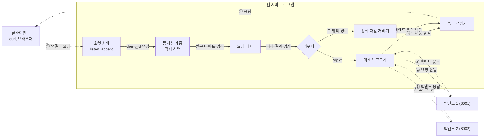

# 미니 웹 서버 설계

이 문서를 읽으면 C로 만드는 웹 서버(+ 리버스 프록시)를 어떤 순서로 만들고, Step마다 무엇을 통과해야 다음으로 넘어가는지 알 수 있어요. 일정과 최종 코드를 고르는 기준도 함께 있어요.

## 1. 진행 방식

- 각자 자유롭게 구현한다. 구조체, 함수 이름, 동시성 방식은 맞추지 않는다.
- 대신 모두 **같은 Step 순서**로 진행하고, Step이 끝날 때마다 모여 "나는 이렇게 했다"를 공유한다.
- 완료 기준은 Step마다 정한 명령어로 확인한다. 모든 구현에 같은 명령어를 돌린다.
- 마지막에 같은 테스트와 기준으로 비교해 **코드 하나를 선택**한다.
- 동적 요청 처리는 **백엔드 전달**로 하고, 리버스 프록시와 같은 Step(Step 6)에서 구현한다. CGI는 시간이 남을 때만 한다.

## 2. 과제 규칙과 제한 사항

과제 안내문에서 정한 규칙이에요. 구현하면서 판단이 헷갈리면 이 장을 기준으로 삼아요.

### 반드시 구현할 것

| 항목           | 내용                                                                                                         |
| -------------- | ------------------------------------------------------------------------------------------------------------ |
| TCP 소켓 서버  | `socket()` → `bind()` → `listen()` → `accept()` 흐름을 직접 구현해요                                         |
| HTTP 요청 파싱 | 요청 라인(메서드, URI, 버전), 헤더(`Host`, `Content-Length`, `Connection` 등), POST 본문                      |
| 지원 메서드    | 최소 `GET`, `POST`                                                                                           |
| HTTP 응답 생성 | 상태 라인, 표준 헤더(`Content-Type`, `Content-Length`, `Connection` 등), 본문                                 |
| 정적 파일 서빙 | 지정한 루트 폴더에서 파일을 읽어 응답해요. MIME 타입(HTML, CSS, JS, PNG, JPG 등)을 맞추고, 404·403·500을 처리해요 |
| 동적 요청 처리 | 요청에 따라 로직을 실행해 응답을 만들어요. CGI 실행이나 백엔드 전달 중 하나                                  |
| 동시 요청 처리 | `fork()`, `pthread`(스레드 풀 권장), `select()`·`poll()`·`epoll()` 중 하나 이상                              |
| 프록시         | 포워드 프록시와 리버스 프록시 중 하나 이상. 둘 다 하면 더 좋아요                                             |

리버스 프록시는 경로(`/api/*` → 8001) 또는 `Host` 헤더로 라우팅하고, 가능하면 라운드 로빈 로드 밸런싱까지 넣어요.

### 기술 제한

- **언어**: C
- **허용**: 표준 C 라이브러리, POSIX API (`<sys/socket.h>`, `<netinet/in.h>`, `<unistd.h>`, `<pthread.h>` 등)
- **금지**: libevent, libuv, nginx, Apache, mongoose 같은 완성된 HTTP·이벤트 루프 라이브러리
- **빌드**: `Makefile` 또는 `CMakeLists.txt`를 제공해요
- **실행**: 포트 번호, 정적 파일 루트, 리버스 프록시 라우팅 규칙을 CLI 인자나 설정 파일로 받아요
- **환경**: `epoll`은 Linux 전용이고 macOS는 `kqueue`예요. 여러 OS에서 빌드하려면 POSIX 안에서 짜거나 `#ifdef`로 나눠요

### 중점 포인트

발표와 질의응답에서 설명할 수 있어야 하는 주제예요. Step별 비교 주제와 겹치므로 회의 내용을 그대로 발표 준비에 써요.

- 소켓 기본 흐름: 3-way handshake, `SO_REUSEADDR`, 블로킹과 논블로킹
- HTTP 최소 구현 (RFC 7230~7235): 요청 라인·헤더·본문의 경계, `Content-Length`, keep-alive
- 동시성 모델: 프로세스, 스레드 풀, 이벤트 루프의 트레이드오프와 C10K 문제
- 프록시와 리버스 프록시: 누가 누구를 대신하는지, 보안·로드 밸런싱·캐싱에서의 쓰임
- 메모리 관리: `malloc`·`free` 짝 맞추기, 버퍼 오버플로 방지, 연결이 끊겼을 때 자원 회수
- 시그널: `SIGINT`·`SIGTERM` 안전 종료, `SIGPIPE` 무시

## 3. 요구사항 ID

회의에서는 ID로 불러요. (예: "R-07 어떻게 했어?")

| ID   | 내용                                                                             | Step       |
| ---- | -------------------------------------------------------------------------------- | ---------- |
| T-01 | C + POSIX만 사용, `Makefile`/CMake, 포트·루트·라우팅을 인자나 설정 파일로        | 0          |
| R-01 | `socket` → `bind` → `listen` → `accept` 흐름, 요청·응답 송수신                   | 1          |
| R-02 | 요청 라인(메서드, URI, 버전), 헤더(`Host`, `Content-Length`, `Connection`) 파싱  | 2          |
| R-03 | 응답 생성: 상태 라인, 표준 헤더, 본문                                            | 2          |
| R-04 | 정적 파일 서빙, MIME 매핑, 404·403·500                                           | 3          |
| R-05 | POST 본문 처리(`Content-Length`), keep-alive                                     | 4          |
| R-06 | 동시 요청 처리 (fork / 스레드 풀 / I/O 멀티플렉싱 중 1개 이상)                   | 5          |
| R-07 | 동적 요청 처리 (백엔드 전달)                                                     | 6          |
| R-08 | 리버스 프록시 (경로 라우팅, 라운드 로빈)                                         | 6          |
| R-09 | `SIGPIPE` 무시, `SIGINT`·`SIGTERM` 안전 종료, 자원 회수                          | 7          |
| Q-01 | 단위 테스트(파서, MIME, 라우팅) · 기능 테스트(`curl`, 동시 접속)                 | 전체       |
| Q-02 | 부하 테스트(`ab`, `wrk`, `hey`) · 메모리 검사(valgrind, ASan)                    | 5, 8       |
| Q-03 | 엣지 케이스: 잘못된 요청, 큰 본문·긴 URI, 백엔드 무응답, 갑작스러운 끊김         | 2, 4, 6, 7 |

## 4. 전체 구조

요청은 소켓에서 읽혀 파서를 거친 뒤, 라우터가 정적 파일 처리기와 리버스 프록시 중 어디로 보낼지 정해요.

- **점선 화살표 (네트워크 통신)**: TCP 연결로 다른 프로그램과 데이터를 주고받아요.
- **실선 화살표 (함수 호출)**: 서버 프로그램 안에서 다음 단계 함수에 데이터를 넘겨요.



| 번호 | 구간                  | 쓰는 소켓                            |
| ---- | --------------------- | ------------------------------------ |
| ①    | 클라이언트 → 웹 서버  | 클라이언트 소켓 (`client_fd`)        |
| ②    | 웹 서버 → 백엔드      | 프록시가 백엔드에 새로 연결한 소켓   |
| ③    | 백엔드 → 웹 서버      | ②와 같은 소켓                        |
| ④    | 웹 서버 → 클라이언트  | ①과 같은 클라이언트 소켓             |

연결 하나의 처리 흐름은 아래와 같아요.

```
서버 시작: 설정 읽기 → 시그널 설정 → socket → SO_REUSEADDR → bind → listen

[연결마다]  client_fd = accept()                  ← handshake는 이미 끝난 상태
  [요청마다]  (keep-alive면 같은 client_fd에서 반복)
    1. read → 버퍼에 쌓기 → "\r\n\r\n"까지
    2. 요청 라인 + 헤더 파싱
    3. Content-Length만큼 본문 읽기 (남은 바이트는 다음 요청)
    4. 라우팅 → 정적 파일 / 리버스 프록시
    5. 응답 쓰기 (끝까지)
    6. Connection: close · 타임아웃 · read()==0 이면 종료
  close(client_fd), 자원 해제
```

## 5. 구현 단계

테스트 예시는 포트 8080, 루트 `./www` 기준이에요. 테스트는 마지막에 몰아서 하지 않고 Step마다 같이 써요.

| Step | 내용                                  | 요구사항         |
| ---- | ------------------------------------- | ---------------- |
| 0    | 공통 준비 (빌드, 실행 인자, 테스트 파일) | T-01          |
| 1    | TCP 에코 서버                         | R-01             |
| 2    | HTTP 요청 파싱 + 고정 응답            | R-02, R-03       |
| 3    | 정적 파일 서빙                        | R-04             |
| 4    | POST 본문 + keep-alive                | R-05             |
| 5    | 동시성                                | R-06             |
| 6    | 리버스 프록시 (동적 요청 처리 포함)   | R-07, R-08       |
| 7    | 안정성 (시그널, 메모리, 엣지 케이스)  | R-09, Q-03       |
| 8    | 테스트와 최종 선택                    | Q-01, Q-02       |

### Step 0. 공통 준비

- `Makefile`을 만들고, 디버그 빌드에 `-fsanitize=address`를 넣는다.
- 실행 인자는 아래 예시를 따른다. 인자 이름은 각자 바꿔도 되지만 같은 정보를 받는다.

| 인자 | 의미                         | 형식                         | 예시                 |
| ---- | ---------------------------- | ---------------------------- | -------------------- |
| `-p` | 서버가 열 포트 번호          | 1~65535 정수                 | `-p 8080`            |
| `-r` | 정적 파일 루트 디렉터리      | 존재하는 디렉터리 경로       | `-r ./www`           |
| `-c` | 리버스 프록시 라우팅 설정 파일 | 파일 경로 (Step 6부터 사용) | `-c ./routes.conf`   |

- 공통 테스트 파일을 `www/`에 둔다: `index.html`, `style.css`, `app.js`, `image.png`, `photo.jpg`, `large.bin`(수 MB), `secret.txt`(`chmod 000`)

**완료 기준**: `make`로 빌드되고 `./webserver -p 8080 -r ./www`처럼 포트와 루트를 인자로 받아요.

### Step 1. TCP 에코 서버

- `socket` → `setsockopt(SO_REUSEADDR)` → `bind` → `listen` → `accept` 반복, 받은 데이터를 그대로 돌려준다.
- `read()`가 0이면 `close()`하고, 시스템 콜 실패를 처리한다.

**완료 기준**

- `nc localhost 8080`으로 입력한 글자가 그대로 돌아와요.
- 서버를 끄고 바로 다시 켜도 `bind()`가 실패하지 않아요.

**비교 주제**: `SO_REUSEADDR`이 없으면 왜 실패하나 (TIME_WAIT)

### Step 2. HTTP 요청 파싱 + 고정 응답

- 연결별 버퍼에 쌓아 `\r\n\r\n`까지 읽는다. 한 번의 `read()`로 다 온다고 가정하지 않는다.
- 요청 라인과 헤더를 파싱하고, 고정 응답을 HTTP 형식으로 보낸다.
- 잘못된 요청은 400, 모르는 메서드는 501, 잘못된 버전은 505로 응답한다.
- 응답은 함수 하나로 만들고, 본문 길이와 `Content-Length`를 항상 맞춘다. 부분 `write()`도 처리한다.
- 파서는 분리된 모듈로 만들어 단위 테스트한다.

**완료 기준**

- `curl -v http://localhost:8080/` → `200 OK`
- 나뉘어 온 요청도 처리해요: `(printf 'GET / HTTP/1.1\r\n'; sleep 1; printf 'Host: x\r\n\r\n') | nc localhost 8080`
- `printf 'BREW / HTTP/1.1\r\nHost: x\r\n\r\n' | nc localhost 8080` → 501

**비교 주제**: 버퍼 관리 방식, 파싱 결과를 담는 구조

### Step 3. 정적 파일 서빙

- 경로를 파일로 바꾸고, 확장자로 MIME 타입을 정한다. 바이너리도 깨지지 않게 보낸다.
- 디렉터리를 요청하면 `index.html`을 보낸다.
- 404·403·500을 처리하고, 루트 밖으로 나가는 경로(`..`)를 막는다.
- MIME 매핑은 단위 테스트한다.

**완료 기준**

- 브라우저에서 HTML·CSS·JS·PNG·JPG가 모두 정상으로 보여요.
- `curl -i http://localhost:8080/nope.html` → 404
- `curl -i http://localhost:8080/secret.txt` → 403
- `curl -i --path-as-is http://localhost:8080/../../etc/passwd` → 403

**비교 주제**: 경로 탈출 방지 방법, 큰 파일 전송 방식

### Step 4. POST 본문 + keep-alive

- `Content-Length`만큼 본문을 읽고, 남은 바이트는 다음 요청으로 넘긴다.
- 한 연결에서 요청을 반복 처리하고, `Connection: close`와 유휴 타임아웃을 처리한다.
- 헤더·URI·본문 크기에 상한을 둔다. URI가 너무 길면 414, 본문이 너무 크면 413으로 응답한다.

**완료 기준**

- `curl -i -X POST -d 'name=hyunji' http://localhost:8080/echo` → 보낸 본문이 돌아와요.
- `curl -v http://localhost:8080/index.html http://localhost:8080/style.css` → 출력에 `Re-using existing connection`이 보여요.

**비교 주제**: 남은 바이트 처리 방법, 타임아웃 구현

### Step 5. 동시성

- fork / 스레드 풀 / I/O 멀티플렉싱 중 하나를 고른다. 팀원끼리 다르게 고르면 비교하기 쉬워요.
- 이 Step이 끝나면 최종 비교표(7장)의 "부하" 칸을 먼저 채운다.

**완료 기준**

- `nc localhost 8080`으로 접속만 해 둔 상태에서도 다른 `curl` 요청이 바로 응답받아요.
- `ab -n 2000 -c 50 http://localhost:8080/index.html` → 실패 0, 처리량(Requests/sec)을 기록해요.

**비교 주제**: 고른 방식과 이유, 같은 부하에서의 처리량

### Step 6. 리버스 프록시 (동적 요청 처리 포함)

동적 요청 처리를 백엔드 전달로 하므로, 리버스 프록시를 만들면 R-07과 R-08을 함께 충족해요.

- 클라이언트 쪽은 `accept`, 백엔드 쪽은 `connect`로 연결한다. 프록시는 서버이자 클라이언트다.
- 설정 파일의 경로 규칙으로 백엔드를 고른다. (`/api/*` → 8001, 8002)
- 같은 경로의 백엔드가 여럿이면 라운드 로빈으로 번갈아 보낸다.
- 백엔드 연결 실패는 502, 응답 지연은 504로 응답한다. 연결·응답 시간 제한을 둔다.
- 라우팅 규칙 매칭은 단위 테스트한다.
- 포워드 프록시와 CGI는 Step 7까지 끝나고 시간이 남을 때만 한다.

**완료 기준**

- 백엔드 2개(`python3 -m http.server 8001`, `python3 -m http.server 8002`)를 띄우면 `/api/` 요청이 번갈아 가요.
- 백엔드 2개를 모두 끄면 502가 나와요.
- 8001 백엔드를 끄고 응답하지 않는 백엔드(`nc -l 8001`, 전통 netcat은 `nc -l -p 8001`)를 띄우면, 8001로 가는 요청에 504가 나와요.
- 프록시를 붙인 뒤에도 Step 3 완료 기준(정적 파일)이 그대로 통과해요.

**비교 주제**: 포워드 프록시 vs 리버스 프록시 (누가 누구를 대신하나), 백엔드 연결 재사용 여부

### Step 7. 안정성

- `SIGPIPE`를 무시하고 `EPIPE`로 처리한다.
- `SIGINT`·`SIGTERM`을 받으면 새 연결 받기를 멈추고, 처리 중인 요청을 끝낸 뒤 종료한다.
- 연결이 끝나면 버퍼·소켓·스레드 자원을 회수하고, 버퍼 오버플로를 막는다.
- 접근 로그를 남긴다.

**완료 기준**

- `curl http://localhost:8080/large.bin`을 중간에 `Ctrl+C`로 끊어도 서버가 살아 있어요.
- 서버를 `Ctrl+C`로 꺼도 ASan·valgrind에 누수와 잘못된 접근이 없어요.

**비교 주제**: 종료 방식, 메모리 검사에서 찾은 버그

### Step 8. 테스트와 최종 선택

- Step 1~7의 완료 기준을 모든 구현에 똑같이 돌린다.
- 부하: `wrk -t4 -c100 -d10s http://localhost:8080/index.html`
- 7장의 최종 비교표를 채우고 코드 하나를 고른다.

## 6. 일정

| 날짜            | Step   | 끝낼 것                                                         |
| --------------- | ------ | --------------------------------------------------------------- |
| 11/21 (토)      | 0, 1   | 빌드·실행 인자, TCP 에코 서버, 동시성 방식 각자 결정            |
| 11/22 (일)      | 쉼     |                                                                 |
| 11/23 (월)      | 2, 3   | 파서와 단위 테스트, 정적 파일, MIME, 403·404                    |
| 11/24 (화)      | 4, 5   | POST 본문, keep-alive, 동시성, `ab` 처리량을 비교표에 기록      |
| 11/25 (수) 오전 | 6      | 리버스 프록시, 라운드 로빈, 502·504                             |
| 11/25 (수) 오후 | 7, 8   | 시그널, ASan·valgrind, 최종 비교표, 코드 선택, 발표 자료        |
| 11/26 (목)      | 발표   | 시연                                                            |

- 화요일 Step 5 공유 때 처리량과 Step 1~5 통과 현황을 비교표에 미리 적는다. 수요일에는 Step 6·7 결과만 더한다.
- **수요일 정오 기준선**: 수요일 정오까지 Step 6을 통과하지 못한 구현은 최종 후보에서 뺀다. 남은 시간은 통과한 코드를 다듬는 데 쓴다.

## 7. 최종 비교

| 기준                              | 팀원 A | 팀원 B | 팀원 C | 팀원 D |
| --------------------------------- | ------ | ------ | ------ | ------ |
| 동시성 방식                       |        |        |        |        |
| Step 1~5 통과 (화요일)            |        |        |        |        |
| 부하 (Requests/sec, 실패 수)      |        |        |        |        |
| Step 6~7 통과 (수요일)            |        |        |        |        |
| 메모리 검사                       |        |        |        |        |
| 코드 구조와 가독성                |        |        |        |        |

**선택 기준 (우선순위)**: 정확성 → 안정성 → 성능 → 구조

**최종 선택**: (코드 / 이유 / 다른 구현에서 가져올 점)
