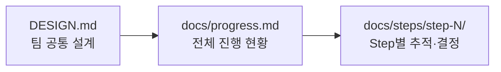

# mini-webserver

이 문서는 C와 POSIX 소켓으로 만드는 웹 서버(+ 리버스 프록시) 저장소의 문서 구성과 탐색 경로를 기술하는 것을 목적으로 한다.

## 어디부터 보나



- 목표: C와 POSIX 소켓으로 웹 서버를 만들고 리버스 프록시까지 확장한다 (Step 0~8). 이 브랜치의 Step 8은 자체 검증만 한다.
- 문서 전체 안내: [docs/README.md](./docs/README.md)

## 알고 싶은 것으로 찾기

| 알고 싶은 것 | 문서 |
| ------------ | ---- |
| 지금 어디까지 했나 | [progress.md](./docs/progress.md) |
| 무엇을 만들어야 하나 | [requirements.md](./docs/requirements.md) |
| 구조와 설계 선택 | [architecture.md](./docs/architecture.md) |
| 그 선택을 왜 했나 | [decisions.md](./docs/decisions.md) → Step의 `decision.md` |
| 테스트가 몇 개이고 몇 개 통과했나 | [test-plan.md](./docs/test-plan.md) |
| 검증 결과 | [verification.md](./docs/verification.md) |
| Step별 요구사항·테스트·구현·검증 | `docs/steps/step-N-이름/README.md` |
| 배경 지식 | [docs/study/](./docs/study/00-overview.md) |

## 폴더 구조

```text
mini-webserver/
├── README.md        이 문서
├── DESIGN.md        팀 공통 설계 (Step 0~8, 완료 기준)
└── docs/
    ├── README.md    문서 안내
    ├── progress.md · requirements.md · architecture.md
    ├── decisions.md · test-plan.md · verification.md
    ├── assignment.md                       과제 원문
    ├── technical-writing-principles.md     문서 작성 기준
    ├── steps/step-N-이름/                  README.md(진행 추적) · decision.md(결정 기록)
    └── study/                              학습 자료
```
