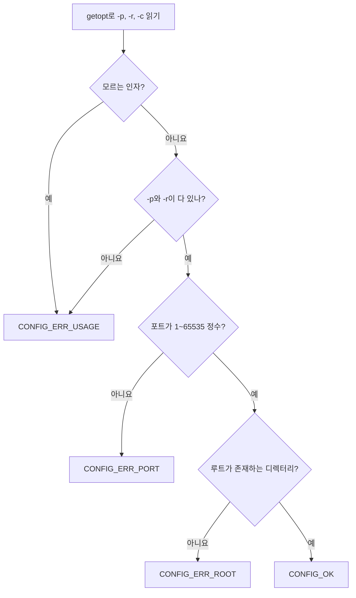

# Step 0 설계: 실행 인자와 빌드

이 문서를 읽으면 Step 0을 어떤 파일과 함수로 나눠 구현하는지, 인자가 잘못됐을 때 어떤 순서로 검사하고 끝내는지 알 수 있어요. 요구사항은 [Step 0 요구사항](../requirements/step0.md)에 있어요.

## 1. 파일 구성

| 파일 | 하는 일 | 관련 요구사항 |
| --- | --- | --- |
| `include/config.h` | 설정 구조체와 함수 선언 | S0-A01~A07 |
| `src/config.c` | 실행 인자 파싱과 검사 | S0-A01~A06 |
| `src/main.c` | `config_parse()`를 부르고 결과를 출력 | S0-A07 |
| `tests/test_config.c` | `config.c` 단위 테스트 | S0-A01~A06 |
| `Makefile` | 빌드, 디버그 빌드, 테스트, 정리 | S0-B01~B05 |
| `scripts/make_www.sh` | `large.bin`, `secret.txt` 만들기 | S0-W02 |

인자 처리를 `main.c`가 아니라 `config.c`에 따로 둔다. `main()` 없이 함수만 불러서 단위 테스트할 수 있게 하려는 거예요.

## 2. 설정 구조체

```c
struct server_config {
    int         port;         /* 1~65535 */
    const char *root;         /* 정적 파일 루트, argv를 그대로 가리킴 */
    const char *config_path;  /* -c 값, 없으면 NULL */
};
```

| 필드 | 의미 | 허용 형식 | 예시 |
| --- | --- | --- | --- |
| `port` | 서버가 열 포트 번호 | 1~65535 정수 | `8080` |
| `root` | 정적 파일을 찾을 디렉터리 | 존재하는 디렉터리 경로 | `"./www"` |
| `config_path` | 라우팅 설정 파일 경로. Step 6에서 읽는다 | 문자열 또는 `NULL` | `"routes.conf"` |

문자열은 복사하지 않고 `argv`를 가리키게 한다. `argv`는 프로그램이 끝날 때까지 살아 있어서 `malloc`과 `free`가 필요 없어요.

## 3. 함수

```c
/* 성공하면 0, 실패하면 아래 오류 코드 중 하나를 돌려준다 */
int config_parse(int argc, char *argv[], struct server_config *out);
void config_print_usage(const char *prog);
```

| 반환값 | 뜻 | 관련 요구사항 |
| --- | --- | --- |
| `CONFIG_OK` (0) | 모두 올바름 | S0-A07 |
| `CONFIG_ERR_USAGE` | 필수 인자 빠짐, 모르는 인자 | S0-A03, S0-A06 |
| `CONFIG_ERR_PORT` | 포트가 정수가 아니거나 범위 밖 | S0-A04 |
| `CONFIG_ERR_ROOT` | 루트가 없거나 디렉터리가 아님 | S0-A05 |

`config_parse()`는 출력하거나 `exit()`하지 않는다. 결과만 돌려주고, 메시지 출력과 종료 코드는 `main()`이 정한다. 그래야 단위 테스트에서 프로그램이 끝나지 않아요.

## 4. 검사 순서



사용법 오류를 먼저 검사한다. `-p 70000`만 준 경우처럼 여러 오류가 겹치면 사용법 오류로 끝나요.

## 5. 세부 결정

- **포트 변환**: `atoi()` 대신 `strtol()`을 쓴다. `atoi("abc")`는 0을 돌려줘서 오류인지 0인지 구분할 수 없어요. `strtol()`은 끝 포인터로 숫자 뒤에 글자가 남았는지(`"80a"`), `errno`로 범위를 넘었는지 알 수 있어요.
- **루트 확인**: `stat()`으로 존재를 확인하고 `S_ISDIR()`로 디렉터리인지 본다. 읽기 권한까지는 Step 3에서 파일마다 확인해요.
- **`getopt()` 다시 쓰기**: 단위 테스트에서 `config_parse()`를 여러 번 부르므로, 함수 시작에서 `optind = 1`로 되돌린다.
- **출력과 종료 코드**: 성공은 표준 출력에 `port:`, `root:`, `config:`를 쓰고 0으로 끝낸다. 오류는 표준 에러에 쓰고 1로 끝낸다.

## 6. 빌드 설계

| 명령 | 하는 일 | 관련 요구사항 |
| --- | --- | --- |
| `make` | `build/*.o`를 만들고 `webserver`로 링크 | S0-B01, S0-B03 |
| `make debug` | ASan·UBSan 옵션을 붙여 빌드 | S0-B04 |
| `make test` | `tests/test_*.c`를 `main.c`를 뺀 모듈과 링크해 실행 | 단위 테스트 |
| `make www` | `scripts/make_www.sh` 실행 | S0-W02 |
| `make clean` | `build/`와 `webserver` 삭제 | S0-B05 |

`make`와 `make debug`의 결과물이 섞이지 않게, 바꿔 빌드할 때는 `make clean`을 먼저 한다.

## 7. 단위 테스트 목록

| 입력 | 기대 반환값 |
| --- | --- |
| `-p 8080 -r ./www` | `CONFIG_OK`, `port == 8080` |
| `-p 8080 -r ./www -c routes.conf` | `CONFIG_OK`, `config_path`가 `"routes.conf"` |
| `-p 8080` | `CONFIG_ERR_USAGE` |
| `-r ./www` | `CONFIG_ERR_USAGE` |
| `-x` | `CONFIG_ERR_USAGE` |
| `-p abc -r ./www` | `CONFIG_ERR_PORT` |
| `-p 80a -r ./www` | `CONFIG_ERR_PORT` |
| `-p 0 -r ./www` | `CONFIG_ERR_PORT` |
| `-p 70000 -r ./www` | `CONFIG_ERR_PORT` |
| `-p 8080 -r ./없음` | `CONFIG_ERR_ROOT` |
| `-p 8080 -r ./www/index.html` | `CONFIG_ERR_ROOT` |
