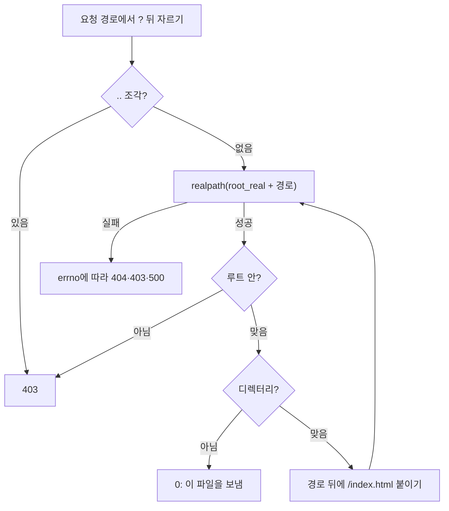

# Step 3 설계: 정적 파일 서빙

이 문서를 읽으면 Step 3 서버가 요청 경로를 루트 안의 파일로 어떻게 바꾸고, 그 파일을 어떤 헤더와 함께 어떻게 보내는지 알 수 있어요. 함수별 동작 순서를 그대로 따라 `src/file.c`와 `src/server.c`를 구현할 수 있어요.

요구사항은 Step 3 요구사항(S3-01 ~ S3-16)을 기준으로 해요. Step 2의 200 응답(`Content-Length: 0`, S2-15·S2-16)은 Step 3부터 파일 응답으로 바뀌어요.

## 자료구조

### 루트의 실제 위치: root_real

서버를 시작할 때 `realpath()`로 루트의 실제 위치를 한 번 구해 두고, 모든 요청에서 이 값과 비교해요. (S3-12)

```c
char root_real[PATH_MAX];      /* 예: "/workspaces/webserver/www" (끝에 / 없음) */
```

`main()`이 구해서 `server_run()` → `handle_conn()`으로 넘겨요. 연결 구조체에는 넣지 않아요. 서버 전체에서 하나뿐인 값이라서예요.

### 파일 경로 버퍼

요청 하나를 처리하는 동안만 쓰는 버퍼 두 개예요. `handle_conn()` 안의 지역 변수로 둬요.

| 이름     | 크기       | 담는 것                                                                       |
| -------- | ---------- | ----------------------------------------------------------------------------- |
| `joined` | `PATH_MAX` | 루트와 요청 경로를 이은 문자열 (예: `/workspaces/webserver/www/style.css`)     |
| `file`   | `PATH_MAX` | `realpath()`로 링크와 `..`을 다 푼 실제 파일 위치. 이 경로로 파일을 열어요     |

### 파일 전송 버퍼

파일을 조금씩 읽어 보내는 데 쓰는 8KB 버퍼예요. `send_file()` 안의 지역 변수로 둬요. 파일이 아무리 커도 이 8KB만 써요. (S3-07)

## 전체 흐름

```
main()
  config_parse() → realpath(root) → root_real → server_listen() → server_run(listen_fd, root_real)

handle_conn(c, root_real)
  read 반복 → http_parse_request()                         (Step 2 그대로)
  resolve_path()   ? 자르기 → .. 거르기 → 루트와 잇기 → realpath → 루트 안인지 → 디렉터리면 index.html
  send_file()      open → fstat → 200 헤더 → 8KB씩 read·write_all 반복
  오류면 send_response()로 403·404·500
  drain()                                                    (Step 2 그대로)
```

- 경로를 파일로 바꾸는 일은 새 파일 `file.c`가 맡아요. 파일을 열지 않고 경로만 다뤄서 단위 테스트하기 쉬워요.
- 파일을 열어 보내는 일은 `server.c`의 `send_file()`이 맡아요. 소켓에 쓰기 때문이에요.

## MIME 타입: mime_type

경로의 확장자로 `Content-Type` 값을 돌려줘요. 확장자는 대소문자를 구분하지 않아요. (S3-08 ~ S3-10)

| 확장자            | Content-Type                         |
| ----------------- | ------------------------------------ |
| `.html`           | `text/html; charset=utf-8`           |
| `.css`            | `text/css; charset=utf-8`            |
| `.js`             | `text/javascript; charset=utf-8`     |
| `.png`            | `image/png`                          |
| `.jpg`, `.jpeg`   | `image/jpeg`                         |
| 그 밖, 확장자 없음 | `application/octet-stream`           |

확장자는 마지막 `/` 뒤의 마지막 `.`부터예요. `/a.d/file`처럼 `.`이 폴더 이름에만 있으면 확장자가 없는 거예요.

```c
static const struct {
    const char *ext;
    const char *type;
} mime_table[] = {
    {"html", "text/html; charset=utf-8"},
    {"css",  "text/css; charset=utf-8"},
    {"js",   "text/javascript; charset=utf-8"},
    {"png",  "image/png"},
    {"jpg",  "image/jpeg"},
    {"jpeg", "image/jpeg"},
};

const char *mime_type(const char *path)
{
    const char *slash = strrchr(path, '/');
    const char *dot = strrchr(path, '.');
    if (dot == NULL || (slash != NULL && dot < slash))
        return "application/octet-stream";

    for (size_t i = 0; i < sizeof(mime_table) / sizeof(mime_table[0]); i++) {
        if (strcasecmp(dot + 1, mime_table[i].ext) == 0)
            return mime_table[i].type;
    }
    return "application/octet-stream";
}
```

## .. 조각 찾기: has_dot_segment

경로를 `/`로 나눈 조각 중에 정확히 `..`인 것이 있으면 `1`이에요. 문자열만 봐요. (S3-11)

| 경로                 | 조각                           | 결과 |
| -------------------- | ------------------------------ | ---- |
| `/../../etc/passwd`  | `..`, `..`, `etc`, `passwd`    | `1`  |
| `/a/..`              | `a`, `..`                      | `1`  |
| `/a..b.html`         | `a..b.html`                    | `0`  |
| `/style.css`         | `style.css`                    | `0`  |

```c
int has_dot_segment(const char *path)
{
    const char *p = path;
    while (*p != '\0') {
        while (*p == '/')
            p++;
        const char *end = strchr(p, '/');
        size_t n = end ? (size_t)(end - p) : strlen(p);
        if (n == 2 && p[0] == '.' && p[1] == '.')
            return 1;
        p += n;
    }
    return 0;
}
```

## 경로를 파일로: resolve_path

요청 경로를 루트 안의 실제 파일 위치로 바꿔 `out`에 넣어요. 파일을 열지는 않아요.

| 돌려주는 값 | 뜻                                                                  |
| ----------- | ------------------------------------------------------------------- |
| `0`         | 성공이에요. `out`에 열 파일의 실제 위치가 있어요.                   |
| `403`       | `..`이 있거나, 루트 밖이거나, 권한이 없거나, 폴더에 `index.html`이 없어요. |
| `404`       | 파일이 없어요.                                                      |
| `500`       | 그 밖의 이유로 위치를 구하지 못했어요.                              |



- `realpath()` 실패: 파일이 없으면(`ENOENT`, `ENOTDIR`) 404, 권한이 없으면(`EACCES`) 403, 그 밖은 500이에요. 단, `index.html`을 찾다가 없으면 404가 아니라 403이에요. (S3-03)
- 루트와 경로를 이은 길이가 `PATH_MAX`를 넘으면 `realpath()` 전에 404예요.
- `index.html`도 링크일 수 있어서, 다시 `realpath()`와 루트 안인지를 거쳐요.

```c
/* realpath() 실패 이유를 상태 코드로 */
static int errno_to_status(int err)
{
    if (err == ENOENT || err == ENOTDIR)
        return 404;
    if (err == EACCES)
        return 403;
    return 500;
}

/* p가 루트 자체이거나 "루트/"로 시작하면 1 */
static int is_inside(const char *root_real, const char *p)
{
    size_t n = strlen(root_real);
    return strncmp(p, root_real, n) == 0 && (p[n] == '\0' || p[n] == '/');
}

int resolve_path(const char *root_real, char *path, char *out, size_t cap)
{
    char joined[PATH_MAX];
    struct stat st;

    char *q = strchr(path, '?');
    if (q != NULL)
        *q = '\0';                               /* 쿼리 문자열 자르기 */

    if (has_dot_segment(path))
        return 403;

    if (cap < PATH_MAX)
        return 500;                              /* realpath()는 out에 PATH_MAX까지 써요 */
    if ((size_t)snprintf(joined, sizeof(joined), "%s%s", root_real, path) >= sizeof(joined))
        return 404;
    if (realpath(joined, out) == NULL)
        return errno_to_status(errno);
    if (!is_inside(root_real, out))
        return 403;

    if (stat(out, &st) < 0)
        return errno_to_status(errno);
    if (S_ISDIR(st.st_mode)) {
        if ((size_t)snprintf(joined, sizeof(joined), "%s/index.html", out) >= sizeof(joined))
            return 404;
        if (realpath(joined, out) == NULL)
            return errno == ENOENT ? 403 : errno_to_status(errno);   /* index.html 없음 → 403 */
        if (!is_inside(root_real, out))
            return 403;
    }
    return 0;
}
```

`is_inside()`가 끝의 `/`까지 보는 이유는 `/workspaces/webserver/www2`가 `/workspaces/webserver/www`로 시작해도 통과하지 않게 하려는 거예요.

## 파일 보내기: send_file

실제 위치를 받아 파일을 열고, 200 헤더와 파일 내용을 보내요. (S3-05 ~ S3-08, S3-14 ~ S3-16)

| 돌려주는 값             | 뜻                                                                   |
| ----------------------- | -------------------------------------------------------------------- |
| `0`                     | 200 응답을 끝까지 보냈어요.                                          |
| `403`, `404`, `500`     | 아무것도 보내지 않았어요. 이 상태 코드로 오류 응답을 보내야 해요.    |
| `-1`                    | 헤더를 보낸 뒤 실패했어요. 더 보내지 말고 연결을 닫아야 해요.        |

동작 순서

1. `open(file, O_RDONLY)`로 열어요. 실패하면 `errno`로 `404`·`403`·`500`을 돌려줘요.
2. `fstat()`으로 크기를 구해요. 실패하면 `500`, 일반 파일이 아니면 `403`이에요.
3. 상태 줄과 `Content-Type`, `Content-Length`(파일 크기), `Connection: close` 헤더를 `write_all()`로 보내요.
4. 8KB씩 `read()`해서 `write_all()`로 보내기를 `read()`가 `0`이 될 때까지 반복해요.
5. 중간에 `read()`나 `write_all()`이 실패하면 파일을 닫고 `-1`이에요. (S3-16)
6. 파일을 닫고 `0`을 돌려줘요.

```c
#define FILE_BUF_SIZE 8192

static int send_file(int fd, const char *file)
{
    int ffd = open(file, O_RDONLY);
    if (ffd < 0) {
        int err = errno;
        return err == ENOENT ? 404 : err == EACCES ? 403 : 500;
    }

    struct stat st;
    if (fstat(ffd, &st) < 0) {
        close(ffd);
        return 500;
    }
    if (!S_ISREG(st.st_mode)) {
        close(ffd);
        return 403;
    }

    char head[256];
    int n = snprintf(head, sizeof(head),
                     "HTTP/1.1 200 OK\r\n"
                     "Content-Type: %s\r\n"
                     "Content-Length: %lld\r\n"
                     "Connection: close\r\n"
                     "\r\n",
                     mime_type(file), (long long)st.st_size);
    if (write_all(fd, head, (size_t)n) < 0) {
        close(ffd);
        return -1;
    }

    char buf[FILE_BUF_SIZE];
    for (;;) {
        ssize_t r = read(ffd, buf, sizeof(buf));
        if (r == 0)
            break;
        if (r < 0) {
            if (errno == EINTR)
                continue;
            perror("read file");
            close(ffd);
            return -1;                           /* 헤더는 이미 나감: 닫기만 */
        }
        if (write_all(fd, buf, (size_t)r) < 0) {
            close(ffd);
            return -1;
        }
    }
    close(ffd);
    return 0;
}
```

## 오류 응답: send_response 변경

Step 2와 같은 모양이에요. 200은 이제 `send_file()`이 보내므로 `send_response()`는 오류만 보내요. `http_reason()`에 세 가지를 더해요.

| 상태 코드 | 문구                    | 본문                          |
| --------- | ----------------------- | ----------------------------- |
| `403`     | `Forbidden`             | `403 Forbidden\n`             |
| `404`     | `Not Found`             | `404 Not Found\n`             |
| `500`     | `Internal Server Error` | `500 Internal Server Error\n` |

## 연결 하나 처리: handle_conn 변경

동작 순서

1. 헤더의 끝까지 읽고 파싱해요. (Step 2 그대로)
2. 파싱이 성공하면 `resolve_path()`로 파일 위치를 구해요.
3. 위치를 구하면 `send_file()`로 보내요.
   - `0`이면 `drain()` 후 끝이에요.
   - `-1`이면 `drain()` 없이 바로 돌아가요. 응답이 중간에 끊긴 상태라 빨리 닫아요.
4. 어느 단계든 오류 상태 코드가 나오면 `send_response()`로 오류 응답을 보내고 `drain()`해요.

```c
int handle_conn(struct conn *c, const char *root_real)
{
    size_t end;
    int status = 0;

    /* ... 헤더의 끝까지 읽기 (Step 2 그대로) ... */

    if (status == 0)
        status = http_parse_request(c->buf, end, &c->req);
    if (status == 0) {
        char file[PATH_MAX];
        status = resolve_path(root_real, c->req.path, file, sizeof(file));
        if (status == 0) {
            status = send_file(c->fd, file);
            if (status < 0)
                return -1;                       /* 보내다 끊김 */
            if (status == 0) {
                drain(c->fd);
                return 0;
            }
        }
    }
    if (send_response(c->fd, status) < 0)
        return -1;
    drain(c->fd);
    return 0;
}
```

## main, server_run 변경

`main()`에서 포트를 열기 전에 루트의 실제 위치를 구해요. `config_parse()`가 이미 루트가 디렉터리인지 확인했으니 여기서 실패할 일은 드물지만, 실패하면 이유를 출력하고 종료 코드 1로 끝내요.

```c
/* config_parse 성공, port/root 출력 뒤 */
char root_real[PATH_MAX];
if (realpath(cfg.root, root_real) == NULL) {
    perror("realpath");
    return EXIT_FAILURE;
}
/* ... signal, server_listen ... */
server_run(listen_fd, root_real);
```

`server_run(int listen_fd, const char *root_real)`은 받은 값을 `handle_conn(c, root_real)`에 그대로 넘겨요.

## 시나리오별 실행 순서

### CSS 파일 (`curl http://localhost:8080/style.css`)

1. 파싱 후 경로는 `/style.css`예요.
2. `resolve_path()`: `..` 없음 → `joined` = `/workspaces/webserver/www/style.css` → `realpath()` 그대로 → 루트 안 → 디렉터리 아님 → `0`
3. `send_file()`: 열고, 크기 520바이트(예)를 구해 `Content-Type: text/css; charset=utf-8`, `Content-Length: 520` 헤더를 보내요.
4. `read()` 한 번에 520바이트를 읽어 보내고, 다음 `read()`가 `0`이라 끝나요.
5. `drain()` 후 닫아요.

### 루트 (`curl http://localhost:8080/`)

1. 경로는 `/`예요. `realpath()`는 루트 자체를 돌려줘요. 루트 안으로 봐요.
2. 디렉터리라서 `/workspaces/webserver/www/index.html`로 다시 `realpath()` → 루트 안 → `0`
3. `index.html`을 `text/html; charset=utf-8`로 보내요. (S3-02)

### 큰 파일 (`curl http://localhost:8080/large.bin`)

1. `Content-Type: application/octet-stream`, `Content-Length`는 파일 크기예요. (S3-10)
2. 8KB씩 읽고 보내기를 수백 번 반복해요. 클라이언트가 늦게 받으면 `write_all()`이 보내기 버퍼가 빌 때까지 잠들어요.
3. 메모리는 8KB 버퍼 하나만 써요. (S3-07)

### 경로 탈출 (`curl --path-as-is http://localhost:8080/../../etc/passwd`)

1. `resolve_path()` 2번에서 `..` 조각을 찾아 `403`을 돌려줘요. 디스크는 보지 않아요. (S3-11)
2. `send_response(403)`으로 `403 Forbidden`을 보내요.

### 없는 파일 (`curl http://localhost:8080/nope.html`)

1. `realpath()`가 `ENOENT`로 실패해요. `resolve_path()`가 `404`를 돌려줘요. (S3-13)

### 읽기 권한 없는 파일 (`curl http://localhost:8080/secret.txt`)

1. `resolve_path()`는 통과해요. 위치는 루트 안이고, `realpath()`는 읽기 권한이 없어도 돼요.
2. `send_file()`의 `open()`이 `EACCES`로 실패해 `403`을 돌려줘요. 아무것도 보내기 전이라 오류 응답을 보낼 수 있어요. (S3-14)

## 파일 구성

| 파일                  | 내용                                                              | Step 3 변경 |
| --------------------- | ----------------------------------------------------------------- | ----------- |
| `include/file.h`      | `mime_type`, `has_dot_segment`, `resolve_path` 선언               | 새로 만듦   |
| `src/file.c`          | 이 문서의 경로·MIME 함수 구현                                     | 새로 만듦   |
| `src/http.c`          | `http_reason()`에 403, 404, 500 추가                              | 수정        |
| `include/server.h`    | `server_run`, `handle_conn`에 `root_real` 인자 추가               | 수정        |
| `src/server.c`        | `send_file` 추가, `send_response`는 오류만, `handle_conn` 변경     | 수정        |
| `src/main.c`          | `realpath()`로 `root_real`을 구해 `server_run()`에 넘김           | 수정        |
| `tests/test_file.c`   | MIME, `..` 조각, 경로 바꾸기 단위 테스트                          | 새로 만듦   |
| `tests/test_server.c` | `handle_conn()` 테스트에 `root_real` 인자 추가, 파일 응답 테스트   | 수정        |

```c
/* include/file.h */
#ifndef FILE_H
#define FILE_H

#include <stddef.h>

/* 확장자로 Content-Type 값을 돌려줘요. 모르거나 없으면 "application/octet-stream" */
const char *mime_type(const char *path);

/* 경로를 /로 나눈 조각 중에 정확히 ".."인 것이 있으면 1, 없으면 0 */
int has_dot_segment(const char *path);

/* 요청 경로를 루트 안의 실제 파일 위치로 바꿔 out(PATH_MAX 이상)에 넣어요.
   path의 '?' 자리에 '\0'을 써요. 성공 0, 실패하면 403·404·500 */
int resolve_path(const char *root_real, char *path, char *out, size_t cap);

#endif
```

`realpath()`는 POSIX의 XSI 부분이라, 이 함수를 쓰는 `file.c`와 `main.c` 맨 위에 `#define _XOPEN_SOURCE 700`을 둬요. `file.c`에 필요한 헤더는 `<errno.h>`, `<limits.h>`(`PATH_MAX`), `<stdio.h>`, `<stdlib.h>`(`realpath`), `<string.h>`, `<strings.h>`, `<sys/stat.h>`예요. `server.c`에는 `<fcntl.h>`, `<limits.h>`, `<sys/stat.h>`, `"file.h"`를 더해요.

## 테스트 방법

| 대상                | 방법                                                                                                   | 근거                 |
| ------------------- | ------------------------------------------------------------------------------------------------------ | -------------------- |
| `mime_type()`       | 확장자별 기대값, 대문자(`PHOTO.JPG`), 확장자 없음, 폴더 이름에만 `.`이 있는 경로를 넣어요.              | S3-08 ~ S3-10        |
| `has_dot_segment()` | 위 표의 경로와 `/..`, `..`, `/a/../b`, `/..hidden`을 넣어요.                                           | S3-11                |
| `resolve_path()`    | 테스트용 임시 폴더에 파일, 하위 폴더, `index.html` 없는 폴더, 밖을 가리키는 링크를 만들고 결과를 봐요.  | S3-01 ~ S3-04, S3-11 ~ S3-13 |
| `handle_conn()`     | `socketpair()`로 요청을 보내고, 받은 본문이 파일과 같은지, 헤더 값이 맞는지 봐요.                       | S3-05 ~ S3-08, S3-14 |
| 서버 전체           | 요구사항 표의 확인 명령어를 실행하고, 브라우저로 `index.html`을 열어 CSS·JS·그림이 다 보이는지 봐요.    | S3-01 ~ S3-14        |
| 오류 경로           | `open()`·`fstat()` 실패 분기와 본문 전송 중 실패 시 닫기를 코드 리뷰로 봐요.                           | S3-15, S3-16         |
