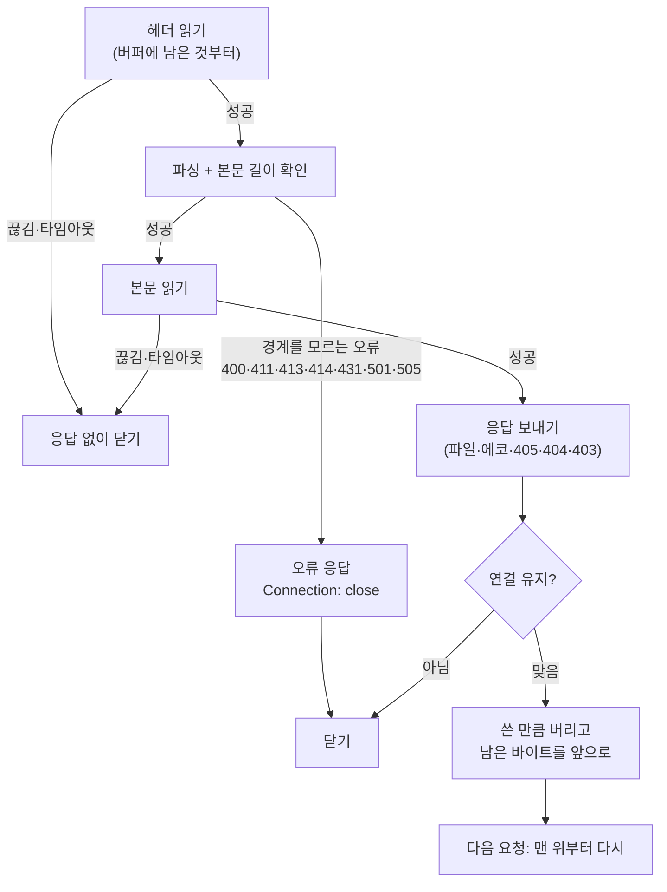

# Step 4 설계: POST 본문과 keep-alive

이 문서를 읽으면 Step 4 서버가 연결 하나에서 요청을 어떻게 반복해서 받고, 본문을 어디까지 읽고, 남은 바이트를 다음 요청으로 어떻게 넘기는지 알 수 있어요. 함수별 동작 순서를 그대로 따라 `src/http.c`와 `src/server.c`를 구현할 수 있어요.

요구사항은 Step 4 요구사항(S4-01 ~ S4-15)을 기준으로 해요. Step 2·3에서 응답 하나 뒤에 닫던 동작과 `drain()`으로 남은 바이트를 버리던 동작이 바뀌어요.

## 자료구조

### 연결 구조체: struct conn 변경

헤더 버퍼와 `len`은 이제 요청 하나가 끝나도 비우지 않아요. 다음 요청의 앞부분이 들어 있을 수 있어서예요. 본문 버퍼 두 칸을 더해요. (S4-01, S4-08)

```c
struct conn {
    int fd;                       /* 클라이언트 소켓 번호 */
    char buf[HEADER_BUF_SIZE];    /* 헤더 버퍼 8KB. 요청 사이에도 남은 바이트를 들고 있어요 */
    size_t len;                   /* buf에 지금 들어 있는 바이트 수 */
    struct http_request req;      /* 파싱 결과: buf 안을 가리키는 포인터들 */
    char *body;                   /* 본문 버퍼. Content-Length만큼 malloc, 요청이 끝나면 free */
    size_t body_len;              /* body에 모은 바이트 수 */
};
```

본문 버퍼는 Step 2에서 정한 대로 `Content-Length`를 본 뒤에 그 크기만큼 따로 만들어요. 상한이 1MB라서 한 연결이 잡는 메모리는 헤더 버퍼 8KB에 본문 버퍼 최대 1MB예요.

### 상수

| 이름                | 값               | 쓰는 곳                          |
| ------------------- | ---------------- | -------------------------------- |
| `IDLE_TIMEOUT_SEC`  | `15`             | 읽기 타임아웃 (S4-13)            |
| `HTTP_MAX_BODY`     | `1048576` (1MB)  | 본문 상한, 넘으면 413 (S4-14)    |
| `HTTP_MAX_URI`      | `4096` (`PATH_MAX`) | URI 상한, 넘으면 414 (S4-15)  |

## 전체 흐름

`handle_conn()`이 요청 하나를 처리하던 것에서 반복문으로 바뀌어요.



그림은 요청 하나를 처리하는 한 바퀴예요. "다음 요청"에 닿으면 맨 위 "헤더 읽기"부터 다시 해요. 닫을 때까지 이 한 바퀴를 반복해요.

- 헤더 버퍼에 다음 요청이 이미 들어 있으면 `read()` 없이 바로 처리해요.
- 닫을 때는 Step 2의 `drain()`을 거쳐 RST가 나가지 않게 해요.

## 연결 하나 처리: handle_conn 변경

동작 순서

1. `read_header()`로 헤더의 끝까지 읽어요. `-1`이면 응답 없이 돌아가요. 버퍼가 비어 있었으면(요청 사이에서 클라이언트가 끊음) 정상 종료로 `0`, 요청을 반쯤 받다 끊겼으면 `-1`이에요.
2. 파싱하고 `body_length()`로 본문 길이를 정해요. 오류면 `Connection: close` 오류 응답을 보내고 닫아요. (S4-12)
3. `read_body()`로 본문을 읽어요. `-1`이면 응답 없이 돌아가요.
4. `http_keep_alive()`로 유지 여부를 정하고, 경로와 메서드에 맞게 응답을 보내요.
5. 본문 버퍼를 `free()`해요.
6. 닫을 거면 `drain()` 후 돌아가요.
7. 헤더 버퍼에서 이 요청이 쓴 만큼 버리고 남은 바이트를 앞으로 당긴 뒤 1번으로 가요.

```c
int handle_conn(struct conn *c, const char *root_real)
{
    for (;;) {
        size_t end = 0, cl = 0, consumed = 0;
        int status = read_header(c, &end);
        if (status < 0)
            return c->len == 0 ? 0 : -1;         /* 요청 사이에서 끊김은 정상 종료, 요청 중간이면 비정상 */
        if (status == 0)
            status = http_parse_request(c->buf, end, &c->req);
        if (status == 0)
            status = body_length(&c->req, &cl);
        if (status != 0) {                       /* 경계를 모름: 닫기 */
            send_error(c->fd, status, 0, NULL);
            drain(c->fd);
            return 0;
        }
        if (read_body(c, end, cl, &consumed) < 0) {
            free_body(c);
            return -1;
        }

        int keep = http_keep_alive(&c->req);
        int r = respond(c, root_real, keep);     /* 경로별 처리, 0 또는 -1 */
        free_body(c);
        if (r < 0)
            return -1;                           /* 보내다 끊김 */
        if (!keep) {
            drain(c->fd);
            return 0;
        }

        memmove(c->buf, c->buf + consumed, c->len - consumed);
        c->len -= consumed;
    }
}
```

`respond()`는 경로별 처리 표대로 `send_file()`, `send_echo()`, `send_error()` 중 하나를 불러요. 정적 파일에서 403·404·500이 나오면 `send_error(fd, status, keep, NULL)`로 보내요. 이 오류들은 요청을 끝까지 읽었으니 연결을 유지해도 돼요.

```c
static int respond(struct conn *c, const char *root_real, int keep)
{
    int post = strcmp(c->req.method, "POST") == 0;

    if (path_is(c->req.path, "/echo"))
        return post ? send_echo(c->fd, c, keep) : send_error(c->fd, 405, keep, "Allow: POST");
    if (post)
        return send_error(c->fd, 405, keep, "Allow: GET");

    char file[PATH_MAX];
    int status = resolve_path(root_real, c->req.path, file, sizeof(file));
    if (status == 0) {
        status = send_file(c->fd, file, keep);
        if (status <= 0)
            return status;                       /* 0: 보냄, -1: 보내다 끊김 */
    }
    return send_error(c->fd, status, keep, NULL);
}

static void free_body(struct conn *c)
{
    free(c->body);
    c->body = NULL;
    c->body_len = 0;
}
```

## server_run 변경

`accept()` 직후 타임아웃을 걸고, 연결 구조체의 본문 칸을 비워 둬요.

```c
        set_read_timeout(client_fd);
        c->fd = client_fd;
        c->len = 0;
        c->body = NULL;
        c->body_len = 0;
```

## 타임아웃: SO_RCVTIMEO

`accept()` 직후 클라이언트 소켓에 "`read()`는 15초까지만 기다린다"를 걸어 둬요. 15초 안에 아무것도 안 오면 `read()`가 `-1`, `errno`가 `EAGAIN`(또는 `EWOULDBLOCK`)으로 돌아와요. 그러면 응답 없이 닫아요. (S4-13)

```c
#define IDLE_TIMEOUT_SEC 15

static void set_read_timeout(int fd)
{
    struct timeval tv = {IDLE_TIMEOUT_SEC, 0};
    if (setsockopt(fd, SOL_SOCKET, SO_RCVTIMEO, &tv, sizeof(tv)) < 0)
        perror("setsockopt SO_RCVTIMEO");
}
```

`poll()`과 비교해 이걸 고른 이유예요.

| 방법            | 지금 코드에 넣기                                   | Step 5와의 관계                                   |
| --------------- | -------------------------------------------------- | ------------------------------------------------- |
| `SO_RCVTIMEO`   | `setsockopt()` 한 줄. `read()` 코드는 그대로예요   | 스레드 방식이면 그대로 써요                       |
| `poll()`        | `read()`마다 앞에 `poll()`을 붙여야 해요           | 이벤트 루프 방식이면 이쪽으로 바뀌어요            |

한계도 있어요. 이 타임아웃은 `read()` 한 번마다 다시 15초를 세요. 그래서 14초마다 1바이트씩 보내는 클라이언트는 끊기지 않아요. 요구사항(S4-13)은 "15초 동안 아무 바이트도 오지 않으면"이라 지금은 충분하고, 요청 전체에 시간 상한을 두는 건 Step 7(안정성)에서 다뤄요.

## 헤더 읽기: read_header

Step 2에서 "읽는 방식이 바뀔 때 함수로 빼자"고 미뤄 둔 반복문이에요. 이제 타임아웃과 남은 바이트 때문에 읽는 방식이 바뀌어서 `handle_conn()` 밖으로 뺐어요.

| 돌려주는 값 | 뜻                                                              |
| ----------- | --------------------------------------------------------------- |
| `0`         | 헤더의 끝을 찾았어요. `*end`에 끝 바로 다음 위치가 있어요.      |
| `431`       | 헤더의 끝을 찾기 전에 헤더 버퍼가 가득 찼어요.                  |
| `-1`        | 클라이언트가 끊었거나, 15초 동안 아무것도 안 왔거나, 읽기가 실패했어요. |

```c
static int read_header(struct conn *c, size_t *end)
{
    while ((*end = http_find_header_end(c->buf, c->len)) == 0) {
        if (c->len == sizeof(c->buf))
            return 431;
        ssize_t n = read(c->fd, c->buf + c->len, sizeof(c->buf) - c->len);
        if (n == 0)
            return -1;                           /* 클라이언트가 끊음 */
        if (n < 0) {
            if (errno == EINTR)
                continue;
            if (errno != EAGAIN && errno != EWOULDBLOCK)
                perror("read");
            return -1;                           /* 타임아웃이거나 실패 */
        }
        c->len += (size_t)n;
    }
    return 0;
}
```

`while` 조건에서 먼저 버퍼를 보니까, 앞 요청이 남긴 바이트에 다음 요청이 통째로 있으면 `read()`를 부르지 않아요. (S4-08)

## 본문 길이 확인: body_length

헤더를 보고 본문이 몇 바이트인지 정해요. 경계를 정할 수 없으면 오류 상태 코드를 돌려줘요.

| 경우                                             | 결과                          |
| ------------------------------------------------ | ----------------------------- |
| `Transfer-Encoding`이 있음                       | `501` (S4-05)                 |
| `Content-Length`가 숫자가 아님, 값이 서로 다름   | `400` (S4-04)                 |
| POST인데 `Content-Length`가 없음                 | `411` (S4-03)                 |
| `Content-Length`가 1MB를 넘음                    | `413` (S4-14)                 |
| GET인데 `Content-Length`가 없음                  | `0`, 본문 0바이트             |
| 그 밖                                            | `0`, 본문 `Content-Length`바이트 |

GET에 `Content-Length`가 붙어 와도 그만큼 읽어서 버려요. 안 읽으면 그 바이트가 다음 요청으로 잘못 읽혀요.

```c
static int body_length(const struct http_request *req, size_t *cl)
{
    if (http_find_header(req, "Transfer-Encoding") != NULL)
        return 501;
    int r = http_content_length(req, cl);
    if (r < 0)
        return 400;
    if (r == 0 && strcmp(req->method, "POST") == 0)
        return 411;
    if (*cl > HTTP_MAX_BODY)
        return 413;
    return 0;
}
```

`http_content_length()`는 `http.c`에 둬요. 헤더 값만 보는 일이라 소켓 없이 단위 테스트할 수 있어요.

```c
/* Content-Length를 읽어 *out에 넣어요. 없으면 0, 있으면 1, 숫자가 아니거나 값이 서로 다르면 -1 */
int http_content_length(const struct http_request *req, size_t *out)
{
    int found = 0;
    size_t val = 0;
    for (int i = 0; i < req->header_count; i++) {
        if (strcasecmp(req->headers[i].name, "Content-Length") != 0)
            continue;
        const char *p = req->headers[i].value;
        if (*p == '\0')
            return -1;
        size_t n = 0;
        for (; *p != '\0'; p++) {
            if (!isdigit((unsigned char)*p) || n > (SIZE_MAX - 9) / 10)
                return -1;                       /* 숫자가 아니거나 넘침 */
            n = n * 10 + (size_t)(*p - '0');
        }
        if (found && n != val)
            return -1;                           /* 서로 다른 값 */
        found = 1;
        val = n;
    }
    *out = val;
    return found;
}
```

## 본문 읽기: read_body

헤더 버퍼에 이미 들어온 본문은 본문 버퍼로 옮기고, 모자란 만큼 `read()`로 본문 버퍼에 바로 이어 읽어요. (S4-01)

```
헤더 버퍼:  [ 헤더 (end) ][ 본문 일부 (have) ][ 다음 요청 ... ]
                          └─ 본문 버퍼로 복사 ─┘
본문 버퍼:  [ 본문 일부 (have) ][ read()로 채움 (cl - have) ]
```

| 돌려주는 값 | 뜻                                                       |
| ----------- | -------------------------------------------------------- |
| `0`         | 본문 `cl`바이트를 다 모았어요. `*consumed`에 헤더 버퍼에서 이 요청이 쓴 바이트 수가 있어요. |
| `-1`        | 끊김, 타임아웃, 읽기 실패, `malloc` 실패예요. 응답 없이 닫아요. |

```c
static int read_body(struct conn *c, size_t end, size_t cl, size_t *consumed)
{
    size_t have = c->len - end;
    if (have > cl)
        have = cl;                               /* 그 뒤는 다음 요청 */
    *consumed = end + have;
    if (cl == 0)
        return 0;

    c->body = malloc(cl);
    if (c->body == NULL) {
        perror("malloc");
        return -1;
    }
    memcpy(c->body, c->buf + end, have);
    c->body_len = have;

    while (c->body_len < cl) {
        ssize_t n = read(c->fd, c->body + c->body_len, cl - c->body_len);
        if (n == 0)
            return -1;
        if (n < 0) {
            if (errno == EINTR)
                continue;
            if (errno != EAGAIN && errno != EWOULDBLOCK)
                perror("read");
            return -1;
        }
        c->body_len += (size_t)n;
    }
    return 0;
}
```

`read()`에 `cl - body_len`만큼만 달라고 하니까, 본문 버퍼에는 다음 요청 바이트가 섞이지 않아요. 다음 요청 바이트는 커널 받기 버퍼에 남아 있다가 다음 `read_header()`가 읽어요.

## 연결 유지 여부: http_keep_alive

요청 버전과 `Connection` 헤더로 정해요. (S4-09 ~ S4-11)

| 버전       | `Connection` 헤더   | 결과   |
| ---------- | ------------------- | ------ |
| HTTP/1.1   | 없음                | 유지   |
| HTTP/1.1   | `close`             | 닫기   |
| HTTP/1.0   | 없음                | 닫기   |
| HTTP/1.0   | `keep-alive`        | 유지   |

```c
int http_keep_alive(const struct http_request *req)
{
    const char *conn = http_find_header(req, "Connection");
    if (strcmp(req->version, "HTTP/1.1") == 0)
        return !(conn != NULL && strcasecmp(conn, "close") == 0);
    return conn != NULL && strcasecmp(conn, "keep-alive") == 0;
}
```

유지하든 닫든 응답에는 항상 `Connection: keep-alive` 또는 `Connection: close`를 적어요. HTTP/1.0 클라이언트는 적어 주지 않으면 유지되는지 몰라요.

## 요청 줄 파싱 변경

- 메서드는 `GET`과 `POST`를 받아요. 그 밖은 Step 2 그대로 501이에요.
- 형식 검사 뒤, 메서드 검사 전에 경로 길이를 봐요. 4096바이트를 넘으면 `414`예요. (S4-15)

그래서 S2-23의 검사 순서는 형식(400) → URI 길이(414) → 메서드(501) → 버전(505) → 헤더(400)가 돼요.

```c
    if (req->method[0] == '\0' || req->path[0] != '/' || !is_version_shape(req->version))
        return 400;
    if (strlen(req->path) > HTTP_MAX_URI)
        return 414;
    if (strcmp(req->method, "GET") != 0 && strcmp(req->method, "POST") != 0)
        return 501;
```

## 응답 보내기

모든 응답 함수가 `keep` 인자를 받아 `Connection` 헤더를 적어요.

| 함수                                      | 보내는 것                                                        |
| ----------------------------------------- | ---------------------------------------------------------------- |
| `send_file(fd, file, keep)`               | 200 + 파일. Step 3 그대로에 `Connection`만 바뀌어요              |
| `send_echo(fd, c, keep)`                  | 200 + 받은 본문. `Content-Type`은 요청 값, 없으면 `application/octet-stream` (S4-07) |
| `send_error(fd, status, keep, extra)`     | 오류 응답. `extra`는 `"Allow: GET"` 같은 헤더 한 줄이거나 `NULL` (S4-02, S4-06) |

```c
static int send_echo(int fd, const struct conn *c, int keep)
{
    const char *type = http_find_header(&c->req, "Content-Type");
    char head[HEADER_BUF_SIZE];
    int n = snprintf(head, sizeof(head),
                     "HTTP/1.1 200 OK\r\n"
                     "Content-Type: %s\r\n"
                     "Content-Length: %zu\r\n"
                     "Connection: %s\r\n"
                     "\r\n",
                     type != NULL ? type : "application/octet-stream",
                     c->body_len, keep ? "keep-alive" : "close");
    if (write_all(fd, head, (size_t)n) < 0)
        return -1;
    if (c->body_len > 0 && write_all(fd, c->body, c->body_len) < 0)
        return -1;
    return 0;
}
```

`head`를 헤더 버퍼만큼 잡은 이유는 `Content-Type` 값이 헤더 버퍼 안에서 왔으니 그보다 길 수 없어서예요.

### 경로별 처리

| 경로      | GET                          | POST                         |
| --------- | ---------------------------- | ---------------------------- |
| `/echo`   | 405, `Allow: POST` (S4-06)   | 에코 (S4-07)                 |
| 그 밖     | 정적 파일 (Step 3 그대로)    | 405, `Allow: GET` (S4-02)    |

`/echo`인지는 `?` 앞까지만 비교해요. `/echo?x=1`도 `/echo`예요.

```c
static int path_is(const char *path, const char *name)
{
    size_t n = strlen(name);
    return strncmp(path, name, n) == 0 && (path[n] == '\0' || path[n] == '?');
}
```

## 시나리오별 실행 순서

### 에코 (`curl -X POST -d 'name=hyunji' http://localhost:8080/echo`)

1. `read()` 한 번에 헤더와 본문 11바이트가 같이 들어와요. 헤더의 끝을 찾아요.
2. `Content-Length: 11`, POST, 1MB 이하라 본문 길이 11이에요.
3. 헤더 버퍼에 본문 11바이트가 다 있어서 본문 버퍼로 옮기기만 해요. `read()`는 안 불러요.
4. HTTP/1.1에 `Connection` 헤더가 없어서 유지예요. 200, `Content-Type: application/x-www-form-urlencoded`, `Connection: keep-alive`와 `name=hyunji`를 보내요.
5. `curl`이 응답을 받고 연결을 끊어요. 다음 `read_header()`의 `read()`가 `0`이라 돌아가요.

### 연결 재사용 (`curl -v .../index.html .../style.css`)

1. `index.html` 응답 뒤 유지라서 1번으로 돌아가 `read()`에서 기다려요.
2. `curl`이 같은 연결로 `style.css`를 요청해요. 그걸 처리해요. (S4-09)

### 요청 두 개가 붙어서 옴 (S4-08 확인 명령어)

1. `read()` 한 번에 두 요청이 다 들어와요. 첫 요청을 처리하고 `consumed`만큼 버리면 두 번째 요청이 버퍼 맨 앞에 와요.
2. `read_header()`가 버퍼에서 바로 헤더의 끝을 찾아요. `read()` 없이 처리해요.
3. 두 번째 요청의 `Connection: close`를 보고 응답 뒤 닫아요.

### 아무것도 안 보냄 (`nc localhost 8080 < /dev/null`)

1. `read()`가 15초 동안 기다리다 `EAGAIN`으로 돌아와요.
2. `read_header()`가 `-1`, `handle_conn()`이 돌아가고 `server_run()`이 닫아요. (S4-13)

### 본문이 너무 큼 (`Content-Length: 999999999`)

1. `body_length()`가 `413`을 돌려줘요. 본문 버퍼는 만들지 않아요.
2. `Connection: close` 413 응답을 보내고, `drain()`으로 16KB까지 비운 뒤 닫아요. (S4-14)

## 파일 구성

| 파일                  | 내용                                                                                 | Step 4 변경 |
| --------------------- | ------------------------------------------------------------------------------------ | ----------- |
| `include/http.h`      | `HTTP_MAX_BODY`, `HTTP_MAX_URI`, `http_content_length`, `http_keep_alive` 추가        | 수정        |
| `src/http.c`          | POST 받기, 414 검사, 위 두 함수, `http_reason()`에 405·411·413·414 추가               | 수정        |
| `include/server.h`    | `struct conn`에 `body`, `body_len` 추가                                              | 수정        |
| `src/server.c`        | 타임아웃, `read_header`, `body_length`, `read_body`, `respond`, `send_echo`, `send_error`, `handle_conn` 반복 | 수정        |
| `tests/test_http.c`   | `http_content_length`, `http_keep_alive`, 414, POST 단위 테스트                       | 수정        |
| `tests/test_server.c` | 에코, 연결 재사용, 남은 바이트, 오류 뒤 닫기, 타임아웃 테스트                         | 수정        |

`server.c`에는 `<sys/time.h>`(`struct timeval`)를, `http.c`에는 `<stdint.h>`(`SIZE_MAX`)를 더해요.

## 테스트 방법

| 대상                    | 방법                                                                                                          | 근거          |
| ----------------------- | ------------------------------------------------------------------------------------------------------------- | ------------- |
| `http_content_length()` | 없음, `11`, `abc`, `-5`, 빈 값, 같은 값 두 번, 다른 값 두 번, 아주 큰 수를 넣어요.                             | S4-03, S4-04  |
| `http_keep_alive()`     | 버전 두 개 × `Connection` 없음·`close`·`keep-alive`·`Keep-Alive`(대소문자) 조합을 넣어요.                      | S4-09 ~ S4-11 |
| 요청 줄                 | `POST`가 0, 4096바이트 경로가 0, 4097바이트가 414인지 봐요.                                                   | S4-15         |
| `handle_conn()`         | `socketpair()`로 에코, 요청 두 개 붙여 보내기, 본문을 나눠 보내기, 오류 뒤 연결이 닫히는지, `Connection` 헤더 값을 봐요. | S4-01 ~ S4-12, S4-14 |
| 타임아웃                | 테스트에서는 `IDLE_TIMEOUT_SEC`을 기다리지 않도록, 아무것도 안 보내고 쓰기도 닫지 않은 채 15초 뒤 끝나는지는 기능 테스트로 봐요. | S4-13         |
| 서버 전체               | 요구사항 표의 확인 명령어를 실행해요.                                                                          | S4-01 ~ S4-15 |
