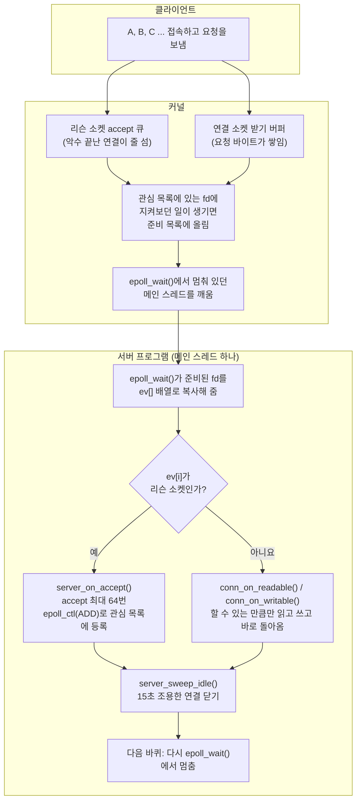

# Step 5 설계: epoll 단일 스레드

프로세스 하나, 스레드 하나가 epoll로 모든 연결을 돌봐요. 연결마다 상태를 들고 있다가, 커널이 준비됐다고 알려 준 연결만 할 수 있는 만큼 처리하고 바로 돌아와요. 요구사항은 S5-01 ~ S5-07이에요.

## epoll 작동 방식



- 관심 목록: 지켜볼 fd 명단이에요. 우리가 `epoll_ctl()`로 넣고 빼요.
- 준비 목록: 관심 목록의 fd 중 지켜보던 일(읽을 데이터 도착, 보내기 버퍼에 자리 남, 끊김)이 생긴 fd만 모인 곳이에요. 커널이 혼자 채워요.
- 유휴 연결은 데이터가 안 오니 준비 목록에 안 올라와요. 그래서 다른 연결을 막지 않아요.

## 바뀌는 핵심

- Step 4의 `handle_conn()`은 연결 하나를 끝까지 붙잡고 반복했어요. 이제는 "지금 할 수 있는 만큼만 하고 돌아오는" 함수 셋으로 쪼개요.
- 모든 소켓(리슨 소켓, 연결 소켓)을 논블로킹(`O_NONBLOCK`)으로 바꿔요. `read()`와 `write()`가 기다리지 않고 `EAGAIN`을 돌려줘요.
- `SO_RCVTIMEO` 타임아웃은 걸리지 않으니, 마지막 활동 시각으로 직접 확인해요.

## 자료구조

### struct conn 추가 항목

| 항목 | 뜻 |
| --- | --- |
| `state` | 지금 단계: `ST_HEADER`(헤더 읽는 중), `ST_BODY`(본문 읽는 중), `ST_WRITE`(응답 보내는 중) |
| `last_active` | 마지막으로 바이트를 주고받은 시각 (S5-03) |
| `out`, `out_len`, `out_sent` | 보낼 응답 헤더(또는 에코·오류 응답 전체)와 지금까지 보낸 바이트 수 |
| `file_fd`, `file_off`, `file_size` | 보낼 파일과 지금까지 보낸 위치 (S5-05) |
| `keep` | 응답을 다 보낸 뒤 연결을 유지할지 |
| `cl` | 이 요청의 본문 길이 |
| `want_out` | `EPOLLOUT`을 켜 두었는지 |
| `prev`, `next` | 열린 연결 리스트 (S5-03 훑기용) |

헤더 버퍼 `buf`, `len`, 본문 버퍼 `body`, `body_len`은 Step 4 그대로예요. 연결마다 어디까지 읽었는지가 여기 남아 있어서, 요청이 나뉘어 와도 이어 붙일 수 있어요 (S5-02).

### struct server (서버 전체)

| 이름 | 값 | 뜻 |
| --- | --- | --- |
| `ep` | `epoll_create1()` 결과 | epoll 인스턴스 fd, 서버에 하나 |
| `listen_fd` | | 리슨 소켓 (논블로킹) |
| `root` | | 정적 파일 루트의 실제 위치 |
| `conns`, `nconn` | | 열린 연결 리스트와 개수 |

| 상수 | 값 | 뜻 |
| --- | --- | --- |
| `MAX_EVENTS` | 64 | `epoll_wait()` 한 번에 받는 최대 개수 |
| `ACCEPT_BATCH` | 64 | 리슨 소켓 알림 한 번에 accept하는 최대 개수 (S5-06) |
| `TICK_MS` | 1000 | `epoll_wait()` 타임아웃. 1초마다 깨어나 유휴 연결을 확인 (S5-03) |
| `IDLE_TIMEOUT_SEC` | 15 | Step 4와 같음 |

등록할 때 `ev.data.ptr`에 리슨 소켓은 `NULL`, 연결은 그 `conn` 포인터를 넣어요. 그래서 알림이 오면 바로 어느 연결인지 알아요.

## 메인 루프

```c
for (;;) {
    int n = epoll_wait(ep, evs, MAX_EVENTS, TICK_MS);
    for (int i = 0; i < n; i++) {
        struct conn *c = evs[i].data.ptr;
        if (c == NULL)                                   server_on_accept(s);   /* 손님 받기 */
        else if (evs[i].events & (EPOLLHUP | EPOLLERR))  server_close_conn(s, c);
        else if (c->state == ST_WRITE)                   conn_on_writable(s, c); /* 이어서 보내기 */
        else                                             conn_on_readable(s, c); /* 이어서 읽기 */
    }
    server_sweep_idle(s, time(NULL));                                            /* 15초 넘은 연결 닫기 */
}
```

`epoll_wait()`가 `EINTR`이면 그냥 다시 돌아요.

## 상태 전이

| 지금 상태 | 일어난 일 | 다음 상태 |
| --- | --- | --- |
| `ST_HEADER` | 헤더의 끝을 찾고 파싱 성공, 본문 있음 | `ST_BODY` |
| `ST_HEADER` | 헤더의 끝을 찾고 파싱 성공, 본문 없음 | `ST_WRITE` |
| `ST_HEADER` | 아직 헤더의 끝 없음 (`EAGAIN`) | 그대로, 다음 알림까지 손 뗌 |
| `ST_HEADER` | 경계를 모르는 오류 (400·411·413·414·431·501·505) | `ST_WRITE`, `keep = 0` |
| `ST_BODY` | 본문 `cl`바이트 다 모음 | `ST_WRITE` |
| `ST_BODY` | 아직 덜 옴 (`EAGAIN`) | 그대로 |
| `ST_WRITE` | 다 보냄, `keep = 1` | 남은 바이트를 앞으로 당기고 `ST_HEADER` |
| `ST_WRITE` | 다 보냄, `keep = 0` | 닫기 |
| `ST_WRITE` | 보내기 버퍼가 꽉 참 (`EAGAIN`) | 그대로, `EPOLLOUT`을 켜고 손 뗌 |
| 어느 상태든 | `read()`가 0, 실패, 15초 조용함 | 닫기 |

## 함수

### server_on_accept (S5-06)

1. `accept()`를 최대 `ACCEPT_BATCH`번 반복해요. `EAGAIN`이 나오면 줄이 빈 거라 멈춰요.
2. 꺼낸 fd마다 `O_NONBLOCK`을 켜고, `conn`을 `malloc`해서 `state = ST_HEADER`, `last_active = 지금`으로 채워요.
3. `epoll_ctl(ADD, EPOLLIN, data.ptr = conn)`으로 관심 목록에 넣고, 연결 리스트에 붙여요.
4. 64개를 채우고도 줄이 남으면, 레벨 트리거라 다음 `epoll_wait()`에서 리슨 소켓이 또 올라와요.

돌려주는 값은 이번에 꺼낸 연결 수예요.

### conn_on_readable (S5-01, S5-02)

1. `state`에 따라 헤더 버퍼나 본문 버퍼에 `read()`를 `EAGAIN`이 날 때까지 해요. 바이트가 오면 `last_active`를 갱신해요.
2. `EAGAIN`이면 그대로 돌아가요. 읽은 것은 `conn`에 남아 있어요.
3. 헤더가 다 모이면 Step 4의 `http_parse_request()`, `body_length()`를 그대로 불러요.
4. 요청이 다 모이면 응답을 준비하고 `ST_WRITE`로 바꾼 뒤 `conn_on_writable()`을 바로 한 번 불러요.

### 응답 준비

- Step 4의 `respond()`가 하던 일을 "바로 보내기"에서 "`out`에 채우기"로 바꿔요.
- 정적 파일: 파일을 `open()`해서 `file_fd`를 들고, 200 헤더만 `out`에 써요. 본문은 `conn_on_writable()`이 조금씩 보내요.
- 에코·오류: 헤더와 본문을 `out`에 한 번에 써요.

### conn_on_writable (S5-05)

1. `out`에 남은 걸 `write()`해요. 다 보내면 파일 차례예요.
2. 파일은 8KB씩 `pread(file_fd, buf, 8192, file_off)`로 읽어 `write()`하고, 실제로 쓴 만큼만 `file_off`를 늘려요.
3. `write()`가 `EAGAIN`이면 `epoll_ctl(MOD, EPOLLOUT)`으로 "쓸 수 있으면 알려 줘"를 켜고 돌아가요.
4. 다 보내면 `EPOLLOUT`을 끄고, 파일을 닫고, 본문 버퍼를 `free`해요. `keep`이면 남은 바이트를 앞으로 당기고 `ST_HEADER`로, 아니면 닫아요.
5. 헤더 버퍼에 다음 요청이 이미 있으면 알림을 기다리지 않고 바로 `conn_on_readable()`을 불러요 (파이프라이닝).

### server_close_conn

`epoll_ctl(DEL)` 후 `close(fd)`, 파일과 본문 버퍼 정리, 리스트에서 빼고 `conn` 해제. 유지하지 않는 연결은 Step 2의 `drain()` 대신, `shutdown(SHUT_WR)` 뒤 한 번 읽고 닫아요. 논블로킹이라 기다리지 않아요.

### server_sweep_idle (S5-03)

연결 리스트를 훑어서 `now - last_active >= 15초`인 연결을 닫아요. `now`를 인자로 받아서 테스트에서 시각을 정할 수 있어요. 연결이 수천 개가 되면 마감 시각 순 자료구조로 바꿔요.

## 테스트를 위해 밖에 여는 함수 (`include/server.h`)

| 함수 | 하는 일 |
| --- | --- |
| `int server_init(struct server *s, int listen_fd, const char *root)` | epoll 만들기, 리슨 소켓 논블로킹·등록 |
| `int server_on_accept(struct server *s)` | 위 설명. 꺼낸 개수 |
| `void conn_on_readable(struct server *s, struct conn *c)` | 위 설명 |
| `void conn_on_writable(struct server *s, struct conn *c)` | 위 설명 |
| `int server_sweep_idle(struct server *s, time_t now)` | 닫은 개수 |
| `void server_close_conn(struct server *s, struct conn *c)` | 위 설명 |
| `void server_free(struct server *s)` | 연결 다 닫고 epoll 닫기 |
| `void server_run(int listen_fd, const char *root)` | `server_init` 후 메인 루프. 돌아오지 않아요 |

`handle_conn()`은 없어져요.

## 요구사항 대응

| 요구사항 | 어디서 |
| --- | --- |
| S5-01 유휴 연결이 있어도 다른 연결 응답 | 메인 루프, 논블로킹 |
| S5-02 나뉘어 온 요청을 연결별로 이어 붙임 | `conn`의 `buf`, `len`, `state` |
| S5-03 15초 조용하면 닫기 | `last_active`, `TICK_MS`, `server_sweep_idle()` |
| S5-04 50연결 2000요청 실패 0 | 전체, 특히 `EAGAIN` 처리와 fd 정리 |
| S5-05 보내기 버퍼가 차면 이어 보내기 | `conn_on_writable()`, `EPOLLOUT`, `file_off` |
| S5-06 accept 반복, 최대 64개 | `server_on_accept()` |
| S5-07 동시에 보낸 본문이 섞이지 않음 | 연결마다 `conn`의 `buf`, `body` |

## Step 4에서 그대로 쓰는 것

`http.c`(파싱, `Content-Length`, keep-alive 판단)와 `file.c`(경로, MIME)는 바꾸지 않아요. 바뀌는 건 `server.c`의 읽기·쓰기와 `server_run()`뿐이에요.

구현 뒤 `server.c`가 커져서 세 파일로 나눴어요. `server.c`는 리슨 소켓·epoll·메인 루프·연결 받기와 정리, `conn.c`는 연결 하나의 읽기·보내기 상태 전이, `respond.c`는 응답 만들기(오류, 에코, 정적 파일)를 맡아요.
