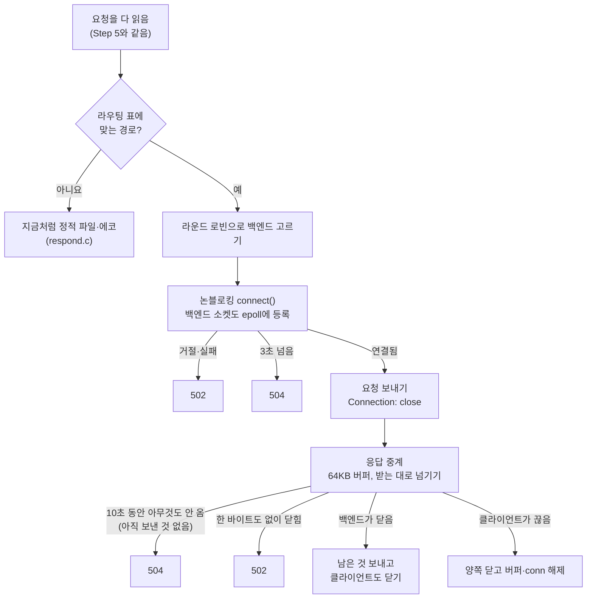

# Step 6 설계: 워커 스레드와 리버스 프록시

워커 스레드 여러 개가 각자 epoll을 돌리고(S6-01), `/api/` 같은 요청은 백엔드로 넘겨 받은 응답을 그대로 돌려줘요(S6-02 ~ S6-10). 요구사항은 Step 6 요구사항(S6-01 ~ S6-10), 결정 이유는 결정사항 17~24행에 있어요. 전체 그림은 "웹 서버 전체 지도 (Step 6까지)" 아티팩트의 "프록시 요청" 흐름과 같아요.

## 한눈에 보기



## 파일

| 파일 | 바뀌는 것 |
| --- | --- |
| `include/config.h`, `src/config.c` | `-t` 인자(워커 수) 추가 |
| `include/route.h`, `src/route.c` | 새 파일. `routes.conf` 읽기, 경로 맞추기, 라운드 로빈 |
| `include/proxy.h`, `src/proxy.c` | 새 파일. 백엔드 연결, 요청 넘기기, 응답 중계, 502·504 |
| `include/server.h`, `src/server.c` | 워커 스레드, `EPOLLEXCLUSIVE`, 이벤트 손잡이(`struct handle`), 프록시 시간 제한 확인 |
| `src/conn.c` | 요청을 다 읽은 뒤 라우팅 표를 먼저 봄 |
| `src/main.c` | 워커 수 정하기, `routes.conf` 읽기 |
| `respond.c`, `http.c`, `file.c` | 그대로 |

## 1. 워커 스레드 (S6-01)

### 워커 수

- `-t N`으로 받아요. 1 ~ 256만 받고, 그 밖이면 사용법을 출력하고 끝내요.
- 안 주면 `sysconf(_SC_NPROCESSORS_ONLN) * 2`예요.

### 띄우기

```c
void server_run(int listen_fd, const char *root, struct routes *routes, int nworkers);
```

1. 메인 스레드가 `pthread_create()`로 워커를 `nworkers`개 띄워요. 각 워커는 자기 `struct server`를 만들고 `server_init()` 뒤 Step 5의 메인 루프를 그대로 돌려요.
2. 메인 스레드는 `pthread_join()`으로 기다리기만 해요. 요청은 처리하지 않아요.
3. 리슨 소켓은 모든 워커가 같이 써요. 각 워커의 epoll에 `EPOLLIN | EPOLLEXCLUSIVE`로 등록해서, 손님이 오면 워커 하나만 깨워요.
4. 늦게 깬 워커의 `accept()`는 `EAGAIN`이라 그냥 넘어가요. Step 5 코드 그대로예요.

### 워커끼리 같이 쓰는 것

| 무엇 | 어떻게 지키나 |
| --- | --- |
| 리슨 소켓 | 커널이 지켜요. `accept()`는 스레드에 안전해요 |
| 라우팅 표 | 켤 때 다 만들고, 그 뒤로는 읽기만 해요 |
| 라운드 로빈 카운터 | `atomic_uint` 하나, `atomic_fetch_add()`만 써요 |
| 루트 경로 문자열 | 읽기만 해요 |

`conn`, epoll, 연결 리스트는 워커마다 따로라서 락이 필요 없어요. `http.c`, `file.c`, `respond.c`에는 같이 쓰는 전역 값이 없어요.

## 2. 라우팅 표 (S6-02, S6-05)

### routes.conf

```
# 경로      백엔드 목록
/api/      127.0.0.1:8001 127.0.0.1:8002
```

- 한 줄에 규칙 하나. 첫 칸은 경로, 나머지는 `IPv4:포트` 백엔드예요. 칸은 공백이나 탭으로 나눠요.
- `#`으로 시작하는 줄과 빈 줄은 건너뛰어요.
- 백엔드 주소는 IPv4 숫자만 받아요. `localhost` 같은 이름은 `getaddrinfo()`가 기다릴 수 있어서 받지 않아요.
- 형식이 틀리면(백엔드 없음, 포트가 숫자가 아님, 규칙·백엔드 개수 초과) 몇 번째 줄인지 출력하고 서버를 켜지 않아요.
- `-c`가 없으면 라우팅 표가 비어서 프록시 없이 Step 5처럼 동작해요.

### 자료구조 (`include/route.h`)

```c
#define ROUTE_MAX 16              /* 규칙 최대 개수 */
#define ROUTE_MAX_BACKENDS 8      /* 규칙 하나의 백엔드 최대 개수 */
#define ROUTE_PREFIX_MAX 256

struct backend {
    struct sockaddr_in addr;      /* connect()에 그대로 넘길 주소 */
    char name[32];                /* "127.0.0.1:8001", 로그용 */
};

struct route {
    char prefix[ROUTE_PREFIX_MAX];
    struct backend backends[ROUTE_MAX_BACKENDS];
    int nbackends;
    atomic_uint next;             /* 라운드 로빈 순번, 모든 워커가 같이 씀 */
};

struct routes {
    struct route items[ROUTE_MAX];
    int n;
};
```

### 함수

| 함수 | 하는 일 |
| --- | --- |
| `int routes_load(const char *path, struct routes *out)` | 파일을 읽어 표를 채워요. 성공 0, 실패 -1 (이유 출력) |
| `struct route *routes_match(struct routes *r, const char *path)` | `path`가 `prefix`로 시작하는 규칙 중 가장 긴 것. 없으면 `NULL` |
| `const struct backend *route_pick(struct route *rt)` | `atomic_fetch_add(&rt->next, 1) % nbackends`번째 백엔드 |

경로는 요청 그대로 비교해요. `?` 뒤 쿼리도 그대로 백엔드에 넘겨요.

## 3. 이벤트 손잡이: 연결 하나에 fd 두 개

Step 5에서는 `ev.data.ptr`에 `conn` 주소를 바로 넣었어요. 프록시에서는 한 `conn`에 클라이언트 소켓과 백엔드 소켓이 함께 있어서, 알림이 어느 쪽에서 왔는지 알아야 해요. 그래서 작은 손잡이를 둬요.

```c
enum handle_kind { H_LISTEN, H_CLIENT, H_BACKEND };

struct handle {
    enum handle_kind kind;
    struct conn *c;               /* H_LISTEN이면 NULL */
};
```

- `struct server`에 `h_listen`, `struct conn`에 `h_cli`, `h_back`을 하나씩 넣어요.
- 등록할 때 `ev.data.ptr`에 이 손잡이 주소를 넣어요.

메인 루프의 갈래는 이렇게 바뀌어요.

```c
struct handle *h = evs[i].data.ptr;
if (h->kind == H_LISTEN)        server_on_accept(s);
else if (h->kind == H_BACKEND)  proxy_on_backend(s, h->c, evs[i].events);
else if (is_proxy(h->c))        proxy_on_client(s, h->c, evs[i].events);
else if (evs[i].events & (EPOLLHUP | EPOLLERR)) server_close_conn(s, h->c);
else if (h->c->state == ST_WRITE) conn_on_writable(s, h->c);
else                            conn_on_readable(s, h->c);
```

## 4. 프록시 (S6-03 ~ S6-10)

### struct conn에 더하는 칸

| 항목 | 뜻 |
| --- | --- |
| `h_cli`, `h_back` | 위의 손잡이 |
| `back_fd` | 백엔드 소켓. 없으면 -1 |
| `relay` | 중계 버퍼 64KB (`PROXY_RELAY_SIZE`). 프록시 시작 때 `malloc`, 끝나면 `free` |
| `rpos`, `wpos` | 중계 버퍼에서 보낸 위치, 채운 위치 |
| `sent_to_client` | 클라이언트에 넘긴 바이트 수. 0이면 아직 오류 응답을 보낼 수 있어요 |
| `back_eof` | 백엔드가 닫았으면 1 |
| `deadline` | 이 시각이 지나면 504 (연결 3초, 응답 10초) |
| `cli_events`, `back_events` | 지금 epoll에 걸어 둔 일. 같으면 `epoll_ctl(MOD)`를 생략해요 |

### 상태

`enum conn_state`에 셋을 더해요.

| 상태 | 하는 일 | 백엔드 소켓이 지켜보는 일 | 클라이언트 소켓이 지켜보는 일 |
| --- | --- | --- | --- |
| `ST_PROXY_CONNECT` | 연결 기다림 | `EPOLLOUT` (연결되면 쓸 수 있음) | `EPOLLRDHUP` (끊김만) |
| `ST_PROXY_SEND` | 요청 보내는 중 | `EPOLLOUT` | `EPOLLRDHUP` |
| `ST_PROXY_RELAY` | 응답 중계 | 버퍼에 자리가 있으면 `EPOLLIN`, 꽉 차면 없음 | 보낼 게 있으면 `EPOLLOUT`, 늘 `EPOLLRDHUP` |

클라이언트 쪽에서 `EPOLLIN`을 빼는 이유: 프록시 중에 클라이언트가 더 보내는 바이트(다음 요청)는 어차피 버리고 닫을 거라, 레벨 트리거로 계속 깨어나지 않게 해요. 끊김은 `EPOLLRDHUP`으로 알아요.

### proxy_start(s, c, rt)

`conn.c`가 요청(헤더, 본문)을 다 모은 뒤, `prepare_response()`보다 먼저 `routes_match()`를 불러요. 규칙이 맞으면 여기로 와요.

1. `c->keep = 0`. 프록시 응답 뒤에는 클라이언트도 닫아요 (결정 20행).
2. `route_pick()`으로 백엔드를 골라요.
3. 백엔드에 보낼 요청을 `c->out`에 만들어요 (S6-03).
   - 요청 줄: `METHOD PATH VERSION\r\n`, 받은 그대로
   - 헤더: 받은 그대로. 단 `Connection`, `Keep-Alive`는 빼요
   - `Connection: close\r\n`, 빈 줄
   - 본문: `c->body`를 그대로 (POST)
4. `socket()`, 논블로킹, `connect()`.
   - 바로 성공: `ST_PROXY_SEND`
   - `EINPROGRESS`: `ST_PROXY_CONNECT`, `deadline = 지금 + 3초`
   - 그 밖(예: `ECONNREFUSED`): 소켓 닫고 502 (S6-06)
5. 백엔드 소켓을 `h_back`으로 epoll에 등록하고, 클라이언트 쪽 지켜볼 일을 바꿔요.

### proxy_on_backend(s, c, events)

| 상태 | 일어난 일 | 할 일 |
| --- | --- | --- |
| CONNECT | 쓸 수 있음 | `getsockopt(SO_ERROR)`가 0이면 `ST_PROXY_SEND`, 아니면 502 |
| SEND | 쓸 수 있음 | `c->out`을 `write()`. 다 보내면 `relay` 만들고 `ST_PROXY_RELAY`, `deadline = 지금 + 10초` |
| RELAY | 읽을 수 있음 | `relay + wpos`에 `read()`. 바이트가 오면 `deadline`을 다시 10초 뒤로 미루고, 바로 클라이언트에 보내 봐요 |
| RELAY | `read()`가 0 | `back_eof = 1`. 아래 "끝내기"로 |
| 아무 때 | `EPOLLERR`, `read()` 실패 | `sent_to_client == 0`이면 502, 아니면 양쪽 닫기 |

### proxy_on_client(s, c, events)

| 일어난 일 | 할 일 |
| --- | --- |
| `EPOLLRDHUP`, `EPOLLHUP`, `EPOLLERR` | 클라이언트가 떠났어요. 양쪽 닫고 해제 (S6-10) |
| `EPOLLOUT` (RELAY) | `relay[rpos..wpos)`를 `write()`. `sent_to_client`를 늘리고, 버퍼에 자리가 생기면 백엔드 `EPOLLIN`을 다시 켜요 |

### 중계 버퍼 (S6-04)

- 백엔드에서 읽으면 바로 클라이언트에 써 봐요. 64KB가 찰 때까지 기다리지 않아요.
- 다 보내면(`rpos == wpos`) 둘 다 0으로 되돌려요.
- `wpos`가 끝에 닿았는데 앞이 비어 있으면(`rpos > 0`) 남은 걸 앞으로 당겨요.
- 그래도 꽉 차 있으면 백엔드 `EPOLLIN`을 끄고, 클라이언트로 보내 자리가 나면 다시 켜요.

### 끝내기

`back_eof == 1`이고 버퍼를 다 보냈을 때 해요.

- `sent_to_client == 0`: 백엔드가 한 바이트도 안 보내고 닫았어요. 백엔드 쪽을 정리하고 502를 보내요 (S6-10).
- 그 밖: 클라이언트 연결을 닫아요 (S6-04).

### 502·504 보내기

- 아직 클라이언트에 아무것도 안 보냈을 때만 보낼 수 있어요.
- 백엔드 쪽(`back_fd`, `relay`, `out`)을 정리하고 `prepare_error(c, 502 또는 504, NULL)`, `keep = 0`으로 Step 5의 `ST_WRITE`에 넘겨요. 그 뒤는 Step 5 코드 그대로예요.
- 이미 보내기 시작했으면 양쪽을 닫아요 (S6-07).

### 시간 제한 (S6-07)

`server_sweep_idle()`이 1초마다 돌 때, 프록시 상태인 연결은 15초 유휴 대신 `deadline`을 봐요.

| 상태 | `deadline` | 넘으면 |
| --- | --- | --- |
| CONNECT | 연결 시작 + 3초 | 504 |
| SEND, RELAY | 마지막으로 백엔드와 바이트를 주고받은 때 + 10초 | 보낸 것 없으면 504, 있으면 양쪽 닫기 |

1초마다 확인하니 504는 3~4초, 10~11초에 나가요. 테스트에서 줄일 수 있게 3초와 10초는 `struct server`의 `connect_timeout`, `response_timeout` 칸에 두고, `server_init()`이 `#define` 값으로 채워요.

### 정리 (S6-10)

`server_close_conn()`이 Step 5 정리에 더해 `proxy_cleanup(s, c)`를 불러요.

- `back_fd`가 있으면 `epoll_ctl(DEL)` 후 `close()`
- `relay` `free`
- 그다음 Step 5처럼 클라이언트 소켓, `out`, `body`, `conn` 해제

어느 쪽이 먼저 끊기든 이 한 함수로 다 정리해서, 해제된 `conn`을 가리키는 손잡이가 epoll에 남지 않아요.

## 5. 상수

| 이름 | 값 | 쓰는 곳 |
| --- | --- | --- |
| `PROXY_RELAY_SIZE` | 65536 | 중계 버퍼 (S6-04) |
| `PROXY_CONNECT_TIMEOUT_SEC` | 3 | 연결 시간 제한 (S6-07) |
| `PROXY_RESPONSE_TIMEOUT_SEC` | 10 | 응답 시간 제한 (S6-07) |
| `WORKERS_MAX` | 256 | `-t` 상한 (S6-01) |

## 요구사항 대응

| 요구사항 | 어디서 |
| --- | --- |
| S6-01 워커 스레드, 연결은 한 스레드가 끝까지 | `server_run()`, `EPOLLEXCLUSIVE`, `config.c`의 `-t` |
| S6-02 경로로 라우팅, 경로 그대로 넘기기 | `route.c`, `conn.c`의 갈래 |
| S6-03 요청 넘기기, `Connection: close` | `proxy_start()` |
| S6-04 받는 대로 넘기기, 64KB, 백엔드가 닫으면 클라이언트도 닫기 | 중계 버퍼, 끝내기 |
| S6-05 라운드 로빈, 카운터 하나 | `route_pick()`, `atomic_uint` |
| S6-06 연결 실패 502, 다시 시도 안 함 | `proxy_start()`, CONNECT의 `SO_ERROR` |
| S6-07 연결 3초, 응답 10초, 504 | `deadline`, `server_sweep_idle()` |
| S6-08 기다리는 동안 다른 연결 처리 | 백엔드 소켓도 epoll에 등록, 논블로킹 |
| S6-09 정적 파일 그대로 | `respond.c`는 그대로, 라우팅 표에 안 맞으면 Step 5 길 |
| S6-10 끊김 정리, 빈 응답 502 | `proxy_on_client()`, `proxy_cleanup()`, 끝내기 |
