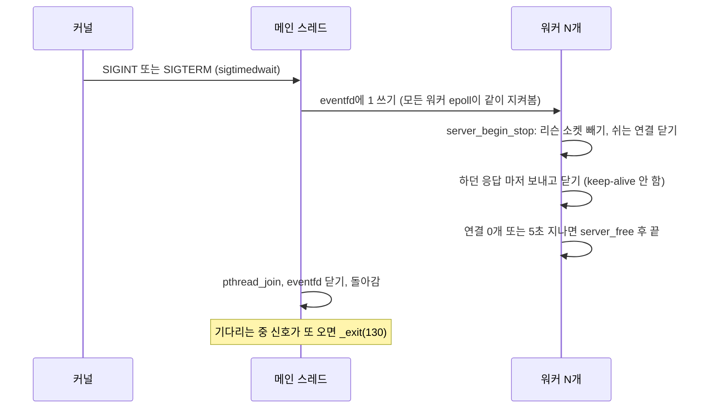

# Step 7 설계: 안정성

이 문서를 읽으면 서버가 종료 신호를 어떻게 받아서 어떤 순서로 꺼지는지, 접근 로그·헤더 시간 상한·fd 바닥을 어떻게 처리하는지 알 수 있어요. 테스트는 [Step 7 테스트](../tests/step7.md)에 있어요.

## 1. 요구사항

| ID | 내용 |
| --- | --- |
| S7-01 | `SIGPIPE`는 무시하고 `EPIPE`로 처리한다. `SIGINT`·`SIGTERM`은 메인 스레드만 받는다 |
| S7-02 | 종료 신호를 받으면 새 연결을 그만 받고, 쉬는 연결은 바로 닫고, 하던 응답은 끝까지 보낸 뒤 닫는다. 최대 5초 기다린다. 신호가 한 번 더 오면 바로 끈다 |
| S7-03 | 꺼질 때 연결·버퍼·소켓·epoll·스레드를 모두 회수한다. ASan·valgrind에 누수와 잘못된 접근이 없다 |
| S7-04 | 요청 헤더를 첫 바이트부터 30초 안에 다 못 받으면 408을 보내고 닫는다 |
| S7-05 | fd가 바닥나 `accept()`가 실패하면 그 워커는 리슨 소켓 감시를 1초 쉰다 |
| S7-06 | 응답마다 접근 로그 한 줄을 화면(stdout)에 남긴다. 여러 워커의 줄이 섞이지 않는다 |
| S7-07 | 버퍼에 쓰는 곳마다 길이를 확인한다 |

## 2. 종료 흐름



- **신호는 메인만 받아요.** 신호는 막지 않은 스레드 아무에게나 가요. 그래서 `server_run()`이 워커를 띄우기 전에 `pthread_sigmask()`로 `SIGINT`·`SIGTERM`을 막아요. 워커는 막힌 채로 태어나고, 메인은 `sigtimedwait()`로 신호를 평범한 코드에서 받아요. 신호 처리 함수를 안 써서 그 안에서 `free()`·`printf()`를 부를 걱정이 없어요.
- **워커에 알리기는 `eventfd` 하나로 해요.** 모든 워커가 같은 `eventfd`를 자기 epoll에 `EPOLLIN`(레벨 트리거)으로 등록해요. 메인이 1을 쓰면 값을 아무도 안 읽어서 계속 읽을 수 있는 상태라, 모든 워커가 깨요. 깨어난 워커는 자기 epoll에서 `eventfd`를 빼서 다시 깨지 않아요.
- **쉬는 연결**은 `ST_HEADER`이고 버퍼가 빈 연결이에요(다음 요청을 기다리는 keep-alive). 헤더를 받는 중이거나 본문·응답·프록시 중인 연결은 끝까지 처리해요.
- **종료 중 응답**은 `keep = 0`으로 만들어 `Connection: close`를 붙이고, 다 보내면 닫아요. 이미 keep-alive로 준비된 응답도 다 보낸 뒤 닫아요.
- **5초 상한**: 워커는 루프마다 `server_should_exit()`를 봐요. 종료 중이고 연결이 0개거나 5초가 지났으면 루프를 끝내고 `server_free()`로 남은 연결을 닫아요. 종료 중에는 `epoll_wait()` 제한을 1초에서 0.1초로 줄여서 빨리 끝나요.
- **종료 코드**: 정상 종료는 0, 두 번째 신호로 끄면 130이에요.

## 3. 자원 회수 (S7-03)

| 자원 | 회수 | 어디서 |
| --- | --- | --- |
| conn, 본문 버퍼, 중계 버퍼, 응답 버퍼 | `free()` | `server_close_conn()` → `reap()` |
| 클라이언트·백엔드 소켓, 파일 | `close()` | `server_close_conn()`, `proxy_cleanup()` |
| 워커 epoll | `close()` | `server_free()` |
| 워커 스레드 | `pthread_join()` | `server_run()` |
| `eventfd` | `close()` | `server_run()` |
| 리슨 소켓 | `close()` | `main()` |

라우팅 표는 `main.c`의 static이라 풀 게 없어요.

## 4. 헤더 30초 상한 (S7-04)

- `conn.req_start`에 이 요청의 첫 바이트가 온 시각을 적어요. 빈 버퍼에 첫 바이트를 읽을 때, 또는 응답 뒤 다음 요청이 이미 버퍼에 있을 때요.
- `server_sweep_idle()`가 1초마다 `ST_HEADER`이고 버퍼에 바이트가 있는 연결을 보고, 30초가 지났으면 `conn_send_error(408)`을 불러요. 유휴 15초 검사보다 먼저 봐요.
- 15초 유휴 타이머는 바이트가 올 때마다 다시 세서, 14초마다 1바이트씩 보내면 안 끊겨요(slowloris). 30초 상한은 다시 세지 않아요.
- 아무것도 안 보낸 연결은 408 대상이 아니에요. 기존대로 15초 뒤 조용히 닫아요.
- 본문은 상한을 두지 않아요. 큰 업로드가 잘릴 수 있어서예요.

## 5. fd 바닥 (S7-05)

- `accept()`가 `EMFILE`·`ENFILE`·`ENOBUFS`·`ENOMEM`이면 손님이 accept 큐에 남아 있어서 epoll이 계속 깨워요. 그대로 두면 CPU 100%로 헛돌아요.
- 그 워커는 리슨 소켓을 자기 epoll에서 빼고(`EPOLL_CTL_DEL`) `accept_resume = 지금 + 1초`를 적어요. `EPOLLEXCLUSIVE`로 등록한 fd는 `EPOLL_CTL_MOD`를 못 써서 빼고 다시 넣어요.
- `server_sweep_idle()`가 시각이 되면 다시 등록해요. 종료 중이면 다시 넣지 않아요.

## 6. 접근 로그 (S7-06)

형식:

```
2026-11-26 00:26:17 127.0.0.1 "GET /api/whoami.txt HTTP/1.1" 200 191 5ms
```

| 칸 | 내용 |
| --- | --- |
| 시각 | 로그를 쓸 때의 지역 시각 |
| IP | `accept()`에서 받은 클라이언트 주소 |
| 요청 줄 | 파싱 못 한 요청(408, 431, 400)은 `"-"` |
| 상태 | 정적·오류는 `c->out` 첫 줄에서, 프록시는 백엔드 응답 첫 줄에서 읽어요 |
| 바이트 | 이 응답에서 클라이언트에 실제로 보낸 바이트(헤더 포함) |
| 처리 시간 | 헤더를 다 받은 순간부터 로그를 쓸 때까지 |

- **언제 쓰나**: 응답을 다 보냈을 때(`flush()`), 또는 응답 도중 연결이 닫힐 때(`server_close_conn()`). 응답을 시작하면 `log_pending = 1`, 쓰면 0이라 한 응답에 한 줄만 나와요. 프록시는 `proxy_start()`에서 `log_pending`을 켜고 닫힐 때 써요.
- **섞이지 않게**: 한 줄을 `snprintf()`로 다 만든 뒤 `write()` 한 번으로 써요. 경로가 길어 4,352바이트를 넘으면 자르고 줄바꿈으로 끝내요.
- **끄기**: `access_log_set_fd(-1)`이 기본이라 테스트에서는 안 나와요. `main.c`만 stdout으로 켜요. 파일로 남기려면 `./webserver ... > access.log`.

## 7. 그 밖에

- **`TCP_NODELAY`**: Step 8 `wrk` 측정에서 keep-alive 요청마다 약 44ms가 걸렸어요. 응답 헤더와 파일을 `write()` 두 번으로 보내면, Nagle 알고리즘이 두 번째 조각을 상대의 지연 ACK(40ms)가 올 때까지 붙잡아서예요. 받은 소켓마다 `TCP_NODELAY`를 켜서 `wrk` 정적 파일 처리량이 초당 약 2,270건에서 약 109,000건으로 올랐어요.
- **버퍼 길이 점검 (S7-07)**: `snprintf`·`memcpy`·`read`를 쓰는 곳을 훑었어요. 헤더 버퍼는 남은 칸만큼만 읽고(꽉 차면 431), 본문은 1MB 상한(413), 에코 헤더는 잘리면 500, 프록시 요청은 필요한 크기를 먼저 계산해 할당해요. 새로 찾은 오버플로는 없었고, 로그 줄만 새로 자르기 처리를 넣었어요.

## 8. 파일

| 파일 | 바뀐 것 |
| --- | --- |
| `src/log.c`, `include/log.h` | 새 파일: 접근 로그 |
| `src/server.c` | 신호·`eventfd`·종료, accept 쉬기, 408 검사, `TCP_NODELAY`, IP 기록 |
| `src/conn.c` | `req_start`, 로그 시점, 종료 중 keep-alive 끄기 |
| `src/proxy.c` | 프록시 로그(상태 코드, 보낸 바이트) |
| `src/main.c` | 로그 켜기, 종료 뒤 리슨 소켓 닫기 |
| `src/http.c` | 408 문구 |
| `include/server.h` | 상수 `HEADER_TIMEOUT_SEC 30`, `SHUTDOWN_GRACE_SEC 5`, `ACCEPT_PAUSE_SEC 1`과 새 필드·함수 |
