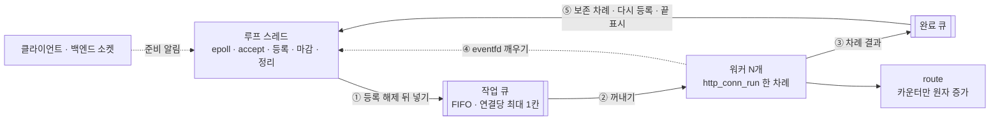
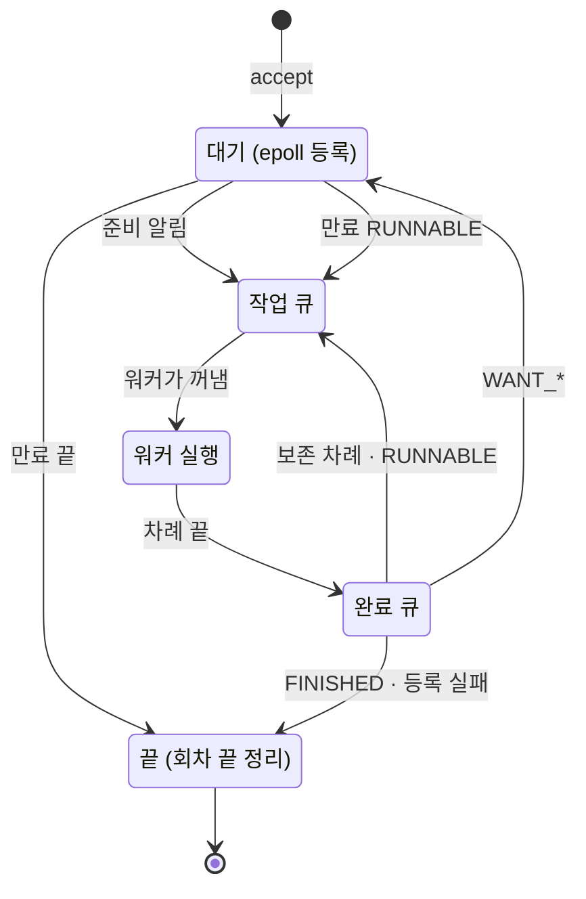

# 후속 확장: epoll + 작업 큐 + 워커 스레드 풀

이 문서는 Step 6 완료 코드 위에 작업 큐와 워커 스레드 풀을 덧붙인 후속 확장의 구현과 검증을 기술하는 것을 목적으로 한다.

| 항목 | 내용 |
| ---- | ---- |
| 상태 | ✅ 구현·독립 검증 통과. 세부 설계 선택은 사용자 채택 전 `임시` |
| 범위 | `server_loop`의 실행 위치 변경, `route` 카운터 원자화. 사용자에게 보이는 HTTP 동작은 바꾸지 않는다 |
| 사용자 확정 | 이벤트 루프는 연결 처리를 직접 하지 않고 큐에 넣는다 · **연결 하나는 동시에 워커 하나만** 처리한다. 나머지는 모두 `임시` |
| 결정 기록 | [decision.md](./decision.md) (채택 때 D-번호 부여) |
| 기준 | [Step 5](../../steps/step-5-concurrency/README.md) D-56~D-59 · [Step 6](../../steps/step-6-reverse-proxy/README.md) D-63·D-67 |
| 기존 Step | Step 5·6의 완료·검증 기록은 바꾸지 않는다 |

## 1. 구조

루프 스레드 하나가 `epoll`·등록·마감·정리를 계속 맡고, 워커는 `http_conn_run` 한 차례만 실행한다.

## 2. 연결의 실행 상태

연결마다 실행 상태를 둔다. `http_conn` 안의 HTTP 상태(D-57)와는 별개다.

| 전이 | 바꾸는 쪽 | 잠금 |
| ---- | --------- | ---- |
| `ARMED → QUEUED`, `DONEQ → QUEUED` | 루프 | 큐 잠금 안에서 작업 큐에 넣으며 |
| `QUEUED → RUNNING` | 워커 | 큐 잠금 안에서 꺼내며 |
| `RUNNING → DONEQ` | 워커 | 큐 잠금 안에서 완료 큐에 넣으며 |
| 완료 큐에서 꺼냄 → `ARMED`·`FIN`·`QUEUED` | 루프 | 꺼내기·실행 표시 되돌리기는 큐 잠금 안, HTTP·등록 처리는 잠금 밖 |
| `ARMED → FIN`, 만료 | 루프 | 없음 (공유 실행 상태를 바꾸지 않음) |

- **바쁨** = `QUEUED`·`RUNNING`·`DONEQ`. 바쁜 연결은 epoll에 등록된 소켓이 없고, 마감 확인·만료·정리 대상이 아니다.
- `QUEUED`는 HTTP 결과 `RUNNABLE`과 다르다. 들어간 까닭(준비 알림·보존 차례·`RUNNABLE`)과 관계없이 `http_conn`의 `deadline`을 멈추거나 다시 잡지 않는다.
- 서버 종료 때는 상태와 관계없이 워커를 모두 멈춘 뒤 해제한다(6장).

## 3. 불변조건

| 이름 | 내용 | 확인 방법 |
| ---- | ---- | --------- |
| 연결당 워커 하나 | 한 연결은 작업 큐·실행 중·완료 큐 중 최대 한 곳에만 있다 | 큐 잠금 안에서 실행 표시 전이를 단언(`assert`), 어긋나면 중단 |
| 소켓별 차례 보존 | 한 배치에서 같은 연결의 클라이언트·백엔드 알림은 **원인을 합치지 않고** 알림마다 한 차례씩, 하나가 끝난 뒤 다음을 실행한다 | 9장 단위 시험 |
| 보존 차례의 세대 | 보존한 백엔드 차례는 넣기 직전에 배치 때 복사한 세대와 현재 `be_gen`·`be_fd`를 다시 비교하고, 다르면 버린다 | 같은 배치 옛 알림 시험(TC-6-13) |
| 바쁘면 등록 없음 | 넣기 전에 유효한 등록을 모두 해제한다. 등록된 연결은 바쁘지 않다 | 넣기 직전 두 등록 방향이 0인지 단언 |
| 유효 등록만 해제 | 해제 전에 세대를 보정한다: 등록 세대 ≠ `be_gen`이면 `close`가 이미 지웠으므로 `DEL` 없이 0으로 둔다 | 만료 504 시험 |
| 회수 전 접근 금지 | 루프는 연결을 완료 큐에서 꺼내기 전에는 `c->http` 필드를 읽지도 쓰지도 않는다. 워커는 루프 필드를 만지지 않는다 | ThreadSanitizer 기능 회귀에서 경합 0 |
| 넘겨주기는 큐 잠금으로 | 공유 실행 상태(큐·실행 표시)의 조회·변경은 큐 잠금으로 보호하고, 완료 회수 뒤 HTTP·등록 처리는 루프가 잠금 밖에서 한다 | 코드 검토 |
| 해제는 루프만 | `http_conn_release`·클라이언트 `close`·`free`는 바쁘지 않은 연결에 회차 끝에만 한다 | ASan, 종료 주입 시험 |
| 백엔드 fd는 `http_conn`이 | 열고 닫는 것은 지금처럼 `http_conn`이다(워커 실행 또는 루프의 만료 처리). 등록은 루프가 회수 뒤 `be_gen` 기준으로 새로 한다 | 백엔드 교체 부하 시험(TC-6-13) |
| 대기만 만료 | `http_conn_expired`·`http_conn_expire`는 `ARMED` 연결에만 부른다. 보존 차례가 남은 연결은 `ARMED`가 아니다 | 단언 |
| 깨우기 손실 없음 | 워커는 완료 큐에 넣은 **뒤** eventfd에 쓴다. 루프는 eventfd를 읽은 **뒤** 완료 큐를 비운다 | 짧은 요청 반복 지연이 1초 안 |
| 공유 상태 | 라우팅 표는 카운터만 원자 증가, 나머지(`root`·표 내용·상수 표)는 읽기 전용 | `route_pick` 다중 스레드 단위 시험 |

## 4. 루프 회차

| 순서 | 할 일 |
| ---- | ----- |
| 1 | `epoll_wait` (시간 제한 = `ARMED` 연결 중 가장 이른 마감, eventfd도 등록) |
| 2 | 배치 직후 백엔드 세대 복사 (D-67 그대로) |
| 3 | 배치를 연결별로 모은다. 연결마다 클라이언트 원인 하나와 백엔드 원인 하나(복사한 세대와 함께)를 **배치 순서대로** 보존한다. 옛 세대 백엔드 알림은 버린다. 듣는 소켓이면 accept |
| 4 | 모은 연결마다 유효 등록 해제 → 첫 보존 차례를 작업 큐에 넣기 (해제 실패는 그 연결 `ERROR`, 넣지 않음) |
| 5 | eventfd를 읽고 완료 큐를 모두 꺼낸다. 연결마다 아래 「회수 처리」 |
| 6 | 마감 확인 (`ARMED`만, 5에서 방금 다시 등록한 연결 포함): 만료면 유효 등록 해제 → `http_conn_expire` → `RUNNABLE`이면 작업 큐, 아니면 끝 표시 |
| 7 | 끝난 연결 정리 (D-57 순서 그대로) |

회수 처리 (D-67의 같은 배치 두 번 실행과 같은 결과):

| 이번 차례 결과 | 보존 차례 남음 | 처리 |
| -------------- | -------------- | ---- |
| `FINISHED` | 상관없음 | 보존 차례 버림, 끝 표시 |
| 그 밖 | 백엔드 차례 | 세대 재확인 → 같으면 그 원인으로 작업 큐, 다르면 버리고 아래 줄 |
| 그 밖 | 클라이언트 차례 | 그 원인으로 작업 큐 (세대 재확인 없음) |
| `RUNNABLE` | 없음 | 작업 큐 뒤 (`WAKE_INTERNAL`) |
| `WANT_*` | 없음 | 결과대로 다시 등록, `ARMED`. 실패는 그 연결 `ERROR` |

- 등록은 보존 차례가 모두 끝난 **마지막 차례 결과**로만 한다. 앞 차례가 `RUNNABLE`이어도 뒤 차례가 `WANT_*`면 내부 실행은 하지 않는다(D-67 「중복 실행」과 같음).

## 5. 마감과 큐 대기

| 항목 | 내용 |
| ---- | ---- |
| 차례의 현재 시각 | 워커가 차례를 시작할 때 단조 시계를 읽어 `now`로 넘긴다 |
| 큐 대기 중 마감 | 멈추거나 다시 잡지 않는다. 바빠서 만료 확인에서 빠질 뿐이다 |
| 회수 직후 확인 | 다시 등록한 연결은 같은 회차의 6단계 마감 확인에 들어간다. 차례에서 실제 진행이 없었고 마감이 지났으면 그때 만료한다(D-59 「준비 알림만 있고 진행이 없으면 기존 마감 유지」) |
| 거짓 만료 없음 | 준비 알림을 받은 연결은 보존 차례를 모두 실행하기 전에는 만료하지 않으므로, 큐 대기가 길어도 진행이 있었던 연결은 닫히지 않는다 |
| 큐 대기 지연 한계 | 상한을 보장하지 않는다. 대략 (앞에 선 연결 수 ÷ 워커 수) × 차례 시간이며, 차례 시간은 예산(D-56)으로 짧지만 파일 디스크 대기(D-55)는 남는다 |
| `epoll_wait` 시간 제한 | `ARMED` 연결 마감만 센다. 바쁜 연결이 있어도 완료는 eventfd가 깨운다 |

## 6. 실패와 종료

| 상황 | 동작 |
| ---- | ---- |
| 시작 때 eventfd·잠금·조건 변수 준비 실패 | 만든 것만 닫거나 없애고 서버를 끝내는 실패로 돌려준다(`epoll_create1` 실패와 같은 길) |
| 시작 때 워커 일부만 만들어짐 | 정지 표시 → 깨움 → **만든 워커만** `join` → 위와 같이 실패로 돌려준다 |
| eventfd | `EFD_NONBLOCK`·`EFD_CLOEXEC`로 만든다 |
| 워커의 eventfd 쓰기 | `EINTR`은 다시 쓴다. `EAGAIN`(계수 포화)은 이미 0이 아니라 루프가 깨므로 성공으로 본다. 그 밖은 계약상 생기지 않으므로 `abort` |
| 루프의 eventfd 읽기 | `EINTR`은 다시 읽는다. `EAGAIN`은 무시한다. 그 밖은 서버를 끝내는 실패다. 읽기 결과와 관계없이 완료 큐는 매 회차 비운다 |
| 넣기·만료 전 등록 해제 실패 | 그 연결 `ERROR`(원래 오류), 끝 표시 |
| 완료 뒤 다시 등록 실패 | 지금처럼 그 연결 `ERROR`(D-57·D-67) |
| 작업 큐 포화 | 생기지 않는다. 연결 구조체 안의 연결 고리로 넣어 할당이 없고, 길이는 연결 수 이하다 |
| 워커 한 차례가 오래 걸림 (디스크 대기) | 그 연결만 바쁨이 길어진다. 바쁜 동안은 만료하지 않는다 |
| 서버를 끝내는 실패 (`epoll_wait`·accept·eventfd 읽기) | 큐 잠금 안에서 정지 표시 → 조건 변수 모두 깨움 → 잠금을 놓고 모두 `join` → 모든 연결 해제 → eventfd·`epoll` 닫기 |

- `join` 교착 방지: 루프는 `join` 동안 잠금을 쥐지 않는다. 워커는 실행 중 차례만 마치고 완료 큐에 넣은 뒤(eventfd는 아직 열려 있고 논블로킹) 정지 표시를 보고 끝난다. 작업 큐에 남은 연결은 실행하지 않는다.
- 해제는 `join` 뒤에만 한다. 큐에 남은 연결도 연결 목록에 있으므로 함께 해제된다.

## 7. 바뀌는 것과 그대로인 것

| 계약 | 확장 뒤 | 근거 |
| ---- | ------- | ---- |
| HTTP 동작·응답·유지·502·504 | 그대로 | `http_conn` 상태 전이를 바꾸지 않음 |
| 5초 무진행 마감 | 그대로, 바쁜 동안은 확인하지 않음 | D-59 |
| 준비 우선 뒤 마감 확인 | 그대로: 준비된 연결은 보존 차례가 다 끝난 뒤에만 확인 | D-59 |
| 차례 예산 | 그대로, 알림마다 한 차례 | D-56, D-67 |
| 같은 배치 두 소켓 알림 | 그대로 두 차례, 다만 동시가 아니라 차례로 | D-67 |
| 라운드 로빈 | 규칙별 순서는 그대로, 동시 요청끼리의 순서는 정해지지 않음 | D-63 |
| 내부 실행 목록 | 없어지고 작업 큐로 합쳐짐 | D-56 |
| 실행 인터페이스 | `http_conn_run`·`expire`·`release` 그대로 | D-57, D-67 |
| `server_loop_run` 서명 | 그대로, 워커 수는 상수 | — |

## 8. 변경 지점

| 위치 | 변경 |
| ---- | ---- |
| `src/server_loop.c` | 실행 상태·보존 차례·eventfd·작업 큐·완료 큐·워커 시작과 종료, 회차 순서 변경, 내부 실행 목록 제거, 해제 전 세대 보정 |
| `src/route.{h,c}` | `next`를 원자 정수로, `route_pick`은 원자 증가 |
| `src/http_conn.h` | 주석만: 워커 스레드에서 부를 수 있고, 루프와 동시에 접근하지 않는다 |
| `Makefile` | 서버·`test_server_loop`·`test_route`에 `-pthread`, ThreadSanitizer 빌드 목표 |
| `tests/test_server_loop.c` | `epoll_wait` 관문으로 같은 배치 두 소켓 알림을 만들고, 깨우기·종료 주입·워커 생성 실패 시험 추가 |
| `tests/test_route.c` | 여러 스레드 `route_pick` 시험 추가 |

## 9. 시험할 수 있는 지점

TC 번호는 채택 뒤 정한다.

- 단위: 여러 스레드가 `route_pick`을 동시에 부르면 백엔드별 횟수가 정확히 같다(전체 횟수가 백엔드 수의 배수일 때).
- 단위: 업로드 중 한 배치에 클라이언트 본문·백엔드 응답 알림이 함께 오면 두 차례로 실행되고, 클라이언트 본문 `read`가 사라지지 않아 마감으로 닫히지 않는다.
- 단위: 첫 차례가 백엔드를 닫거나 바꾸면 보존한 백엔드 차례는 버려진다. 첫 차례가 `FINISHED`면 보존 차례는 실행되지 않는다.
- 단위: 커밋 전 백엔드 대기 만료는 `ERROR`가 아니라 504로 끝난다(만료 전 해제·세대 보정).
- 단위: 큐 대기 중 마감이 지난 준비 연결은 차례에서 진행하면 닫히지 않고, 진행이 없으면 회수 직후 확인에서 만료한다.
- 단위: 연결당 워커 하나 단언과 바쁘면 등록 없음 단언이 부하 중에 깨지지 않는다.
- 단위: 서버 종료 주입(`epoll_wait` 실패)과 워커 일부 생성 실패 주입에서 만든 워커만 `join`되고 ASan 누수·오류 0, 교착 없음.
- 기능·회귀: Step 3·4·5 기능 TC, TC-6-01~14, `ab -n 2000 -c 50` 실패 0 (처리량은 기록만).
- 기능: ThreadSanitizer 빌드로 위 기능 회귀를 돌려 경합 보고 0.
- 기능: 짧은 요청 연속 1000번이 각각 1초 안에 끝난다(깨우기 손실이면 마감 시간까지 늦어짐).

## 10. 구현·자체 점검 기록

자체 점검(Raiden)이며 독립 검증이 아니다. 환경은 Docker Ubuntu 24.04(aarch64)다.

| 날짜 | 항목 | 결과 | 근거 |
| ---- | ---- | ---- | ---- |
| 11/26 | 구현 | 완료 | 8장 변경 지점대로. 워커 수 4는 `임시` |
| 11/26 | RED (Step 6 코드) | 3건 | 다중 스레드 `route_pick` 횟수 불일치(3회 모두), 워커 생성 실패 주입 2건. 같은 배치·깨우기·`epoll_wait` 실패 시험은 Step 6에서도 통과(새 RED 없음) |
| 11/26 | 변이 확인 | 5종 모두 잡힘 | 원인 합치기 · 만료 뒤 해제 · eventfd 통지 누락 · 종료 때 해제 누락(LeakSanitizer) · 비원자 카운터(ThreadSanitizer) |
| 11/26 | 단위 (마지막 코드 수정 뒤) | 통과 | `make -B`·`make -B debug` 경고 0, `make -B test` 11개 통과, `make -B tsan` 통과·경합 보고 0 |
| 11/26 | 기능·회귀 | 통과 | Step 3~6 기능 54건을 `-O2`·ASan·TSan 서버로 각각 통과, `ab -n 2000 -c 50` 실패 0(처리량은 4,880~5,090 req/s, `-O2`) |

- 시험하지 못한 것: 첫 차례가 백엔드를 바꾼 뒤 보존 차례 버림, 첫 차례 `FINISHED` 뒤 보존 차례 버림, 큐 대기 중 진행 없는 연결의 회수 직후 만료는 루프 수준에서 결정적으로 재현하지 않았다(코드와 단언만).

### 독립 검증 (11/26)

- **판정:** Mavuika가 변경 범위에서 차단 결함을 찾지 못했다. [보고서](../../../.agent/reviews/worker-pool-verify/report.md)는 로컬 전용이다.
- **새 경계 시험:** O2·ASan·TSan에서 각각 6개 통과. `FINISHED` 뒤 차례 폐기와 큐 대기 후 무진행 만료를 별도 경계 시험으로 확인했다.
- **실제 루프:** 송신 정체 8개와 32개 연결의 응답 96개를 확인하고 실패 종료 시 정리까지 실행했다.
- **남은 한계:** 백엔드 교체 뒤 옛 알림 폐기는 FD 재사용 방어 시험으로 확인했지만 자연 요청의 이중 알림 배치에서는 재현하지 못했다. 전체 기존 기능 시험은 독립 재실행하지 않았고, 11/26 자체 시험 결과와 소스 해시 일치를 확인했다.
