# 전체 진행 현황

이 문서는 Step 0~8의 전체 진행 상태와 다음 행동을 기술하는 것을 목적으로 한다.

상태: ⬜ 시작 전 · 🟦 진행 중 · ✅ 완료 · ⛔ 막힘

```mermaid
flowchart LR
    S0["0 공통 준비"] --> S1["1 TCP 에코"] --> S2["2 HTTP 파싱"] --> S3["3 정적 파일"] --> S4["4 POST·keep-alive"]
    S4 --> S5["5 동시성"] --> S6["6 리버스 프록시"] --> S7["7 안정성"] --> S8["8 현재 브랜치 검증"]

    classDef todo fill:#F1EFE8,stroke:#888780,color:#2C2C2A
    classDef doing fill:#E6F1FB,stroke:#185FA5,color:#042C53
    classDef done fill:#EAF3DE,stroke:#3B6D11,color:#173404
    classDef blocked fill:#FCEBEB,stroke:#A32D2D,color:#501313
    class S0,S1,S2,S3 done
    class S4,S5,S6 done
    class S7 done
    class S8 done
```

| Step | 내용 | 요구사항 | 일정 | 상태 | 문서 |
| ---- | ---- | -------- | ---- | ---- | ---- |
| 0 | 공통 준비 | T-01 (라우팅은 Step 6에서 검증) | 11/21 (토) | ✅ 완료 | [Step 0](./steps/step-0-setup/README.md) · [결정](./steps/step-0-setup/decision.md) |
| 1 | TCP 에코 서버 | R-01 | 11/21 (토) | ✅ 완료 | [Step 1](./steps/step-1-echo/README.md) · [결정](./steps/step-1-echo/decision.md) |
| 2 | HTTP 요청 파싱 + 고정 응답 | R-02, R-03, Q-03 | 11/23 (월) | ✅ 완료 | [Step 2](./steps/step-2-http-parse/README.md) · [결정](./steps/step-2-http-parse/decision.md) |
| 3 | 정적 파일 서빙 | R-04 | 11/23 (월) | ✅ 완료 | [Step 3](./steps/step-3-static/README.md) · [결정](./steps/step-3-static/decision.md) |
| 4 | POST 본문 + keep-alive | R-05, Q-03 | 11/24 (화) | ✅ 완료 | [Step 4](./steps/step-4-post-keepalive/README.md) · [결정](./steps/step-4-post-keepalive/decision.md) |
| 5 | 동시성 | R-06, Q-02 | 11/24 (화) | ✅ 완료 | [Step 5](./steps/step-5-concurrency/README.md) · [결정](./steps/step-5-concurrency/decision.md) |
| 6 | 리버스 프록시 (동적 요청 처리 포함) | R-07, R-08, Q-03 | 11/25 (수) 오전 | ✅ 완료 | [Step 6](./steps/step-6-reverse-proxy/README.md) · [결정](./steps/step-6-reverse-proxy/decision.md) |
| 7 | 안정성 | R-09, Q-03 | 11/25 (수) 오후 | ✅ 완료 | [Step 7](./steps/step-7-robustness/README.md) · [결정](./steps/step-7-robustness/decision.md) |
| 8 | 현재 브랜치 최종 검증 | Q-01, Q-02 | 11/25 (수) 오후 | ✅ 완료 | [Step 8](./steps/step-8-final/README.md) · [결정](./steps/step-8-final/decision.md) |

## 지금

- Step 0~8의 현재 브랜치 검증을 마쳤다. 현행 TC 112개 통과, 과거 계약 6개 비적용; `wrk` 23,475건·2,342.95 req/s·소켓 오류 0 ([Step 8 검증 기록](./steps/step-8-final/README.md#3-검증-기록)). 사람 앞 시연은 아직 하지 않았다.
- [워커 풀 확장](./extensions/worker-pool/README.md)은 구현·독립 코드 검증을 마쳤으나 세부 설계 선택은 `임시`다. 팀원 비교와 최종 코드 선택은 범위에서 제외했다 (D-73).

## Step 8 검증 기준

- 현재 브랜치 구현만 대상으로 한다 ([Step 8 결정](./steps/step-8-final/decision.md#d-73-step-8은-현재-브랜치만-검증한다)).
- 이전 Step의 `ab` 결과와 테스트 근거는 [검증 요약](./verification.md)에 보존하며, Step 8 새 실행 결과와 구분한다.
