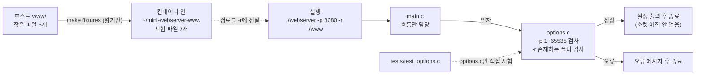

# Step 0. 공통 준비

이 문서는 Step 0의 진행 상태와 요구사항·설계·테스트·구현·검증 기록을 기술하는 것을 목적으로 한다.

| 항목 | 내용 |
| ---- | ---- |
| 상태 | ✅ 완료 (독립 검증 통과) |
| 요구사항 | T-01 |
| 일정 | 11/21 (토) |
| 결정 기록 | [decision.md](./decision.md) |
| 기준 | [DESIGN.md 5장 Step 0](../../../DESIGN.md#5-구현-단계) |

## 진행 체크

- [x] 요구사항 확인
- [x] 선택 기록 → [decision.md](./decision.md)
- [x] 인자 단위 테스트 작성
- [x] Step 0 구현
- [x] 검증

## 1. 요구사항

- `Makefile` 디버그 빌드에 `-fsanitize=address`를 켠다.
- `-p`(1~65535), `-r`(존재하는 디렉터리)를 받고 설정을 출력한 뒤 종료한다. `-c`는 Step 6에서 추가한다.
- 공통 시험 파일 7개를 준비한다: `index.html`, `style.css`, `app.js`, `image.png`, `photo.jpg`, `large.bin`(4 MB), `secret.txt`(권한 000).
  - 호스트 `www/`의 작은 파일 5개를 입력으로 쓰고, 실제 파일 7개는 컨테이너 안에서 `make fixtures`로 만든다.

## 2. 설계 요약

이유와 버린 선택지는 [decision.md](./decision.md)에 있다. 여기에는 무엇을 정했는지만 적는다.

| 주제 | 내용 | 결정 |
| ---- | ---- | ---- |
| 실행 환경 | Ubuntu 24.04 Docker 컨테이너(glibc), 비root `jungle`. 코드는 호스트에서 bind mount | [D-01](./decision.md#d-01-linux-단일-실행-환경) |
| 폴더·모듈 구성 | 서버 코드는 `src/`, 시험은 `tests/`. 인자 검사는 `options.c/h`, 흐름은 `main.c` | [D-02](./decision.md#d-02-step-0-실행-인자와-테스트-구성) |
| 옵션 파싱 | POSIX `getopt`로 `-p`·`-r`·`-h` 처리. 결과는 `options` 구조체와 상태값(`OPTIONS_OK`/`ERROR`/`HELP`) | [D-02](./decision.md#d-02-step-0-실행-인자와-테스트-구성) |
| 반복 호출 | glibc `getopt`가 이전 위치를 기억하므로 호출마다 초기화한다. 회귀 시험이 있다 | [D-02](./decision.md#d-02-step-0-실행-인자와-테스트-구성) |
| 정상 종료 | 설정을 출력하고 종료한다. 소켓은 Step 1에서 `main.c`에 붙인다 | [D-02](./decision.md#d-02-step-0-실행-인자와-테스트-구성) |
| 테스트 | 외부 프레임워크 없이 `tests/test_options.c`, 디버그·테스트 빌드는 ASan | [D-02](./decision.md#d-02-step-0-실행-인자와-테스트-구성) |
| 시험 파일 | 컨테이너 안 `~/mini-webserver-www`에 7개 파일을 준비한다. 경로·크기는 입력으로 받지 않는다 | [D-03](./decision.md#d-03-컨테이너-내부의-전용-시험-파일-폴더) |

문서의 `~`는 컨테이너 안 비root 계정(`jungle`)의 홈 폴더이다.

### 구성도

## 3. 테스트

상태: ⬜ 미실행 · 🟢 통과 · 🔴 실패 · ⛔ 막힘

| TC | 주제 | 종류 | 실행 | 기대 결과 | 상태 |
| -- | ---- | ---- | ---- | --------- | ---- |
| TC-0-01 | Linux 컨테이너에서 빌드 | 수동 | 컨테이너에서 `make` | 빌드 성공, `./webserver` 생성 | 🟢 |
| TC-0-02 | `-p`·`-r` 받고 설정 출력 | 수동 | 컨테이너에서 `./webserver -p 8080 -r ./www` | 설정 출력 후 종료 | 🟢 |

두 TC 모두 최종 판본으로 독립 검증했다. 시험 파일을 쓸 때는 같은 컨테이너에서 `dir=$(make -s fixtures)` 뒤 `./webserver -p 8080 -r "$dir"`로 실행한다. 이 Step은 아직 포트를 열지 않는다.

## 4. 구현 기록

모두 2026-11-23.

| 작업 | 요약 | 결정 |
| ---- | ---- | ---- |
| Linux 개발 환경 구성 | `Dockerfile`, `.dockerignore`, `Makefile` | D-01 |
| 실행 인자 모듈과 단위 테스트 | `src/`, `tests/` (`options.c/h`, `test_options.c`) | D-02 |
| 시험 파일 폴더 준비 | `make fixtures`, 호스트 `www/` 입력 파일 | D-03 |

## 5. 검증 기록

결과: 🟢 **TC-0-01·02 통과**. 환경은 Ubuntu 24.04.5(glibc 2.39, aarch64), 비root `jungle`이다.

| 날짜 | 검증 | 결과 | 확인한 것 |
| ---- | ---- | ---- | --------- |
| 2026-11-23 | TC-0-01·02 최종 판본 독립 실행 | 🟢 통과 | `make`와 `./webserver -p 8080 -r ./www` 모두 exit 0, 실행 파일 생성·설정 출력 |
| 2026-11-23 | 단위 검사 22개·ASan·`getopt` 반복 파싱 | 🟢 통과 (이전 증거 재사용) | 소스·빌드 규칙 해시가 이전 독립 검증과 같아 기존 실행 근거를 썼다. 최종 판본에서 전수 재실행하지는 않았다 |
| 2026-11-23 | `make fixtures` 시험 파일 준비 | 🟢 통과 | 7개 생성, 작은 파일 5개는 원본과 동일, `large.bin` 4194304바이트, `secret.txt` 권한 000. 반복·restart·새 컨테이너에서도 통과 |
| 2026-11-23 | 이전 파일 안전성 반례 | 🟢 해결 | 폴더 링크는 거부, 파일 링크의 외부 대상은 불변, 이전 경로·크기 입력은 무시, 호스트 `www/` 불변 |

- 검증자의 상세 보고서는 로컬 임시 파일이라 저장소에 없다.
- 알려진 한계: Make 변수 `WWW`·`FIXTURE_COPY`를 명령줄로 일부러 바꾸는 경우는 막지 않는다(문서화된 사용법이 아님).

## 6. 막힌 것 / 다음 행동

- 막힌 것 없음. 다음은 Step 1 TCP 에코 서버이다.
- 실제 파일 전송·403 응답은 Step 3, `-c` 라우팅 설정은 Step 6 범위이다.
