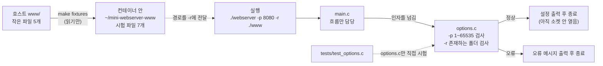

# Step 0. 공통 준비

이 문서는 Step 0의 진행 상태와 요구사항·설계·테스트·구현·검증 기록을 기술하는 것을 목적으로 한다.

| 항목 | 내용 |
| ---- | ---- |
| 상태 | ✅ 완료 (독립 검증 통과) |
| 요구사항 | T-01 |
| 일정 | 11/21 (토) |
| 결정 기록 | [decision.md](./decision.md) |
| 기준 | [DESIGN.md 5장 Step 0](../../../DESIGN.md#5-구현-단계) |

## 진행 체크

- [x] 요구사항 확인
- [x] 선택 기록 → [decision.md](./decision.md)
- [x] 인자 단위 테스트 작성
- [x] Step 0 구현
- [x] 검증

## 1. 요구사항

목표: 빌드와 실행 인자, 공통 테스트 파일을 준비한다.

- `Makefile` 디버그 빌드에 `-fsanitize=address`
- 공통 테스트 파일 7개: `index.html`, `style.css`, `app.js`, `image.png`, `photo.jpg`, `large.bin`(4 MB), `secret.txt`(권한 000). 호스트 `www/`의 작은 파일 5개를 입력으로 쓰며, 실제 시험 파일 7개는 Linux 컨테이너 내부에서 `make fixtures`로 준비한다.
- `-p`(1~65535), `-r`(존재하는 디렉터리)을 받고 설정을 출력한 뒤 종료한다. `-c`는 Step 6에 추가한다.

## 2. 설계 요약

세부 선택과 이유는 [decision.md](./decision.md)에 기술하고, 여기에는 설계의 핵심만 요약한다.

### 설계 포인트

| 포인트 | 내용 | 결정 |
| ------ | ---- | ---- |
| 실행 환경 | Ubuntu 24.04 Docker 컨테이너(glibc), 비root `jungle`. 코드는 호스트에서 bind mount한다. | [D-01](./decision.md#d-01-linux-단일-실행-환경) |
| 폴더 구성 | 서버 코드는 `src/`, 시험 코드는 `tests/`에 둔다. | [D-02](./decision.md#d-02-step-0-실행-인자와-테스트-구성) |
| 옵션 모듈 분리 | 인자 검사는 `options.c/h`, 흐름은 `main.c`가 맡는다. 서버를 띄우지 않고 검사 규칙만 단위 테스트할 수 있다. | D-02 |
| 옵션 파싱 | POSIX `getopt`로 `-p`(1~65535), `-r`(존재하는 디렉터리), `-h`(도움말)를 처리한다. 결과는 `options` 구조체와 상태값(`OPTIONS_OK`/`ERROR`/`HELP`)으로 돌려준다. `-c`는 Step 6에서 추가한다. | D-02 |
| 반복 호출 | glibc `getopt`는 이전 호출의 위치를 기억하므로 호출마다 초기화한다. 틀린 인자 뒤에 올바른 인자를 파싱하는 회귀 테스트가 있다. | D-02 |
| 정상 종료 방식 | 설정을 출력하고 종료한다. 소켓은 Step 1에서 `main.c`에 이어 붙인다. | D-02 |
| 테스트 | 외부 프레임워크 없이 `tests/test_options.c` 하나로 시험하고, 디버그·테스트 빌드는 ASan을 켠다. | D-02 |
| 시험 파일 | 호스트 `www/`의 작은 파일 5개를 입력으로, 컨테이너 안 `~/mini-webserver-www`에 7개 파일을 준비한다. `large.bin`은 4 MB, `secret.txt`는 권한 000이다. 경로·크기는 입력으로 받지 않는다. | [D-03](./decision.md#d-03-컨테이너-내부의-전용-시험-파일-폴더) |

문서의 `~`는 컨테이너 안 비root 계정(`jungle`)의 홈 폴더를 뜻한다.

### 구성도

## 3. 테스트

상태: ⬜ 미실행 · 🟢 통과 · 🔴 실패 · ⛔ 막힘

| TC | 종류 | 실행 | 기대 결과 | 상태 |
| -- | ---- | ---- | --------- | ---- |
| TC-0-01 | 수동 | Linux 컨테이너에서 `make` | 빌드 성공, `./webserver` 생성 | 🟢 (최종 판본 독립 검증) |
| TC-0-02 | 수동 | Linux 컨테이너에서 `./webserver -p 8080 -r ./www` | 포트·루트를 인자로 받아 설정 출력 후 종료 | 🟢 (최종 판본 독립 검증) |

실제 시험용 파일을 쓸 때에는 같은 컨테이너에서 `dir=$(make -s fixtures)`로 경로를 받은 뒤 `./webserver -p 8080 -r "$dir"`로 실행한다. Step 0에서는 아직 포트를 열지 않는다.

## 4. 구현 기록

| 날짜 | 변경 파일 | 내용 |
| ---- | --------- | ---- |
| 2026-11-23 | `Dockerfile`, `.dockerignore`, `Makefile`, `src/`, `tests/`, `www/`, `.gitignore` | Linux 환경·CLI·단위 테스트·전용 시험 파일 폴더 구현. |

## 5. 검증 기록

| 날짜 | TC | 실행 환경 | 결과 | 비고 |
| ---- | -- | --------- | ---- | ---- |
| 2026-11-23 | TC-0-01 `make`, TC-0-02 `./webserver -p 8080 -r ./www` | Ubuntu 24.04.5 / glibc 2.39 / Linux aarch64 / 비root `jungle` | 각각 exit 0, 실행파일 생성·설정 출력 | 최종 판본의 독립 실행. |
| 2026-11-23 | `make test`, `make debug`, getopt 반복 파싱 | 같은 Linux 환경 | 22개 검사 통과·ASan 계측 확인·이전 재파싱 반례 해결 | 소스·빌드 규칙 해시가 이전 독립 검증과 같아 기존 실행 근거를 재사용했다. 최종 판본에서 전수 재실행하지는 않았다. |
| 2026-11-23 | `dir=$(make -s fixtures) && ./webserver -p 8080 -r "$dir"` | 같은 Linux 환경 | exit 0, 7개 파일 생성·CLI 루트 출력 | `dir`은 `~/mini-webserver-www`. 작은 파일 5개는 원본과 바이트 동일, `large.bin` 4194304바이트, `secret.txt` 권한 000·읽기 거부. 반복·restart·새 컨테이너에서도 통과. |
| 2026-11-23 | 이전 파일 안전성 반례 | 일회용 Linux 컨테이너 | 두 결함 해결, Step 0 전체 통과 | 폴더 링크는 거부, 파일 링크의 외부 대상은 불변. 이전 경로·크기 입력은 무시. 호스트 `www/` 불변. 검증자의 상세 보고서는 로컬 임시 파일이라 저장소에 포함하지 않는다. |

## 6. 막힌 것 / 다음 행동

- Step 0 기술 완료. 다음 구현 단위는 Step 1 TCP 에코 서버다.
- 단일 개발자 범위에서 내부 Make 변수 `WWW`·`FIXTURE_COPY`를 명령줄로 의도적으로 바꾸는 경우의 보호는 하지 않는다. 해당 변수 조작은 문서화된 사용법이 아니다.
- 실제 HTTP 파일 전송·403 응답은 Step 3 범위다. `-c` 라우팅 설정은 Step 6에서 추가한다.
