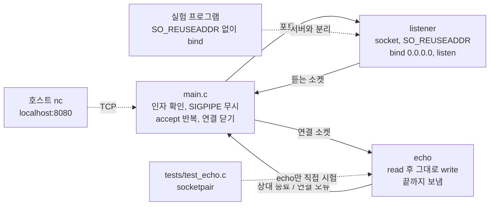

# Step 1. TCP 에코 서버

이 문서는 Step 1의 진행 상태와 요구사항·설계·테스트·구현·검증 기록을 기술하는 것을 목적으로 한다.

| 항목 | 내용 |
| ---- | ---- |
| 상태 | ✅ 완료 (독립 검증 통과) |
| 요구사항 | R-01 |
| 일정 | 11/21 (토) |
| 결정 기록 | [decision.md](./decision.md) |
| 기준 | [DESIGN.md 5장 Step 1](../../../DESIGN.md#5-구현-단계) |

## 진행 체크

- [x] 요구사항 확인
- [x] 설계 작성 → [decision.md](./decision.md)
- [x] 설계 검토 (조건부 통과, 지적 반영)
- [x] 테스트 작성
- [x] 구현
- [x] 검증

## 1. 요구사항

- `read()`가 0이면 `close()`한다.
- 시스템 콜 실패를 처리한다.

### 이 Step의 범위 (사용자 확정, 2026-11-23)

- 접속: 컨테이너를 `-p 127.0.0.1:8080:8080`으로 실행하고 호스트에서 `nc localhost 8080`으로 접속한다. 서버는 컨테이너 안에서 `0.0.0.0`에 연다 (D-04).
- 끊긴 뒤 쓰기: `SIGPIPE`를 무시하고 그 연결만 닫는다 (D-05).
- `SO_REUSEADDR` 비교 주제: 옵션을 뺀 `bind()` 실패를 재현해 기록한다 (D-06).
- 기본값(이의 없이 확정):
  - 한 번에 한 연결씩 순차 처리한다. 동시성은 Step 5이다.
  - 읽은 바이트를 줄 구분 없이 그대로 돌려준다.
  - 시작 실패(`bind` 등)는 오류 메시지 후 종료한다. 연결 하나의 오류는 그 연결만 닫고 서버는 계속 동작한다.
  - `accept`의 일시 오류(`EINTR` 등)는 재시도하고, 부분 `write`는 끝까지 보낸다.
  - `listen` backlog와 버퍼 크기는 일반적인 값으로 정하고 근거를 구현 기록에 남긴다.
  - 로그는 시작 메시지 수준이다. 접근 로그는 Step 7이다.

### DESIGN.md 기준과의 보정

`DESIGN.md`는 공용 문서라 수정하지 않고, 이 Step의 해석을 여기에 기록한다.

- `TC-1-02`의 "서버를 끄고 바로 다시 켜도"는 연결이 살아 있는 상태에서 서버가 먼저 끊어져야 `TIME_WAIT` 또는 `FIN_WAIT_2` 소켓이 남아 재현된다. 그래서 연결을 유지한 채 서버를 종료하고 같은 컨테이너에서 곧바로 재실행하는 조건으로 시험한다. 소켓이 남지 않았으면 실패가 아니라 ⛔(전제 불성립)로 기록한다.
- 서버 종료는 `Ctrl+C` 기본 동작(즉시 종료)을 쓴다. 정상 종료 처리는 Step 7이다.

## 2. 설계 요약

이유와 버린 선택지는 [decision.md](./decision.md)에 있다. 여기에는 무엇을 정했는지만 적는다. 설계 검토(조건부 통과)의 지적은 반영했고, 반영분의 별도 재검토는 하지 않았다(구현 검증에서 TC와 코드로 확인).

| 주제 | 내용 | 결정 |
| ---- | ---- | ---- |
| 모듈 구성 | `listener`(듣는 소켓 준비), `echo`(연결 하나 처리), `main.c`(인자 확인, `accept` 반복, 연결 닫기) | [D-07](./decision.md#d-07-모듈-구성과-accept-실패-처리) |
| `listener` 계약 | 성공하면 듣는 소켓을 돌려주고, 실패하면 자신이 연 소켓을 닫고 -1과 오류 이유를 돌려준다. 메시지는 `main`이 출력한다 | [D-07](./decision.md#d-07-모듈-구성과-accept-실패-처리) |
| `echo` 계약 | 소켓을 닫지 않는다. "상대가 닫음"과 "읽기·쓰기 오류"를 구분해 돌려주고, 오류면 `errno`를 보존한다 | [D-07](./decision.md#d-07-모듈-구성과-accept-실패-처리) |
| 연결 소켓 소유 | `accept`한 `main`만 닫는다 | [D-07](./decision.md#d-07-모듈-구성과-accept-실패-처리) |
| `accept` 실패 | `EINTR`·`ECONNABORTED` 등은 재시도, 그 밖은 메시지 후 종료 | [D-07](./decision.md#d-07-모듈-구성과-accept-실패-처리) |
| 쓰기 실패 | `SIGPIPE`를 무시하고 그 연결만 닫는다 | [D-05](./decision.md#d-05-클라이언트-종료-뒤-쓰기-처리는-step-1에서-최소한으로-한다) |
| 접속 | 컨테이너 `-p 127.0.0.1:8080:8080`, 서버는 `0.0.0.0`에 연다 | [D-04](./decision.md#d-04-포트-공개와-호스트-접속) |
| 시험 | 수동 `nc` 시험 + `echo` 단위 테스트(`socketpair`) | [D-08](./decision.md#d-08-시험-방식과-so_reuseaddr-실험-방식) |
| `SO_REUSEADDR` 실험 | 서버와 분리한 작은 프로그램으로 `bind` 실패를 재현하고 서버 성공과 나란히 기록 | [D-06](./decision.md#d-06-so_reuseaddr-비교-주제는-실험-증거를-남긴다), [D-08](./decision.md#d-08-시험-방식과-so_reuseaddr-실험-방식) |

구현에 맡긴 값: 버퍼 크기, `listen` backlog, 메시지 문구. 읽기·쓰기의 `EINTR`도 재시도한다고 가정한다.

### 구성도

## 3. 테스트

상태: ⬜ 미실행 · 🟢 통과 · 🔴 실패 · ⛔ 막힘

| TC | 주제 | 종류 | 실행 | 기대 결과 | 상태 |
| -- | ---- | ---- | ---- | --------- | ---- |
| TC-1-01 | 입력이 그대로 돌아옴 | 기능 | 호스트에서 `nc localhost 8080` 후 글자 입력 (개행 없는 입력 포함) | 입력한 글자가 그대로 돌아옴 | 🟢 |
| TC-1-02 | 서버 즉시 재시작 시 `bind` 성공 | 기능 | 연결을 유지한 채 서버를 `Ctrl+C`로 종료하고, 같은 컨테이너(`docker exec`)에서 `/proc/net/tcp`의 `:1F90` 항목이 `06`·`05`인지 확인한 뒤 곧바로 재실행 | `bind()` 실패 없음. 소켓이 남지 않았으면 ⛔ | 🟢 |
| TC-1-03 | `SO_REUSEADDR` 없으면 `bind` 실패 | 기능 | TC-1-02와 같은 조건·같은 컨테이너에서 소켓 상태 확인 후 실험 프로그램, 이어서 서버 실행 (소켓은 약 60초 뒤 사라지므로 바로) | 실험은 `EADDRINUSE`로 실패, 서버는 성공. 소켓 상태를 함께 기록 (D-06). 소켓이 남지 않았으면 ⛔ | 🟢 |
| TC-1-04 | 클라이언트 종료 뒤 재접속 | 기능 | `nc`를 끝낸 뒤 새 `nc`로 접속 | 에코 정상, 서버 유지 (`read()==0` 경로는 TC-1-08) | 🟢 |
| TC-1-05 | 같은 포트 두 번째 서버 → 실패 | 기능 | 같은 컨테이너에서 같은 포트로 두 번째 서버 실행 | 오류 메시지 후 0이 아닌 종료 코드 | 🟢 |
| TC-1-06 | 연결 둘은 순차 처리 | 기능 | 첫 연결을 연 채 둘째 `nc` 접속 | 첫 연결이 끝날 때까지 둘째는 대기 (동시성은 Step 5) | 🟢 |
| TC-1-07 | 개행 없는·`0x00` 데이터 에코 | 단위 | 개행 없는 바이트·`0x00` 포함 데이터를 `echo`에 전달 | 그대로 돌아옴 | 🟢 |
| TC-1-08 | 상대 쓰기 종료 → `PEER_CLOSED` | 단위 | 상대가 데이터를 쓰고 `SHUT_WR`로 쓰기 방향만 닫음 | 응답을 읽어 확인, `echo`는 상대 종료로 반환 | 🟢 |
| TC-1-09 | 끊긴 연결 쓰기 → 오류 반환 | 단위 | `SIGPIPE` 무시 상태에서 상대가 데이터를 쓰고 `close()` (D-05) | 연결 오류로 반환, 테스트 프로세스 유지 | 🟢 |
| TC-1-10 | 버퍼보다 큰 입력 에코 | 단위 | 버퍼보다 큰 입력 (`socketpair` 버퍼 범위 안) | 모두 그대로 돌아옴 | 🟢 |

- Step 1부터 서버가 계속 실행되므로 Step 0의 `TC-0-02`("설정 출력 후 종료")는 Step 0 시점의 시험이다. 회귀는 `make test`의 인자 검사 단위 테스트로 확인한다.
- 부분 `write` 처리는 TC로 만들기 어려워 통과로 주장하지 않고 코드 검토 항목으로 남긴다.

## 4. 구현 기록

모두 2026-11-23.

| 작업 | 요약 | 결정 |
| ---- | ---- | ---- |
| 듣는 소켓 모듈 추가(`listener`) | `listener_open`: socket → `SO_REUSEADDR` → bind `0.0.0.0` → listen. backlog는 `SOMAXCONN`(커널이 제한) | D-07 |
| 에코 모듈 추가(`echo`) | `echo_serve`: 상대 종료·오류를 구분해 반환하고 부분 `write`는 끝까지 보냄. 버퍼 4096바이트 | D-07 |
| `main`에 서버 루프 연결 | 인자 확인 → `SIGPIPE` 무시 → `listener_open` → `accept` 순차 반복. 연결 오류는 stderr에 한 줄 남기고 그 연결만 닫음 | D-05, D-07 |
| 단위 테스트 추가 | `tests/test_echo.c`(`socketpair`, TC-1-07~10) | D-08 |
| `SO_REUSEADDR` 실험 프로그램 추가 | `experiments/bind_no_reuse.c`: 옵션 없이 bind만 하고 결과 출력. 서버 소스와 분리 | D-06 |
| 빌드·안내 갱신 | `Makefile`(`make test`에 `test_echo`, `make experiment`), `Dockerfile` 주석의 `docker run` 포트 공개 안내, `options`의 `-r` 문구("Step 3부터 사용") | D-04, D-08 |

## 5. 검증 기록

결과: 🟢 **TC-1-01~10 전부 통과**, 단위 검사 29개 통과(기존 22개 회귀 없음). 환경은 Ubuntu 24.04.5(aarch64) Docker, 호스트 macOS `nc`이다.

| 날짜 | 검증 | 결과 | 확인한 것 |
| ---- | ---- | ---- | --------- |
| 2026-11-23 | 빌드·`make test` | 🟢 통과 | `make`·`make debug`·`make test`·`make experiment` 모두 exit 0, ASan 계측 확인 |
| 2026-11-23 | TC-1-01·04·05·06 | 🟢 통과 | 에코 정상, 재접속 시 서버 유지, 두 번째 서버는 `bind` 오류와 exit 1, 둘째 연결은 첫 연결이 끝날 때까지 대기 |
| 2026-11-23 | TC-1-02 | 🟢 통과 | 연결 유지 중 종료 뒤 `TIME_WAIT`(`06`) 확인, 0.53초 뒤 재실행 성공. `FIN_WAIT_2`는 관측되지 않음 |
| 2026-11-23 | TC-1-03 | 🟢 통과 | 같은 조건에서 실험은 `EADDRINUSE`, 서버는 성공. 소켓이 사라진 뒤(약 59초)는 실험도 성공(대조) |
| 2026-11-23 | TC-1-07~10 | 🟢 통과 | `PEER_CLOSED`와 `ECHO_ERROR`(`EPIPE`)를 구분함. 복사본 변형으로 TC-1-08·09가 서로 다른 경로를 검사함을 확인 |
| 2026-11-23 | 코드 검토·실행 경로 | 🟢 결함 없음 | `accept` 재시도 목록이 D-07과 일치, `EMFILE`이면 메시지 후 exit 1, `listener_open` 반복 실패에도 fd 누수 없음, 연결 fd는 `main`에서만 닫힘, ASan 오류 0건 |

- 검증 근거는 독립 검증자의 로컬 임시 보고서이며 저장소에 없다.
- 알려진 한계:
  - 부분 `write` 루프와 읽기·쓰기·`accept` 도중의 `EINTR` 재시도는 시험으로 재현하지 못했다(코드 검토 항목).
  - 실제 서버에서 `EPIPE` 경로는 재현하지 못했다. 리셋은 `ECONNRESET`으로 끝나 `SIGPIPE`가 나지 않았고, `EPIPE`는 단위 시험과 `SigIgn` 비트로만 확인했다.
  - 읽기 오류 분기는 단위 시험이 없고, 실제 서버에서 리셋으로 실행되는 것만 확인했다.
  - x86_64, Docker Desktop이 아닌 엔진, 오프라인 이미지 빌드는 확인하지 않았다.

## 6. 막힌 것 / 다음 행동

- 막힌 것 없음. 다음은 Step 2이다.
- 사용자 선택이 남은 항목: 연결 오류로 닫을 때 stderr에 `연결 오류로 닫음: <오류>` 한 줄을 남기는 동작은 구현자가 추가했고 기본값(로그는 시작 메시지 수준)에 없다. 유지할지 제거할지 정해야 하며, 검증은 이 동작이 있는 상태에서 통과했다.
- 연결 하나를 열어 두면 다른 클라이언트는 무기한 대기한다(Step 5 범위). 정상 종료·접근 로그는 Step 7 범위이다.
