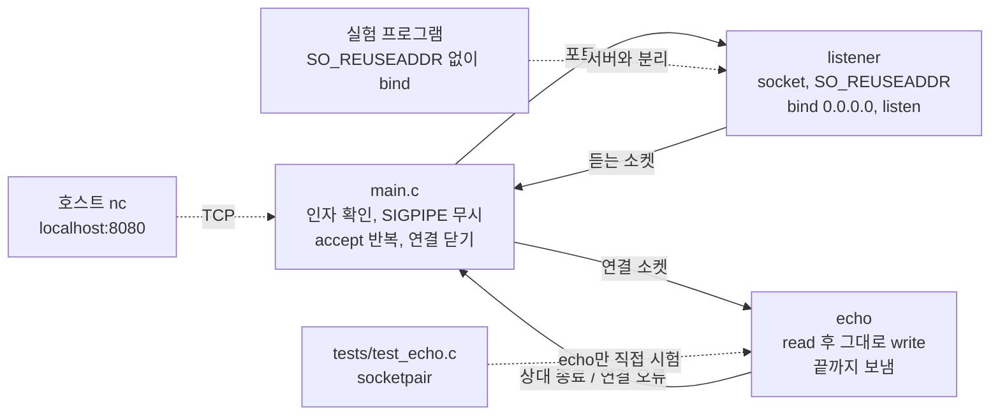

# Step 1. TCP 에코 서버

이 문서는 Step 1의 진행 상태와 요구사항·설계·테스트·구현·검증 기록을 기술하는 것을 목적으로 한다.

| 항목 | 내용 |
| ---- | ---- |
| 상태 | ✅ 완료 (독립 검증 통과) |
| 요구사항 | R-01 |
| 일정 | 11/21 (토) |
| 결정 기록 | [decision.md](./decision.md) |
| 기준 | [DESIGN.md 5장 Step 1](../../../DESIGN.md#5-구현-단계) |

## 진행 체크

- [x] 요구사항 확인
- [x] 설계 작성 → [decision.md](./decision.md)
- [x] 설계 검토 (조건부 통과, 지적 반영)
- [x] 테스트 작성
- [x] 구현
- [x] 검증

## 1. 요구사항

목표: `socket` → `bind` → `listen` → `accept` 흐름으로 받은 데이터를 그대로 돌려준다.

- `read()`가 0이면 `close()`
- 시스템 콜 실패 처리

### 이 Step의 범위 (사용자 확정, 2026-11-23)

- 접속: 컨테이너를 `-p 127.0.0.1:8080:8080`으로 실행하고 호스트에서 `nc localhost 8080`으로 접속한다. 서버는 컨테이너 안에서 `0.0.0.0`에 연다 ([D-04](./decision.md#d-04-포트-공개와-호스트-접속)).
- 클라이언트가 끊긴 뒤 쓰기: `SIGPIPE`를 무시하고 그 연결만 닫는다 ([D-05](./decision.md#d-05-클라이언트-종료-뒤-쓰기-처리는-step-1에서-최소한으로-한다)).
- `SO_REUSEADDR` 비교 주제: 옵션을 뺀 `bind()` 실패를 재현해 기록한다 ([D-06](./decision.md#d-06-so_reuseaddr-비교-주제는-실험-증거를-남긴다)).
- 기본값(이의 없이 확정):
  - 한 번에 한 연결씩 순차 처리한다. 동시성은 Step 5다.
  - 읽은 바이트를 줄 구분 없이 그대로 돌려준다.
  - 시작 실패(`bind` 등)는 오류 메시지 후 종료한다. 연결 하나의 오류는 그 연결만 닫고 서버는 계속 동작한다. `accept`의 일시 오류(`EINTR` 등)는 재시도하고, 부분 `write`는 끝까지 보낸다.
  - `listen` backlog와 버퍼 크기는 일반적인 값으로 정하고 근거를 구현 기록에 남긴다.
  - 로그는 시작 메시지 수준이다. 접근 로그는 Step 7이다.

### DESIGN.md 기준과의 보정

`DESIGN.md`는 공용 문서라 수정하지 않고, 이 Step에서의 해석을 여기에 기록한다.

- `TC-1-02`의 "서버를 끄고 바로 다시 켜도"는 연결이 살아 있는 상태에서 서버가 먼저 끊어져야 `TIME_WAIT` 또는 `FIN_WAIT_2` 소켓이 남아 재현된다. 따라서 연결을 유지한 채 서버를 종료한 뒤 같은 컨테이너에서 곧바로 재실행하는 조건으로 시험한다. 소켓이 남았는지 먼저 확인하고, 남지 않았으면 실패가 아니라 ⛔(전제 불성립)로 기록한다.
- 서버 종료는 `Ctrl+C`의 기본 동작(즉시 종료)을 쓴다. 정상 종료 처리는 Step 7이다.

## 2. 설계 요약

세부 선택과 이유는 [decision.md](./decision.md)에 기술하고, 여기에는 설계의 핵심만 요약한다. 설계 검토 지적을 반영한 판본이다.

설계 검토에서 조건부 통과를 받았고, 지적 사항을 이 문서와 decision.md에 반영했다. 반영분의 별도 설계 재검토는 하지 않았고 구현 검증에서 TC와 코드로 확인했다.

### 설계 포인트

| 포인트 | 내용 | 결정 |
| ------ | ---- | ---- |
| 모듈 구성 | `listener`(듣는 소켓 준비), `echo`(연결 하나 처리), `main.c`(인자 확인, `accept` 반복, 연결 닫기) | [D-07](./decision.md#d-07-모듈-구성과-accept-실패-처리) |
| `listener` 계약 | 성공하면 듣는 소켓을, 실패하면 자신이 연 소켓을 닫고 -1과 오류 이유를 돌려준다. 오류 메시지는 `main`이 출력한다. (Step 0 `options_parse` 방식) | D-07 |
| `echo` 계약 | 연결 소켓을 닫지 않는다. "상대가 닫음"과 "읽기·쓰기 오류"를 구분해 돌려주고, 오류면 `errno`를 보존한다. | D-07 |
| 연결 소켓 소유 | `accept`한 `main`만 닫는다. `echo`는 읽고 쓰기만 한다. | D-07 |
| `accept` 실패 | `EINTR`·`ECONNABORTED` 등은 재시도, 그 밖의 오류는 메시지 후 종료 | D-07 |
| 쓰기 실패 | `SIGPIPE`를 무시하고 그 연결만 닫는다. | [D-05](./decision.md#d-05-클라이언트-종료-뒤-쓰기-처리는-step-1에서-최소한으로-한다) |
| 접속 | 컨테이너 `-p 127.0.0.1:8080:8080`, 서버는 `0.0.0.0`에 연다. | [D-04](./decision.md#d-04-포트-공개와-호스트-접속) |
| 시험 | 수동 `nc` 시험 + `echo` 단위 테스트(`socketpair`) | [D-08](./decision.md#d-08-시험-방식과-so_reuseaddr-실험-방식) |
| `SO_REUSEADDR` 실험 | 서버와 분리한 작은 프로그램으로 `bind` 실패를 재현하고 서버 성공과 나란히 기록 | [D-06](./decision.md#d-06-so_reuseaddr-비교-주제는-실험-증거를-남긴다), D-08 |

구현에 맡기는 값: 버퍼 크기, `listen` backlog(근거는 구현 기록에 남긴다), 메시지 문구. 읽기·쓰기의 `EINTR`도 재시도하는 것을 가정으로 둔다.

### 구성도

## 3. 테스트

상태: ⬜ 미실행 · 🟢 통과 · 🔴 실패 · ⛔ 막힘

| TC | 종류 | 실행 | 기대 결과 | 상태 |
| -- | ---- | ---- | --------- | ---- |
| TC-1-01 | 기능 | 호스트에서 `nc localhost 8080` 후 글자 입력 (개행 없는 입력 포함) | 입력한 글자가 그대로 돌아옴 | 🟢 |
| TC-1-02 | 기능 | `nc`로 연결을 유지한 채 서버를 `Ctrl+C`로 종료. 같은 컨테이너(`docker exec`)에서 `/proc/net/tcp`의 `:1F90` 항목이 `06`(TIME_WAIT) 또는 `05`(FIN_WAIT_2)인지 확인한 뒤 곧바로 재실행 | 소켓 상태 확인 후 `bind()` 실패 없음. 상태가 남지 않았으면 ⛔(전제 불성립) | 🟢 |
| TC-1-03 | 기능 | TC-1-02와 같은 조건·같은 컨테이너에서 소켓 상태 확인 후 실험 프로그램(`SO_REUSEADDR` 없음) 실행, 이어서 서버 실행. 소켓은 약 60초 뒤 사라질 수 있으므로 바로 실행 | 실험은 `EADDRINUSE`로 실패, 서버는 성공. 소켓 상태를 함께 기록 (D-06). 상태가 남지 않았으면 ⛔ | 🟢 |
| TC-1-04 | 기능 | 클라이언트가 `nc`를 끝낸 뒤 새 `nc`로 접속 | 에코가 정상 동작, 서버 유지 (`read()==0` 경로는 TC-1-08이 확인) | 🟢 |
| TC-1-05 | 기능 | 같은 컨테이너(`docker exec`)에서 같은 포트로 두 번째 서버 실행 | 오류 메시지 후 0이 아닌 종료 코드 | 🟢 |
| TC-1-06 | 기능 | 첫 연결을 연 채 둘째 `nc` 접속 | 첫 연결이 끝나기 전까지 둘째는 응답 대기 (순차 처리 기록, 동시성은 Step 5) | 🟢 |
| TC-1-07 | 단위 | 개행 없는 바이트·`0x00` 포함 데이터를 `echo`에 전달 | 그대로 돌아옴 | 🟢 |
| TC-1-08 | 단위 | 상대가 데이터를 쓰고 `SHUT_WR`로 쓰기 방향만 닫음 | 테스트가 응답을 읽어 확인하고, `echo`는 상대 종료로 반환 | 🟢 |
| TC-1-09 | 단위 | `SIGPIPE` 무시 상태에서 상대가 데이터를 쓰고 `close()` (D-05) | 연결 오류로 반환, 테스트 프로세스 유지 | 🟢 |
| TC-1-10 | 단위 | 버퍼보다 큰 입력 (크기는 `socketpair` 버퍼 범위 안에서 구현이 정함) | 모두 그대로 돌아옴 | 🟢 |

위 TC는 설계 검토 지적을 반영한 계획이며, 실행 결과는 「5. 검증 기록」에 있다. Step 1부터 서버가 계속 실행되므로 Step 0의 `TC-0-02`("설정 출력 후 종료")는 Step 0 시점의 시험이다. 회귀는 `make test`의 인자 검사 단위 테스트로 확인한다. 부분 `write` 처리는 TC로 만들기 어려워 통과로 주장하지 않고 구현 코드 검토 항목으로 남긴다.

## 4. 구현 기록

| 날짜 | 변경 파일 | 내용 |
| ---- | --------- | ---- |
| 2026-11-23 | `src/listener.h`, `src/listener.c` (신규) | `listener_open(port, error, size)`: socket → `SO_REUSEADDR` → bind `0.0.0.0:port` → listen. 실패하면 자신이 연 소켓을 닫고 -1, 실패 단계와 `strerror`를 `error`에 쓴다(errno 보존). backlog는 `SOMAXCONN`(glibc 4096): 표준 상수이고 커널이 `net.core.somaxconn`(컨테이너에서 4096)으로 제한하므로 별도 값을 정하지 않았다. |
| 2026-11-23 | `src/echo.h`, `src/echo.c` (신규) | `echo_serve(fd)`: read==0이면 `ECHO_PEER_CLOSED`, 읽기·쓰기 오류면 `ECHO_ERROR`(errno 보존). 부분 write는 끝까지 보내고, read·write의 `EINTR`는 재시도한다. fd는 닫지 않는다. 버퍼 `ECHO_BUFFER_SIZE` 4096 바이트: 일반적인 페이지 크기이고 스택에 둬도 부담이 없다. |
| 2026-11-23 | `src/main.c` | 인자 확인 → `SIGPIPE` 무시(D-05) → `listener_open` → 시작 메시지 → `accept` 순차 반복. 연결 fd는 main만 닫는다. `accept` 실패는 D-07 목록이면 재시도, 그 밖은 메시지 후 종료(exit 1). 시작 실패는 메시지 후 exit 1. 연결 오류는 stderr에 한 줄 남기고 그 연결만 닫는다. 시그널 핸들러는 두지 않는다. |
| 2026-11-23 | `src/options.h`, `src/options.c` | 구조체 주석과 사용법의 `-r` 문구를 "Step 3부터 사용"으로 고쳤다. 파싱 동작은 그대로다. |
| 2026-11-23 | `tests/test_echo.c` (신규) | `socketpair` 기반 TC-1-07~10. 테스트 준비 실패는 `SETUP ERROR`(exit 2)로 제품 실패와 구분한다. TC-1-10 입력 크기는 `4 × ECHO_BUFFER_SIZE + 123` 바이트(socketpair 기본 버퍼 안). `alarm(10)`으로 멈춤을 실패로 만든다. |
| 2026-11-23 | `experiments/bind_no_reuse.c` (신규) | D-06 실험: `SO_REUSEADDR` 없이 `0.0.0.0:8080`에 bind만 하고 성공 또는 errno(`EADDRINUSE` 표시)를 출력하고 끝난다. 서버 소스와 분리했다. |
| 2026-11-23 | `Makefile`, `.gitignore` | 서버 소스·헤더 목록 추가, `make test`가 `test_options`와 `test_echo`를 모두 실행, `make experiment`(빌드만) 추가, `clean`·`help` 갱신. 새 산출물(`tests/test_echo`, `experiments/bind_no_reuse`)을 무시 목록에 추가. |
| 2026-11-23 | `Dockerfile` | 주석의 `docker run`에 `-p 127.0.0.1:8080:8080`과 호스트 접속 안내를 추가했다(D-04). 이미지 내용은 그대로다. |

## 5. 검증 기록

| 날짜 | TC | 실행 환경 | 결과 | 비고 |
| ---- | -- | --------- | ---- | ---- |
| 2026-11-23 | `make clean` 후 `make`, `make debug`, `make test`, `make experiment` | Ubuntu 24.04.5 / glibc 2.39 / GCC 13.3 / Linux 6.12 aarch64 / 비root `jungle` (Docker Desktop) | 모두 exit 0. 단위 검사 29개(`test_options` 22 + `test_echo` 7) 통과, 기존 22개 회귀 없음 | ASan 계측 확인(디버그 서버·테스트 2개). 독립 검증자 실행. |
| 2026-11-23 | TC-1-01, 04, 05, 06 | 같은 환경, 컨테이너 `-p 127.0.0.1:8080:8080`, 호스트 macOS `nc localhost 8080` | 🟢 | 개행 없는 입력·`0x00` 에코, 클라이언트 종료 뒤 새 접속 정상(서버 PID 유지), 두 번째 서버는 `bind` 오류와 exit 1, 첫 연결 중 둘째 연결은 3초간 대기 후 첫 연결이 끝나자 0.001초 뒤 응답. |
| 2026-11-23 | TC-1-02 | 같은 환경, 같은 컨테이너 `docker exec -it`로 `Ctrl+C` | 🟢 | 연결 유지 중 종료(exit 130). 0.4초 안에 서버 쪽 `:8080` 소켓 `06`(TIME_WAIT) 기록, 0.53초 뒤 재실행 성공·새 접속 에코 정상. `05`(FIN_WAIT_2)는 관측되지 않음. |
| 2026-11-23 | TC-1-03 | 같은 환경, TC-1-02와 같은 조건 | 🟢 | 서버 쪽 `:8080` TIME_WAIT 2건 기록. 실험 프로그램(`SO_REUSEADDR` 없음)은 `errno=98 (EADDRINUSE)`, exit 1. 이어 0.55초 시점에 서버는 시작 성공. 소켓이 모두 사라진 뒤(약 59초) 같은 실험은 `bind 성공`, exit 0(대조). |
| 2026-11-23 | TC-1-07~10 | 같은 환경 (`make test`의 `test_echo`) | 🟢 | `ECHO_PEER_CLOSED`/`ECHO_ERROR`(`EPIPE`) 구분 확인. 검증용 복사본으로 `echo.c`를 고쳐 TC-1-08(EOF 경로)과 TC-1-09(쓰기 실패 경로)가 서로 다른 경로를 검사함을 확인했고, 원본은 변경하지 않았다. 16507바이트 입력도 그대로 에코. |
| 2026-11-23 | 코드 검토·실행 경로 | 같은 환경 | 결함 없음 | `accept` 재시도 목록이 D-07과 일치, `ulimit -n 4`로 `EMFILE`을 일으키면 메시지 후 exit 1. 포트 점유 상태에서 `listener_open` 50회 연속 실패해도 열린 fd 수 4→4. 연결 fd는 `main.c`에서만 닫힘. 실행 중 서버의 `SigIgn`에 `SIGPIPE` 포함, 연결 리셋 2가지 상황에서 그 연결만 닫히고 다음 연결은 정상. ASan 서버 오류 0건. |

검증 근거는 독립 검증자의 로컬 임시 보고서(`~/.hermes/profiles/mavuika/cache/scratch/webserver-step1-review-xqshhue8/report.md`)이며 저장소에 포함하지 않는다.

시험으로 확인하지 못한 한계:

- 부분 `write` 루프와 읽기·쓰기·`accept` 도중의 `EINTR` 재시도는 시험으로 재현하지 못했다. 코드 검토 항목이다. TC-1-10은 부분 `write`를 만들지 못한다.
- 실제 서버에서 `EPIPE` 경로는 재현하지 못했다. Linux TCP는 상대가 리셋하면 `ECONNRESET`으로 끝나고 `SIGPIPE`가 나지 않았다. `EPIPE`는 단위 시험과 `SigIgn` 비트로만 확인했다.
- 읽기 오류 분기는 단위 시험이 없고, 실제 서버에서 리셋으로 실행되는 것만 확인했다.
- x86_64와 Docker Desktop이 아닌 엔진, 이미지를 오프라인으로 처음부터 빌드하는 경우는 확인하지 않았다.

## 6. 막힌 것 / 다음 행동

- Step 1 기술 범위 완료. 다음 구현 단위는 Step 2다.
- 미확정 항목: 연결 오류로 닫을 때 stderr에 `연결 오류로 닫음: <오류>` 한 줄을 남기는 동작은 구현자가 추가했고 위 기본값(로그는 시작 메시지 수준)에 없는 동작이다. 유지할지 제거할지 사용자 선택이 남아 있다. 검증은 이 동작이 있는 상태에서 통과했다.
- 서버가 연결 하나를 열어 두면 다른 클라이언트는 무기한 대기한다(Step 5 범위). 정상 종료·접근 로그는 Step 7 범위다.
