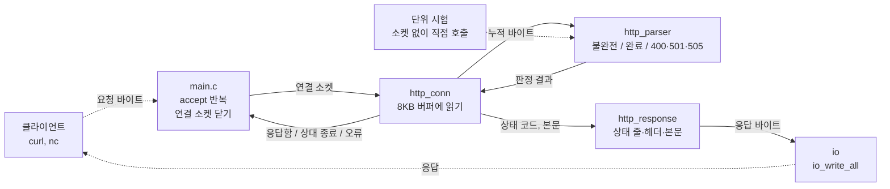

# Step 2. HTTP 요청 파싱 + 고정 응답

이 문서는 Step 2의 진행 상태와 요구사항·설계·테스트·구현·검증 기록을 기술하는 것을 목적으로 한다.

| 항목 | 내용 |
| ---- | ---- |
| 상태 | 🟦 진행 중 (구현·자체 시험 완료, 독립 검증 전) |
| 요구사항 | R-02, R-03, Q-03 |
| 일정 | 11/23 (월) |
| 결정 기록 | [decision.md](./decision.md) |
| 기준 | [DESIGN.md 5장 Step 2](../../../DESIGN.md#5-구현-단계) |

## 진행 체크

- [x] 요구사항 확인
- [x] 설계 → [decision.md](./decision.md) (D-14~D-23 채택, 설계 검토 통과)
- [x] 테스트 작성
- [x] 구현
- [x] 검증

## 1. 요구사항

목표: 요청 라인과 헤더를 파싱하고 고정 응답을 HTTP 형식으로 보낸다.

- 연결별 버퍼에 `\r\n\r\n`까지 쌓기
- 응답 생성 함수 하나, `Content-Length` 일치, 부분 `write()` 처리
- 파서는 분리된 모듈

## 2. 설계 요약

세부 선택과 이유는 [decision.md](./decision.md)에 기술하고, 여기에는 설계의 핵심만 요약한다. 설계 검토(재검토 포함)를 통과했고 D-14~D-23은 모두 채택됐다. 구현은 독립 검증을 통과했다. 구현과 자체 시험은 마쳤고 독립 검증은 아직이다.

### 설계 포인트

| 포인트 | 내용 | 결정 |
| ------ | ---- | ---- |
| 모듈 구성 | `http_parser`(판정), `http_response`(응답 쓰기), `http_conn`(연결 하나 처리), `io`(`io_write_all` 공유). `main.c`는 `echo` 대신 `http_conn`을 부른다 | D-14 |
| 연결 소켓 소유 | `accept`한 `main`만 닫는다. 나머지 모듈은 닫지 않는다 | D-14 (D-07 유지) |
| 버퍼 | 연결마다 8KB 고정 버퍼, 종료 빈 줄 포함 8KB 초과 시 400 | D-10, D-11 |
| 파서 | 누적 바이트 전체를 매번 다시 판정하는 상태 없는 함수. 결과는 불완전/완료/400/501/505 | D-15 |
| 파싱 결과 | 구조체 안 저장 공간에 값 복사, 헤더 목록은 이름(대소문자 무시)으로 조회 | D-12, D-15 |
| 판정 순서 | 줄 바꿈·NUL(400, 머리 완성 전에도 즉시) → 요청 줄(400) → 버전 형식(400) → 버전 종류(505) → 메서드(501) → 헤더 문법·개수·`Host`(400) | D-13, D-16, D-22 |
| 헤더 수 | 100개까지, 초과 시 400 | D-17 |
| 응답 | 함수 하나가 상태 줄·`Date`·`Content-Type`·`Content-Length`·`Connection: close`를 만들고 끝까지 쓴다 | D-18 |
| 실패 동작 | 머리 전 상대 종료는 응답 없이 닫기, 읽기·쓰기 오류는 그 연결만 닫기 | D-19 |
| 시험 | 파서 단위 시험(TC-2-04 구체화) + 응답·연결 단위 시험과 기능 TC 제안 | D-20 |
| 응답 후 닫는 방식 | 응답 뒤 남은 입력을 읽지 않고 바로 닫는다. 요청을 계속 보내는 중이면 클라이언트가 응답 대신 연결 재설정을 볼 수 있다 | D-21 |

### 구성도

## 3. 테스트

상태: ⬜ 미실행 · 🟢 통과 · 🔴 실패 · ⛔ 막힘. 🟢는 독립 검증자가 직접 실행해 통과를 확인한 것이다(2026-11-23).

| TC | 종류 | 실행 | 기대 결과 | 상태 |
| -- | ---- | ---- | --------- | ---- |
| TC-2-01 | 기능 | `curl -v http://localhost:8080/` | `200 OK` | 🟢 |
| TC-2-02 | 기능 | `(printf 'GET / HTTP/1.1\r\n'; sleep 1; printf 'Host: x\r\n\r\n') \| nc localhost 8080` | 나뉘어 온 요청도 응답 | 🟢 |
| TC-2-03 | 기능 | `printf 'BREW / HTTP/1.1\r\nHost: x\r\n\r\n' \| nc localhost 8080` | 501 | 🟢 |
| TC-2-04 | 단위 | `make test` 중 `./tests/test_http_parser` (D-20 표 전 항목) | 잘못된 요청 400, 지원하지 않는 버전 505, 버전 형식 오류 400, 분할·8KB·헤더 수 경계, 복사 | 🟢 |
| TC-2-05 | 단위 | `make test` 중 `./tests/test_http_response` (`socketpair`, 200·400·501·505·빈 본문·지원하지 않는 상태·상대 닫힘) | 상태 줄, `Content-Length` = 실제 본문 길이, `Connection: close`, `Date` 형식. 지원하지 않는 상태는 -1(`EINVAL`)이고 아무것도 쓰지 않음 | 🟢 |
| TC-2-06 | 단위 | `./tests/test_http_response`의 4MB 본문 (자식 프로세스가 보내고 부모가 읽음) | 전 바이트 도착. 이어 쓰기 분기 실행은 주장하지 않는다(코드 검토 항목, D-23) | 🟢 |
| TC-2-07 | 단위 | `make test` 중 `./tests/test_http_conn` (`socketpair`로 나눠 쓰기 / 머리 도중 `SHUT_WR`) | 200 응답 / 응답 없이 `PEER_CLOSED` | 🟢 |
| TC-2-08 | 기능 | `head -c 8192 /dev/zero \| tr '\0' a \| nc localhost 8080` | 400 (정확히 8192바이트, 0바이트 `read` 없음) | 🟢 |
| TC-2-09 | 기능 | `curl --http1.0 -v http://localhost:8080/` | 200 | 🟢 |
| TC-2-10 | 기능 | `printf 'GET / HTTP/1.1\r\n\r\n' \| nc localhost 8080`, `printf 'GET / HTTP/2.0\r\nHost: x\r\n\r\n' \| nc localhost 8080` | 400, 505 | 🟢 |
| TC-2-11 | 기능 | 머리 도중(`GET / HTTP/1.1\r\nHo`) `nc`를 끊은 뒤 `curl` | 서버 유지, 200 | 🟢 |

- `test_http_conn`에는 TC-2-07 외에 D-19 보조 검사(판정 결과별 200·400·501·505, `POST` 본문을 읽지 않고 200, 종료 없이 8192바이트면 0바이트 `read` 없이 400, 응답 쓰기 실패 시 `ERROR`·`EPIPE`)가 함께 들어 있다.
- 부분 `write` 이어 쓰기 분기와 `read`·`write`의 `EINTR` 재시도는 시험으로 실행하지 못한다. 코드 검토 항목이다(D-23).
- 서버가 더 이상 에코하지 않으므로 TC-1-01~06은 Step 1 시점의 시험이다. `echo` 모듈 회귀는 `make test`의 `test_echo`(TC-1-07~10)로 확인한다(D-14).

## 4. 구현 기록

| 날짜 | 변경 파일 | 내용 |
| ---- | --------- | ---- |
| 2026-11-23 | `src/io.h`, `src/io.c` (신규), `src/echo.c` | `echo.c`의 정적 `write_all`을 `io_write_all(fd, const void *, len)`으로 옮겼다. 포인터 산술은 `const unsigned char *`로 바꿔서 한다. `echo` 동작은 그대로다. |
| 2026-11-23 | `src/http_parser.h`, `src/http_parser.c` (신규) | D-15 인터페이스·상수(8192, 헤더 100). 종료 빈 줄은 판정 범위 `min(len, 8192)` 안에서 길이 기반으로 찾는다(NUL에서 멈추지 않음). 줄 바꿈·NUL 검사(D-22) → 요청 줄 → 버전 형식(400) → 버전 종류(505) → 메서드(501) → 헤더 문법 → 헤더 수 → `Host` 순으로 판정한다(D-16). 101번째 헤더는 배열에 쓰기 전에 거절한다. 복사본은 머리 안의 바이트만 `storage`에 NUL로 끝나게 쓴다. 이름 비교는 `strcasecmp`. |
| 2026-11-23 | `src/http_response.h`, `src/http_response.c` (신규) | `http_response_send`: 200·400·501·505만 지원(그 밖은 쓰지 않고 -1·`EINVAL`). 머리는 512바이트 고정 버퍼에 `snprintf`로 만들고(넘치면 -1·`EINVAL`), 머리와 본문을 `io_write_all`로 차례로 쓴다. `Date`는 `gmtime_r` + `strftime`(서버가 `setlocale`을 부르지 않아 C 로캘). |
| 2026-11-23 | `src/http_conn.h`, `src/http_conn.c` (신규) | `http_conn_serve`: 8KB 버퍼와 `http_request`를 스택에 둔다. `read` → 매번 전체 다시 파싱 → `INCOMPLETE`가 아니면 결과별 고정 응답 하나를 보내고 돌아간다. `EINTR` 재시도, 머리 전 `read == 0`은 `PEER_CLOSED`, 읽기·쓰기 오류는 `ERROR`. 본문(D-18 제안): 200은 `Hello from mini-webserver\n`, 오류는 `<코드> <이유 문구>\n`, 모두 `text/plain; charset=utf-8`. |
| 2026-11-23 | `src/main.c` | `echo_serve` 대신 `http_conn_serve`를 부르고, `HTTP_CONN_ERROR`면 stderr 한 줄 후 그 연결만 닫는다. 시작 문구를 "HTTP 서버 시작"으로 바꿨다. `accept`·`SIGPIPE`·fd 닫기는 그대로다. |
| 2026-11-23 | `tests/test_http_parser.c`, `tests/test_http_response.c`, `tests/test_http_conn.c` (신규) | TC-2-04(64검사), TC-2-05·06(51검사), TC-2-07과 D-19 보조(12검사). 외부 프레임워크 없이 ASan 빌드, 소켓 시험은 `alarm(10)`과 `SIGPIPE` 무시. 준비 실패는 `SETUP ERROR`(exit 2). |
| 2026-11-23 | `Makefile`, `.gitignore` | 서버 소스·헤더 목록을 HTTP 모듈로 바꾸고 `echo.c`는 뺐다. `test_echo`에 `src/io.c`를 더했다. 시험 실행 파일 3개를 `make test`·`clean`·`help`와 무시 목록에 추가했다. |

### 자체 시험 기록 (구현자 실행)

환경: Ubuntu 24.04.5 / GCC 13.3.0 / Linux 6.12.76-linuxkit aarch64 / 비root `jungle`, `mini-webserver-dev` 이미지로 만든 임시 컨테이너(`-p 127.0.0.1:8080:8080`, 시험 후 삭제). 기능 시험은 호스트 macOS의 `curl` 8.7.1·`nc`로 실행했다.

| TC | 명령 | 결과 |
| -- | ---- | ---- |
| RED (TC-2-04) | 결과를 항상 `INCOMPLETE`로 돌려주는 스텁으로 `./tests/test_http_parser` | 44건 실패, exit 1 |
| RED (TC-2-05·06) | 항상 -1을 돌려주는 스텁으로 `./tests/test_http_response` | 14건 실패, exit 1 |
| RED (TC-2-07) | 항상 `ERROR`를 돌려주는 스텁으로 `./tests/test_http_conn` | 11건 실패, exit 1 |
| GREEN 전 시험 결함 2건 | `test_http_response`의 `Date` 검사 패턴이 소문자를 문자 그대로 비교해 정상 응답을 거절했다(응답 바이트를 직접 확인 후 패턴만 수정). `test_http_conn`은 서버가 먼저 닫으면 `SETUP ERROR`로 끝나 제품 실패를 준비 실패로 분류했다(쓰기 실패·`ECONNRESET`을 제품 실패로 기록하도록 수정) | 수정 후 재실행 |
| GREEN | `make clean && make && make debug && make test && make experiment` | exit 0, 경고 0. 검사 156개 통과(`test_options` 22, `test_echo` 7, `test_http_parser` 64, `test_http_response` 51, `test_http_conn` 12) |
| 시험 유효성 확인 | 컨테이너 `/tmp` 복사본에서 `Date` 형식을 `%A`로 바꾼 변이 / 파서가 `len == 8192`에서도 `INCOMPLETE`를 돌려주는 변이 | `Date` 형식 검사 6건 실패 / `test_http_conn`의 8192바이트 검사만 `PEER_CLOSED`로 실패. 원본은 바꾸지 않았다 |
| TC-2-01 | `curl -sS -v http://localhost:8080/` | `HTTP/1.1 200 OK`, `Content-Length: 26`, `Connection: close`, `Date` 포함 |
| TC-2-02 | `(printf 'GET / HTTP/1.1\r\n'; sleep 1; printf 'Host: x\r\n\r\n') \| nc -w 5 localhost 8080` | 200 |
| TC-2-03 | `printf 'BREW / HTTP/1.1\r\nHost: x\r\n\r\n' \| nc -w 5 localhost 8080` | 501 |
| TC-2-08 | `head -c 8192 /dev/zero \| tr '\0' a \| nc -w 5 localhost 8080` | 400 응답 수신 |
| TC-2-09 | `curl -sS --http1.0 -v http://localhost:8080/` | 요청 `GET / HTTP/1.0`, 응답 200 |
| TC-2-10 | 위 두 `printf \| nc -w 5` | 400, 505 |
| TC-2-11 | Python `subprocess`로 `nc localhost 8080`에 `GET / HTTP/1.1\r\nHo`만 쓰고(stdin 열어 둠) 1초 뒤 `nc` 강제 종료, 0.5초 뒤 `curl -sS -i` | `nc`가 받은 바이트 0, 이어 `curl` 200, 서버 PID 전후 같음(471) |

- 기능 시험의 서버는 ASan 빌드(`./webserver-debug -p 8080 -r /workspace/www`)였고, 시험 뒤 `SIGINT`로 끝낼 때까지 stderr는 비어 있었다(ASan 오류·연결 오류 로그 없음).
- 실행하지 않은 것: x86_64, 부분 `write`·`EINTR` 분기 실행(코드 검토 항목), `read` 오류(`ECONNRESET`) 경로의 시험.

## 5. 검증 기록

| 날짜 | TC | 실행 환경 | 결과 | 비고 |
| ---- | -- | --------- | ---- | ---- |
| 2026-11-23 | `make clean` 후 `make`, `make debug`, `make test`, `make experiment` | Ubuntu 24.04.5 / GCC 13.3.0 / Linux 6.12.76-linuxkit aarch64 / 비root `jungle` (Docker Desktop 임시 컨테이너, 작업 트리 복사본으로 시험) | 모두 exit 0, 경고 0. 단위 검사 156개(`test_options` 22, `test_echo` 7, `test_http_parser` 64, `test_http_response` 51, `test_http_conn` 12) 통과, 실패 0 | 독립 검증자 실행. 구현자 기록과 개수 일치. `test_echo` 회귀(TC-1-07~10) 포함 |
| 2026-11-23 | TC-2-01~03, 08~11 | 같은 환경, 컨테이너 `-p 127.0.0.1:8080:8080`, ASan 빌드 서버, 호스트 macOS `curl` 8.7.1·`nc` | 🟢 | 200(`Content-Length` 26 = 본문 26바이트, `Connection: close`, `Date` 포함), 분할 200, 501, 8192바이트 400, HTTP/1.0 200, 400·505, 머리 도중 끊김 뒤 서버 PID 유지·200. 시험 뒤 서버 stderr 0바이트 |
| 2026-11-23 | TC-2-04~07 | 같은 환경 (`make test`) | 🟢 | 개수 재현만 했고 항목별 기대값 전수 검토는 하지 않았다. 대신 D-15·16·17·22를 따로 구현한 참조 모델과 C 파서를 30만 건 비교해 불일치 0건. `storage` 경계 손상 0, 최대 사용 8187바이트 |
| 2026-11-23 | 구현 검증 항목 7개 | 같은 환경, `LD_PRELOAD` read 기록 shim 병행 | 확인 | 길이 기반 종료 빈 줄 검색, 101번째 헤더는 쓰기 전 거절, `INCOMPLETE`는 `len < 8192`에서만(0바이트 `read` 없음), `gmtime_r`+C 로캘 `strftime`, 포인터 변환·`-Wpedantic` 경고 0, D-16·D-22 순서 일치. 맨 `\n` 요청은 첫 `read`(15바이트)에서 바로 400 |

- 확인하지 못한 것: `EINTR` 재시도와 부분 `write` 이어 쓰기(코드 검토만), `read` 오류(`ECONNRESET`) 경로 실행, x86_64.
- 증거 위치(임시): `~/.hermes/profiles/mavuika/cache/scratch/mws2-192451/probe/`.

## 6. 막힌 것 / 다음 행동

- 막힌 것 없음. 독립 검증 차단·조건부 지적 없음.
- 비차단 참고(선택 시 고칠 것):
  - `http_response.c`의 시간 함수 실패 분기가 `errno`를 설정하지 않는다(64바이트 버퍼라 사실상 일어나지 않음).
  - 헤더 배열 초과 쓰기는 구조체 안쪽이라 ASan이 직접 잡지 못한다. 근거는 코드 검토, 101개 시험, 변이 시험이다.
  - TC-2-07 분할 시험은 `read`가 두 번 이상이었는지 확인하지 않는다(TC-2-02 shim 관찰로 보완).
- 다음: Step 3 정적 파일 서빙.
