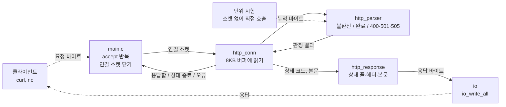

# Step 2. HTTP 요청 파싱 + 고정 응답

이 문서는 Step 2의 진행 상태와 요구사항·설계·테스트·구현·검증 기록을 기술하는 것을 목적으로 한다.

| 항목 | 내용 |
| ---- | ---- |
| 상태 | ✅ 완료 |
| 요구사항 | R-02, R-03, Q-03 |
| 일정 | 11/23 (월) |
| 결정 기록 | [decision.md](./decision.md) |
| 기준 | [DESIGN.md 5장 Step 2](../../../DESIGN.md#5-구현-단계) |

## 진행 체크

- [x] 요구사항 확인
- [x] 설계 → [decision.md](./decision.md) (D-09~D-20 채택, 설계 검토 통과)
- [x] 테스트 작성
- [x] 구현
- [x] 검증

## 1. 요구사항

- 연결별 버퍼에 `\r\n\r\n`까지 쌓는다.
- 응답 생성 함수 하나로 `Content-Length`를 맞추고, 부분 `write()`를 처리한다.
- 파서는 분리된 모듈로 둔다.

## 2. 설계 요약

이유와 버린 선택지는 [decision.md](./decision.md)에 있다. 여기에는 무엇을 정했는지만 적는다.

| 주제 | 내용 | 결정 |
| ---- | ---- | ---- |
| 모듈 구성 | `http_parser`(판정), `http_response`(응답 쓰기), `http_conn`(연결 하나 처리), `io`(`io_write_all` 공유). `main.c`는 `echo` 대신 `http_conn`을 부른다 | D-13 |
| 연결 소켓 소유 | `accept`한 `main`만 닫는다 | D-13 (D-07 유지) |
| 버퍼 | 연결마다 8KB 고정, 종료 빈 줄 포함 8KB 초과 시 400 | D-09, D-10 |
| 파서 | 누적 바이트 전체를 매번 다시 판정하는 상태 없는 함수. 결과는 불완전/완료/400/501/505 | D-14 |
| 파싱 결과 | 값을 복사해 담고, 헤더는 이름(대소문자 무시)으로 조회 | D-11, D-14 |
| 판정 순서 | 줄 바꿈·NUL(400, 머리 완성 전에도 즉시) → 요청 줄(400) → 버전 형식(400) → 버전 종류(505) → 메서드(501) → 헤더 문법·개수·`Host`(400) | D-12, D-15, D-19 |
| 헤더 수 | 100개까지, 초과 시 400 | D-15 |
| 응답 | 함수 하나가 상태 줄·`Date`·`Content-Type`·`Content-Length`·`Connection: close`를 만들고 끝까지 쓴다. Step 4에서 `Connection`은 유지 여부에 따라 바뀜([D-51](../step-4-post-keepalive/decision.md)) | D-16 |
| 실패 동작 | 머리 전 상대 종료는 응답 없이 닫기, 읽기·쓰기 오류는 그 연결만 닫기 | D-17 |
| 응답 뒤 닫기 | 남은 입력을 읽지 않고 바로 닫는다. 요청을 보내는 중이면 클라이언트가 연결 재설정을 볼 수 있다 | D-18 |
| 부분 `write` | 이어 쓰기 분기는 코드 검토, 시험은 전 바이트 도착만 확인 | D-20 |

### 구성도

## 3. 테스트

상태: ⬜ 미실행 · 🟢 통과 · 🔴 실패 · ⛔ 막힘. 🟢는 독립 검증자가 직접 실행해 통과를 확인한 것이다(2026-11-23).

| TC | 주제 | 종류 | 실행 | 기대 결과 | 상태 |
| -- | ---- | ---- | ---- | --------- | ---- |
| TC-2-01 | 기본 요청 → 200 | 기능 | `curl -v http://localhost:8080/` | `200 OK` | 🟢 |
| TC-2-02 | 나뉘어 온 요청도 응답 | 기능 | `(printf 'GET / HTTP/1.1\r\n'; sleep 1; printf 'Host: x\r\n\r\n') \| nc localhost 8080` | 200 응답 | 🟢 |
| TC-2-03 | 모르는 메서드 → 501 | 기능 | `printf 'BREW / HTTP/1.1\r\nHost: x\r\n\r\n' \| nc localhost 8080` | 501 | 🟢 |
| TC-2-04 | 파서 판정 규칙 전 항목 | 단위 | `./tests/test_http_parser` (D-15 전 항목) | 잘못된 요청 400, 지원하지 않는 버전 505, 버전 형식 오류 400, 분할·8KB·헤더 수 경계, 복사 | 🟢 |
| TC-2-05 | 응답 형식·`Content-Length` | 단위 | `./tests/test_http_response` (`socketpair`) | 상태 줄, `Content-Length` = 본문 길이, `Connection: close`, `Date` 형식. 지원하지 않는 상태는 -1(`EINVAL`)이고 아무것도 쓰지 않음 | 🟢 |
| TC-2-06 | 4MB 본문 전 바이트 도착 | 단위 | `./tests/test_http_response`의 4MB 본문 | 전 바이트 도착. 이어 쓰기 분기는 코드 검토 항목 (D-20) | 🟢 |
| TC-2-07 | 연결 처리: 나눠 쓰기·머리 도중 닫기 | 단위 | `./tests/test_http_conn` (`socketpair`) | 200 응답 / 응답 없이 `PEER_CLOSED` | 🟢 |
| TC-2-08 | 8192바이트 요청 → 400 | 기능 | `head -c 8192 /dev/zero \| tr '\0' a \| nc localhost 8080` | 400 (정확히 8192바이트, 0바이트 `read` 없음) | 🟢 |
| TC-2-09 | HTTP/1.0 요청 → 200 | 기능 | `curl --http1.0 -v http://localhost:8080/` | 200 | 🟢 |
| TC-2-10 | `Host` 없음 → 400, 버전 2.0 → 505 | 기능 | `printf 'GET / HTTP/1.1\r\n\r\n' \| nc localhost 8080`, `printf 'GET / HTTP/2.0\r\nHost: x\r\n\r\n' \| nc localhost 8080` | 400, 505 | 🟢 |
| TC-2-11 | 머리 도중 끊어도 서버 유지 | 기능 | 머리 도중(`GET / HTTP/1.1\r\nHo`) `nc`를 끊은 뒤 `curl` | 서버 유지, 200 | 🟢 |

- `test_http_conn`에는 TC-2-07 외에 보조 검사가 있다: 판정 결과별 200·400·501·505, `POST` 본문을 읽지 않고 200, 종료 없이 8192바이트면 0바이트 `read` 없이 400, 쓰기 실패 시 `ERROR`·`EPIPE` (D-17).
- 서버가 더 이상 에코하지 않으므로 TC-1-01~06은 Step 1 시점의 시험이다. `echo` 회귀는 `make test`의 `test_echo`(TC-1-07~10)로 확인한다 (D-13).

## 4. 구현 기록

모두 2026-11-23.

| 작업 | 요약 | 결정 |
| ---- | ---- | ---- |
| 공통 쓰기 함수 분리(`io`) | `echo.c`의 `write_all`을 `io_write_all`로 옮김. `echo` 동작은 그대로 | D-13 |
| HTTP 파서 모듈 추가(`http_parser`) | 상태 없는 판정 함수. 판정 범위는 처음 8192바이트, 헤더는 100개까지 | D-14, D-15, D-19 |
| 응답 모듈 추가(`http_response`) | 200·400·501·505 지원, `Date`·`Content-Length` 자동 생성 | D-16 |
| 연결 처리 모듈 추가(`http_conn`) | 읽기 → 전체 재판정 → 결과별 고정 응답 → 반환. 머리 전 상대 종료는 응답 없음 | D-17 |
| `main`을 HTTP 서버로 전환 | `echo_serve` 대신 `http_conn_serve`를 호출. `accept`·`SIGPIPE`·fd 닫기는 그대로 | D-13 |
| 단위 테스트 3개 추가 | `test_http_parser`(64검사), `test_http_response`(51), `test_http_conn`(12). 스텁으로 실패를 확인한 뒤 구현 | D-14 |
| 빌드 갱신 | `Makefile`에서 서버 소스를 HTTP 모듈로 교체(`echo.c` 제외), 시험 3개를 `make test`에 추가 | D-13 |

자체 시험(구현자): `make test` 단위 검사 156개 통과, 기능 TC-2-01~03·08~11 확인, 서버 stderr는 비어 있었다. 시험 유효성 변이 2건(`Date` 형식 변경, 파서의 `len == 8192` 처리 변경)은 시험이 잡았다. 시험 코드 결함 2건(`Date` 패턴, `test_http_conn`의 쓰기 실패 분류)은 고쳐 재실행했다.

## 5. 검증 기록

결과: 🟢 **TC-2-01~11 전부 통과**, 단위 검사 156개 통과(`test_echo` 회귀 포함). 환경은 Ubuntu 24.04.5(aarch64) Docker, ASan 서버, 호스트 macOS `curl`·`nc`이다.

| 날짜 | 검증 | 결과 | 확인한 것 |
| ---- | ---- | ---- | --------- |
| 2026-11-23 | 빌드·`make test` | 🟢 통과 | `make`·`make debug`·`make test`·`make experiment` exit 0, 경고 0, 156개 통과, 구현자 기록과 개수 일치 |
| 2026-11-23 | TC-2-01~03·08~11 | 🟢 통과 | 200, 분할 요청 200, 501, 8192바이트 400, HTTP/1.0 200, 400·505, 머리 도중 끊김 뒤 서버 유지, 서버 stderr 비어 있음 |
| 2026-11-23 | TC-2-04~07 | 🟢 통과 | 항목별 기대값 전수 검토는 하지 않았다. 대신 참조 모델과 C 파서를 30만 건 비교해 불일치 0건 |
| 2026-11-23 | 구현 검증 항목 | 🟢 확인 | 길이 기반 종료 빈 줄 검색, 101번째 헤더는 쓰기 전 거절, `INCOMPLETE`는 `len < 8192`에서만, 경고 0, 판정 순서가 D-15·D-19와 일치 |

- 알려진 한계:
  - `EINTR` 재시도와 부분 `write` 이어 쓰기는 코드 검토만 했다.
  - `read` 오류(`ECONNRESET`) 경로 실행과 x86_64는 확인하지 않았다.
  - 증거 위치(임시): 검증자의 로컬 scratch 폴더(저장소에 없음).
- 비차단 참고(선택 시 고칠 것):
  - `http_response.c`의 시간 함수 실패 분기가 `errno`를 설정하지 않는다(64바이트 버퍼라 사실상 일어나지 않음).
  - 헤더 배열 초과 쓰기는 구조체 안쪽이라 ASan이 직접 잡지 못한다. 근거는 코드 검토, 101개 시험, 변이 시험이다.
  - TC-2-07 분할 시험은 `read`가 두 번 이상이었는지 확인하지 않는다(TC-2-02 관찰로 보완).

## 6. 막힌 것 / 다음 행동

- 막힌 것 없음. 독립 검증의 차단·조건부 지적 없음.
- 다음은 Step 3 정적 파일 서빙이다.
