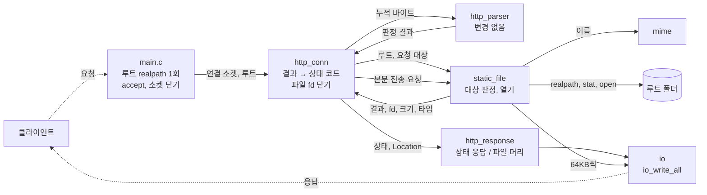
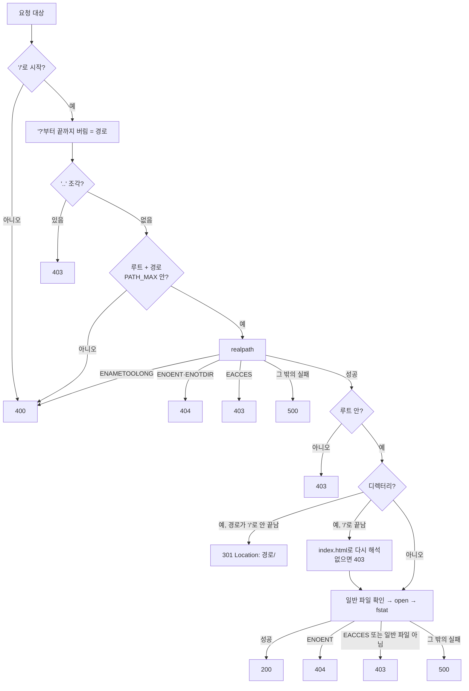

# Step 3. 정적 파일 서빙

이 문서는 Step 3의 진행 상태와 요구사항·설계·테스트·구현·검증 기록을 기술하는 것을 목적으로 한다.

| 항목 | 내용 |
| ---- | ---- |
| 상태 | ✅ 완료 |
| 요구사항 | R-04 |
| 일정 | 11/23 (월) |
| 결정 기록 | [decision.md](./decision.md) |
| 기준 | [DESIGN.md 5장 Step 3](../../../DESIGN.md#5-구현-단계) |

## 진행 체크

- [x] 요구사항 확인
- [x] 설계 → [decision.md](./decision.md)
- [x] 테스트 작성
- [x] 구현
- [x] 검증

## 1. 요구사항

- 디렉터리 요청은 `index.html`로 보낸다.
- 바이너리를 손상 없이 전송한다.
- 루트 밖 경로(`..`)를 막는다.

## 2. 설계 요약

이유와 버린 선택지는 [decision.md](./decision.md)에 있다. 여기에는 무엇을 정했는지만 적는다.

| 주제 | 내용 | 결정 |
| ---- | ---- | ---- |
| 모듈 구성 | `static_file`(판정·열기·본문 전송)과 `mime` 신설. `http_conn`은 결과 → 상태 코드와 응답 순서만 맡는다 | D-26 (D-13 재검토) |
| 경로 탈출 방지 | `..` 조각이면 403, `realpath` 결과가 루트 밖이면 403 | D-21, D-28 |
| 요청 대상 판정 | 아래 흐름도의 순서대로 판정한다 | D-23, D-24, D-28 |
| 디렉터리 요청 | 슬래시 없으면 301, 있으면 `index.html`, 없으면 403 | D-23, D-24, D-27 |
| 일반 파일이 아닌 대상 | FIFO·장치·소켓은 403 | D-31 |
| `POST` | Step 4 전까지 `GET`과 똑같이 파일을 보내고 본문은 버린다 | D-30 |
| 응답 인터페이스 | 머리 쓰기를 따로 두고, 오류·301은 상태 응답 함수 하나가 본문·길이를 만든다 | D-27, D-33 (D-16 갱신) |
| 큰 파일 전송 | `fstat` 크기로 머리를 먼저 쓰고, 64KB씩 `read` → `io_write_all` | D-22, D-29 |
| 파일 fd 소유 | `http_conn`이 모든 경로에서 닫는다. 머리 뒤 실패는 연결만 닫는다 | D-29 |
| `HEAD` | 판별하지 않고 Step 2처럼 501과 본문을 보낸다 (RFC 9112 6.3 위반은 한계로 수용) | D-35 |
| MIME | 7개 확장자, 요청 주소의 마지막 이름 기준(폴더면 `index.html`) | D-25, D-34 |
| 시험 변경 | 새 `test_mime`·`test_static_file`. `test_http_response`는 404 `EINVAL` 1건 교체, `test_http_conn`은 루트 인자를 더하고 `GET /`·`POST`·나눠 쓴 요청(TC-2-07)의 기대 본문이 `index.html`로 바뀐다. 폴더 시험용 `sub/index.html`·`empty/`를 `make fixtures`에 추가. 회귀 TC-2-01·09는 `-r <fixture 폴더>`로 돌리며 본문이 바뀐다 | D-32 |

### 구성도

### 요청 대상 판정 흐름 (D-28)

- `index.html`로 다시 해석할 때 4~6단계를 다시 적용하므로 400·403·500도 나올 수 있다. 301 `Location`은 연속 `/`를 하나로 줄이고 쿼리를 붙이지 않는다 (D-24, D-27).

## 3. 테스트

상태: ⬜ 미실행 · 🟢 통과 · 🔴 실패 · ⛔ 막힘

방침: 판정 표의 행은 소켓 없는 단위 시험(임시 루트)으로, 완료 기준은 `curl`·브라우저 기능 시험으로 확인한다.

| TC | 주제 | 종류 | 실행 | 기대 결과 | 상태 |
| -- | ---- | ---- | ---- | --------- | ---- |
| TC-3-01 | 브라우저로 시험 파일 표시 | 기능 | 브라우저로 `http://localhost:8080/` 접속 | HTML·CSS·JS·PNG·JPG 정상 표시 | 🟢 |
| TC-3-02 | 없는 파일 → 404 | 기능 | `curl -i http://localhost:8080/nope.html` | 404 | 🟢 |
| TC-3-03 | 권한 없는 파일 → 403 | 기능 | `curl -i http://localhost:8080/secret.txt` | 403, secret 내용 없음 | 🟢 |
| TC-3-04 | 루트 밖 경로(`..`) → 403 | 기능 | `curl -i --path-as-is http://localhost:8080/../../etc/passwd` | 403 | 🟢 |
| TC-3-05 | MIME 확장자 매핑 | 단위 | MIME 매핑 단위 테스트 | 확장자별 타입 일치 | 🟢 |
| TC-3-06 | 판정 표(D-28) 행별 시험 | 단위 | 요청 대상 판정표 행별 시험 | D-28 표대로 | 🟢 |
| TC-3-07 | 접두 경계·링크 탈출 → 403 | 단위 | 접두 경계·심볼릭 링크 탈출 | 403 | 🟢 |
| TC-3-08 | 파일 fd 누수 없음 | 단위 | fd 누수 확인 | 누수 없음 | 🟢 |
| TC-3-09 | 응답 함수 계약(머리·상태 응답) | 단위 | 응답 함수(머리·상태 응답) 시험 | D-27·D-33 계약 | 🟢 |
| TC-3-10 | 연결 처리 동작(`http_conn`) | 단위 | `http_conn` 연결 처리 시험 | D-29·D-30·D-35 동작 | 🟢 |
| TC-3-11 | 큰 파일·이미지 바이트 동일 | 기능 | 큰 파일·이미지를 `cmp`로 비교 | 차이 없음, `Content-Length: 4194304` | 🟢 |
| TC-3-12 | 경로별 `Content-Type` | 기능 | 경로별 `Content-Type` 확인 | D-25 표와 일치 | 🟢 |
| TC-3-13 | 쿼리 허용, `%2e%2e`는 이름 취급 | 기능 | 쿼리 붙은 요청, `%2e%2e` 요청 | 200, 404 | 🟢 |
| TC-3-14 | `/` 없는 대상 → 400 | 기능 | `GET index.html HTTP/1.1` | 400 | 🟢 |
| TC-3-15 | `HEAD` → 501과 본문 | 기능 | `HEAD /` 요청 | 501과 본문 (Step 2와 같음, D-35) | 🟢 |
| TC-3-16 | 큰 파일 도중 끊어도 서버 유지 | 기능 | 큰 파일을 중간에 끊은 뒤 `GET /` | 서버 유지, 200 | 🟢 |
| TC-3-17 | 폴더 요청: 301 / 200 / 403 | 기능 | `/sub`, `/sub/`, `/empty/` | 301 / 200 / 403 | 🟢 |
| TC-3-18 | `POST`도 파일 응답 | 기능 | `POST /index.html` | 200, `GET`과 같은 본문 | 🟢 |
| TC-3-19 | 루트 접두 비교 함수 경계 | 단위 | `static_file_within_root` 경계 시험 | 루트 `/` 포함 5개 경우 | 🟢 |

## 4. 구현 기록

모두 2026-11-23, 구현 Raiden. 시험을 먼저 작성하고 구현했다.

| 작업 | 요약 | 결정 |
| ---- | ---- | ---- |
| 정적 파일 서빙 모듈 추가(`static_file`, `mime`) | 대상 판정 10단계, 64KB 조각 전송, MIME 7개(요청 이름 기준) | D-28, D-29, D-25, D-34 |
| `http_conn` 책임 정리 | 결과 → 상태 코드 대응, 파일 fd 닫기, `main`이 루트를 `realpath`로 한 번 정규화해 전달 | D-26, D-29 |
| 응답 함수 확장 | 머리만 쓰는 `http_response_send_head`와 상태 응답 `http_response_send_status` 추가 | D-27, D-33 |
| 시험 추가·수정 | `test_mime`·`test_static_file` 신규, `test_http_response`(TC-2-05 404→418)·`test_http_conn`(임시 루트, 기대 본문 `index.html`) 수정 | README 3장 |
| `make fixtures` 확장 | `sub/index.html`과 빈 `empty/` 추가 | D-32 |
| `HEAD` 처리 되돌림 | `head_only` 인자와 `HEAD` 판별을 제거하고 Step 2처럼 501 + 본문으로 복귀 | D-35 |

## 5. 검증 기록

결과: 🟢 **TC-3-01~19 전부 통과**, 회귀(TC-2-01~11, Step 1 에코)도 통과. 환경은 Docker Ubuntu 24.04(aarch64), 비root, ASan 서버이다.

| 날짜 | 검증 | 결과 | 확인한 것 |
| ---- | ---- | ---- | --------- |
| 2026-11-23 | TC-3-01~19 + 회귀 통과 (Mavuika) | 🟢 통과 | 빌드 경고 0건, 단위 검사 412건 실패 0. 검증 소스가 Raiden의 최종 해시와 일치 |
| 2026-11-23 | 머리 전송 뒤 실패 경로(D-29) | 🟢 확인 | 머리 쓰기 `EPIPE`, 읽기 `EIO`, 파일 축소 `EIO`는 fd가 닫히고 `errno`가 보존됨. 파일이 커져도 원래 크기만 전송 |
| 2026-11-23 | 시험 장치 신뢰성(변이 시험) | 🟢 확인 | 변이본 23개 중 18개가 시험에 잡힘. 단위 시험이 못 잡은 2건은 주입 시험이 잡았고, 나머지 3건은 설계상 이중 방어·도달 불가 |

- 상세 보고서: `.agent/reviews/step3-verify/report.md` (로컬 전용)
- 알려진 한계:
  - PNG·JPG는 ``가 없어 파일을 직접 열어 확인했고, 스크린샷은 눈으로 판정하지 못했다.
  - `EMFILE` 500, 검사와 열기 사이 경쟁, x86_64는 확인하지 않았다.
  - 컨테이너 안 TC-3-18은 `curl`이 없어 bash `/dev/tcp`로 실행했다.

## 6. 막힌 것 / 다음 행동

- 막힌 것 없음.
- 다음은 Step 4(POST 본문 + keep-alive)이다. `POST` 동작(D-30)은 그때까지의 임시 동작이다.
