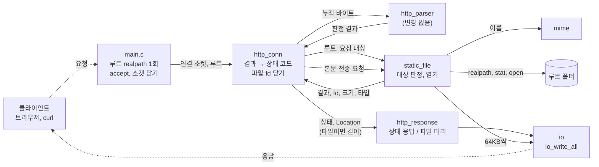

# Step 3. 정적 파일 서빙

이 문서는 Step 3의 진행 상태와 요구사항·설계·테스트·구현·검증 기록을 기술하는 것을 목적으로 한다.

| 항목 | 내용 |
| ---- | ---- |
| 상태 | ✅ 완료 |
| 요구사항 | R-04 |
| 일정 | 11/23 (월) |
| 결정 기록 | [decision.md](./decision.md) |
| 기준 | [DESIGN.md 5장 Step 3](../../../DESIGN.md#5-구현-단계) |

## 진행 체크

- [x] 요구사항 확인
- [x] 설계 → [decision.md](./decision.md)
- [x] 테스트 작성
- [x] 구현
- [x] 검증

## 1. 요구사항

목표: 루트 폴더의 파일을 MIME 타입에 맞게 보내고 404·403·500을 처리한다.

- 디렉터리 요청 → `index.html`
- 바이너리 손상 없이 전송
- 루트 밖 경로(`..`) 차단

## 2. 설계 요약

세부 선택과 이유는 [decision.md](./decision.md)에 기술하고, 여기에는 설계의 핵심만 요약한다. D-21~D-35는 채택됐다(`HEAD` 본문 생략·판별 안은 D-35로 대체됨). 설계 검토는 조건부 통과 뒤 재검토를 통과했다.

### 설계 포인트

| 포인트 | 내용 | 결정 |
| ------ | ---- | ---- |
| 모듈 구성 | 새 `static_file`(대상 판정·파일 열기·본문 전송)과 `mime`(확장자 → 타입). `http_conn`은 결과를 상태 코드로 바꾸고 응답 순서만 맡는다. `main`은 시작할 때 루트를 `realpath`로 한 번 정규화해 넘긴다 | D-26 (D-13 재검토) |
| 경로 탈출 방지 | `..` 조각 문자열 검사(403) + `realpath` 결과가 루트와 같거나 `루트/`로 시작하는지 비교(403) | D-21, D-28 |
| 요청 대상 판정 | `/` 시작(아니면 400) → `?` 뒤 제거 → `..` 조각(403) → 길이가 `PATH_MAX` 초과면 400 → `realpath`(없음 404, 권한 403, 이름 너무 김 400, 그 밖 500) → 루트 안 → 디렉터리면 301 또는 `index.html` → 일반 파일 → `open`(`O_NONBLOCK`)·`fstat` | D-23, D-24, D-28 |
| 디렉터리 | 슬래시 없으면 301 `Location: <경로>/`(연속 `/`는 하나로 줄이고 쿼리는 붙이지 않는다), 있으면 `index.html`, 없으면 403 | D-23, D-24, D-27 |
| 일반 파일이 아닌 대상 | FIFO·장치·소켓은 403 (`open` 전에 `stat`으로 거른다) | D-31 |
| `POST` | Step 4 전까지 `GET`과 똑같이 파일을 보내고 본문은 버린다 | D-30 |
| 응답 인터페이스 | 오류·301 응답은 상태 응답 함수 하나가 본문과 `Content-Length`를 만든다. 머리만 쓰는 함수는 파일 응답에서만 부른다. 기존 함수는 그대로 둔다. 301·403·404·500과 `Location`(301 전용)을 더하고, 머리 버퍼는 512 + `PATH_MAX` 이상이다 | D-27, D-33 (D-16 갱신) |
| 큰 파일 전송 | `fstat` 크기로 머리를 먼저 쓰고 64KB 버퍼로 `read` → `io_write_all` 반복 | D-22, D-29 |
| 파일 fd 소유 | `static_file_open`이 `OK`일 때만 열린 fd를 넘기고, `http_conn`이 모든 경로에서 닫는다 | D-29 |
| 실패 동작 | 머리 전 실패는 상태 코드로 응답, 머리 뒤 실패(읽기 오류·파일 축소·`EPIPE`)는 연결만 닫고 `ERROR`. 파일 fd를 닫을 때 `errno`를 보존한다 | D-23, D-29 |
| `HEAD` | 판별하지 않는다. Step 2처럼 501과 본문을 그대로 보낸다(RFC 9112 6.3 위반은 비차단 한계로 수용) | D-35 (본문 생략·판별 안 대체) |
| MIME | 7개 확장자(대소문자 무시), 텍스트 계열 `charset=utf-8`, 나머지 `application/octet-stream`. 요청 주소의 마지막 이름으로 정한다(폴더면 `index.html`) | D-25, D-34 |
| 시험 | `test_mime`·`test_static_file` 새로 추가(임시 루트 폴더, `ELOOP` 500 필수, 루트 `/` 접두 비교 함수 시험). `test_http_response`는 404 `EINVAL` 1건만 교체. `test_http_conn`은 루트 인자를 더하고, `GET /`·`POST`·나눠 쓰기(TC-2-07) 시험의 기대 본문이 `index.html`로 바뀐다. 기능 회귀 TC-2-01·09는 `-r <fixture 폴더>`로 돌리고 본문이 바뀐다. 폴더 기능 시험용 `sub/index.html`·`empty/`를 `make fixtures`에 더한다 | D-32 |

### 구성도

## 3. 테스트

상태: ⬜ 미실행 · 🟢 통과 · 🔴 실패 · ⛔ 막힘

시험 방침: 판정 표의 행은 소켓 없는 단위 시험(임시 루트)으로, 완료 기준은 `curl`·브라우저 기능 시험으로 덮는다.

| TC | 종류 | 실행 | 기대 결과 | 상태 |
| -- | ---- | ---- | --------- | ---- |
| TC-3-01 | 기능 | 브라우저로 `http://localhost:8080/` 접속 | HTML·CSS·JS·PNG·JPG 정상 표시 | 🟢 |
| TC-3-02 | 기능 | `curl -i http://localhost:8080/nope.html` | 404 | 🟢 |
| TC-3-03 | 기능 | `curl -i http://localhost:8080/secret.txt` | 403, 응답에 secret 내용 없음 | 🟢 |
| TC-3-04 | 기능 | `curl -i --path-as-is http://localhost:8080/../../etc/passwd` | 403 | 🟢 |
| TC-3-05 | 단위 | MIME 매핑 단위 테스트 | 확장자별 타입 일치 | 🟢 |
| TC-3-06 | 단위 | 요청 대상 판정표 행별 시험 | D-28 표대로 | 🟢 |
| TC-3-07 | 단위 | 접두 경계·심볼릭 링크 탈출 | 403 | 🟢 |
| TC-3-08 | 단위 | fd 누수 확인 | 누수 없음 | 🟢 |
| TC-3-09 | 단위 | 응답 함수(머리·상태 응답) | D-27·D-33 계약 | 🟢 |
| TC-3-10 | 단위 | `http_conn` 연결 처리 | D-29·D-30·D-35 동작 | 🟢 |
| TC-3-11 | 기능 | 큰 파일·이미지 `cmp` | 차이 없음, `Content-Length: 4194304` | 🟢 |
| TC-3-12 | 기능 | 경로별 `Content-Type` | D-25 표와 일치 | 🟢 |
| TC-3-13 | 기능 | 쿼리 붙은 요청, `%2e%2e` 요청 | 200, 404 | 🟢 |
| TC-3-14 | 기능 | `GET index.html HTTP/1.1`(`/` 없음) | 400 | 🟢 |
| TC-3-15 | 기능 | `HEAD /` 요청 | 501과 본문 (Step 2와 같음, D-35) | 🟢 |
| TC-3-16 | 기능 | 큰 파일을 중간에 끊은 뒤 `GET /` | 서버 유지, 200 | 🟢 |
| TC-3-17 | 기능 | `/sub`, `/sub/`, `/empty/` | 301 / 200 / 403 | 🟢 |
| TC-3-18 | 기능 | `POST /index.html` | 200, `GET`과 같은 본문 | 🟢 |
| TC-3-19 | 단위 | `static_file_within_root` 경계 | 루트 `/` 포함 5개 경우 | 🟢 |

## 4. 구현 기록

| 날짜 | 변경 파일 | 내용 |
| ---- | --------- | ---- |
| 2026-11-23 | 새 `src/static_file.{c,h}`, `src/mime.{c,h}`, `tests/test_static_file.c`, `tests/test_mime.c`, `www/sub/index.html` / 수정 `src/http_response.{c,h}`, `src/http_conn.{c,h}`, `src/main.c`, `tests/test_http_response.c`, `tests/test_http_conn.c`, `Makefile`, `.gitignore` | 시험 먼저 작성 후 구현(Raiden). D-26 모듈 분리와 `main`의 루트 `realpath` 정규화, D-27·D-33 `http_response_send_head`·`http_response_send_status`(머리 버퍼 512 + `PATH_MAX`), D-28 판정 10단계, D-29 64KB 조각 전송·파일 fd 닫기·`errno` 복원, D-25·D-34 MIME 7개(요청 이름 기준). README 3장 회귀 영향대로 TC-2-05 404→418, `test_http_conn`에 임시 루트·기대 본문 `index.html` 반영. D-32 `make fixtures`에 `sub/index.html`(호스트 `www/sub/`에서 복사)·빈 `empty/` 추가. 독립 검증 전 |
| 2026-11-23 | `src/http_response.{c,h}`, `src/http_conn.c`, `tests/test_http_response.c`, `tests/test_http_conn.c` | D-35(HEAD 되돌림) 반영: `http_response_send_status(fd, status, location)`로 `head_only` 인자 제거, `http_conn`의 앞 5바이트 `HEAD` 판별 제거. `HEAD`는 Step 2처럼 501 + 본문. HEAD 본문 0바이트 시험을 지우고 `HEAD /` → 501 본문 있음 1건으로 바꿨다 |

## 5. 검증 기록

| 날짜 | TC | 실행 환경 | 결과 | 비고 |
| ---- | -- | --------- | ---- | ---- |
| 2026-11-23 | TC-3-01~19, TC-2-01~11 회귀, Step 1 에코 | Docker `mini-webserver-dev`(Ubuntu 24.04.5, gcc 13.3.0, aarch64), 비root `jungle`, 서버 ASan 빌드, 클라이언트 호스트 curl 8.7.1·nc·bash `/dev/tcp`·로컬 Chrome. Mavuika 독립 검증 | 🟢 통과 | `make`·`make debug`·`make test`·`make experiment` 종료 코드 0, 경고 0건, 단위 검사 412건(options 22, echo 7, http_parser 64, http_response 131, http_conn 40, mime 21, static_file 127) 실패 0. 검증 소스 해시가 Raiden `hashes-d44.txt`와 일치 |
| 2026-11-23 | D-29 머리 전송 뒤 실패 경로 | 위와 같음, `--wrap=read,close` 주입 | 🟢 확인 | 머리 쓰기 실패 `EPIPE`, 머리 뒤 read `EIO`, 파일 축소 `EIO`(본문 70000B), 파일 증가는 정확히 원래 크기만 전송, 모든 경우 fd 닫힘·`errno` 보존 |
| 2026-11-23 | 시험 장치 신뢰성 | 변이본 23개 | 18개가 시험에 잡힘 | 단위 시험이 못 잡은 2건(`errno` 복원 제거, 크기 상한 제거)은 주입 시험이 잡음. 나머지 3건은 설계상 이중 방어·도달 불가 경로 |

- 보고서: `.agent/reviews/step3-verify/report.md`(로컬 전용)
- 비차단 참고: PNG·JPG는 `index.html`에 ``가 없어 파일을 직접 열어 확인했다. 스크린샷은 눈으로 판정하지 못했다. EMFILE 500, 검사와 열기 사이 경쟁, x86_64는 확인하지 않았다. 컨테이너 안 TC-3-18은 curl이 없어 bash `/dev/tcp`로 실행했다.

## 6. 막힌 것 / 다음 행동

- 막힌 것 없음. 다음은 Step 4(POST 본문 + keep-alive)이다. 이번 Step의 `POST` 동작(D-30)은 Step 4 전까지의 임시 동작이다.
