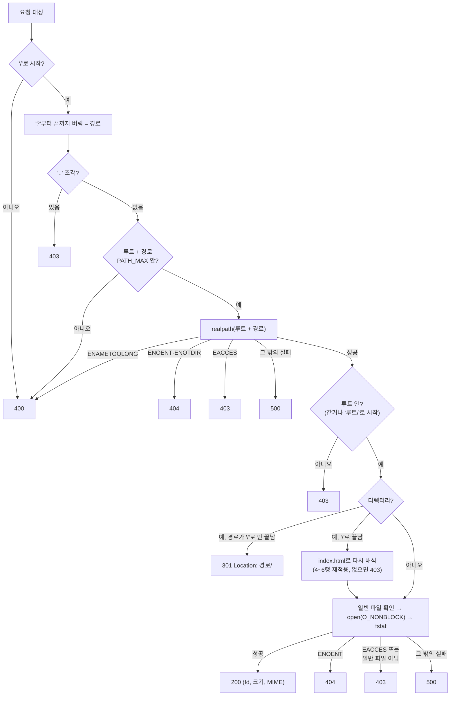

# Step 3 결정 기록

이 문서는 Step 3의 설계·구현 결정과 그 근거를 기술하는 것을 목적으로 한다.

- 진행 상태: [README.md](./README.md)
- 작성 형식: [전체 결정 색인](../../decisions.md#작성-형식)

## 정할 것

- [x] 경로 탈출 방지 방법 (D-24)
- [x] 큰 파일 전송 방식 (D-25)
- [x] `HEAD` 요청의 응답 (D-26 → D-44로 대체)
- [x] 오류 상황별 상태 코드 (D-27)
- [x] 요청 대상 형태: 쿼리, 퍼센트 인코딩, 슬래시 없는 디렉터리 (D-28)
- [x] MIME 표 (D-29)
- [x] 모듈 구성과 `http_conn` 책임 경계 (D-30)
- [x] 응답 인터페이스: 머리 쓰기 분리, 상태·`Location` 추가 (D-31)
- [x] 요청 대상 판정 규칙과 순서 (D-32)
- [x] 파일 본문 전송, 파일 fd 소유, 실패 동작 (D-33)
- [x] `HEAD` 요청 판별 방법 (D-34, D-44로 대체되어 하지 않는다)
- [x] MIME 판정 함수 계약 (D-35)
- [x] 시험 대상과 TC 후보 (D-36)
- [x] `POST` 요청을 Step 3에서 어떻게 처리할지 (D-37)
- [x] 일반 파일이 아닌 대상(FIFO·장치·소켓)의 상태 코드 (D-38)
- [x] 하위 디렉터리 시험 파일을 `make fixtures`에 더할지 (D-39)
- [x] 메모리 본문 응답의 길이 계산 위치 (D-40, 설계 검토 C2)
- [x] 너무 긴 경로의 상태 코드 (D-41)
- [x] 301 `Location`에 쿼리를 붙일지 (D-42)
- [x] MIME을 요청 이름과 실제 파일 이름 중 무엇으로 정할지 (D-43)

## 결정

### D-24. 경로 탈출은 문자열 검사와 `realpath` 접두 비교를 둘 다 한다

- 상태: 채택
- 선택: 요청 경로를 `/`로 나눈 조각 중 정확히 `..`인 것이 있으면 403으로 거절한다. 통과한 경로도 `realpath`로 실제 경로를 구해 루트의 실제 경로 안에 있는지 비교하고, 밖이면 403이다. 비교는 "루트와 같거나, 루트 뒤에 `/`가 이어진다"로 해서 `/www`가 `/www-evil`을 안에 있다고 보지 않게 한다.
- 이유: 사용자 선택. 문자열 검사는 TC-3-04(`/../../etc/passwd`)를 파일 시스템에 닿기 전에 막고, `realpath` 비교는 루트 안의 심볼릭 링크가 밖을 가리키는 경우까지 막는다. 둘 중 하나가 빠져도 다른 하나가 남는다.
- 다른 선택지와 버린 이유: 문자열 검사만 하면 심볼릭 링크로 루트 밖에 나갈 수 있다. `realpath` 비교만 하면 한 겹이라 비교 코드의 실수(접두 경계 등)가 곧 탈출이 된다.
- 영향: 판정 순서는 D-32에 둔다. `..`가 먼저 거절되므로 접두 비교는 심볼릭 링크로만 시험할 수 있다(D-36).
- 다시 볼 조건: 퍼센트 디코딩(D-28)을 도입할 때. 디코딩 뒤 경로에 문자열 검사를 다시 해야 한다.

### D-25. 큰 파일은 머리를 먼저 보내고 64KB 고정 버퍼로 나눠 보낸다

- 상태: 채택
- 선택: 열린 파일의 `fstat` 크기로 `Content-Length`를 정해 응답 머리를 먼저 쓴다. 이어서 64KB 고정 버퍼에 `read`하고 `io_write_all`로 쓰기를 크기만큼 반복한다.
- 이유: 사용자 선택. 파일 크기와 관계없이 메모리 사용이 64KB로 고정되고, 이미 검증한 `io_write_all`(D-18, D-23)을 그대로 쓴다.
- 다른 선택지와 버린 이유: 파일을 통째로 메모리에 읽으면 기존 `http_response_send`를 그대로 쓸 수 있지만 파일 크기만큼 메모리를 쓰고 할당 실패를 다뤄야 한다. `sendfile`은 복사가 줄지만 Linux 전용 호출이고 부분 전송 처리를 따로 시험해야 한다.
- 영향: 응답 머리와 본문 쓰기를 나눠야 한다(D-31). 머리를 보낸 뒤 생긴 실패는 상태 코드를 바꿀 수 없다(D-27, D-33).
- 다시 볼 조건: Step 8 부하 측정에서 파일 전송이 병목으로 확인될 때.

### D-26. `HEAD`는 파서 규칙대로 501로 응답하되 응답 본문은 보내지 않는다

- 상태: 대체됨 (D-44)
- 선택: D-16 5행(메서드는 `GET`·`POST`만, 나머지 501)을 바꾸지 않는다. 다만 `HEAD` 요청에 보내는 응답에는 머리만 쓰고 본문을 쓰지 않는다. `HEAD`를 `GET`처럼 처리하는 정식 지원은 범위 밖이다.
- 이유: 사용자 선택. RFC 9112 6.3은 `HEAD` 요청에 대한 응답에 본문이 없다고 정한다. 판정 규칙과 파서 시험(TC-2-04의 `HEAD` → 501)을 그대로 두고 표준 위반 하나만 없앤다(D-18 「다시 볼 조건」).
- 다른 선택지와 버린 이유: 정식 지원은 파서 규칙·시험을 바꾸고 파일 경로 판정을 `HEAD`에도 태워야 해 이번 Step 범위가 늘어난다. 아무것도 바꾸지 않으면 501 응답에 본문이 붙어 RFC 9112 6.3과 어긋난다.
- 영향: 파서는 501일 때 요청 구조를 채우지 않으므로(D-15) `HEAD` 판별 방법이 따로 필요하다(D-34).
- 다시 볼 조건: `curl -I`나 브라우저가 `HEAD`로 정적 파일을 확인해야 할 때.
- 대체 사유: 지원하지 않는 메서드의 거절 응답에서 본문 하나를 빼려고 `HEAD` 판별 코드(D-34), 상태 응답 함수의 `head_only` 인자(D-40), 시험, 결정 문서가 여러 모듈로 번져 범위 대비 과하다. 사용자가 Step 2처럼 501과 본문을 그대로 보내기로 되돌렸다.

### D-27. 오류 상황별 상태 코드

- 상태: 채택
- 선택:

| 상황 | 응답 |
| ---- | ---- |
| 파일이 없다 | 404 |
| 읽기 권한이 없다(`secret.txt`, 권한 000), 경로가 루트 밖이다 | 403 |
| 디렉터리에 `index.html`이 없다 | 403 |
| 경로가 너무 길다(루트 + 경로가 `PATH_MAX` 초과, `ENAMETOOLONG`) | 400 (D-41로 추가) |
| 그 밖의 열기 실패(`EMFILE`, `EIO` 등) | 500 |
| 응답 머리를 보낸 뒤 파일 읽기 실패 | 코드를 바꿀 수 없으므로 연결만 닫는다 |

- 이유: 사용자 선택. DESIGN.md Step 3의 404·403·500을 상황에 하나씩 대응시킨다. 디렉터리 목록을 보여 주지 않으므로 `index.html` 없는 디렉터리는 "있지만 줄 수 없음"으로 본다.
- 다른 선택지와 버린 이유: `index.html` 없는 디렉터리를 404로 보내면 "없음"과 구분되지 않는다. 디렉터리 목록 생성은 요구사항에 없다.
- 영향: `realpath`·`open`의 `errno`를 이 표로 바꾸는 규칙은 D-32에 둔다. 머리 전송 뒤 실패는 D-33에 둔다. 경로 길이 초과 행은 설계 검토 뒤 D-41로 더했다.
- 다시 볼 조건: Step 4에서 414·413이 들어와 경로 길이 초과의 응답을 다시 정할 때.

### D-28. 쿼리는 버리고, 퍼센트 디코딩은 하지 않고, 슬래시 없는 디렉터리는 301로 보낸다

- 상태: 채택
- 선택: 요청 대상에서 첫 `?`부터 끝까지 버린 나머지를 경로로 쓴다. `%2e%2e` 같은 퍼센트 인코딩은 풀지 않고 글자 그대로 파일 이름으로 본다. 경로가 `/`로 끝나지 않는데 디렉터리이면 301 Moved Permanently와 `Location: <경로>/`로 응답한다.
- 이유: 사용자 선택. 캐시 무효화용 쿼리(`?v=1`)를 붙인 요청도 파일을 받는다. 디코딩을 하지 않으면 디코딩 뒤 `..`가 생기는 탈출 경로가 아예 없다. 301은 브라우저가 디렉터리 안의 상대 링크(`style.css`)를 올바른 위치에서 찾게 한다.
- 다른 선택지와 버린 이유: 퍼센트 디코딩은 공백·한글 파일 이름을 받을 수 있지만 디코딩 뒤 `..`·NUL 검사가 더 필요하다. 슬래시 없이 디렉터리를 바로 `index.html`로 보내면 단순하지만 그 페이지의 상대 링크가 한 단계 위를 가리킨다.
- 영향: 공백·한글처럼 인코딩해야 하는 이름의 파일은 받을 수 없다(현재 시험 파일에는 없다). 판정 순서는 D-32, `Location` 형식은 D-31에 둔다.
- 다시 볼 조건: 인코딩이 필요한 이름의 파일을 보내야 할 때.

### D-29. MIME 표는 7개 확장자만 두고 나머지는 `application/octet-stream`이다

- 상태: 채택
- 선택: `html` `css` `js` `png` `jpg` `jpeg` `txt` 7개만 표에 둔다. 표에 없는 확장자와 확장자가 없는 이름은 `application/octet-stream`이다. 텍스트 계열(`html` `css` `js` `txt`)에는 `; charset=utf-8`을 붙인다. 확장자는 대소문자 구분 없이 비교한다.
- 이유: 사용자 선택. DESIGN.md 완료 기준(HTML·CSS·JS·PNG·JPG)과 시험 파일을 모두 덮는 최소 표다. 시험 파일은 UTF-8이다.
- 다른 선택지와 버린 이유: `/etc/mime.types`를 읽으면 넓게 맞지만 환경 의존과 파일 파싱이 생긴다. 큰 표를 미리 넣는 것은 요구사항에 없다.
- 영향: TC-3-05가 이 표를 그대로 시험한다(D-36). 함수 계약은 D-35에 둔다.
- 다시 볼 조건: 시험·시연에 다른 형식(`svg`, `ico` 등)이 필요할 때.

### D-30. 모듈 구성과 `http_conn` 책임 경계 (D-14 재검토)

- 상태: 채택
- 선택: 파일 시스템을 다루는 일은 새 모듈 `static_file`과 `mime`에 두고, `http_conn`은 "결과 → 상태 코드" 대응과 응답 호출 순서만 맡는다.

| 모듈 (파일명은 제안) | 책임 | 하지 않는 것 |
| -------------------- | ---- | ------------ |
| `mime` (새) | 파일 이름 → `Content-Type` 문자열 (D-29, D-35) | 파일 시스템 접근, I/O |
| `static_file` (새) | 요청 대상 → 판정 결과 분류와 파일 열기(D-32), 열린 파일 본문을 64KB씩 보내기(D-33) | 상태 코드 결정, 응답 머리 쓰기, 연결 소켓 닫기 |
| `http_response` | 파일 응답의 머리 쓰기(D-31), 상태 응답(오류·301)을 본문·길이까지 만들어 쓰기(D-40), 기존 머리+본문 쓰기(D-18) | 요청 해석, 파일 읽기, fd 닫기 |
| `http_conn` | 연결 하나: 읽기·파서 호출(기존), 파서 결과와 `static_file` 결과를 상태 코드로 바꾸기, 파일 응답 순서(머리 → 본문), 파일 fd 닫기 | 연결 소켓 닫기, 경로 해석, 응답 본문·`Content-Length` 만들기 |
| `main` | 시작할 때 `-r` 루트를 `realpath`로 한 번 정규화해 `http_conn_serve`에 넘긴다. 실패하면 오류를 출력하고 끝낸다 | 요청별 처리 |
| `http_parser`, `io` | 바뀌지 않는다 | |

- 인터페이스 변경(헤더 선언 수준, 이름은 제안)

```c
/* http_conn.h: root는 main이 realpath로 정규화한 절대 경로(끝에 '/' 없음, 루트가 "/"인 경우만 예외).
 * root 문자열은 main이 소유하고 프로세스 수명 동안 유효하다. http_conn은 빌려 쓰기만 한다. */
http_conn_result http_conn_serve(int fd, const char *root);
```

- 흐름(D-19의 4단계를 바꾼다)
  1. 읽기·판정은 D-19 1~3단계 그대로다.
  2. 파서 결과가 `OK`가 아니면 D-19 대응(400·501·505)대로 `http_response_send_status(fd, status, NULL)`을 부른다(D-40). `HEAD`도 Step 2처럼 501과 본문을 그대로 받는다(D-44).
  3. `OK`이면 `static_file_open(root, req.target, &file)`을 부르고 결과를 상태로 바꾼다: `OK`→200, `REDIRECT`→301, `BAD_TARGET`→400, `FORBIDDEN`→403, `NOT_FOUND`→404, `ERROR`→500.
  4. 200이면 `http_response_send_head`로 머리를 쓰고 `static_file_send_body`로 본문을 보낸 뒤 파일 fd를 닫는다(D-33). 그 밖에는 `http_response_send_status(fd, status, location 또는 NULL)`을 부른다(D-40). `http_response_send_head`를 직접 부르는 곳은 이 파일 응답 하나뿐이다.
  5. `POST`도 3~4를 그대로 따른다. 메서드로 분기하지 않고, 머리 뒤 본문은 읽지 않고 버린다(D-37, D-19).
- 이유: 사용자 채택(설계 검토 통과 후). D-14의 다시 볼 조건("Step 3 라우팅으로 `http_conn`의 상태 코드 결정 책임이 커질 때")을 검토했다. 늘어나는 것은 결과별 상태 대응 6줄과 응답 순서뿐이고, 크게 늘어나는 경로·파일 처리는 `static_file`로 빠진다. 상태 코드를 정하는 곳이 `http_conn` 한 곳으로 남아 "어떤 상황이 몇 번 코드인가"를 한 표(D-27)와 한 함수로 대조할 수 있다. `static_file_open`은 소켓 없이 임시 폴더만으로 단위 시험할 수 있다.
- 다른 선택지와 버린 이유: `static_file`이 상태 결정과 응답 쓰기까지 하는 "처리기" 구조는 `http_conn`이 더 작아지지만, 경로 판정 시험에 소켓이 필요해지고 상태 코드를 정하는 곳이 두 곳이 된다. 라우팅 표(경로 → 처리 함수)를 지금 만드는 것은 처리 대상이 정적 파일 하나라 과하다(D-14와 같은 이유).
- 영향: `http_conn_serve` 선언이 바뀌므로 `main.c`와 `tests/test_http_conn.c`의 모든 호출을 고친다. `GET /`·`POST /`에 200을 기대하는 시험은 모두 임시 루트 폴더에 `index.html`을 두어야 한다(목록은 D-36 「회귀 영향」). `Makefile`의 서버 소스와 `test_http_conn` 소스 목록에 `static_file.c`·`mime.c`가 더해진다. D-19 흐름 4단계와 D-14 모듈 표의 갱신은 Step 2 문서가 아니라 이 결정으로 기록한다.
- 다시 볼 조건: Step 4에서 `/echo` 같은 두 번째 처리 대상이 들어올 때, Step 6에서 프록시 경로가 들어올 때.

### D-31. 응답은 머리 쓰기를 따로 두고 301·403·404·500과 `Location`을 더한다 (D-18 갱신, D-40으로 보완)

- 상태: 채택
- 선택: 인터페이스(헤더 선언 수준, 이름은 제안)

```c
/* 상태 줄, Date, Content-Type, Content-Length(content_length), [Location], Connection: close, 빈 줄만 쓴다.
 * location은 status가 301일 때만, 그리고 301이면 반드시 NULL이 아니어야 한다. 어기면 아무것도 쓰지 않고 -1(EINVAL).
 * 성공 0, 실패 -1(errno 보존). fd는 닫지 않는다. */
int http_response_send_head(int fd, int status, const char *content_type,
                            size_t content_length, const char *location);

/* 기존과 같다(D-18). http_response_send_head(fd, status, ctype, body_len, NULL) 뒤에 본문을 쓴다.
 * 따라서 301은 이 함수로 보낼 수 없다(-1, EINVAL). 서버 코드는 D-40의 상태 응답 함수를 쓰고,
 * 이 함수는 Step 2 시험(TC-2-05·06)과 상태 응답 함수의 구현 재료로 남는다. */
int http_response_send(int fd, int status, const char *content_type,
                       const char *body, size_t body_len);
```

- 계약
  - 지원 상태: 200 OK, 301 Moved Permanently, 400 Bad Request, 403 Forbidden, 404 Not Found, 500 Internal Server Error, 501 Not Implemented, 505 HTTP Version Not Supported. 그 밖의 코드는 아무것도 쓰지 않고 -1(`EINVAL`).
  - `Location`은 `Connection` 앞에 한 줄로 쓴다. 값은 요청 경로(`?` 앞)의 연속된 `/`를 하나로 줄이고 뒤에 `/`를 붙인 경로다(RFC 9110 10.2.2가 상대 참조를 허용한다). `//sub` 요청이 `Location: //sub/`가 되면 RFC 3986에서 호스트 `sub`를 가리키는 참조가 되어 브라우저가 다른 호스트로 가므로 줄인다(설계 검토 C1). `static_file`이 `location`을 만들 때 줄인다. 쿼리는 붙이지 않는다(D-42). 값에 CR·LF·공백이 들어갈 수 없다는 것은 파서 계약(D-16 2행: 대상에 공백·제어 문자 없음)으로 보장한다.
  - `Location`의 최대 길이: 301은 `realpath`가 성공한 뒤에만 나오고 D-32 4행이 `루트 + 경로`를 `PATH_MAX`(4096) 안으로 제한하므로, 값은 `PATH_MAX`바이트를 넘지 않는다. 머리 버퍼는 고정 부분(상태 줄·`Date`·`Content-Type`·`Content-Length`·`Connection`과 줄 끝, 지금의 512바이트) + `Location: ` + `PATH_MAX`를 담아야 한다. 즉 512 + `PATH_MAX` 이상이다. 지금의 512바이트로는 `/sub/./././…`처럼 긴 경로에서 `EINVAL`이 나 301 대신 응답 없이 연결이 닫힌다. 버퍼를 키울지 `Location`을 따로 쓸지는 구현에 맡긴다.
  - 머리만 쓰는 함수가 `Content-Length`를 인자로 받는다. D-40에 따라 이 함수를 직접 부르는 곳은 파일 응답(`fstat` 크기, D-25) 하나뿐이다. 메모리 본문 응답(오류·301)은 상태 응답 함수가 길이를 계산한다.
  - 오류·301 응답의 본문은 D-18 형식(`text/plain; charset=utf-8`, `<코드> <이유 문구>\n`)을 그대로 쓴다.
- 이유: 사용자 채택(설계 검토 통과 후). 파일 본문은 메모리에 다 없으므로(D-25) 머리와 본문을 따로 써야 한다(D-18 「다시 볼 조건」). 기존 함수를 남기면 오류 응답 쪽 호출과 Step 2 시험이 그대로 산다.
- 다른 선택지와 버린 이유: 기존 함수에 "본문 생략"·`Location` 인자를 더하면 함수 하나로 남지만 모든 호출과 Step 2 시험의 선언을 고쳐야 한다. 파일 fd를 받아 머리와 본문을 함께 보내는 함수를 `http_response`에 두면 응답 모듈이 파일 읽기 실패까지 다루게 된다(D-30 경계와 어긋남).
- 영향(회귀): `tests/test_http_response.c`에서 깨지는 것은 TC-2-05의 "지원하지 않는 상태 404 → -1(`EINVAL`)" 한 건이다. 404가 지원 상태가 되므로 지원하지 않는 예를 다른 코드(예: 418)로 바꾼다. 200·400·501·505·빈 본문·`EPIPE`·4MB(TC-2-06) 시험은 선언과 동작이 같아 그대로 통과해야 한다.
- 다시 볼 조건: Step 4에서 `Connection` 값이 인자로 바뀔 때.

### D-32. 요청 대상 판정 규칙과 순서

- 상태: 채택
- 선택: `static_file_open`이 아래 순서로 판정하고 첫 번째로 걸린 결과를 돌려준다. 루트는 `main`이 정규화한 경로다(D-30). 흐름도는 한눈에 보기 위한 요약이고, 세부 판정의 기준은 아래 표다.



| 순서 | 검사 | 실패 결과 | 예 |
| ---- | ---- | --------- | -- |
| 1 | 대상이 `/`로 시작한다 | 400 | `index.html`, `http://localhost/`(절대 형식), `*` |
| 2 | 첫 `?`부터 끝까지 버리고 나머지를 경로로 쓴다 (D-28) | | `/index.html?v=1` → `/index.html`, `/?a=..` → `/` |
| 3 | 경로를 `/`로 나눈 조각 중 정확히 `..`인 것이 없다 (D-24) | 403 | `/..`, `/../../etc/passwd`, `/a/../b`. `/..a`, `/a..`, `/...`, `/%2e%2e/`는 통과(이름으로 본다) |
| 4 | 루트 + 경로가 경로 길이 상한(`PATH_MAX`, NUL 포함) 안에 들어간다 | 400 (D-41) | `/./././…`로 4KB를 넘는 경로. Step 4에서 414로 바꿀 자리 |
| 5 | `realpath(루트 + 경로)`가 성공한다 | `ENOENT`·`ENOTDIR` 404, `EACCES` 403, `ENAMETOOLONG` 400(D-41), 그 밖(`ELOOP`, `EIO` 등) 500 | `/nope.html` 404, `/index.html/x` 404(`ENOTDIR`), 255바이트를 넘는 이름 400, 루트 안 `loop -> loop` 500(`ELOOP`) |
| 6 | 결과가 루트와 같거나 `루트 + "/"`로 시작한다. 루트가 `/`이면 항상 통과 (D-24) | 403 | 루트 `/t/www`, 링크 `www/evil -> ../www-evil` → `/t/www-evil/...` 403 |
| 7 | 결과를 `stat`해 디렉터리이면: 경로(2의 결과)가 `/`로 끝나지 않으면 301, 끝나면 대상을 `결과 + "/index.html"`로 바꿔 4~6을 다시 적용한다(4행의 길이 검사 대상은 `결과 + "/index.html"`). 이때 길이 초과는 400(D-41), `ENOENT`·`ENOTDIR`은 403(D-27 "index 없음"), `index.html`이 디렉터리여도 403이다. `stat` 실패는 5행과 같은 대응이다(index 재해석 중이면 `ENOENT`·`ENOTDIR`도 403) | 301 / 403 / 400 | `/sub` → 301 `Location: /sub/`, `//sub` → 301 `Location: /sub/`, `/sub/` → `sub/index.html`, `/empty/` → 403 |
| 8 | 대상이 일반 파일이다(`stat`으로 확인, 실패는 5행과 같은 대응) | 403 (D-38) | FIFO, 소켓 파일. `/dev/null`을 가리키는 링크는 6에서 403 |
| 9 | `open(결과, O_RDONLY \| O_NONBLOCK)`이 성공한다. `O_NONBLOCK`은 8행 검사 뒤 대상이 FIFO로 바뀌어도 `open`이 멈추지 않게 한다(일반 파일 읽기에는 영향 없음). 이 경우는 10행이 거른다 | `EACCES` 403, `ENOENT` 404, 그 밖(`EMFILE`, `EIO` 등) 500 | `secret.txt`(권한 000) 403 |
| 10 | 열린 fd의 `fstat`이 성공하고 일반 파일이다. 그 크기를 `Content-Length`로 쓴다 (D-25) | 실패 500, 일반 파일이 아니면 403(8과 같음) | |

- 계약
  - `OK`일 때만 `out->fd`가 열려 있다. 다른 결과로 돌아갈 때 `static_file_open`은 자신이 연 fd를 모두 닫는다(D-33).
  - 열고 크기를 재는 대상은 `realpath` 결과(검사를 통과한 경로) 그 자체다. 요청 문자열을 다시 이어 붙여 열지 않는다.
  - 301 판단은 요청 경로 문자열(2의 결과)이 `/`로 끝나는지로 한다. 실제 경로(`realpath` 결과)는 끝 `/`가 지워지므로 쓰지 않는다.
  - MIME은 요청 경로(`?` 앞)의 마지막 이름으로 정한다(D-43). 디렉터리 요청(`/`, `/sub/`)은 `index.html` 기준으로 `text/html`이다. `realpath` 결과의 이름은 쓰지 않는다.
  - 6행의 접두 비교는 소켓·파일 없이 부를 수 있는 함수로 둔다(아래 `static_file_within_root`). 루트가 `/`인 예외를 단위 시험하기 위해서다(D-36).
- 인터페이스(헤더 선언 수준, 이름은 제안)

```c
#define STATIC_FILE_CHUNK 65536 /* D-25 */

typedef enum {
    STATIC_FILE_OK,         /* 200: fd, size, content_type 유효 */
    STATIC_FILE_REDIRECT,   /* 301: location 유효 */
    STATIC_FILE_BAD_TARGET, /* 400: '/'로 시작하지 않는다, 경로가 너무 길다(D-41) */
    STATIC_FILE_FORBIDDEN,  /* 403 */
    STATIC_FILE_NOT_FOUND,  /* 404 */
    STATIC_FILE_ERROR       /* 500: errno 보존 */
} static_file_result;

typedef struct {
    int fd;                   /* OK에서만 유효. 호출자가 닫는다 */
    size_t size;              /* OK: fstat 크기 */
    const char *content_type; /* OK: mime_type_for 결과(정적 문자열) */
    char location[PATH_MAX + 2]; /* REDIRECT: 연속 '/'를 줄인 경로 + "/" + NUL (4행 때문에 이 안에 들어간다) */
} static_file;

/* root: main이 정규화한 루트. target: 파서가 돌려준 요청 대상(req->target, 쿼리 포함). */
static_file_result static_file_open(const char *root, const char *target, static_file *out);

/* D-24·6행: resolved가 root와 같거나 root + "/"로 시작하면 1. root가 "/"이면 절대 경로 전부 1. 순수 함수. */
int static_file_within_root(const char *root, const char *resolved);
```

- 이유: 사용자 채택(설계 검토 통과 후). 싸고 확실한 문자열 검사를 먼저 해서 파일 시스템에 닿기 전에 대부분을 거른다. `realpath` 실패의 `errno`를 D-27 표의 세 갈래(없음·권한·그 밖)로 그대로 나눌 수 있다. 1행의 400은 D-16이 Step 3로 넘긴 "`/` 시작 검사"를 문법 오류로 본 것이다(DESIGN.md "잘못된 요청은 400").
- 다른 선택지와 버린 이유: `realpath`를 쓰지 않고 `open` 실패만으로 404·403을 나누면 호출이 하나 줄지만 루트 밖 판정(D-24)을 할 수 없다. 권한 확인을 `access`로 미리 하면 `open`과 판정이 둘로 갈려 결과가 어긋날 수 있다.
- 포기한 것: RFC 9112 3.2.2는 서버가 절대 형식 대상(`http://host/path`)을 받아야 한다고 하지만(MUST) 1행에서 400으로 거절한다. `curl`·브라우저·`ab`는 원 서버에 `/`로 시작하는 대상을 보낸다. `realpath` 검사와 `open` 사이에 링크가 바뀌면 검사를 우회할 수 있다(단일 개발자 로컬 컨테이너라 받아들인다. FIFO로 바뀌어 서버가 멈추는 경우만 9행 `O_NONBLOCK`으로 막는다). 경로가 너무 길면 414가 아니라 400이다(D-41).
- 문서 근거로 설계가 정한 것: 1행의 400. 설계 검토에서 D-16·DESIGN.md와 맞는다고 확인했고 D-32 채택으로 확정됐다. 4행·5행의 길이 초과(D-41)와 `Location`의 쿼리 제외(D-42)는 사용자가 채택했다.
- 영향: 시험은 D-36. 8행·10행의 일반 파일이 아닌 대상은 D-38대로 403이다. `GET`과 `POST`가 같은 판정을 거친다(D-37).
- 다시 볼 조건: 여러 사용자가 루트를 쓰거나 파일 업로드가 생길 때(검사와 열기 사이 경쟁), Step 4에서 414를 넣을 때, Step 6 프록시가 절대 형식 대상을 받아야 할 때.

### D-33. 파일 본문 전송, 파일 fd 소유, 실패 동작

- 상태: 채택
- 선택: 인터페이스(이름은 제안)

```c
/* file->fd에서 file->size 바이트를 STATIC_FILE_CHUNK씩 read해 io_write_all(out_fd, ...)로 쓴다.
 * 성공 0, 실패 -1(errno 보존. size에 닿기 전에 파일 끝이면 errno = EIO). fd는 둘 다 닫지 않는다. */
int static_file_send_body(int out_fd, const static_file *file);
```

- 순서: `static_file_open` `OK` → `http_response_send_head(200, content_type, size, NULL)` → `static_file_send_body` → `close(file.fd)`. 파일 fd는 머리 쓰기가 실패해도, 본문 전송이 실패해도 `http_conn`이 반드시 닫는다.
- 불변조건
  - `http_conn_serve`가 돌아갈 때 그 요청에서 연 파일 fd는 하나도 열려 있지 않다.
  - `RESPONDED`이면 본문으로 정확히 `size` 바이트를 보냈다. 그렇지 못하면 `ERROR`다.
  - 파일이 전송 중 커져도 `size`까지만 보낸다.
  - 64KB 전송 버퍼는 `static_file_send_body`의 지역 자원이다. 수명은 호출 한 번이고 해제할 것이 없다. 두는 위치는 구현에 맡긴다(스택이면 연결 처리 하나가 8KB 버퍼 + 요청 구조체 약 10KB + `static_file` 약 4KB(`PATH_MAX + 2`) + 64KB를 쓴다. Linux 기본 주 스레드 스택 8MB 안이다).

| 시점 | 상황 | 동작 | `http_conn` 결과 |
| ---- | ---- | ---- | ---------------- |
| 열기 | `static_file_open`이 `OK`가 아님 | 열린 fd 없음. 상태 응답 함수로 응답한다(D-40) | `RESPONDED` (쓰기 실패면 `ERROR`) |
| 머리 쓰기 | `EPIPE` 등 | 본문을 보내지 않고 파일 fd를 닫는다 | `ERROR` |
| 본문 `read` | `EINTR` | 다시 읽는다 | |
| 본문 `read` | -1 (`EIO` 등) | 멈추고 파일 fd를 닫는다. 상태 코드는 바꿀 수 없다(D-27) | `ERROR` (errno 보존) |
| 본문 `read` | `size` 전에 0 (전송 중 파일이 줄었다) | 멈추고 파일 fd를 닫는다 | `ERROR` (errno `EIO`) |
| 본문 쓰기 | `EPIPE`·`ECONNRESET` (클라이언트가 중간에 끊음) | 멈추고 파일 fd를 닫는다 | `ERROR` |

- `ERROR`이면 `main`은 지금처럼 stderr에 한 줄 남기고 연결 소켓을 닫는다(D-19). 클라이언트는 `Content-Length`보다 짧은 본문과 연결 종료를 보고 전송 실패를 안다.
- `errno` 계약: 실패 경로에서 `http_conn`은 파일 fd를 `close`하기 전에 `errno`를 저장하고 `close` 뒤 되돌린다(성공한 `close`도 `errno`를 바꿀 수 있다). 그래서 `main`이 출력하는 이유는 원래 실패다.
- 본문을 `size`만큼 다 보낸 뒤 파일 fd의 `close`가 실패하면 결과는 `RESPONDED` 그대로다. 클라이언트에 보낸 응답은 이미 온전하기 때문이다.
- 이유: 사용자 채택(설계 검토 통과 후). 머리를 보낸 뒤에는 상태 코드를 바꿀 수 없으므로(D-27) 연결 종료가 유일한 실패 신호다. 이번 Step은 응답 뒤 항상 닫으므로(D-21) 남은 바이트로 다음 응답이 어긋날 일도 없다. 파일 fd를 연 모듈이 아니라 마지막 사용자인 `http_conn`이 닫게 해 "보낸 뒤 닫는다"를 한 함수 안에서 확인할 수 있다.
- 다른 선택지와 버린 이유: `static_file_send_body`가 fd를 닫게 하면 호출자가 닫을 일은 줄지만, 머리 쓰기 실패처럼 본문 함수를 부르지 않는 경로에서 따로 닫아야 해 닫는 곳이 둘이 된다.
- 영향: Step 7 완료 기준(`large.bin`을 중간에 끊어도 서버 유지)은 본문 쓰기 `EPIPE` 경로로 이미 성립해야 한다. Step 4 keep-alive에서는 머리 전송 뒤 실패한 연결을 반드시 닫아야 한다(본문 길이가 어긋났으므로).
- 다시 볼 조건: Step 4 keep-alive, Step 5에서 연결 처리가 스레드로 옮겨 스택 크기가 줄 때.

### D-34. `HEAD` 요청은 받은 바이트의 앞 5바이트로 판별한다

- 상태: 대체됨 (D-44)
- 선택: `http_conn`은 판정이 끝난 뒤 받은 바이트가 5바이트 이상이고 `HEAD `(공백 포함 5바이트, 대소문자 구분)로 시작하면 상태 응답 함수에 `head_only = 1`을 넘긴다(D-40). 그 함수가 머리를 같게 쓰고 `Content-Length`를 보내지 않은 본문의 길이로 둔다(RFC 9110 9.3.2, 8.6이 허용한다). D-16 순서상 `HEAD` 요청의 결과는 400·501·505 중 하나다. 받은 바이트가 5바이트보다 짧은 400(예: `\n` 한 바이트)은 `HEAD`가 아니다(길이 확인 없이 비교하면 버퍼 밖을 읽는다).
- 요청 줄이 깨진 400에서는 판별이 D-16과 다를 수 있다(`HEAD /`만 있는 줄은 본문 생략, 앞쪽 빈 줄 뒤 `HEAD`는 본문 포함). 어느 쪽도 해가 없어 그대로 둔다(설계 검토 R5).
- 이유: 사용자 채택(설계 검토 통과 후). 파서는 `OK`가 아닐 때 요청 구조를 채우지 않는다(D-15, 채택). 판별 규칙이 D-16의 메서드 규칙(대소문자 구분, 요청 줄 첫 단어)과 같아, 메서드가 정의되는 요청에서는 결과가 어긋나지 않는다(요청 줄이 깨진 400은 위 항목대로 다를 수 있다). 파서와 그 시험을 건드리지 않는다.
- 다른 선택지와 버린 이유: 파서가 501일 때도 메서드를 채우도록 D-15 계약을 바꾸면 판별이 한 곳에 모이지만, 채택·검증된 파서 계약과 TC-2-04를 고쳐야 한다. 501 응답에서만 본문을 빼면 `HEAD / HTTP/2.0`(505)이나 헤더 문법 오류(400)에 본문이 남아 RFC 9112 6.3과 다시 어긋난다.
- 영향: `http_conn` 단위 시험에 `HEAD` 경우가 더해진다(D-36). 정식 `HEAD` 지원으로 바꾸면 이 판별은 없어지고 파서 결과를 쓴다.
- 다시 볼 조건: 정식 `HEAD` 지원(D-26)을 할 때.
- 대체 사유: D-44가 `HEAD` 응답의 본문 생략(D-26)을 되돌려, 판별할 이유가 없어졌다. `http_conn`은 `HEAD`를 판별하지 않는다. 근거로 삼은 D-15·D-16·TC-2-04는 바뀌지 않는다.

### D-35. MIME 판정 함수 계약

- 상태: 채택
- 선택: 인터페이스(이름은 제안)

```c
/* 경로의 마지막 '/' 뒤 이름에서 마지막 '.' 뒤를 확장자로 보고 D-29 표로 바꾼다. 항상 NULL이 아닌 정적 문자열. */
const char *mime_type_for(const char *path);
```

| 확장자 (대소문자 무시) | `Content-Type` |
| --------------------- | -------------- |
| `html` | `text/html; charset=utf-8` |
| `css` | `text/css; charset=utf-8` |
| `js` | `text/javascript; charset=utf-8` |
| `txt` | `text/plain; charset=utf-8` |
| `png` | `image/png` |
| `jpg`, `jpeg` | `image/jpeg` |
| 그 밖, 확장자 없음(`.` 없음, `.`으로 끝남) | `application/octet-stream` |

- `app.min.js`는 `js`, `a.tar.gz`는 `gz`(표에 없음), `.txt`처럼 `.`으로 시작하는 이름은 `txt`로 본다. 디렉터리 이름의 `.`(`/a.b/c`)은 보지 않는다.
- 함수에 넣을 이름은 요청 경로(`?` 앞)의 마지막 이름이다. 디렉터리 요청은 `index.html`로 본다(D-43, 사용자 선택). 아래 표는 결정 때 비교한 선택지다.

| 선택지 | 동작 | 장점 | 단점 |
| ------ | ---- | ---- | ---- |
| 요청 이름 (채택, D-43) | 요청 경로(`?` 앞)의 마지막 이름. 디렉터리면 `index.html` | 사용자가 부른 주소의 확장자대로 타입이 정해져 예측하기 쉽다. nginx도 요청 주소의 확장자로 정한다. `page.html -> data` 링크가 `text/html`이다 | 링크 대상의 실제 내용과 타입이 다를 수 있다 |
| 실제 파일 이름 (버림) | `realpath` 결과의 마지막 이름 | 실제로 연 파일 기준이라 링크 대상과 타입이 맞는다 | `page.html -> data` 링크가 `application/octet-stream`이 되어 브라우저가 내려받기로 처리한다 |

- 이유: 사용자 채택(설계 검토 통과 후). `js`의 타입은 RFC 9239가 `text/javascript`를 표준으로 정하고 `application/javascript`를 낡은 것으로 둔다. 순수 함수라 파일 없이 TC-3-05로 덮을 수 있다.
- 다른 선택지와 버린 이유: `.`으로 시작하는 이름을 확장자 없음으로 보는 규칙은 경우가 하나 늘고 이 서버의 시험 파일에는 그런 이름이 없다.
- 영향: `static_file`이 요청 이름(디렉터리면 `index.html`)을 넣는다(D-32, D-43). TC-3-06의 링크 경우 `page.html -> data`는 `text/html`이다.
- 다시 볼 조건: D-29 표를 넓힐 때.

### D-36. 시험 대상과 TC 후보

- 상태: 채택
- 선택: Step 2처럼 외부 프레임워크 없는 C 시험 실행 파일을 ASan으로 빌드해 `make test`에 넣는다. 파일 시스템이 필요한 단위 시험은 시험이 `mkdtemp`로 만든 임시 루트(컨테이너 내부 `/tmp`, bind mount 아님: D-03과 같은 이유)를 쓰고 끝나면 지운다. 권한 000 검사는 root로 실행하면 성립하지 않으므로 그때는 "건너뜀"으로 출력하고 통과로 세지 않는다.
- 단위 TC (제안)

| TC | 파일 | 내용 | 기대 |
| -- | ---- | ---- | ---- |
| TC-3-05 | `tests/test_mime.c` (새) | D-35 표의 7개 확장자, 대문자(`INDEX.HTML`, `photo.JPG`), `app.min.js`, `a.tar.gz`, `large.bin`, `README`, `a.`, `/a.b/c` | 표와 일치, 나머지는 `application/octet-stream` |
| TC-3-06 | `tests/test_static_file.c` (새) | D-32 표 1~10행을 행마다 하나 이상: `/`로 시작하지 않는 대상 400, `?` 제거, `..` 조각 403과 `..a`·`%2e%2e` 통과, `PATH_MAX`를 넘는 `/./././…` 경로 400과 255바이트를 넘는 이름 400(D-41), 없음 404, `ENOTDIR` 404, 권한 000 디렉터리 아래(5행 `EACCES`) 403과 권한 000 파일(9행 `EACCES`) 403을 따로, 루트 안 `loop -> loop` 링크 500(`ELOOP`, 필수), 슬래시 없는 디렉터리 301과 `location`, `//sub` → `location` `/sub/`(C1), `index.html` 있는 디렉터리 200, 없는 디렉터리 403, `index.html`이 디렉터리 403, FIFO(`mkfifo`) 403이고 멈추지 않음(D-38), 빈 파일 크기 0, 루트 안 링크 `page.html -> data`의 `content_type`이 `text/html; charset=utf-8`(D-43) | 결과 분류·`size`·`content_type`·`location` 일치 |
| TC-3-07 | `tests/test_static_file.c` | 접두 경계: 루트 `<tmp>/www`, 옆 폴더 `<tmp>/www-evil/x.txt`, 루트 안 링크 `evil -> ../www-evil`. 루트 안을 가리키는 링크는 통과. `index.html`이 루트 밖을 가리키는 링크인 디렉터리 | `/evil/x.txt` 403, 안쪽 링크 200, 밖을 가리키는 `index.html` 403 |
| TC-3-08 | `tests/test_static_file.c`, `tests/test_http_conn.c` | fd 누수: 가장 낮은 빈 fd 번호가 호출 전과 같다. `static_file_open`의 모든 결과 뒤(`OK`는 호출자가 닫은 뒤), 그리고 `http_conn_serve`의 머리 쓰기 실패(상대를 미리 닫음) 뒤와 본문 전송 중 `EPIPE`(도중에 닫음) 뒤 | 같음 |
| TC-3-19 | `tests/test_static_file.c` | `static_file_within_root`: (`/`, `/x`) 1, (`/t/www`, `/t/www`) 1, (`/t/www`, `/t/www/a`) 1, (`/t/www`, `/t/www-evil`) 0, (`/t/www`, `/t`) 0 | 기대대로 |
| TC-3-09 | `tests/test_http_response.c` | `http_response_send_head`가 머리만 쓰고 `Content-Length`가 인자와 같음. `http_response_send_status`로 301(`Location` 있음)·400·403·404·500·501·505: 상태 줄, 본문 `<코드> <이유 문구>\n`, `Content-Length` = 실제 본문 길이. 301 아닌데 `location` / 301인데 `NULL` / 418 / `http_response_send_status`에 200 → `EINVAL`이고 쓴 바이트 0. `PATH_MAX` 길이의 `Location`도 성공 | 기대대로 |
| TC-3-10 | `tests/test_http_conn.c` | `socketpair` + 임시 루트: `GET /` 200과 본문 바이트 일치, 본문이 붙은 `POST /index.html`도 같은 200과 같은 본문(D-37, 기존 `POST` 시험을 바꾼다), 64KB를 여러 번 넘는 파일을 다른 프로세스가 읽어 바이트 일치, `HEAD / HTTP/1.1` → Step 2처럼 501과 본문(`Content-Length`와 같은 길이, D-44 회귀 확인), 머리 쓰기 실패와 본문 도중 읽는 쪽이 닫으면 `ERROR`·`EPIPE`(TC-3-08 fd 확인을 함께 한다) | 기대대로 |

- 기능 TC (기존 TC-3-01~04 + 제안, 컨테이너에서 `dir=$(make -s fixtures)` 뒤 `./webserver -p 8080 -r "$dir"`)

| TC | 실행 | 기대 |
| -- | ---- | ---- |
| TC-3-01 | 브라우저로 `http://localhost:8080/` | HTML·CSS·JS·PNG·JPG 정상 표시 |
| TC-3-02 | `curl -i http://localhost:8080/nope.html` | 404 |
| TC-3-03 | `curl -i http://localhost:8080/secret.txt` | 403, 응답에 secret 내용 없음 |
| TC-3-04 | `curl -i --path-as-is http://localhost:8080/../../etc/passwd` | 403 |
| TC-3-11 | `curl -s http://localhost:8080/large.bin \| cmp - "$dir/large.bin"`, `image.png`·`photo.jpg`도 같게 | 차이 없음, `Content-Length: 4194304` |
| TC-3-12 | `curl -s -o /dev/null -w '%{content_type}\n'`로 `/`, `/style.css`, `/app.js`, `/image.png`, `/photo.jpg` | D-35 표와 일치 |
| TC-3-13 | `curl -i 'http://localhost:8080/index.html?v=1'`, `curl -i --path-as-is 'http://localhost:8080/%2e%2e/%2e%2e/etc/passwd'` | 200 / 404 |
| TC-3-14 | `printf 'GET index.html HTTP/1.1\r\nHost: x\r\n\r\n' \| nc localhost 8080` | 400 |
| TC-3-15 | `printf 'HEAD / HTTP/1.1\r\nHost: x\r\n\r\n' \| nc localhost 8080` | 501과 본문 `501 Not Implemented`. Step 2와 같다(D-44 회귀 확인) |
| TC-3-16 | `curl -s http://localhost:8080/large.bin \| head -c 1000 > /dev/null` 뒤 `curl -i http://localhost:8080/` | 서버 유지, 200 (stderr에 연결 오류 한 줄은 정상) |
| TC-3-17 | `curl -i http://localhost:8080/sub`, `curl -i http://localhost:8080/sub/`, `curl -i http://localhost:8080/empty/` | 301 `Location: /sub/` / 200 / 403. 시험 파일은 D-39대로 `make fixtures`가 준비한다 |
| TC-3-18 | `curl -i -X POST -d 'name=hyunji' http://localhost:8080/index.html` | 200, `GET /index.html`과 같은 본문 (D-37). 본문이 머리와 함께 도착해 서버가 닫을 때 읽지 않은 바이트가 남지 않는 것을 전제로 한다(D-21 연결 재설정 조건, 설계 검토 R6). 컨테이너 안과 호스트 포트 포워딩 경유를 구분해 기록한다 |

- 시험하지 않고 코드 검토로 두는 것: 머리를 보낸 뒤 파일 `read`가 실패하거나 파일이 줄어드는 경로(D-33)는 기능 시험으로 재현하기 어렵다. D-23처럼 실행했다고 주장하지 않고 코드 검토 항목으로 둔다. `close` 전후 `errno` 보존(D-33), 머리 버퍼 크기(D-31), index 재해석의 길이 초과 400(D-41, D-32 7행)도 코드 검토 항목에 넣는다. 500의 필수 시험은 `ELOOP`(TC-3-06)이고, `EMFILE`(자식 프로세스에서 `setrlimit`으로 fd 상한을 낮춤)은 더해도 된다(선택).
- 구현 메모 (설계 재검토 I1): `realpath`는 기본 POSIX가 아니라 XSI 함수라 `-std=c11`과 `_POSIX_C_SOURCE 200809L`만으로는 선언되지 않는다(암묵 선언 경고, 64비트에서 반환 포인터가 잘릴 수 있다). `static_file.c`는 첫 줄에 `_XOPEN_SOURCE 700` 또는 `_DEFAULT_SOURCE`를 둔다. `PATH_MAX`도 기능 매크로 없이는 정의되지 않으므로 `static_file.h`는 `<limits.h>`를 직접 포함하고, 이 헤더를 포함하는 시험 파일도 같은 매크로를 첫 줄에 둔다. 구현 검증에서 빌드 경고 0건을 확인한다.
- 회귀 영향 (기존 시험)
  - `tests/test_http_response.c`: 바뀌는 것은 TC-2-05의 "지원하지 않는 상태 404 → `EINVAL`" 1건뿐이다(418로 바꾼다). 나머지는 그대로 통과해야 한다.
  - `tests/test_http_conn.c`: 모든 호출에 루트 인자가 붙고, 임시 루트에 `index.html`이 있어야 한다. 기대값이 바뀌는 시험은 TC-2-07 나눠 쓰기(`GET /` 200, 본문이 `index.html`), `D-19 OK → 200`(같음), `D-19 POST 본문은 읽지 않고 200`(본문이 `index.html`, D-37), 쓰기 실패 시험(파일 응답의 머리 쓰기 실패가 되고 TC-3-08 fd 확인을 붙인다)이다. 400·501·505·머리 도중 닫기·8192바이트 시험은 기대가 같다.
  - 기능 회귀: TC-2-01·TC-2-09를 다시 돌릴 때 서버에 `-r <fixture 폴더>`가 필요하다(지금도 `-r`은 필수 인자다). 상태 줄(200)은 같지만 본문은 26바이트 고정 문장에서 `index.html`(901바이트)로 바뀐다.
- 이유: 사용자 채택(설계 검토 통과 후). 경로 판정은 단위 시험으로 표의 행을 빠짐없이 덮고, 소켓·실제 시험 파일 경로는 대표 사례만 기능 시험으로 확인한다. 접두 비교(D-24)는 `..`가 먼저 걸러지므로 링크로만 실행되어 TC-3-07을 따로 둔다.
- 영향: 시험 파일 2개(`test_mime`, `test_static_file`)와 `Makefile` 타깃이 늘고, `test_http_response`·`test_http_conn`이 바뀐다. 확정되면 README 「3. 테스트」와 `docs/test-plan.md` 수를 갱신한다.
- 다시 볼 조건: 기능 시험 결과가 환경에 따라 흔들릴 때.

### D-37. Step 3에서 `POST`는 `GET`과 똑같이 파일을 보낸다 (Step 4 전까지의 임시 동작)

- 상태: 채택
- 선택: `POST` 요청도 `GET`과 같은 대상 판정(D-32)을 거쳐 같은 응답(200 파일, 301, 403, 404, 500)을 보낸다. 머리 뒤 본문은 읽지 않고 버린다(D-19). `http_conn`은 메서드로 분기하지 않는다.
- 이유: 사용자 선택. `POST`는 원래 서버가 본문을 처리한 결과를 돌려주는 요청이지만, Step 3에는 처리할 로직이 없다. Step 4(`POST` 본문 + `/echo`)가 들어오기 전까지 임시로 파일 요청처럼 받는다. 분기·상태 코드·시험이 늘지 않아 가장 단순하다.
- 다른 선택지와 버린 이유: 405 Method Not Allowed는 표준에 가깝지만 상태 코드와 `Allow` 헤더, 시험이 늘어난다. Step 2의 고정 200 문장을 유지하면 `POST /index.html`이 파일과 다른 내용으로 성공해 헷갈린다.
- 영향: D-30 흐름 5단계, D-36 TC-3-10·TC-3-18. 기존 `test_http_conn`의 "`POST` 본문은 읽지 않고 200" 시험은 임시 루트의 파일 응답을 확인하도록 바뀐다. 본문을 읽지 않고 닫으므로, 서버가 닫는 시점에 수신 버퍼에 읽지 않은 바이트가 남으면 D-21대로 연결 재설정이 난다. 원인은 본문 크기 자체가 아니라 남은 바이트다. 설계 검토 실험(컨테이너 안 TCP loopback)에서 본문 11·1000바이트는 머리와 같은 `read`로 들어와 정상이었고, 64KB는 응답을 받은 뒤 `ECONNRESET`, 4MB는 클라이언트 전송 도중 `ECONNRESET`이었다(응답은 받음).
- 다시 볼 조건: Step 4에서 `POST` 본문 읽기와 `/echo`를 넣을 때. 그때 `/echo`가 아닌 경로의 `POST`를 어떻게 할지 다시 정한다.

### D-38. 일반 파일이 아닌 대상(FIFO·장치·소켓)은 403으로 응답한다

- 상태: 채택
- 선택: 루트 안에 있고 검사를 통과했지만 일반 파일도 디렉터리도 아닌 대상은 403이다. `open` 전 `stat`(D-32 8행)과 `open` 뒤 `fstat`(10행) 두 곳에 같은 규칙을 쓴다.
- 이유: 사용자 선택. D-27의 "있지만 줄 수 없음은 403"(`index.html` 없는 디렉터리) 기준과 같다.
- 다른 선택지와 버린 이유: 404("보낼 파일 없음")도 구현 비용은 같지만, 실제로 있는 대상을 없다고 답하게 되어 D-27 기준과 어긋난다.
- 영향: D-32 8행·10행, D-36 TC-3-06(FIFO). 시험 파일(`make fixtures`)에는 이런 대상이 없으므로 단위 시험의 임시 루트에서 `mkfifo`로만 확인한다.
- 다시 볼 조건: 장치·소켓 파일을 일부러 보내야 하는 요구가 생길 때.

### D-39. 하위 폴더 시험 파일 `sub/index.html`과 빈 폴더 `empty/`를 `make fixtures`에 더한다

- 상태: 채택
- 선택: `make fixtures`가 컨테이너 내부 시험 폴더(D-03)에 `sub/index.html`과 빈 폴더 `empty/`를 만든다. TC-3-17(슬래시 없는 폴더 301, `index.html` 있는 폴더 200, 없는 폴더 403)을 기능 시험으로 유지한다.
- 이유: 사용자 선택. 폴더 규칙(D-28, D-32 7행)을 실제 서버와 시험 파일로 재현할 수 있고, 손으로 폴더를 만드는 방식보다 재현성이 높다.
- 다른 선택지와 버린 이유: 폴더 규칙을 단위 시험(임시 폴더)으로만 확인하면 `Makefile`이 바뀌지 않지만 TC-3-17을 실제 서버로 돌릴 수 없다. 시험 때 손으로 `mkdir`하면 간단하지만 다시 하기 어렵다.
- 영향: D-03의 "정해진 7개 파일만 다시 만든다"는 "7개 파일 + `sub/index.html`을 지우고 새로 쓰고, `sub/`·`empty/` 폴더는 만들기만 하며, `empty/index.html`은 지워서 없음을 보장한다"로 넓어진다. 경로는 같은 고정 시험 폴더 아래 두 이름으로만 제한하고, `sub`·`empty`가 심볼릭 링크이거나 폴더가 아니면 시험 폴더 자체와 같은 방식으로 실패한다. 그 밖의 파일은 여전히 건드리지 않는다. `Makefile` 변경(`sub/index.html` 내용을 호스트 `www/`에 둘지 recipe에서 만들지 포함)은 구현(Raiden) 몫이다. 빈 폴더는 git에 남지 않으므로 recipe가 만든다.
- 다시 볼 조건: 하위 폴더 시험 파일이 더 필요해질 때, D-03을 다시 볼 때.

### D-40. 메모리 본문 응답은 상태 응답 함수 하나가 본문과 길이를 만든다 (설계 검토 C2)

- 상태: 채택
- 선택: `http_response`에 상태 응답 함수를 하나 더한다. 오류·301 응답처럼 본문이 메모리에 있는 응답은 모두 이 함수로 보낸다. `http_response_send_head`를 직접 부르는 곳은 파일 응답 하나뿐이다(D-30, D-33).

```c
/* status의 D-18 형식 본문("<코드> <이유 문구>\n", text/plain; charset=utf-8)과 그 길이로
 * 머리와 본문을 쓴다. 본문을 빼는 경우는 없다(D-44).
 * status: 301, 400, 403, 404, 500, 501, 505. 200과 그 밖의 코드는 아무것도 쓰지 않고 -1(EINVAL).
 * location 규칙은 http_response_send_head와 같다(301이면 필수, 아니면 NULL).
 * 성공 0, 실패 -1(errno 보존). fd는 닫지 않는다. */
int http_response_send_status(int fd, int status, const char *location);
```

- 이유: 사용자 선택(설계 검토 U1의 권장안). `Content-Length`와 본문이 같은 함수 안의 같은 값에서 나오므로 D-18의 "길이를 한 함수가 계산해 어긋날 자리가 없다"가 메모리 본문 응답 전부에 유지된다. `http_conn`은 본문 문자열과 길이를 다루지 않아 짧아진다.
- 다른 선택지와 버린 이유: `http_conn` 안의 정적 함수 하나에서만 본문과 길이를 꺼내는 규칙을 적는 방식은 변경이 가장 적지만 보장이 문서 규칙에 머물고 `http_conn` 시험으로만 확인된다. 기존 `http_response_send`에 `location` 인자를 더하면 함수가 하나로 남지만 모든 호출과 Step 2 시험의 선언이 바뀐다(D-31에서 버린 선택지).
- 영향: D-18 보장의 범위는 이렇게 된다. 메모리 본문 응답(`http_response_send`, `http_response_send_status`)은 함수가 길이를 계산한다. 파일 응답만 `Content-Length`를 인자(`fstat` 크기)로 받고, 그 경로의 길이 일치는 D-33 불변조건("`RESPONDED`이면 정확히 `size` 바이트, 아니면 `ERROR`로 연결을 닫는다")이 맡는다. 모든 메모리 본문 응답은 본문 전체를 보내므로 `Content-Length`와 실제로 보낸 본문이 항상 같다(D-44로 `head_only`가 빠져 "길이만 보내고 본문은 생략"하는 예외가 없다). D-30 표와 흐름, D-31 계약, D-36 TC-3-09·TC-3-10을 이에 맞게 고쳤다. 기존 `http_response_send`와 그 시험은 그대로 남는다.
- 다시 볼 조건: Step 4에서 `/echo`처럼 메모리 본문이 상태 문구가 아닌 응답이 생길 때.

### D-41. 너무 긴 경로는 400으로 응답한다

- 상태: 채택
- 선택: `루트 + 경로`가 `PATH_MAX`(NUL 포함)를 넘으면 400이다(D-32 4행). `realpath`가 `ENAMETOOLONG`(이름 하나가 255바이트를 넘는 경우 등)을 내도 400이다(5행). `index.html` 재해석에서 `결과 + "/index.html"`이 `PATH_MAX`를 넘을 때도 400이다(7행). 이전 임시안(500)을 바꾼다.
- 이유: 사용자 선택(설계 검토 U2의 권장안). 4행·5행의 길이 초과는 서버 고장이 아니라 클라이언트 입력 문제이므로 4xx가 맞고, DESIGN.md의 "잘못된 요청은 400"과 맞다. 7행(index 재해석)의 길이 초과는 클라이언트 입력이 아니라 서버 디렉터리 구조(루트 안 디렉터리의 실제 경로가 약 4085바이트를 넘을 때)로 생기므로 이 이유가 맞지 않는다. 이 경우는 규칙 단순화를 위해 같은 400으로 둔다. 시험 환경을 만들기 비싸므로 TC 대신 코드 검토 항목으로 둔다(D-36).
- 다른 선택지와 버린 이유: 500 유지는 규칙이 늘지 않지만 서버 오류가 아닌데 500이 된다. 404는 255바이트를 넘는 이름에는 맞지만, `/./././…`처럼 길어도 실제 파일을 가리키는 요청이 있어 "없다"가 항상 참은 아니다.
- 영향: D-27 표에 행을 더했다. D-32 4·5·7행과 흐름도, D-36 TC-3-06. 설계 검토 실험에서 `PATH_MAX`를 넘는 존재하지 않는 경로는 glibc `realpath`가 `ENOENT`를 냈으므로, 4행 검사가 `realpath` 앞에 있어야 400이 된다.
- 다시 볼 조건: Step 4에서 URI 길이 상한과 414를 넣을 때. 같은 자리(4·5·7행의 길이 초과)를 414로 바꿀지 그때 정한다.

### D-42. 301 `Location`에는 쿼리를 붙이지 않는다

- 상태: 채택
- 선택: `/sub?v=1` 요청의 301은 `Location: /sub/`다. 요청의 쿼리는 버린다.
- 이유: 사용자 선택(설계 검토 U3의 권장안). D-28의 "쿼리 버림"과 같은 규칙이고 `location` 버퍼와 시험이 늘지 않는다.
- 다른 선택지와 버린 이유: 쿼리 보존은 Apache mod_dir·nginx와 비슷하지만 정적 서버에서는 실익이 작다.
- 포기한 것: 슬래시 없는 디렉터리로 이동할 때 캐시 무효화 값(`?v=1`)이 사라진다.
- 영향: D-31 계약, D-32 「문서 근거로 정한 것」.
- 다시 볼 조건: Step 6 프록시 등에서 쿼리를 보존해야 할 때.

### D-43. MIME은 요청한 주소의 마지막 이름으로 정한다

- 상태: 채택
- 선택: `mime_type_for`에는 요청 경로(`?` 앞)의 마지막 이름을 넣는다. 디렉터리 요청(`/`, `/sub/`)은 `index.html`로 본다. 실제로 연 파일의 이름(`realpath` 결과)은 쓰지 않는다.
- 이유: 사용자 선택(설계 검토 R7). 주소만 보고 결과 타입을 예측할 수 있고, nginx도 요청 주소의 확장자로 정한다.
- 다른 선택지와 버린 이유: 실제 파일 이름 기준은 링크 대상과 타입이 맞지만, `page.html -> data` 같은 링크가 `application/octet-stream`이 되어 브라우저가 페이지 대신 내려받기로 처리한다.
- 영향: 링크가 가리키는 실제 내용과 응답 타입이 다를 수 있다(예: `page.html -> data`에 실제로 바이너리가 있어도 `text/html`). D-32 계약, D-35, D-36 TC-3-06의 링크 경우 기대값(`text/html`)을 이에 맞췄다. 시험 파일(`make fixtures`)에는 링크가 없어 기능 TC 결과는 같다.
- 다시 볼 조건: 링크로 내용과 이름이 다른 파일을 내보내야 할 때.

### D-44. `HEAD`는 Step 2처럼 501과 본문을 그대로 보낸다 (D-26 대체)

- 상태: 채택 · D-26 대체
- 선택: `HEAD` 요청도 다른 지원하지 않는 메서드와 똑같이 501 응답을 머리와 본문(`501 Not Implemented\n`) 모두 보낸다. `http_conn`은 `HEAD`를 판별하지 않고(D-34 대체), 상태 응답 함수에는 본문 생략 인자가 없다(D-40). 파서 규칙(D-15, D-16 5행)과 TC-2-04는 그대로다.
- 이유: 사용자 선택. `HEAD`는 지원하지 않는데, 거절 응답의 본문을 빼려고 판별 코드, 응답 함수 인자, 시험, 결정 문서가 여러 모듈로 번져 범위 대비 과하다. Step 2와 동작이 같아 회귀 확인만 하면 된다.
- 다른 선택지와 버린 이유: 501이되 본문을 빼는 직전 설계(D-26, D-34)는 RFC 9112 6.3을 지키지만, 받은 바이트 판별(`http_conn`), `head_only` 인자(`http_response`), 400·501·505별 시험이 늘어 파급 범위가 컸다. 정식 `HEAD` 지원은 파서 규칙과 경로 판정까지 바꿔야 해 이번 Step 범위 밖이다.
- 포기한 것: `HEAD` 요청에 대한 응답에 본문이 붙어 RFC 9112 6.3(응답에 본문이 없어야 한다)을 어긴다. 클라이언트가 응답 뒤 남은 바이트를 다음 응답으로 잘못 읽을 수 있지만, 이번 Step은 응답 뒤 항상 연결을 닫으므로(D-21) 실제 영향은 작다. 비차단 한계로 받아들인다.
- 영향: D-26·D-34를 대체한다. D-30 책임 표·흐름 2단계, D-31 계약, D-40 인터페이스(`http_response_send_status(fd, status, location)`), D-36 TC-3-09·TC-3-10·TC-3-15를 고쳤다. Step 4 keep-alive에서는 `HEAD` 응답의 본문이 다음 응답과 섞일 수 있어 다시 봐야 한다.
- 다시 볼 조건: `HEAD` 정식 지원이 필요할 때(`curl -I` 등), 표준 준수가 필요할 때, Step 4에서 연결을 유지할 때.
