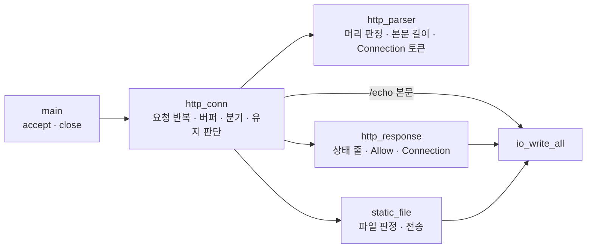
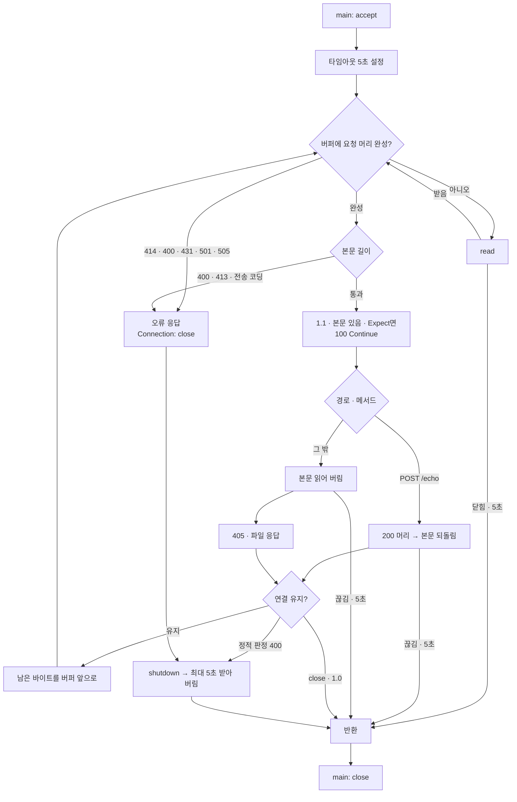

# Step 4. POST 본문 + keep-alive

이 문서는 Step 4의 진행 상태와 요구사항·설계·테스트·구현·검증 기록을 기술하는 것을 목적으로 한다.

| 항목 | 내용 |
| ---- | ---- |
| 상태 | ✅ 완료 |
| 요구사항 | R-05, Q-03 |
| 일정 | 11/24 (화) |
| 결정 기록 | [decision.md](./decision.md) |
| 기준 | [DESIGN.md 5장 Step 4](../../../DESIGN.md#5-구현-단계) |

## 진행 체크

- [x] 요구사항 확인 (사용자 선택 D-36~D-45)
- [x] 설계 → [decision.md](./decision.md) (D-46~D-54 채택, 설계 검토 통과)
- [x] 테스트 작성 (TC-4-01~36)
- [x] 구현
- [x] 검증 (Mavuika 검증·재확인 통과)

## 1. 요구사항

- 남은 바이트는 다음 요청으로
- `Connection: close`, 유휴 타임아웃
- 헤더·URI·본문 크기 상한

## 2. 설계 요약

이유와 버린 선택지는 [decision.md](./decision.md)에 있다. 여기에는 무엇을 정했는지만 적는다.

모듈 구성은 아래와 같다.

연결 하나는 아래처럼 처리한다.

| 주제 | 내용 | 결정 |
| ---- | ---- | ---- |
| 메서드가 맞지 않는 요청 | 파일 주소 `POST`는 405 + `Allow: GET`, `GET /echo`는 405 + `Allow: POST`. 본문은 읽고 버린다 | D-36 |
| 오류 뒤 연결 유지 | 404·403·405·301·500은 유지, 400·413·414·431·501·505는 응답 뒤 닫는다 | D-37, D-42 |
| 버전별 연결 유지 | 1.1은 `close`가 없으면 유지, 1.0은 `keep-alive`를 보낼 때만 유지 | D-38 |
| 본문 처리 | `/echo`는 머리 먼저 보내고 본문을 조각으로 돌려준다. 버릴 본문도 조각으로 읽고 버린다 | D-39 |
| 타임아웃 방법 | 소켓에 `SO_RCVTIMEO`를 설정하고, `read()`가 시간을 넘기면 닫는다. slowloris는 한계로 둔다 | D-40 |
| 쓰기 시간 제한 | `SO_SNDTIMEO` 5초(`write` 한 번 단위). 쓰기가 막히면 그 연결만 닫는다. Linux 실측 약 10초 | D-53 |
| 타임아웃 시간 | 5초 | D-41 |
| 머리 초과 | 8KB 또는 헤더 100개를 넘으면 431 (D-09의 400 대체) | D-42 |
| URI 상한 | 2048바이트(쿼리 포함)를 넘으면 414 | D-43 |
| 본문 상한 | `Content-Length`가 1MB를 넘으면 본문을 받기 전에 413 | D-44 |
| 닫기 전 남은 데이터 | 닫는 오류 응답 뒤 `shutdown`하고, 최대 5초 받아 버린 뒤 닫는다 | D-45 |
| 연결 반복 | `http_conn`이 요청 반복·유지 판단·정리를 맡고 `main`은 받고 닫기만 한다 | D-46 |
| 남은 바이트 | 8KB 버퍼 하나. 본문은 남은 길이만큼만 읽고, 다음 요청 조각은 맨 앞으로 옮긴다 | D-47 |
| 판정 순서 | 414 → 400(줄 바꿈) → 431 → 형식 → 전송 코딩 → 400(길이) → 413 → 분기 | D-48 |
| 본문 길이 | `Content-Length` 숫자 하나만 받고 형식 오류·중복은 400, 없으면 0 | D-49 |
| `/echo`와 본문 순서 | `/echo`만 머리를 먼저 보내고, 나머지는 본문을 다 읽어 버린 뒤 응답한다 | D-50 |
| 유지 판단 | 응답 전에 한 번 정해 `Connection` 헤더와 동작을 맞춘다. 1.1 유지 응답에는 헤더를 넣지 않는다 | D-51 |
| 응답 함수 | 405·413·414·431을 더하고 `Allow`·`Connection`은 추가 머리 묶음으로 받는다 | D-52 |
| 타임아웃 세부 | 연결 시작 때 설정. 요청 사이 타임아웃은 응답 없이 닫는다 | D-53 |
| 정리 세부 | 총 5초까지 받아 버리고, 바이트 상한은 두지 않는다 | D-54 |

- 사용자 결정 대기: 없음. 쓰기 시간 제한은 `SO_SNDTIMEO` 5초로 정했다(D-53).

## 3. 테스트

상태: ⬜ 미실행 · 🟢 통과 · 🔴 실패 · ⛔ 막힘

| TC | 주제 | 종류 | 실행 | 기대 결과 | 상태 |
| -- | ---- | ---- | ---- | --------- | ---- |
| TC-4-01 | POST 본문 → `/echo`로 돌아옴 | 기능 | `curl -i -X POST -d 'name=hyunji' http://localhost:8080/echo` | 보낸 본문이 돌아옴 | 🟢 |
| TC-4-02 | 한 연결에서 요청 반복(keep-alive) | 기능 | `curl -v http://localhost:8080/index.html http://localhost:8080/style.css` | `Re-using existing connection` 출력 | 🟢 |
| TC-4-03 | 긴 URI·큰 본문 → 414·413 | 기능 | 긴 URI / 큰 본문 요청 | 414 / 413 (명령은 구현 때 정함) | 🟢 |
| TC-4-04 | 파일 주소 `POST` → 405, 연결 유지 | 기능 | `curl -v -X POST -d x http://localhost:8080/index.html http://localhost:8080/index.html` | 405 + `Allow: GET` 두 번, `Re-using existing connection` | 🟢 |
| TC-4-05 | `GET /echo` → 405 | 기능 | `curl -i http://localhost:8080/echo` | 405 + `Allow: POST` | 🟢 |
| TC-4-06 | 1MB 본문 되돌림 | 기능 | 1048576바이트 파일을 `curl --data-binary`로 `/echo`에 보내 `cmp` | 차이 없음, `Content-Length: 1048576` | 🟢 |
| TC-4-07 | 4MB 본문 → 413, 연결 재설정 없음 | 기능 | `www/large.bin`을 `curl --data-binary`와 `nc`로 `/echo`에 보내기 | 413 + `Connection: close`, `ECONNRESET` 없음 | 🟢 |
| TC-4-08 | `Connection`·버전별 유지 | 기능 | `curl -v` 두 주소에 `-H 'Connection: close'` / `--http1.0 -H 'Connection: keep-alive'` / `--http1.0` | 닫힘 / `Connection: keep-alive`와 재사용 / 닫힘 | 🟢 |
| TC-4-09 | 오류 뒤 유지·닫기 | 기능 | 404 뒤 같은 연결로 `GET /`, 400 요청 뒤 같은 연결 | 404 뒤 재사용 / 400 뒤 닫힘 | 🟢 |
| TC-4-10 | 한 번에 온 두 요청 | 단위 | `test_http_conn`: `POST /echo`(본문 5바이트)와 `GET /`를 한 번에 쓰기 | 응답 두 개가 순서대로, 본문 정확 | 🟢 |
| TC-4-11 | URI 2048 / 2049바이트 | 단위 | `test_http_parser`: 경계 값, 종료 빈 줄 없는 2049바이트 대상 | 통과 / 414 / 머리 완성 전에도 414 | 🟢 |
| TC-4-12 | 판정 순서 (D-48) | 단위 | `test_http_parser` 행별 시험 | D-48 표대로, 나눠 도착해도 결과 같음 | 🟢 |
| TC-4-13 | `Content-Length` 규칙 | 단위 | `test_http_parser`: 숫자 아님·부호·빈 값·중복·목록·1048576·1048577·긴 자릿수 | 400 / 통과 / 413 (D-49) | 🟢 |
| TC-4-14 | `Connection` 토큰 비교 | 단위 | `test_http_parser`: 대소문자·쉼표 목록·헤더 여러 개 | D-51 표대로 | 🟢 |
| TC-4-15 | 응답 함수 새 계약 | 단위 | `test_http_response` | 새 이유 문구, `Allow` 규칙 위반·`send`에 `location`·`allow`·세 함수의 100은 -1(`EINVAL`), `Connection` 세 값, 100 전용 함수는 `HTTP/1.1 100 Continue\r\n\r\n`만 씀 | 🟢 |
| TC-4-16 | 유휴 5초 → 서버가 닫음 | 기능 | `nc localhost 8080`만 열고 시간 재기 | 약 5초 뒤 응답 없이 닫힘 | 🟢 |
| TC-4-17 | 정리 총 5초 | 기능 | 413을 받은 뒤 1초마다 1바이트씩 계속 보내기 | 정리 시작부터 약 5초 안에 닫힘 | 🟢 |
| TC-4-18 | `/echo` 도중 끊어도 서버 유지 | 기능 | 큰 본문을 보내다 끊은 뒤 `curl http://localhost:8080/` | 200 | 🟢 |
| TC-4-19 | `Expect: 100-continue` | 단위 | `test_http_conn`: 1.1 본문 있음 / 1.0 본문 있음 / `Content-Length: 0` / 1MB 초과 | 100 뒤 200 / 100 없음 / 100 없음 / 100 없이 413 | 🟢 |
| TC-4-20 | 요청 도중 타임아웃 → 응답 없이 닫기 | 단위 | `test_http_conn`: 머리 일부·버릴 본문 일부만 쓰고 기다리기 | 응답 0바이트, `TIMED_OUT` | 🟢 |
| TC-4-21 | `Transfer-Encoding` | 단위 | `chunked` / `gzip, chunked` / `chunked, gzip` / `Content-Length`와 함께 / 빈 값 | 501 / 501 / 400 / 501 / 400, 모두 닫힘 | 🟢 |
| TC-4-22 | 본문 뒤 덧붙은 빈 줄 | 단위 | `test_http_conn`: 본문 5바이트 + `\r\n` + `GET /` | 첫 응답 200, 다음은 400 후 닫힘 | 🟢 |
| TC-4-23 | `/echo` 응답 `Content-Type` | 기능 | `curl -i -d x http://localhost:8080/echo` | `application/octet-stream` | 🟢 |
| TC-4-24 | 큰 본문 + 다음 요청 한 번에 | 단위 | `test_http_conn`(fork): 머리 + 8KB를 넘는 `/echo` 본문 + `GET /`를 한 번에 쓰기 | 응답 두 개, 본문 정확 (D-47 본문 일부만 있는 경우) | 🟢 |
| TC-4-25 | `/echo` 판정 경계 | 단위 | `POST /echo?x=1` / `POST /echo/` / 없는 파일에 `POST` / 루트에 `echo` 파일이 있을 때 `POST /echo` | 200 / 405 `Allow: GET` / 405 / 200 되돌림 | 🟢 |
| TC-4-26 | 유지·닫기 경계 | 단위 | 500(`/loop`)·301·403 뒤 다음 요청, 정적 판정 400(`GET index.html`) 뒤 | 유지 / 닫힘 + `Connection: close` | 🟢 |
| TC-4-27 | 본문 있는 `GET` 뒤 다음 요청 | 단위 | `Content-Length: 3` `GET /` + 본문 + `GET /` | 200 두 개 | 🟢 |
| TC-4-28 | 본문 도중 상대가 닫음 | 단위 | 버릴 본문 일부만 쓰고 쓰기 방향 닫기 | 응답 없음, `PEER_CLOSED` | 🟢 |
| TC-4-29 | 응답을 받아 가지 않는 클라이언트 → 그 연결만 닫힘 | 단위 | `test_http_conn`(따로 실행): `/huge.bin` 요청 뒤 클라이언트 소켓은 열어 둔 채 읽지 않음 | `ERROR`, `errno` `EAGAIN`·`EWOULDBLOCK`, 4.5초 이상, 12초 미만(Linux 실측 약 10.5초, D-53), 파일 fd 누수 없음 | 🟢 |
| TC-4-30 | `/echo` 본문 도중 타임아웃 | 단위 | `test_http_conn`(따로 실행): 머리 + 본문 일부만 쓰고 기다리기 | `TIMED_OUT`, 약 5초, 머리와 받은 본문만 나감 | 🟢 |
| TC-4-31 | `/echo` 본문 도중 상대가 닫음 | 단위 | 머리 + 본문 일부만 쓰고 쓰기 방향 닫기 | `PEER_CLOSED`, 머리와 받은 본문만 나감 | 🟢 |
| TC-4-32 | `ECONNRESET` 분류 | 단위 | 응답 도착 뒤 읽지 않고 닫기: 요청 사이 / 다음 머리 일부가 버퍼에 있을 때 | `DONE` / `ERROR`, 둘 다 `errno` `ECONNRESET` | 🟢 |
| TC-4-33 | `100 Continue` 쓰기 실패 | 단위 | `Expect` 요청을 쓰고 클라이언트를 닫은 뒤 서버 호출 | `ERROR`, `errno` `EPIPE` | 🟢 |
| TC-4-34 | 남은 바이트가 다음 머리 일부 | 단위 | 요청 + 다음 머리 일부를 쓰고 첫 응답을 받은 뒤 나머지 쓰기 | 응답 두 개, `DONE` (옮긴 뒤 다시 읽음, D-47) | 🟢 |
| TC-4-35 | 남은 바이트가 다음 머리 + 본문 일부 | 단위 | 본문 일부가 먼저 돌아온 것을 본 뒤 나머지 본문 + 다음 요청 쓰기 | 응답 세 개, 본문 정확, `DONE` | 🟢 |
| TC-4-36 | 머리 정확히 8192바이트 | 단위 | 머리 8192 + 본문 + 다음 요청 / 머리 8193 | 응답 두 개 / 431 + 닫힘 | 🟢 |

- 코드 검토 항목(D-54): 정리의 남은 시간이 0 이하면 읽지 않음, 양수가 `{0,0}`이 되지 않음, 정리 중 `setsockopt` 실패 시 종료.

기존 시험 영향:

- `POST` 파일 응답 → 405: TC-3-18, `test_http_conn`의 `POST` 200 두 경우.
- 머리 초과 400 → 431: TC-2-08, `test_http_parser`의 8KB 초과·헤더 101개, `test_http_conn`의 8192바이트.
- `Connection: close` 고정: `test_http_response`의 TC-2-05·TC-3-09는 새 인자로 `close`를 넘겨 확인한다. `test_http_conn`의 `Location: /sub/` 다음 `Connection: close`는 1.1 유지 응답이라 헤더 없음으로 바뀐다.
- 연결 유지·정리로 멈춤: `test_http_conn`은 쓰기 방향을 열어 둔 채 서버를 부른다. 유지 응답 뒤에는 유휴 5초, 닫는 코드(400·431·501·505) 뒤에는 정리 5초를 기다린다. 그래서 `serve_prewritten`과 `test_status_mapping`의 **모든 경우**에 요청 뒤 `shutdown(SHUT_WR)`이 필요하고, 결과 `RESPONDED`는 `DONE`으로 바뀐다(TC-2-07 포함).
- `alarm(10)`: 프로그램 전체에 하나라 5초 대기가 두 번 이상이면 넘는다. 타임아웃 시험(TC-4-16·17·20)은 별도 실행 파일로 두거나 `alarm`을 조정한다.
- 머리 길이: `http_request`의 필드로 돌려주므로 `test_http_parser`의 호출 형태는 그대로이고 확인 항목만 더해진다.
- `test_http_response` 계약 위반 표(TC-3-09): `allow` 규칙 위반과 100 거절 경우가 더해진다.
- `printf | nc`로 200을 받는 기능 시험(TC-2-02 등): 서버가 연결을 유지해 `nc` 종류에 따라 5초 뒤에 끝난다. 결과는 같다.
- TC-3-15 `HEAD`: 501이라 응답 뒤 닫으므로 D-35의 keep-alive 우려(본문 섞임)는 생기지 않는다.

## 4. 구현 기록

| 작업 | 요약 | 결정 |
| ---- | ---- | ---- |
| 연결 반복 | `http_conn_serve`가 요청 반복·유지 판단·정리를 맡고 결과를 `DONE`·`PEER_CLOSED`·`TIMED_OUT`·`ERROR`로 나눔 | D-46, D-53 |
| 남은 바이트 | 8KB 버퍼 하나, 본문은 남은 길이만큼만 읽고 다음 요청 조각은 맨 앞으로 옮김 | D-47 |
| 판정 순서·크기 상한 | 파서가 414 → 400 → 431 → 형식 → 전송 코딩 → 길이 형식 → 413 순서로 판정하고 머리 길이·본문 길이를 돌려줌 | D-42~D-44, D-48, D-49 |
| `/echo`와 405 | `POST /echo`는 머리 먼저 보내고 본문을 조각으로 되돌림, 그 밖의 `POST`·`GET /echo`는 본문을 버린 뒤 405 | D-36, D-39, D-50 |
| 연결 유지 | `Connection` 토큰과 버전으로 한 번 정해 응답 `Connection` 머리와 맞춤 | D-37, D-38, D-51 |
| 응답 함수 | 405·413·414·431, `Allow`·`Connection` 추가 머리 묶음, `100 Continue` 전용 함수 | D-52 |
| 시간 제한·정리 | `SO_RCVTIMEO`·`SO_SNDTIMEO` 5초, 닫는 응답 뒤 `shutdown` 후 총 5초 받아 버림 | D-40, D-41, D-45, D-53, D-54 |

## 5. 검증 기록

| 날짜 | 검증 | 결과 | 확인한 것 |
| ---- | ---- | ---- | --------- |
| 2026-11-24 | Mavuika 코드 검증 (1차) | 통과, 차단 결함 없음 | 빌드 경고 0, `make test` 649 ok, 독립 probe 19개, curl/nc. 시험 공백 N1·N2는 시험 추가로 보완(사용자 선택) |
| 2026-11-24 | D-54 특수 경로 (N3) | 통과, 기록으로 갈음 | 남은 시간 0 이하면 읽지 않음, 1µs 미만은 1µs로 올림, `setsockopt` 실패 시 정리 끝, `EINTR` 뒤 남은 시간 재계산. 함수 바꿔치기 하니스로만 확인했고 `make test`에는 없음(사용자 선택) |
| 2026-11-25 | Mavuika 재확인 (TC-4-30~36) | 통과, 결함 없음 | `make test` 3회 반복 675 ok·FAIL 0·경고 0, 결함 주입 7개 모두 검출. TC-4-32는 Linux 기준 동작에 의존(기준 환경 Ubuntu 컨테이너) |

## 6. 막힌 것 / 다음 행동

- 막힌 것 없음.
- 남은 한계: 연결을 한 번에 하나씩 처리한다. 쓰기가 막힌 클라이언트는 약 10초 뒤 끊긴다(D-53). Step 5에서 다시 본다.
- 다음은 Step 5(동시성)이다. `ab -k` 비교는 Step 5에서 한다.
