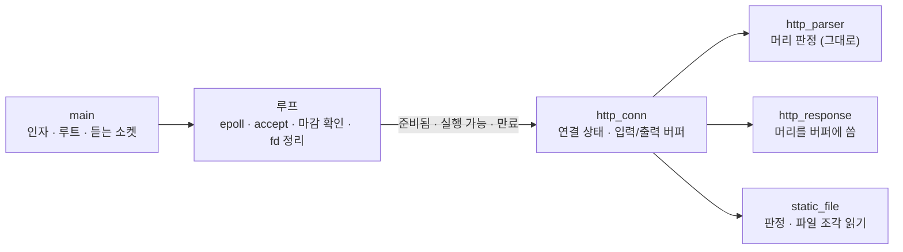
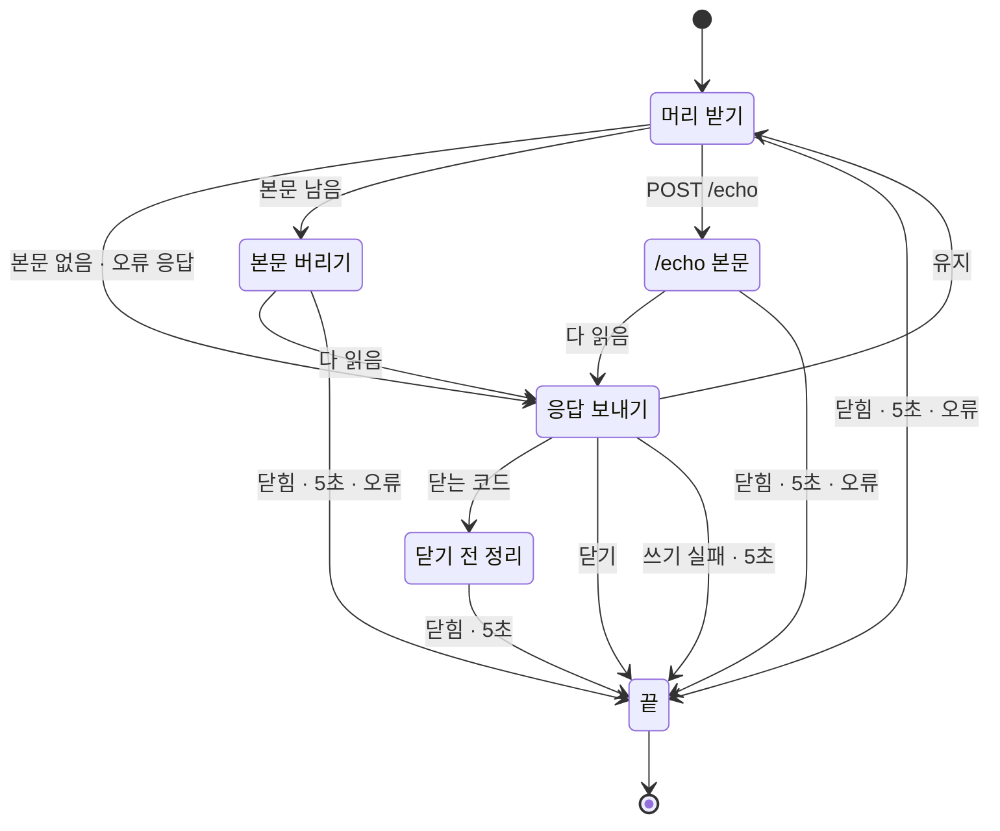

# Step 5. 동시성

이 문서는 Step 5의 진행 상태와 요구사항·설계·테스트·구현·검증 기록을 기술하는 것을 목적으로 한다.

| 항목 | 내용 |
| ---- | ---- |
| 상태 | ✅ 완료 |
| 요구사항 | R-06, Q-02 |
| 일정 | 11/24 (화) |
| 결정 기록 | [decision.md](./decision.md) |
| 기준 | [DESIGN.md 5장 Step 5](../../../DESIGN.md#5-구현-단계) |

## 진행 체크

- [x] 요구사항 확인 (R-06, DESIGN.md Step 5 완료 기준)
- [x] 설계 → [decision.md](./decision.md) (D-56~D-58은 구현 내부 선택)
- [x] 테스트 작성 (TC-5-07·09·10·11 단위, 기능·부하 스크립트)
- [x] 구현 (자체 점검까지)
- [x] 검증 (필수 완료 기준·구현 영향·현행 기능 회귀 통과)

## 1. 요구사항

- 유휴 연결이 있어도 다른 요청에 바로 응답한다.
- `ab -n 2000 -c 50` 실패 0건과 처리량을 기록한다.

## 2. 설계 요약

이유와 버린 선택지는 [decision.md](./decision.md)에 있다. D-56~D-58은 구현 내부 선택이며, D-59의 정책과 준비 우선 순서는 사용자 선택이다. 구현 영향은 독립 검증을 통과했다.

모듈 구성은 아래와 같다.

연결 하나는 아래 상태를 오간다. 어느 상태든 출력이 남아 있으면 쓰기를 먼저 기다린다.

- 출력 우선: 각 상태 안에서 출력이 남으면 먼저 다 보내고, 다 보낸 뒤 그 상태의 다음 동작을 한다. 그래서 `/echo`는 머리와 조각을 보내면서 본문을 받고, `ECHO → SEND`는 남은 출력을 마무리하는 전이다.
- 순서: `100` → 본문. `/echo`는 머리 + 버퍼 속 본문 → 조각 반복. 그 밖은 본문을 다 버린 뒤 판정·응답. 닫는 코드는 출력을 다 보낸 뒤 `shutdown` 한 번 → 정리.
- 실행 가능: 버퍼 안 바이트만으로 진행할 일이 남았는데 차례 예산이 끝나면 상태는 그대로 두고 루프의 내부 실행 목록으로 간다(읽기 대기로 돌아가지 않음).

| 주제 | 내용 | 결정 |
| ---- | ---- | ---- |
| 동시성 방식 | I/O 멀티플렉싱 | D-55 |
| 준비 알림 | `epoll` 레벨 트리거, 모든 소켓 논블로킹 | D-56 |
| 한 차례 예산 | 소켓 `read` 1번·파일 조각 1번·차례 시작 때 있던 출력까지 | D-56 |
| 내부 남은 일 | 예산이 끝나도 버퍼만으로 진행할 수 있으면 실행 가능 → 내부 실행 목록에서 다음 회차에 실행 | D-56 |
| 회차 | 반환 배치 → 실행 목록 → 마감 확인, 실행 목록이 있으면 `epoll_wait`는 기다리지 않음 | D-56, D-59 |
| accept | 회차마다 시도 수 상한(실패도 한 번으로 셈), `EAGAIN`이면 멈춤 | D-56 |
| 모듈 분담 | 루프: 소켓 fd·연결 목록·마감 확인 / `http_conn`: 상태 전이·파일 fd | D-57 |
| 연결 인터페이스 | 만들기(fd, root, 지금) · 차례 실행(→ 읽기 대기·쓰기 대기·실행 가능·끝) · 만료 처리 · 해제(파일 fd 닫기, 소켓은 루프가 닫음) | D-57 |
| HUP·ERR | 깨우는 정보일 뿐, 남은 입출력과 실제 `read`·`write` 결과로 판정 | D-57 |
| 함수 분리 | 상태마다 처리 함수 하나, 공유 값은 구조체 필드 | D-57 |
| 연결별 메모리 | 입력 8KB(D-47) + 요청 정보 약 10KB + 출력 64KB | D-57, D-58 |
| 응답 송신 | 출력 버퍼에 만들고 부분 쓰기는 위치를 기억해 이어 보냄, 다 보낸 뒤에만 다시 채움 | D-58 |
| 읽기·쓰기 순서 | 출력이 남아 있으면 새로 읽지 않음 | D-58 |
| 5초 시간 제한 | 실제 대기 종류(요청 사이·요청 도중 읽기·쓰기·정리)에 들어갈 때 시작, 성공한 진행만 갱신, 정리는 고정 | D-59 |
| 준비·만료 겹침 | 이번에 반환된 준비 연결을 먼저 처리한 뒤 마감 확인; 실제 진행이 있으면 이어 처리 (사용자 선택, 정리는 예외) | D-59 |
| 끝난 연결 정리 | 즉시 끝 표시·실행 목록에서 뺌 → 회차 끝에 결과 기록(`ERROR`만 로그)·파일 fd 닫기·소켓 닫기·해제 | D-57 |
| 새 연결 준비 실패 | 만든 자원까지 회수하고 그 소켓만 닫음, 관심 방향 변경 실패는 그 연결 `ERROR` | D-57 |
| 서버를 끝내는 실패 | `epoll` 만들기·기다리기(`EINTR` 제외) 실패, D-07 밖 accept 오류 | D-56 |

Step 4 계약과의 관계는 아래와 같다.

| 계약 | Step 5 | 결정 |
| ---- | ------ | ---- |
| 405·`/echo`·본문 처리 순서 | 그대로 | D-36, D-39, D-50 |
| 유지·닫기와 `Connection` | 그대로 | D-37, D-38, D-51 |
| 버퍼 맨 앞 = 다음 요청 시작 | 그대로 | D-47 |
| 판정 순서·크기 상한 | 그대로 (파서 변경 없음) | D-42~D-44, D-48, D-49 |
| 응답 머리 규칙 | 그대로, 버퍼에 쓰는 함수 추가 | D-52, D-58 |
| 5초·결과 구분 | 값과 결과 구분은 유지, 호출별 제한에서 무진행 기간으로 변경 | D-41, D-53, D-59 |
| 닫기 전 정리 총 5초 | 그대로 | D-54, D-59 |
| 받아 가지 않는 클라이언트 | Step 4의 약 10초는 호출별 제한의 관측값, 새 정책은 마지막 쓰기 진행 뒤 5초 이후 루프가 확인할 때 닫음 | D-53, D-59 |
| 연결 반복 함수 | `http_conn_serve` 대신 상태 구조체 | D-46, D-57 |

## 3. 테스트

상태: ⬜ 미실행 · 🟦 일부 실행 · 🟢 통과 · 🔴 실패 · ⛔ 막힘

| TC | 주제 | 종류 | 실행 | 기대 결과 | 상태 |
| -- | ---- | ---- | ---- | --------- | ---- |
| TC-5-01 | 연결만 유지한 클라이언트가 있어도 응답 | 기능 | `nc localhost 8080`로 연결만 유지하고, 그 연결이 열려 있는 5초 안에 `time curl` 요청 | `nc`가 아직 열린 채 `curl`이 1초 안에 응답받음(기준 임시), 시간 기록 | 🟢 |
| TC-5-02 | `ab` 부하 시험 | 부하 | `ab -n 2000 -c 50 http://localhost:8080/index.html` | 실패 0, Requests/sec 기록 (공평성·메모리 안전의 증거는 아님) | 🟢 |
| TC-5-03 | 정리 중인 연결이 있어도 응답 | 기능 | 413을 받은 뒤 쓰기 방향을 열어 둔 채 1초마다 1바이트씩 보내는 연결을 두고 `curl` | `curl`이 바로 응답받음, 서버 쪽 소켓이 정리 시작부터 5초 이후 닫힘(EOF가 아니라 추가 송신 실패·소켓 사라짐으로 판정) | 🟢 |
| TC-5-04 | 받아 가지 않는 클라이언트가 있어도 응답 | 기능 | 컨테이너 안 `/dev/tcp` 연결로 `/large.bin`을 10번 파이프라인 요청하고 받지 않는 채 `curl` | `curl`이 바로 응답받음, 막힌 연결은 마지막 쓰기 진행 뒤 5초 이후 `ERROR`로 닫힘 | 🟢 |
| TC-5-05 | 느린 수신에도 파일 내용 일치 | 기능 | `curl --limit-rate 500K`로 `/large.bin`(4MB, 약 8초)을 받는 동안 2초마다 다른 `curl`, 받은 파일 `cmp` | 차이 없음, 다른 요청도 바로 응답 (부분 쓰기 발생 자체는 TC-5-10에서 확인) | 🟢 |
| TC-5-06 | 연결 여러 개의 유휴 마감 | 기능 | 입력 없는 `nc` 연결 2개를 시간 차를 두고 열고 각 연결 시각부터 재기 | 각각 약 5초 뒤 응답 없이 닫힘 | 🟢 |
| TC-5-07 | Step 2~4 단위 시험 회귀 | 단위 | `make test` (`test_http_conn`은 시험 쪽 구동 함수로 바꿈) | 기존 HTTP 결과 유지. TC-4-29는 기존 허용 범위 확인만, TC-4-32는 응답을 소비하지 않고 전체 도착을 확인하거나 서버의 다음 읽기 진입을 동기화한 뒤 상대를 닫아 확인, TC-4-33은 HUP 뒤 `100` `EPIPE` 보존으로 확인. 버퍼에 쓰는 응답 함수는 기존 `send_*`와 같은 바이트를 만드는지 따로 확인 | 🟢 |
| TC-5-08 | Step 3·4 기능 시험 회귀 | 기능 | Step 3·4 README의 기능 TC 다시 실행 | 현행 기대 결과 그대로 (TC-3-18의 옛 POST 200은 Step 4의 405로 대체, TC-4-17은 서버 쪽 실제 닫힘 기준) | 🟢 |
| TC-5-09 | 버퍼에 남은 일 이어 처리 | 단위 | EOF·추가 송신 없이 한 번에 쓰기: 완성 요청 2개 / `Expect` 요청 + 본문 / `/echo` 머리 + 본문 일부 | 둘째 응답·본문 응답까지 받음, 읽기 대기로 멈추지 않음 | 🟢 |
| TC-5-10 | 대기 종류별 마감 | 단위 | 첫 `write`부터 막힘 / `100` 뒤 5초 넘게 조금씩 본문 → 최종 응답 / `/echo` 출력 막힘 / `/echo` 입력 끊김 / 부분 쓰기 뒤 바이트 비교 / 5초 경계에 이번 배치의 준비 연결이 실제 진행·미진행인 경우 | `ERROR`(`EAGAIN`) / 정상 응답 / `ERROR`(`EAGAIN`) / `TIMED_OUT` / 내용 일치 / 실제 진행 시 계속, 미진행 시 만료 | 🟢 |
| TC-5-11 | 루프 경계 | 단위 | `test_server_loop`: HUP + 남은 입력, 준비 연결 200개, 끝나는 연결과 새 연결 섞기, `--wrap=accept4`로 재시도 오류 주입 | 남은 요청 처리 후 결과 기록, 모든 연결 순환 처리, 끝난 연결 재실행 없음, 다른 연결 계속 처리 | 🟢 |

- 상태 🟢는 자체 실행과 코드 영향 한정 독립 검증의 근거를 대조한 결과다. TC-5-03·04는 독립 재실행 없이 자체 로그를 검토했다.
- 기능·부하 시험은 호스트(macOS) `curl`·`nc`·`ab`·`python3`로 Docker Desktop 포트 공개(`127.0.0.1:8080`)를 거쳐 실행했다. 컨테이너 이미지에는 이 도구가 없다.
- 서버 쪽 닫힘(TC-5-03·04)은 호스트 신호 대신 컨테이너 안 서버 프로세스의 소켓 fd 수와 `/proc/net/tcp`로 판정했다. 포트 프록시가 끊김을 늦게 전달하기 때문이다.
- 끝난 연결 fd 재사용·준비/만료 경계는 독립 검증에서 별도 결정적 하니스로 확인했다.
- TC-5-08: 기존 기능 24경로(고유 TC 22개) 증거를 재사용하고, TC-4-17은 TC-5-03의 서버 측 닫힘으로 대체했다. 남은 TC-3-01은 Chrome에서 HTML·CSS·JS·PNG·JPG를 새로 확인했다. 단위 TC는 `make -B test` 근거를 재사용했으며, 옛 계약인 TC-3-18은 회귀 대상이 아니다.

## 4. 구현 기록

| 작업 | 요약 | 결정 |
| ---- | ---- | ---- |
| 이벤트 루프 추가 | `server_loop`가 `epoll` 레벨 트리거, 회차당 accept 상한 64, 배치 64, 내부 실행 목록, 마감 확인, 회차 끝 정리를 맡음 | D-56, D-57 |
| 연결 상태 구조체 | `http_conn_serve`를 상태별 처리 함수 7개(머리·본문 시작·`/echo`·본문 버리기·파일·응답 끝·정리)로 나눔 | D-57 |
| 출력 버퍼와 나눠 보내기 | 64KB 출력 버퍼, 이번 차례에 채운 출력은 다음 회차에 씀, 다 보낸 뒤에만 다시 채움 | D-56, D-58 |
| 5초 무진행 마감 | 연결별 단조 시계 마감, 대기 종류별 만료 결과, 정리는 고정 마감 | D-59 |
| 버퍼에 쓰는 응답 함수 | `http_response_format_*` 추가, 기존 `send_*`는 감싸개로 바꿈 | D-52, D-58 |
| 파일 조각 읽기 | `static_file_read_chunk` 추가, 기존 `send_body`도 이 함수 사용 | D-29, D-58 |

## 5. 검증 기록

| 날짜 | 검증 | 결과 | 확인한 것 |
| ---- | ---- | ---- | --------- |
| 2026-11-25 | Raiden 자체 점검: 빌드·단위 | 통과 | `make`·`make debug` 경고 0, `make test` ok 742줄·FAIL 0 (Step 4 기준선 675줄). 새 시험은 먼저 RED(동작 실패)를 확인한 뒤 구현 |
| 2026-11-25 | Raiden 자체 점검: 결함 주입 | 10개 모두 검출 | 마감 변형 5개, 루프 변형 4개, 내부 실행 변형 1개 |
| 2026-11-25 | Raiden 자체 점검: 기능·부하 | 통과 | TC-5-01·03~06, Step 3·4 기능 24건, `ab -n 2000 -c 50` 실패 0·6368~6478 req/s (3회, -O2) |
| 2026-11-25 | Mavuika 독립 검증: 구현 영향 | 통과, 필수 수정 없음 | Ubuntu ASan 빌드·`make -B test` ok 742줄/실패 0, `nc` 중 `curl` 200·0.004971초, `ab -n 2000 -c 50` 실패 0·5191.97 req/s, 경계 하니스 3종. TC-5-03·04는 기존 로그 재사용, TC-5-08은 일부만 실행 |
| 2026-11-25 | Mavuika 기능 회귀 마무리 | TC-5-08 통과 | 55개 ID 대조: 현행 기능 24개(이전 22개 증거 + TC-4-17 대체 + 새 TC-3-01 브라우저), 단위 30개는 기존 `make -B test` 근거 재사용. Chrome 실제 로드·표시·JS 실행·이미지 디코딩 통과. 제품·시험 파일 30개 전후 해시 불변 |

## 6. 남은 한계

- 설계 재검토: 이전 차단 2건은 설계상 해소됐고, 조건부로 남은 문구 2건을 고쳤다. 마지막 문구 수정본은 설계 재검토 대상이 아니었으나 구현 영향은 독립 검증했다.
- 비차단 관찰: `ab -k` 1110.80 req/s와 재사용 연결의 약 40ms 지연을 관찰했다. Nagle·지연 ACK는 미확인 가설이며, Step 4 대비 새 회귀인지 측정하지 않았다. 임의로 네트워크 설정을 바꾸지 않는다.
