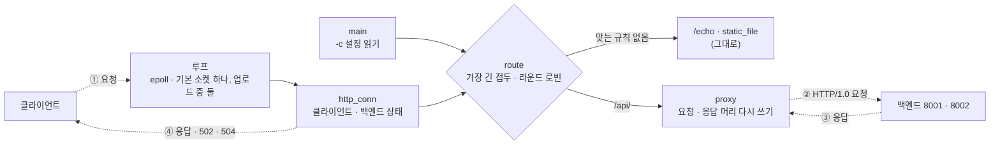
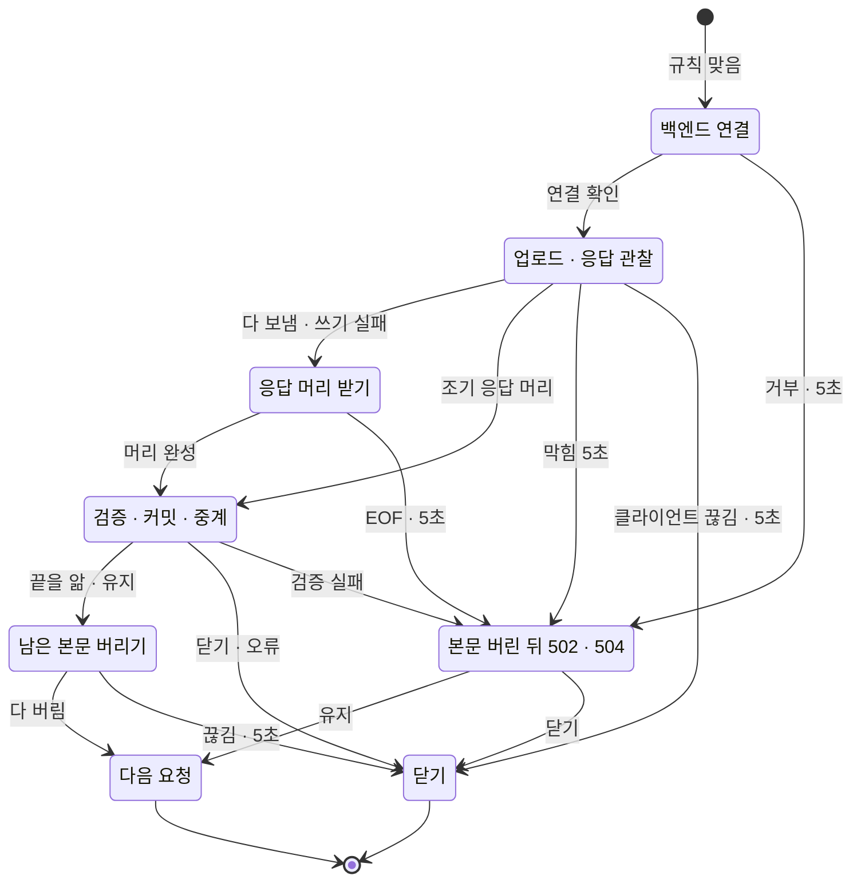

# Step 6. 리버스 프록시 (동적 요청 처리 포함)

이 문서는 Step 6의 진행 상태와 요구사항·설계·테스트·구현·검증 기록을 기술하는 것을 목적으로 한다.

| 항목 | 내용 |
| ---- | ---- |
| 상태 | ✅ 완료 (독립 검증 통과, F1 수정 재확인) |
| 요구사항 | R-07, R-08, Q-03 |
| 일정 | 11/25 (수) 오전 |
| 결정 기록 | [decision.md](./decision.md) |
| 기준 | [DESIGN.md 5장 Step 6](../../../DESIGN.md#5-구현-단계) |

## 진행 체크

- [x] 요구사항 확인 (R-07, R-08, Q-03, DESIGN.md Step 6 완료 기준)
- [x] 설계 → [decision.md](./decision.md) (검토 차단 5건 해소, B4는 현행 단일 루프 전제)
- [x] 테스트 작성 (TC-6-01~14, 단위 4개 파일·기능 스크립트)
- [x] 구현 (자체 점검까지)
- [x] 검증 (Mavuika 독립 검증, F1 수정 재확인 통과)

## 1. 요구사항

- 클라이언트 쪽 `accept`, 백엔드 쪽 `connect`
- 연결·응답 시간 제한
- 포워드 프록시·CGI는 Step 7 이후 여유 있을 때만

## 2. 설계 요약

이유와 버린 선택지는 [decision.md](./decision.md)에 있다. D-60·D-65는 사용자 선택이고, 나머지 D-61~D-67은 검토 차단을 해소한 내부 설계다. 구현 동작은 독립 검증을 통과했다.

모듈 구성은 아래와 같다. 점선은 네트워크, 실선은 함수 호출이다.

프록시 요청 하나는 아래 상태를 지난다. 백엔드 응답 머리를 검증해 출력 버퍼에 채우기(커밋) 전까지만 502·504로 바꿀 수 있다. 백엔드 소켓은 중계를 마치거나 실패하면 바로 닫는다.

- 업로드 중 관찰: 요청을 보내는 동안에도 백엔드 응답을 읽는다. 완전한 응답 머리가 오면 업로드를 멈추고 그 응답을 중계한다(조기 응답).
- 유지 판단: 끝이 정해진 응답(204·304, `Content-Length` 한 개)은 D-51 규칙을 따르고, 끝이 EOF인 응답은 닫는다. 유지면 남은 요청 본문을 버린 뒤 다음 요청으로 간다.
- `본문 중계 → 닫기`: EOF 응답, 닫기 규칙, 조기 끝, 5초 무진행인 경우다.

- `RELAY → FAIL`은 커밋 전 검증(D-65 판정 순서 1~6)에서만 일어난다. 남은 본문이 없으면 `SKIP`은 바로 지나간다.

| 주제 | 내용 | 결정 |
| ---- | ---- | ---- |
| 백엔드 전달 주소 | `/api/` → `/`, `/api/users` → `/users` | D-60 |
| 설정 파일 | `-c`는 선택 인자, `route <접두 경로> <호스트:포트>...` 줄, 접두에 `?`·`#`·공백·제어 문자 금지, 호스트 255바이트 이하, 잘못되면 시작 실패, 이름은 시작할 때만 조회 | D-61 |
| 경로 매칭 | 바이트 접두 비교, 가장 긴 규칙, 쿼리 유지, 디코딩·정규화 없음, `/api`는 규칙 밖 | D-62 |
| 매칭 순서 | 파서 오류 → 규칙 매칭 → `/echo`·405·정적 | D-62 |
| 라운드 로빈 | 규칙마다 카운터, 고를 때 바로 증가, 실패해도 재시도 없음 | D-63 |
| 백엔드 연결 | 요청마다 새 논블로킹 `connect`, 끝·실패 때 바로 닫음, 재사용 없음 | D-64 |
| 백엔드 요청 | `HTTP/1.0`, 홉 머리 빼기, `Host`·`Connection: close` 붙이기, `Content-Length`는 검증한 값으로 새로 쓰기, 본문은 조각 전달 | D-64 |
| 홉 머리 (양방향) | `Connection`·`Keep-Alive`·`Proxy-Connection`·`TE`·`Upgrade`와 `Connection` 토큰이 가리키는 머리 | D-64 |
| `100 Continue` | 본문을 기다리기 전에 서버가 직접 보냄, 커밋 아님 | D-64 |
| 응답 머리 검증 | 8KB·CRLF·NUL, 1.0/1.1 상태 줄, token 이름, 허용 값 바이트, obs-fold 거절, 통과 전 클라이언트에 쓰지 않음 | D-65 |
| 프레이밍 검사 | `Transfer-Encoding`, `Content-Length` 두 줄 이상·형식 오류, 길이 머리를 가리키는 `Connection` 토큰 → 상태와 관계없이 502 | D-65 |
| 응답 본문 끝 | 204는 머리 끝·`Content-Length` 뺌, 304는 머리 끝·`Content-Length` 유지, 그 밖은 `Content-Length` 또는 EOF | D-65 |
| 클라이언트 연결 | 끝을 알면 D-51 규칙(1.1 유지, 1.0 `keep-alive` 유지), EOF 응답은 `Connection: close` 뒤 닫기 | D-65 |
| 응답 머리 다시 쓰기 | 버전 `HTTP/1.1`, 홉 머리 빼고 우리 `Connection` 넣기 | D-65 |
| 길이 경계 | 길이만큼만 중계하고 넘는 바이트 버림, 커밋 뒤 길이 전 EOF는 응답 없이 닫기 | D-65, D-66 |
| 502·504 | 커밋 전 실패는 502, 시간 초과는 504, 남은 요청 본문을 버린 뒤 D-51 규칙으로 유지·닫기, 커밋 뒤 실패는 연결만 닫기 | D-66 |
| 조기 응답 | 업로드를 멈추고 미송신 바이트 버림 → 중계 → 유지면 남은 본문 버리기 | D-66 |
| 시간 제한 | 연결 5초 고정, 그 밖은 실제 대기 구간별 진행 없음 5초 | D-66, D-67 |
| 루프 등록 | 기본 소켓 하나, 업로드 중에만 백엔드 읽기를 함께 등록 | D-67 |
| 깨운 원인 | 소켓 종류를 알림에 담고, 전체 배치의 백엔드 세대를 실행 전에 복사해 옛 알림을 버림 | D-67 |
| HUP·ERR | 남은 응답을 실제로 읽은 뒤 EOF·오류를 판정하고, 읽기 예산이 끝나면 다음 기회를 남김 | D-66, D-67 |
| 연결 완료 | `EINPROGRESS` 뒤에는 현재 백엔드의 쓰기 준비 알림을 받은 차례에만 `SO_ERROR`로 판정 | D-67 |
| 차례 예산 | 백엔드 `read`도 소켓 `read` 1번에 포함, 백엔드 `write` 1번 | D-67 |
| 소유 | 백엔드 소켓은 `http_conn`이 끝·실패·release 때 닫고 세대 번호를 올림, 라우팅 표는 `main`이 빌려줌 | D-67 |

Step 5까지의 계약과의 관계는 아래와 같다.

| 계약 | Step 6 | 결정 |
| ---- | ------ | ---- |
| `-c` 없이 실행 | Step 5와 같음 | D-61 |
| 정적 파일·`/echo`·405 | 규칙에 맞지 않는 요청은 그대로 | D-62 |
| 파서 판정·크기 상한 | 그대로, 프록시보다 먼저 | D-62 |
| 출력 버퍼·출력 우선 | 그대로, 백엔드 본문도 같은 버퍼로 중계 | D-58, D-65 |
| 유지·닫기와 `Connection` | 끝을 아는 프록시 응답과 502·504는 그대로, EOF 응답만 닫기 | D-37, D-38, D-51, D-65 |
| 버퍼 맨 앞 = 다음 요청 시작 | 그대로, 프록시 요청 뒤에도 유지 | D-47, D-64 |
| 5초 무진행 마감 | 클라이언트 쪽은 그대로, 백엔드 구간 추가 | D-59, D-67 |
| 끝난 연결 정리 순서 | 그대로, release에서 백엔드 소켓도 닫음 | D-57, D-67 |
| 실행 인터페이스 | 차례 실행에 깨운 원인을 넘기고, 만료도 차례 결과를 돌려줌 | D-56, D-57, D-67 |
| 실패 통보 시점 | 본문을 다 버린 뒤 502·504 (기존 정책 한계, 바꾸지 않음) | D-39, D-59, D-66 |

시험할 수 있는 지점은 아래와 같다. TC 번호는 테스트 작성 때 정한다.

- 단위: 설정 글자 → 표(잘못된 줄 번호), 매칭·전달 주소(`/api`, `/api/`, `/api/users?x=1`, 가장 긴 규칙), 라운드 로빈 순서.
- 단위: 응답 머리 검증(모든 분할 도착, 정확히 8KB·초과, 단독 CR·LF, NUL, obs-fold, `Content-Length :`, 이름 앞 공백, 금지 제어 문자, 머리와 본문 동시 도착), 1.1/1.0별 `Connection` 결과.
- 단위: 홉 머리 제거(여러 `Connection` 줄, 대소문자, 여러 토큰, 지명 머리의 앞뒤 순서, `Connection: Content-Length` 요청·응답), 같은 이름 일반 머리 보존.
- 단위: 204의 `Content-Length` 없음·0·양수·형식 오류·두 줄, 304의 유효 `Content-Length`, `Transfer-Encoding`과 무본문 상태 조합.
- 단위: 본문 끝 경계(`Content-Length: 0`, 204·304에 바이트가 따라옴, 길이보다 긴 본문, 길이 전 EOF, 길이 없는 응답의 EOF), 요청 머리·본문·다음 요청이 한 번에 온 경우 다음 정적·프록시 요청까지 진행.
- 단위: 시험 쪽 구동으로 연결 거부 502, 듣기만 하는 백엔드 504, 본문을 남긴 채 실패한 뒤 유지, 업로드 중 조기 413(백엔드 쓰기 막힘·클라이언트 업로드 멈춤 두 경우), 쓰기 실패 뒤 응답 머리 수신.
- 단위: `connect` 즉시 성공·실패·`EINPROGRESS`, 알림 없는 중복 실행, 클라이언트 알림 뒤 새 백엔드 대기, 같은 fd 번호 재개방과 옛 배치 알림, 논리 시계로 구간별 마감과 504가 끝으로 사라지지 않는지.
- 기능·회귀: DESIGN 완료 기준 4개, `-c` 없이 Step 3·4·5 기능 TC.

## 3. 테스트

상태: ⬜ 미실행 · 🟢 통과 · 🔴 실패 · ⛔ 막힘. 🟢는 Raiden 자체 실행 뒤 Mavuika 독립 검증까지 통과한 결과다.

기능 시험은 기존 포트를 건드리지 않으려고 DESIGN의 8001·8002 대신 격리 포트(백엔드 18001·18002·18004, 서버 `127.0.0.1:18080`)로 했다.

| TC | 주제 | 종류 | 실행 | 기대 결과 | 상태 |
| -- | ---- | ---- | ---- | --------- | ---- |
| TC-6-01 | 백엔드 번갈아 전달 | 기능 | 백엔드 2개(`python3 -m http.server`) 뒤 `/api/who.txt` 4번, `/api/` | 두 백엔드에 번갈아 감, 백엔드는 `/who.txt`를 받음 | 🟢 |
| TC-6-02 | 백엔드 모두 종료 → 502 | 기능 | 백엔드 2개 종료 뒤 `/api/who.txt` 2번 | 502 두 번, 같은 연결 재사용 | 🟢 |
| TC-6-03 | 무응답 백엔드 → 504 | 기능 | 8001 자리에 입력을 열어 둔 `nc -l`, `/api/` 2건 동시 | 그쪽은 약 5초 뒤 504, 다른 쪽 200 | 🟢 |
| TC-6-04 | Step 3 회귀·504 중 정적 | 회귀 | `-c`로 Step 3 기능 TC, 504 대기 중 정적 요청 | 기존 결과 그대로, 정적은 1초 안 | 🟢 |
| TC-6-05 | 라우팅 규칙 매칭 | 단위 | `test_route`, `test_proxy_conn` | `/api`·`/api?x`·`/API/` 규칙 밖, 가장 긴 접두, 쿼리 유지, 규칙별 라운드 로빈 | 🟢 |
| TC-6-06 | 설정 파일 검사 | 단위·기능 | 잘못된 줄·없는 파일·이름 조회 실패, 너무 긴 `호스트:포트`, `-c` 생략 | 줄 번호와 함께 시작 실패(exit 1), `-c`는 선택 | 🟢 |
| TC-6-07 | 응답 머리 검증 | 단위 | `test_proxy` | 분할 도착은 기다림, 8KB 초과·CR·LF·NUL·obs-fold·이름 공백·제어 문자·1xx → 502 | 🟢 |
| TC-6-08 | 머리 다시 쓰기·홉 머리 | 단위 | `test_proxy`, `test_proxy_conn` | 백엔드에 HTTP/1.0·`Host`·`Connection: close`, 홉·지명 머리 제거, 길이 다시 씀, 100 먼저 | 🟢 |
| TC-6-09 | 204·304·길이 경계 | 단위 | `test_proxy`, `test_proxy_conn` | 204 길이 뺌·304 유지·본문 없음, 넘는 바이트 버림, 길이 전 EOF는 응답 없이 닫음 | 🟢 |
| TC-6-10 | 클라이언트 연결 유지 | 단위·기능 | 끝을 아는 응답 뒤 다음 요청, EOF 응답, `curl` 재사용, 1.0 `keep-alive` | 끝을 알면 유지, EOF 응답은 `Connection: close` 뒤 닫음 | 🟢 |
| TC-6-11 | 502·504 뒤 유지 | 단위·기능 | `connect` 거부·`SO_ERROR`·`socket` 실패, 잘못된 응답, 응답 무진행 | 남은 본문을 버린 뒤 502·504, 다음 요청 처리 | 🟢 |
| TC-6-12 | 업로드 중 조기 응답 | 단위·기능 | 쓰기 막힘·업로드 멈춤 중 413, 쓰기 실패 뒤 응답, 1MB 업로드 | 413 중계 → 남은 본문 버림 → 다음 요청 200 | 🟢 |
| TC-6-13 | 연결 완료·옛 알림·마감 | 단위 | 가짜 시계 직접 호출, 루프 부하(백엔드 소켓 150개 교체) | 쓰기·ERR 알림에서만 연결 완료, 알림만으로 마감 연장 없음, 구간별 504·ERROR·TIMED_OUT | 🟢 |
| TC-6-14 | `-c` 생략 회귀 | 회귀 | `make -B test`, `-c` 없이 Step 3·4·5 기능 TC | `/api/`도 정적 처리, 기존 결과 그대로 | 🟢 |

## 4. 구현 기록

| 작업 | 요약 | 결정 |
| ---- | ---- | ---- |
| 라우팅 설정 모듈 | `route`: 설정 글자 → 표, 시작 때 IPv4 조회, 가장 긴 접두, 규칙별 카운터. 규칙 16개·백엔드 8개 상한 | D-60~D-63 |
| `-c` 선택 인자 | `options`가 받고 `main`이 표를 만들어 루프에 빌려줌, 실패면 exit 1 | D-61 |
| 머리 검증·다시 쓰기 | `proxy`: 응답 판정 순서 1~7, 요청·응답 홉 머리 제거, 버퍼에 쓰는 순수 함수 | D-64, D-65 |
| 연결 상태에 프록시 추가 | `http_conn`에 연결 대기·업로드·머리·본문·본문 버리기 상태와 백엔드 버퍼 16KB·8KB | D-64~D-67 |
| 깨운 원인과 만료 결과 | `http_conn_run`이 깨운 원인을 받고, `http_conn_expire`가 커밋 전 백엔드 만료에 RUNNABLE을 돌려줌 | D-67 |
| 루프 두 소켓 등록 | 기다리는 소켓만 등록, 업로드 중 백엔드 읽기 추가, 배치 직후 세대 복사로 옛 알림 버림 | D-67 |
| 502·504 상태 | `http_response` 상태 목록에 추가 | D-66 |

## 5. 검증 기록

| 날짜 | 검증 | 결과 | 확인한 것 |
| ---- | ---- | ---- | --------- |
| 11/25 | 자체 단위 (Raiden) | 통과 | Docker Ubuntu 24.04에서 마지막 코드 수정 뒤 `make -B`·`make -B debug`·`make -B test` 모두 성공, 경고 0, 시험 11개 모두 통과 |
| 11/25 | 자체 기능·회귀 (Raiden) | 53/53 | TC-6-01~04·06·10~12·14, `-c` 있음·없음 각각 Step 3·4·5 기능 TC와 `ab` 실패 0 |
| 11/25 | 반례 변이 (Raiden) | 5/5 검출 | 연결 완료 판정·길이 자르기·본문 버리기 순서·조기 응답·쓰기 실패 처리를 하나씩 망가뜨리면 해당 시험이 실패함 |
| 11/25 | 독립 검증 (Mavuika) | 수정 요청 1건 | 연결 교대·502·504·조기 413·연결 유지·옛 알림·정적/`/echo` 회귀는 결함 없음. 실제 연결 지연 504와 같은 배치 옛 알림도 별도 하니스로 재현. 설정 파서 버퍼 넘침(F1) 발견 |
| 11/25 | F1 자체 수정 (Raiden) | RED → GREEN | `호스트:포트` 토큰이 261바이트를 넘으면 복사 전에 줄 번호 오류. 수정 전에는 0 300·400개를 받아들이고 3000개는 ASan 넘침이 났다. 수정 뒤 `make -B`·`make -B debug`·`make -B test` 성공, 경고 0. 제품 `-c`는 `N행` 오류로 exit 1, 261바이트는 기동. `route.c` sha256 `ca9d0182…` |
| 11/25 | F1 독립 재확인 (Mavuika) | 통과 | 해시 일치, `test_route` ok 46·실패 0, 최초 넘침 재현 설정이 모두 줄 번호 오류로 바뀜, ASan 메모리 오류 0. 필수 수정 남지 않음 |

## 6. 막힌 것 / 다음 행동

- 막힌 것: 없음.
- Step 7에서 해결: 시작 실패 경로의 `realpath` 결과 누수는 D-72에 따라 수정했고 TC-7-14에서 확인했다.
- 관찰: 입력이 `/dev/null`인 `nc -l`은 바로 FIN을 보내 504가 아니라 502가 된다(머리 없이 EOF, D-66). 터미널에서 띄운 `nc`는 입력이 열려 있어 504다.
- 시험 환경: 서버는 컨테이너 안, 백엔드는 호스트에서 돈다. 설정 주소는 `host.docker.internal:8001`처럼 적는다(D-61).
