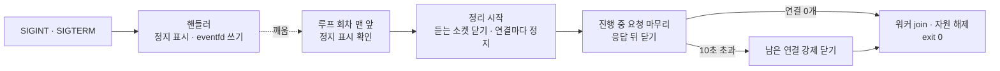

# Step 7. 안정성

이 문서는 Step 7의 진행 상태와 요구사항·설계·테스트·구현·검증 기록을 기술하는 것을 목적으로 한다.

| 항목 | 내용 |
| ---- | ---- |
| 상태 | ✅ 완료 |
| 요구사항 | R-09, Q-03 |
| 일정 | 11/25 (수) 오후 |
| 결정 기록 | [decision.md](./decision.md) |
| 기준 | [DESIGN.md 5장 Step 7](../../../DESIGN.md#5-구현-단계) |

## 진행 체크

- [x] 요구사항 확인
- [x] 설계 → [decision.md](./decision.md) (D-68~D-72 채택)
- [x] 테스트 작성
- [x] 구현
- [x] 검증

## 1. 요구사항

- `SIGPIPE` 무시 → `EPIPE` 처리 (D-05 유지)
- `SIGINT`·`SIGTERM`: 새 연결 중단 → 처리 중 요청 완료 → 종료
- 버퍼·소켓·스레드 자원 회수, 시작 실패 경로 포함
- 버퍼에 쓸 때 길이 확인
- 접근 로그

## 2. 설계 요약

이유와 버린 선택지는 [decision.md](./decision.md)에 있다. 여기에는 무엇을 정했는지만 적는다. D-68~D-72는 사용자 채택, `SIGPIPE` 무시와 `EPIPE` 처리는 D-05 그대로다. 현재 구조(epoll 루프 + 워커 4개 + 완료 eventfd)를 그대로 쓴다.

종료는 아래 순서로 진행한다.

### 신호와 스레드

| 주제 | 내용 | 결정 |
| ---- | ---- | ---- |
| 핸들러 설치 | `main`이 듣는 소켓을 열기 전에 `sigaction`으로 건다 | D-68 |
| 핸들러 동작 | errno 저장 → 처음 신호 번호 기록 → 공개된 eventfd에 `write` 한 번(결과 무시) → errno 복원 | D-68 |
| 핸들러 스레드 | 워커는 두 신호를 막은 채 만든다. 핸들러는 루프 스레드에서만 돈다 | D-68 |
| 깨우기 순서 | eventfd 공개 → 회차 맨 앞 정지 확인 → `epoll_wait` | D-68 |
| 두 번째 신호 | 무시한다(표시가 이미 있음) | D-68 |

### 연결별 마무리

정지는 루프가 **바쁘지 않은 연결에만** 적용한다. 정리 시작 때 대기 중 연결에, 바쁜 연결은 회수할 때 적용한다.

| 정지 적용 때 연결 | 동작 | 결정 |
| ----------------- | ---- | ---- |
| 요청 사이 대기 (다음 요청 바이트가 버퍼에 있어도 아직 시작 전) | 바로 닫는다 (`DONE`) | D-69 |
| 요청 머리·본문 받는 중 | 기존 규칙대로 받는다. 5초 무진행이면 `TIMED_OUT` | D-59, D-69 |
| 응답 머리를 아직 안 채움 (본문 버리기, 백엔드 커밋 전) | `Connection: close`로 응답한 뒤 닫는다 | D-69 |
| 응답 머리를 이미 채움 (파일·`/echo`·프록시 본문, 출력 남음) | 끝까지 보낸 뒤 닫는다 (D-51 정리 중 예외) | D-69 |
| 닫기 전 정리 (D-54) | 그대로 고정 5초 | D-54 |
| 버퍼에 이미 온 다음 요청 | 직전 응답 완료 뒤 요청 경계에서 처리하지 않고 닫는다 | D-69 |

워커는 응답 완료 뒤 **다음 요청을 파싱하기 전에** 한 차례를 반환한다. 루프가 회수하고 정지를 적용한 뒤에만 다음 요청을 시작한다. 버퍼에 바이트가 있다는 사실만으로 다음 요청을 이미 진행 중이라고 보지 않는다. 다음 요청의 수락은 루프가 종료 신호를 잠시 막고 정지 표시를 확인한 뒤 큐에 넣는 구간으로 정한다. 그 안에 도착한 신호는 큐에 넣은 직후 처리한다.

### 종료 대기 상한

| 기다리는 원인 | 끝나는 때 | 결정 |
| ------------- | --------- | ---- |
| 유휴 keep-alive | 정리 시작 즉시 | D-69 |
| 멈춘 불완전 요청 | 5초 무진행 (`TIMED_OUT`) | D-59 |
| 응답 지연 (백엔드 무응답) | 5초 → 504 + `Connection: close` 뒤 닫기 | D-66, D-69 |
| 느리지만 진행하는 전송 | 정리 시작 10초 뒤 강제 닫기 | D-70 |
| 실행 중인 워커 차례 | 차례 회수 즉시 (차례는 예산 안, 디스크 대기는 남음) | D-56, D-70 |

### 루프 단계

| 단계 | 하는 일 | 결정 |
| ---- | ------- | ---- |
| 실행 | 지금과 같다. 회차 맨 앞에서 정지 표시만 확인한다 | D-68 |
| 정리 (한 번 진입) | 듣는 소켓 `close`(등록도 지워짐) → 마감 = 지금 + 10초 → 대기 중 연결 정지 → 시작 알림 | D-69, D-70 |
| 정리 회차 | accept 없음. `epoll_wait` 시간 제한은 연결 마감과 10초 마감 중 이른 것. 회수한 연결에 정지 적용 후 다음 요청 재개 여부 판단 | D-69 |
| 강제 | 대기 중 연결 즉시 닫기, 회수한 연결은 결과와 관계없이 닫기, 새로 넣지 않음 | D-70 |
| 끝내기 | 연결 목록이 비면: 워커 정지·`join`(잠금 밖) → eventfd 공개 해제 → eventfd·잠금·`epoll`·정리 → 0 반환 | D-69, D-72 |

### 인터페이스 변경

| 인터페이스 | 변경 | 결정 |
| ---------- | ---- | ---- |
| `server_loop_run` | 듣는 소켓 소유를 넘겨받아 모든 경로에서 닫는다. 정상 종료 0, 서버 실패 -1 | D-69, D-72 |
| `server_loop_request_stop(signo)` (새) | 핸들러가 부르는 async-signal-safe 함수. 시험도 이것으로 정지를 건다 | D-68 |
| `http_conn_stop` (새) | 루프 스레드에서 바쁘지 않은 연결에만. 직전 응답 뒤 다음 요청을 파싱하기 전 경계라면 버퍼에 다음 요청이 있어도 `DONE`으로 닫는다 | D-69 |
| `http_conn_init` | 접속 주소(로그용)를 받는다 | D-71 |
| `http_conn_release` | 남은 로그 줄을 `aborted`로 쓴다 | D-71 |
| `access_log` 모듈 (새) | 출력 대상을 시작 때 한 번 정한다(없으면 끔). 한 줄 쓰기 | D-71 |

### 자원 소유와 해제

| 자원 | 소유 | 해제 시점 | 결정 |
| ---- | ---- | --------- | ---- |
| `root` (`realpath`) | `main` | 시작 실패·서버 실패·정상 종료 모든 경로 | D-72 |
| 라우팅 표 | `main` (정적, 힙 없음) | 해제 없음 | D-67 |
| 듣는 소켓 | 루프 | 정리 시작·서버 실패·시작 실패 | D-69 |
| `epoll`·eventfd·잠금·조건 변수 | 루프 | 끝내기·서버 실패 | D-72 |
| 워커 스레드 | 루프 | `join` (연결 해제 전) | D-69 |
| 연결 구조체·클라이언트 소켓 | 루프 | 회차 끝 정리 (D-57 순서) | D-57 |
| 파일 fd·백엔드 소켓 | `http_conn` | `http_conn_release` | D-67 |

### 실패 시 동작

| 상황 | 동작 | 결정 |
| ---- | ---- | ---- |
| `sigaction` 실패 | 시작 실패, exit 1 | D-72 |
| 워커 신호 마스크 설정 실패 | 워커 생성 실패와 같은 길 (만든 워커만 `join`) | D-68 |
| 핸들러의 eventfd `write` 실패 | 무시. `EAGAIN`은 이미 깨어 있고, 루프 스레드라 `epoll_wait`도 `EINTR`로 깬다 | D-68 |
| 정리 중 `epoll_wait`·eventfd 읽기 실패 | 기존 서버 실패 경로. 연결 해제(`aborted` 로그) 뒤 -1, exit 1 | D-71, D-72 |
| 강제 닫기 | `ERROR`·`ECANCELED`, 기존 연결 오류 한 줄 + 강제 개수 한 줄 (stderr) | D-70 |
| 접근 로그 쓰기 실패 | 무시, 연결에 영향 없음 | D-71 |
| 끊긴 클라이언트·백엔드에 쓰기 (`EPIPE`) | 클라이언트면 그 연결만 닫고, 백엔드면 D-66대로 처리한다. 서버는 유지 | D-05, D-66 |

### 접근 로그와 알림

| 주제 | 내용 | 결정 |
| ---- | ---- | ---- |
| 단위 | 상태가 정해진 요청마다 정확히 한 줄 | D-71 |
| 결과 | 마지막 바이트를 보내면 `ok`, 그 전에 끝나면 해제 때 `aborted` | D-71 |
| 형식 | `2026-11-26T14:03:05+0900 172.17.0.1:53422 "GET /index.html HTTP/1.1" 200 1234 3ms ok` | D-71 |
| 판정 실패 요청 | 요청 자리에 `"-"` | D-71 |
| 보낸 바이트 | 이 요청의 응답 머리 + 본문 (`100 Continue` 제외) | D-71 |
| 길이 경계 | 고정 버퍼에 길이를 확인해 쓰고 넘치면 자른다. 대상의 0x21~0x7E 밖·`"`·`\`는 `?`로 바꾼다 | D-71 |
| 출력 | 접근 로그·시작·종료 알림은 stdout(줄 버퍼), 오류·강제 종료는 stderr | D-71 |
| 종료 알림 | `종료 신호 SIGTERM: 새 연결 중단, 연결 N개 마무리 (최대 10초)` → `서버 종료` | D-71 |

### 불변조건

- 정지 표시는 루프가 **바쁘지 않은 연결에만** 쓴다. 작업 큐 잠금이 워커에 보이게 한다.
- 정리 시작 뒤에는 accept하지 않고, 강제 단계 뒤에는 작업 큐에 넣지 않는다. 응답 완료 뒤 다음 요청을 파싱하기 전 루프 회수 경계를 반드시 지난다.
- 끝내기는 연결 목록이 빈 뒤(바쁜 연결 없음)에만 하고, `join` 동안 잠금을 쥐지 않는다.
- eventfd는 공개를 해제한 뒤에만 닫는다.
- 기존 5초 무진행 마감·keep-alive 규칙은 정리 중에도 그대로다. 정리는 새 요청을 받지 않는 것만 더한다.

### 길이 경계

- 새 고정 버퍼는 접근 로그 줄 하나다. 대상 상한 2KB(D-43)가 줄 안에 들어가는 크기로 하고, 그래도 길이를 확인한다.
- 기존 상한(머리 8KB 431, URI 2KB 414, 본문 1MB 413, 출력 64KB)은 바꾸지 않고 ASan으로 다시 확인한다.

## 3. 테스트

상태: ⬜ 미실행 · 🟢 통과 · 🔴 실패 · ⛔ 막힘

서버는 `./webserver -p 8080 -r ./www > out.log 2> err.log`로 띄우고, 종료 시간은 신호를 보낸 때부터 잰다. 전송 중단 시험은 느린 클라이언트만으로 판정하지 않고 **서버의 미송신 출력이 남았다는 관문/계측**을 먼저 확인한다. 관문이 없으면 해당 TC는 통과가 아니라 ⛔로 기록한다.

| TC | 주제 | 종류 | 실행 | 기대 결과 | 상태 |
| -- | ---- | ---- | ---- | --------- | ---- |
| TC-7-01 | 큰 파일 도중 중단해도 서버 유지 | 기능 | 서버 미송신 출력 관문을 확인한 뒤 클라이언트를 끊고 `/index.html` 요청 | 서버 유지·200, 큰 파일 로그 한 줄 `aborted` | 🟢 |
| TC-7-02 | 종료 뒤 누수·잘못된 접근 없음 | 메모리 | ASan 빌드와 valgrind로 정적·`/echo`·프록시·keep-alive 요청 뒤 `kill -INT` | 종료 코드 0, 누수·오류 0 | 🟢 |
| TC-7-03 | 유휴 서버 종료 | 기능 | 시작 뒤 `kill -INT`, 다시 띄워 `kill -TERM` | 1초 안에 종료 코드 0, 종료 알림 | 🟢 |
| TC-7-04 | 유휴 keep-alive 즉시 닫기 | 기능 | `nc` 접속만 한 연결과 keep-alive 요청 뒤 열린 연결을 두고 `kill -TERM` | 1초 안에 종료, 두 연결 모두 EOF | 🟢 |
| TC-7-05 | 진행 중 다운로드 마무리 | 기능 | 서버 미송신 출력 관문 확인 → `kill -TERM` → 클라이언트가 남은 응답을 읽음 | 응답 전체 크기 일치, 서버 종료 코드 0 | 🟢 |
| TC-7-06 | 정리 중 새 연결 거부 | 기능 | TC-7-05의 출력 관문으로 정리 상태를 유지한 채 새 연결 시도 | 연결 거부, 기존 응답은 마무리 | 🟢 |
| TC-7-07 | 정리 중 완성된 요청은 닫는 응답 | 기능 | `(printf 'GET / HTTP/1.1\r\n'; sleep 2; printf 'Host: x\r\n\r\n'; sleep 3) \| nc` 1초 뒤 `kill -TERM` | 200 + `Connection: close`, 그 뒤 서버 종료 | 🟢 |
| TC-7-08 | 멈춘 불완전 요청은 5초 마감 | 기능 | `printf 'GET / HTTP/1.1\r\n'` 뒤 멈춘 `nc`를 두고 `kill -TERM` | 약 5초 뒤(6초 안) 종료 코드 0 | 🟢 |
| TC-7-09 | 응답 없는 백엔드는 504 뒤 종료 | 기능 | 8001에 `nc -l`, `-c`로 띄워 `/api/` 요청 중 `kill -TERM` | 504 + `Connection: close`, 6초 안에 종료 코드 0 | 🟢 |
| TC-7-10 | 끝나지 않는 전송은 10초 뒤 강제 | 기능 | 작은 소켓 버퍼·충분한 응답으로 서버 미송신 출력 확인 → `kill -TERM`; 수신을 조절해 5초보다 짧은 간격으로 실제 서버 송신을 계속 확인 | 10~11초에 종료 코드 0, 강제 종료·`aborted` 한 줄씩, 응답 미완료 | 🟢 |
| TC-7-11 | 접근 로그 한 줄 규칙 | 기능 | keep-alive 요청 2개, 404, 400(잘못된 요청 줄), `POST /echo`, 조기 프록시 응답 뒤 업로드 중단 | 요청마다 한 줄, 완송된 413은 `ok` | 🟢 |
| TC-7-12 | 연결 정지 단위 | 단위 | `test_http_conn`: 요청 사이·머리 도중·응답 머리 전·후·버퍼 속 다음 요청에 정지 | 「연결별 마무리」 표대로 결과와 `Connection` 머리 | 🟢 |
| TC-7-13 | 루프 종료와 스레드·요청 경계 | 단위 | 기존 관문, 완료 eventfd 읽기 직후 신호, 정지 확인 뒤 큐 삽입 전 신호 관문 | 처리된 신호가 수락보다 먼저면 둘째 요청 무응답; 구간 안의 보류 신호는 삽입 뒤 처리. 종료 코드 0·워커 `join`·TSan 경고 0 | 🟢 |
| TC-7-14 | 시작 실패 누수 없음 | 메모리 | ASan 빌드로 잘못된 `-c` 파일, 사용 중인 포트 | exit 1, LSan 누수 0 (`realpath` 4097B 없음) | 🟢 |
| TC-7-15 | 길이 경계 회귀 | 메모리 | ASan 빌드로 8KB 넘는 머리, 2KB 넘는 URI, 1MB 넘는 본문, 2KB 대상 요청 | 431·414·413, 2KB 대상 로그 한 줄, ASan 오류 0 | 🟢 |
| TC-7-16 | 기존 계약 회귀 | 회귀 | `make test`와 Step 3~6 기능 TC (`SIGPIPE`·5초 마감·keep-alive 포함) | 모두 통과 | 🟢 |
| TC-7-17 | 프록시 다음 요청에서 정지 | 기능 | 같은 연결의 프록시 응답 뒤 다음 정적 요청의 본문 일부를 보내고 `SIGTERM` → 나머지 본문 전송 | 아직 생성 전인 정적 응답에 `Connection: close`, 응답 뒤 종료 | 🟢 |

## 4. 구현 기록

| 작업 | 요약 | 결정 |
| ---- | ---- | ---- |
| 종료 신호·루프 회수 | `sigaction`·eventfd로 루프를 깨우고 accept 중단, 요청 경계 회수, 10초 강제 마감, 워커 join과 fd 정리를 구현했다 | D-68~D-70·D-72 (채택) |
| 요청별 접근 로그 | 응답 상태 확정·완송·중단 경로에 로그 한 줄과 송신 바이트 계측을 추가했다 | D-71 (채택) |
| 시작 실패·버퍼 경계 | `realpath` 결과를 모든 반환 경로에서 해제하고 로그 대상·줄 길이를 검사한다 | D-71~D-72 (채택) |
| 독립 검증 F1~F3 수정 | 모든 요청 admission 직전 최신 신호 반영, 완송한 중계 응답 로그를 남은 업로드 버리기와 분리, 요청마다 커밋 상태 초기화 | D-69·D-71 (채택) |
| F1 admission 마스크 경계 | 큐 삽입 구간에서 두 신호를 막고 최신 정지를 확인한 뒤 넣고 마스크를 되돌린다 | D-69 (채택) |

## 5. 검증 기록

| 날짜 | 검증 | 결과 | 확인한 것 |
| ---- | ---- | ---- | --------- |
| 11/25 | 자체 실행: Linux 비root `make all debug && make test` | 통과 | 11개 ASan 단위 실행, 경고·실패 0; 로그 `/Users/hyeonji/.hermes/profiles/raiden/cache/scratch/ws-step7/final2-make-test.log` |
| 11/25 | 자체 실행: `make tsan` | 통과 | TSan 단위 2개, 경고 0; TC-7-10 계측 10.09초·write 7회; 로그 `/Users/hyeonji/.hermes/profiles/raiden/cache/scratch/ws-step7/final-tsan.log` |
| 11/25 | 자체 실행: `python3 tests/test_step7.py` (일반·ASan·TSan 서버) | 통과 | 실제 TCP TC-7-03/04/07/08/09/11/14/15; 로그 `/Users/hyeonji/.hermes/profiles/raiden/cache/scratch/ws-step7/{integration5,asan-integration2,tsan-integration}.log` |
| 11/25 | 자체 실행: valgrind 정적·echo·프록시·keep-alive 뒤 SIGINT | 통과 | 종료 0·누수 0·오류 0; `/Users/hyeonji/.hermes/profiles/raiden/cache/scratch/ws-step7/valgrind.log` |
| 11/25 | 자체 실행: `test_server_loop` ASan·TSan | 통과 | TC-7-01/05/06/10은 AF_UNIX 실제 루프에서 미송신 64KB write 관문을 사용했다; 강제 종료 계측 10.02초·write 7회; 로그 `final2-make-test.log`, `final-tsan.log` |
| 11/25 | 미실시: Step 3~6 전체 기능 TC | ⛔ | `make test`와 Step 7 TCP 집중 검사는 통과했으나 TC-7-16의 전체 기능 시나리오는 실행하지 않았다 |
| 11/26 | 독립 검증: Step 7 변경 경계 | 수정 요청 | 완료 회수 직전 신호에 다음 요청 파싱(F1), 완송 413 로그 오분류(F2), 프록시 다음 정적 응답의 닫기 머리 누락(F3). 보고서: `~/.hermes/profiles/mavuika/cache/scratch/ws-step7-independent-1zcy65_6/report.md` |
| 11/26 | 자체 실행: F1~F3 수정 뒤 RED→GREEN | 통과 | 수정 전 RED(F1 둘째 요청 재실행, F2 `aborted`, F3 close 머리 누락) → 수정 뒤 통과; Linux 비root `make test` 11개·`make tsan` 2개·TCP 일반/ASan/TSan·valgrind 통과, Mavuika 하니스 사본 3건 해소. 로그 `/Users/hyeonji/.hermes/profiles/raiden/cache/scratch/ws-step7-fix/` |
| 11/26 | 독립 재검토: F1~F3 수정 경계 | 수정 요청 | F2·F3 해소. F1은 기존 관문 통과했으나 정지 확인 뒤 큐 삽입 전 신호에 둘째 요청을 파싱했다. `~/.hermes/profiles/mavuika/cache/scratch/ws-step7-recheck/report.md` |
| 11/26 | 자체 실행: F1 admission 마스크 경계 | 통과 (독립 검증 전) | 원본 submit-entry 관문 RED(`next_request_started=1`) → GREEN(0); 자체 마스크 직전·마스크 구간 관문 ASan·TSan 통과(구간 안 신호는 삽입 뒤 복원에서 전달); Linux 비root `make test` 11개·`make tsan` 2개·TCP 일반/ASan/TSan 통과. 로그 `/Users/hyeonji/.hermes/profiles/raiden/cache/scratch/ws-step7-f1b/` |
| 11/26 | 독립 재검토: F1 마스크 경계 | 통과 (F1 범위) | 마스크 직전 신호는 둘째 요청 거부, 마스크 안 신호는 보류 → 큐 삽입 뒤 전달; 원래 마스크 복원·워커 차단 확인(ASan, 실제 TCP 6사례). 옛 submit-lock 관문 exit 1은 현행 경계상 허용. 미확인: 외부 `kill`, 신호 동시 도착. `~/.hermes/profiles/mavuika/cache/scratch/ws-step7-f1b-independent/report.md` |
| 11/26 | 독립 실행: TC-7-16 기존 계약 회귀 | 통과 (일부 미검증) | Linux 비root `make test` 11개 통과; `func.sh` 54건 · 보완 37건 × -O2/ASan/TSan 실패 0. 5초 마감·SIGPIPE 무시·keep-alive·`Connection` 세부 보완 확인, 접근 로그 stdout 추가와 충돌 없음. ⛔ TC-3-01 실제 브라우저 표시(바이트·형식 일치로만 확인). `~/.hermes/profiles/mavuika/cache/scratch/ws-step7-tc716/report.md` |
| 11/26 | 브라우저 표시: TC-3-01 보완 | 통과 (Chromium) | 현재 코드의 전용 Linux 비root 컨테이너를 로컬 18080에서 실행. Chromium에서 HTML 제목·목록 표시, CSS 테두리·여백 적용, JS로 문구와 제목 변경, PNG·JPG 각각 64×64 표시 확인; 브라우저 오류 0. 화면 증거 `~/.hermes/cache/scratch/mini-webserver-step7-browser/{home,png,jpg}.png`. 이로써 TC-7-16의 마지막 ⛔ 해소. |
| 11/26 | DESIGN 완료 기준: 실제 Ctrl+C | 통과 | 전송 중인 `curl`을 PTY Ctrl+C로 중단 후 서버 생존·GET 200; 서버 Ctrl+C 뒤 ASan 오류 없음·valgrind 누수/오류 0, 종료 0. 첫 하니스의 사후 재바인드 검사 exit 1은 원문 보존; LISTEN 부재 판정으로 바꿔 재실행 runner exit 0. 로컬 보고서 `~/.hermes/profiles/mavuika/cache/scratch/ws-step7-final-ctrlc-clean/report.md`. |

## 6. 마무리

- 해결: 시작 실패 시 `realpath` 결과 4097바이트 누수는 D-72로 수정하고 TC-7-14(ASan)에서 확인했다.
- 완료: TC-7-01~17 통과, DESIGN.md Step 7 완료 기준 두 문장 독립 실행 확인. D-68~D-72 채택. 다음은 Step 8이다.
