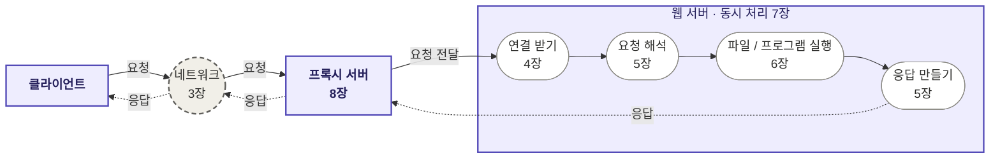

### 웹서버 이해를 위한 학습 목차

**[1. 웹서버는 왜 등장했나 (역사와 배경)](./01-background.md)**

- 클라이언트-서버 모델: 요청하는 쪽과 응답하는 쪽
- 정적 웹 → CGI → 애플리케이션 서버 → 프록시 앞단 구조로의 흐름
- 각 단계에서 어떤 문제를 해결하려고 다음 단계가 나왔는지

**[2. 네트워크 계층](./02-network-layers.md)**

- TCP/IP 4계층과 OSI 7계층 비교
- 캡슐화: 내려가며 헤더를 씌우고, 올라가며 벗기기
- OS가 하는 일과 내 코드가 하는 일의 경계 (HTTP는 내 코드, TCP는 OS)

**[3. TCP 기초](./03-tcp.md)**

- IP 주소와 포트, TCP와 UDP의 차이
- 3-way handshake(연결), 4-way handshake(종료), TIME_WAIT
- 바이트 스트림: TCP에는 메시지 경계가 없다

**[4. 소켓 프로그래밍 (과제와 직결)](./04-socket.md)**

- 파일 디스크립터: 소켓도 파일처럼 다룬다
- socket, bind, listen, accept, connect, read, write, close
- blocking 동작, listen 대기열, SO_REUSEADDR, bind 실패 원인
- read/write가 요청한 만큼 다 처리하지 않는 경우(short read/write)
- 직접 체험하기: 접속하면 고정 문자열을 돌려주는 20~30줄짜리 서버를 만들고 curl, nc로 접속해 보기

**[5. HTTP/1.1 메시지](./05-http.md)**

- 요청과 응답의 구조: 시작 줄, 헤더, 빈 줄, 본문
- 메서드(GET, POST)와 상태 코드(2xx, 4xx, 5xx)
- 핵심 헤더: Host, Content-Type, Content-Length, Connection-
- 경계 식별: \r\n\r\n, Content-Length 기반 본문 길이 (chunked는 개념만)
- keep-alive: 연결 하나로 여러 요청 처리하기
- 직접 체험하기: curl -v로 실제 요청·응답 원문 확인, 4장 서버를 HTTP 응답을 돌려주도록 고쳐 브라우저로 접속해 보기

**[6. 정적·동적 콘텐츠](./06-static-dynamic.md)**

- URI를 파일 경로로 바꾸기, ../로 루트 밖에 접근하는 공격 막기
- MIME 타입 매핑, 404 / 403 / 500을 언제 쓰는지
- CGI의 원리: fork → exec → pipe로 출력 받기, 환경변수로 요청 정보 넘기기

**[7. 동시성 모델](./07-concurrency.md)**

- 왜 필요한가: 한 연결이 오래 붙잡으면 생기는 일
- 멀티프로세스(fork), 스레드 풀(pthread), 이벤트 루프(non-blocking + select/poll/epoll)
- 각 방식의 트레이드오프와 C10K 문제
- epoll(Linux)과 kqueue(macOS)의 차이, 이식성 처리

**[8. 프록시와 리버스 프록시](./08-proxy.md)**

- Forward와 Reverse의 차이: 누구의 입장에서 누구를 대신하는가
- 연결 두 개를 들고 중계하는 구조
- 경로·호스트 기반 라우팅, Round-Robin 로드 밸런싱, 캐싱
- 백엔드 장애 처리: 타임아웃, 502 / 504
- 정적은 프록시가 직접, 동적은 백엔드로 넘기는 구조(nginx 방식)

**[9. 견고성과 검증](./09-robustness.md)**

- 시그널: SIGINT / SIGTERM 안전한 종료, SIGPIPE 무시
- 자원 회수(fd, 메모리), 버퍼 오버플로 방지
- 엣지 케이스: 잘못된 요청, 매우 큰 요청, 갑작스러운 연결 종료
- 검증 도구: 단위 테스트, curl, ab / wrk, valgrind / AddressSanitizer