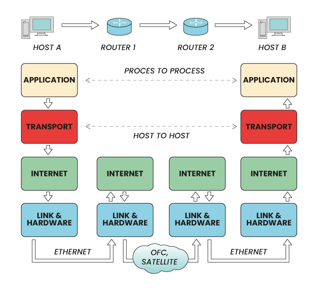
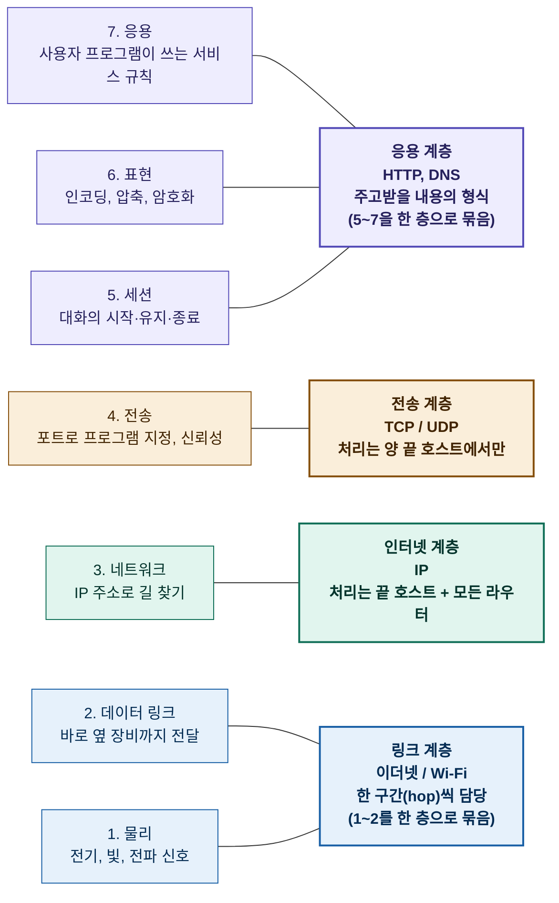

[⬅ overview](./00-overview.md)

---

# 2. 네트워크 계층
> - TCP/IP 4계층과 OSI 7계층 비교
> - 캡슐화: 내려가며 헤더를 씌우고, 올라가며 벗기기
> - OS가 하는 일과 내 코드가 하는 일의 경계 (HTTP는 내 코드, TCP는 OS)

---

## TCP/IP 4계층
- 네트워크 통신은 역할별로 4개 층으로 나뉘어 있고, 각 층은 바로 그 아래 층의 기능만 빌려 씀
- 계층 구조의 필요성
  - 브라우저가 GET/index.html을 보낼 때 아래의 과정을 모두 거쳐야 함 :
    - 요청 문장 만들기
    - 데이터가 빠짐없이, 순서대로 도착하게 하기
    - 상대 컴퓨터까지 가는 길을 찾기
    - Wi-Fi나 랜선으로 신호를 실제로 내보내기



---

## OSI 7계층과 비교
- OSI 7계층은 TCP/IP 4계층과 같은 층 구조를 더 잘게 나눈 설명용 표준 모델이고, 실제 인터넷은 4계층으로 동작한다.
- 두 모델이 따로 있는 이유
  - **OSI 모델** : ISO가 "서로 다른 회사 장비끼리 통신하려면 기준 모델이 필요하다"는 목적으로 만든 참조 모델
    - layer를 먼저 정하고, 거기에 맞춰 프로토콜을 만들려는 설계
    - 명세가 크고 복잡했고 구현이 늦어져서 기존의 TCP/IP에 밀림
    - 층별 역할을 이야기할 때 쓰는 공통 언어로 남음
  - **TCP/IP** : 인터넷에서 이미 쓰이던 프로토콜들을 층으로 정리한 구조
    - 현장에서 쓰이는 구조
- 주의점 : OSI의 "네트워크 계층"은 IP(3계층)을 의미함. (이름이 비슷하지만 전혀 다른 위치를 뜻함)
- 번호로 부르는 관습 : L4 로드 밸런서, L7 프록시 등 → 몇 레벨의 헤더 내용을 바탕으로 작업을 하는지


---

## 캡슐화
- **캡슐화** : 데이터가 위 층에서 아래 층으로 내려갈 때마다 그 층의 헤더(제어 정보)를 앞에 덧붙이고, 받는 쪽에서 올라갈 때마다 자기 층 헤더만 읽고 벗겨서 위로 넘김
- **헤더** : 각 층이 자기 일을 하기 위한 자기만의 제어 정보를 담음
  - 전송 층 : 어느 포트로 보낼지, 순서 번호가 몇 번인지
  - 인터넷 층 : 출발지, 목적지 IP 주소가 무엇인지
  - 링크 층 : 다음 장비의 MAC 주소가 무엇인지
- 규칙대로 각 층은 위 층의 내용을 열어보지 않아야 함 → 위층에서 받은 내용(위 층의 헤더부터 데이터까지) 전체를 그냥 payload로 취급. 그 앞에 자기 헤더만 추가 (캡슐)

#### 송신 과정
``` plain text
응용   :                            [HTTP 요청 문장]
전송   :                   [TCP 헤더][HTTP 요청 문장]
인터넷 :            [IP 헤더][TCP 헤더][HTTP 요청 문장]
링크   : [프레임 헤더][IP 헤더][TCP 헤더][HTTP 요청 문장][프레임 꼬리]
```
- 각 층이 만드는 결과물에 서로 다른 이름이 붙음
  - 전송 : 세그먼트 (TCP)
  - 인터넷 : 패킷
  - 링크 : 프레임
- 각 헤더에는 바로 위 층이 무엇인지 알려주는 값도 들어 있음 (예 : IP 헤더 안에, 내부의 값이 TCP라는 사실도 함께 들어 있음)

#### 수신 과정
``` plain text
링크   : [프레임 헤더][IP 헤더][TCP 헤더][HTTP 요청 문장][프레임 꼬리]  → 프레임 헤더·꼬리 확인, 벗김
인터넷 :            [IP 헤더][TCP 헤더][HTTP 요청 문장]            → IP 주소 확인, 벗김
전송   :                   [TCP 헤더][HTTP 요청 문장]            → 포트 확인, 벗김
응용   :                            [HTTP 요청 문장]            → 웹서버가 읽음

```
- 각 층이 자신의 헤더만 읽고 벗김
- 같은 층끼리만 헤더를 해석함. 클라이언트의 TCP 헤더는 서버의 TCP를 위한 것.
- 전송 구간마다 새로 붙는 헤더와 끝까지 가는 헤더가 있음 (링크 헤더는 구간마다 갱신, IP·TCP·HTTP는 출발지에서 목적지까지 유지)

---

## OS vs 응용 프로그램
- **OS** : TCP/IP 아래층 (전송, 인터넷, 링크) 처리
- **응용 프로그램** : 소켓이라는 창구를 통해 OS와 바이트를 주고 받으면서 그 위의 HTTP를 직접 해석하고 처리
- 과제 요구사항
  - 소켓 API(OS가 제공하는 창구)는 사용
  - HTTP 처리를 대신해 주는 완성된 라이브러리는 쓰지 않기
#### 소켓의 역할
- **소켓(socket)** : 응용 프로그램이 OS의 TCP 기능을 쓰기 위해 호출하는 창구
  - 소켓은 OS 커널이 만들고 관리하는 객체. 내 프로그램은 그 객체를 직접 만지지 못함
  - OS로부터 소켓의 fd를 받고, 응용은 fd를 통해 쓰기, 읽기 등의 syscall을 OS에 보냄
- 코드 예시
  ``` c
  // 개념 보여주기용 의사 코드 (실제 구현 아님)
  int conn = accept(listen_fd, ...);          // OS가 TCP 연결을 맺어서 건네줌
  read(conn, buf, sizeof(buf));               // OS가 TCP 헤더를 벗기고 순서를 맞춘 바이트만 받음
  // buf 안: "GET / HTTP/1.1\r\nHost: ...\r\n\r\n"   ← 여기서부터는 내 코드의 일
  write(conn, "HTTP/1.1 200 OK\r\n...", n);  // 내가 만든 HTTP 응답 문자열을 OS에 넘김
  ```
  - `read()`로 받은 바이트는 TCP/IP/링크 헤더가 없음 (OS가 이미 벗기고, 순서를 맞추고, 빠진 것을 재전송한 뒤의 순수 데이터)
  - `write()`로 넘기는 것은 HTTP문장 뿐임. GET, HOST:, 빈 줄(\r\n\r\n)의 의미는 내 코드가 파싱해야 함.
  

<br>
<br>

---

<p align="right">
  <a href="./01-background.md">⬅ 이전 페이지</a>
  &nbsp;&nbsp;&nbsp;|&nbsp;&nbsp;&nbsp;
  <a href="./03-tcp.md">다음 페이지 ➡</a>
</p>
