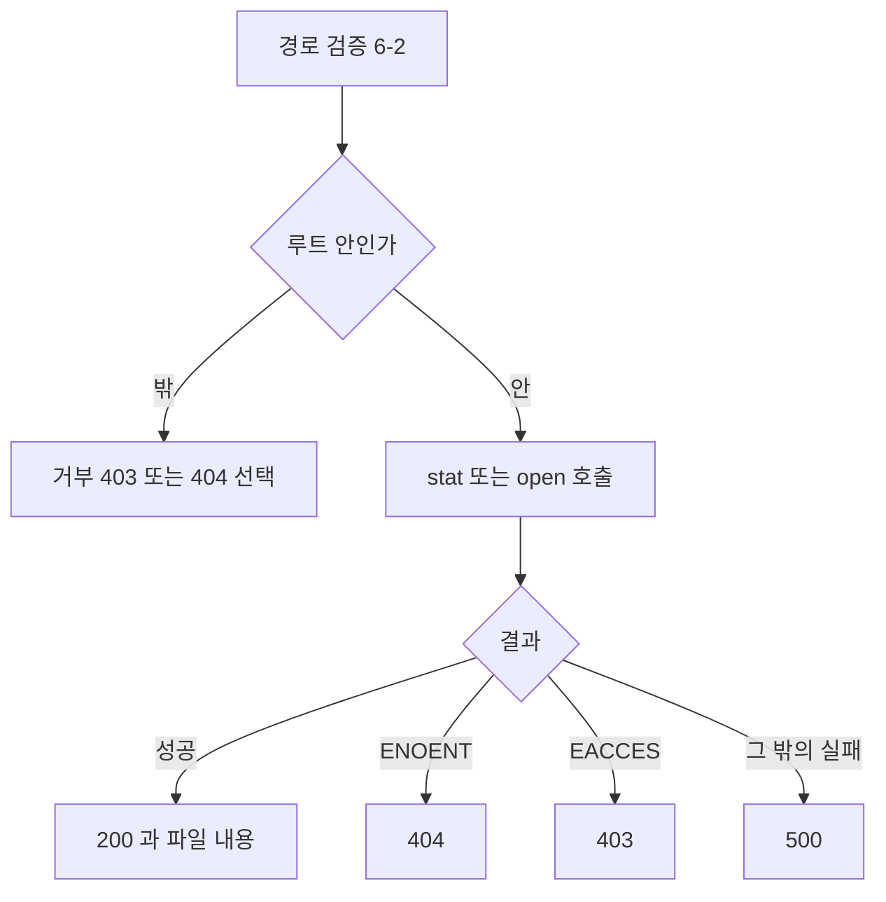
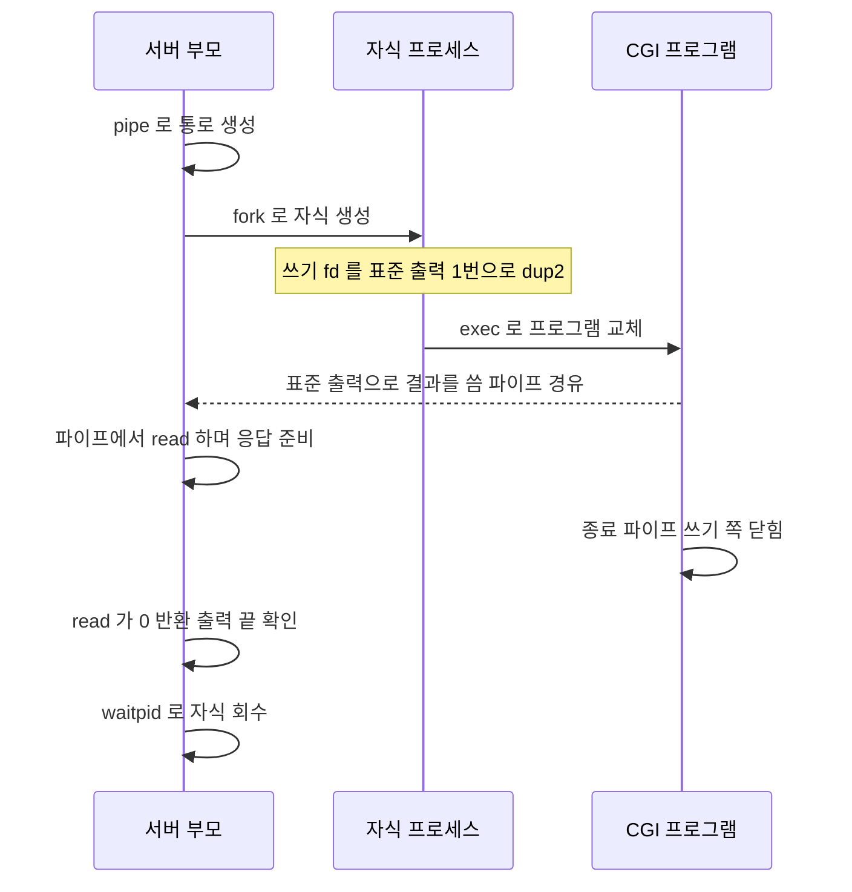

[⬅ overview](./00-overview.md)

---

# 6. 정적·동적 콘텐츠
> - URI를 파일 경로로 바꾸기, ../로 루트 밖에 접근하는 공격 막기
> - MIME 타입 매핑, 404 / 403 / 500을 언제 쓰는지
> - CGI의 원리: fork → exec → pipe로 출력 받기, 환경변수로 요청 정보 넘기기

---

## URI를 파일 경로로 바꾸기
``` plain text 
GET /css/a.css HTTP/1.1
```
- 여기서 `/css/a.css`는 URI 경로일 뿐, 디스크의 파일 위치가 아님
- 서버 컴퓨터에서 `/`는 시스템 최상위 디렉토리(`/etc`, `/Users` 등이 있는 곳)
- 일반적인 처리 : "웹사이트 파일을 모아 둔 디렉토리"를 루트로 따로 정하고, 요청 경로를 그 아래로 매핑
- 변환 과정
  ``` mermaid
  flowchart TD
    A["요청 시작 줄<br/>GET /css/a.css?v=2 HTTP/1.1"] --> B["대상 부분만 꺼냄<br/>/css/a.css?v=2"]
    B --> C["물음표 앞뒤로 분리<br/>경로 /css/a.css<br/>쿼리 v=2"]
    C --> D["퍼센트 디코딩<br/>%20 은 공백으로 복원"]
    D --> E["루트와 이어 붙임<br/>./www + /css/a.css"]
    E --> F["파일 경로<br/>./www/css/a.css"]
  ```
  - 대상 꺼내기 : 시작 줄을 공백 기준으로 나눠 가운데 값을 얻음
  - `?` 분리 : `?` 앞은 경로, 뒤는 쿼리 문자열. (쿼리는 파일 이름이 아님)
  - `%` 디코딩 : `%XX`를 해당 바이트로 되돌림 (공백, 한들 등은 `%20`처럼 인코딩되어 옴)
  - 루트 붙이기 : 루트 + 경로 (시스템 전체가 아닌, 웹 루트 아래로 한정)

--- 

## 경로 탈출 (../로 루트 밖 접근) 막기
- **경로 탈출** : 요청 경로에 `..`(상위 디렉토리)를 넣어 웹 루트 밖의 파일을 읽어 가는 공격
  - 서버는 최종 파일 경로가 루트 안에 있는지 확인해서 이러한 공격을 방지
  - `curl`과 브라우저는 보통 `..`를 내보내기 전에 정리해 버림
- **방지 방법** 
  - 방법 1 : 경로를 정규화한 뒤 루트 안인지 비교 (`realpath()`)
  - 방법 2 : 경로 조각을 직접 검사 (`/`로 나눈 조각 중 `..`가 있으면 거부)
  ``` mermaid
  flowchart TD
    A["요청 경로<br/>/%2e%2e/etc/passwd"] --> B["퍼센트 디코딩<br/>/../etc/passwd"]
    B --> C{"NUL 바이트가<br/>있는가"}
    C -->|있음| X["거부"]
    C -->|없음| D["루트와 이어 붙임<br/>/srv/www/../etc/passwd"]
    D --> E["정규화<br/>/srv/etc/passwd"]
    E --> F{"루트 /srv/www/ 안에<br/>있는가"}
    F -->|밖| X
    F -->|안| G["open 으로 파일 열기"]
  ```

---

## MIME 타입 매핑
- MIME = Multipurpose Internet Mail Extensions(다목적 인터넷 메일 확장)
  - 원래 이메일 본문이 영어 텍스트만이 아니라 이미지, 첨부파일 같은 다양한 데이터를 담을 수 있게 하려고 만든 규격
  - 웹에서는 `종류/세부종류`로 데이터 형식을 표시하는 체계만 빌려 씀
- 핵심 구조 
  | 확장자 | `Content-Type` 값 |
  |---|---|
  | `.html` | `text/html; charset=utf-8` |
  | `.css` | `text/css; charset=utf-8` |
  | `.js` | `text/javascript; charset=utf-8` |
  | `.png` | `image/png` |
  | `.jpg`, `.jpeg` | `image/jpeg` |
  | `.txt` | `text/plain; charset=utf-8` |
  | 그 밖에 표에 없는 것 | `application/octet-stream` |

---

## 404 / 403 / 500의 사용

- 오류도 완전한 HTTP 응답임. 
- 시작 줄만 응답으로 보내면, 클라이언트는 길이 표시가 없어서 기다릴 수 있음 (keep-alive)
- 오류 응답에도 짧은 본문과 `Content-Length`를 붙여주는 것이 기본
  ``` text
  HTTP/1.1 404 Not Found\r\n
  Content-Type: text/html; charset=utf-8\r\n
  Content-Length: 22\r\n
  \r\n
  <h1>404 Not Found</h1>
  ```

---

## CGI의 원리: fork → exec → pipe
#### 기초 개념
| # | 개념 | 한 줄 정의 |
| --- | --- | --- |
| 1	| 프로세스 | 실행 중인 프로그램 하나. PID라는 번호가 있음. 부모가 만든 프로세스가 자식 프로세스 | 
| 2 |	fd와 file 객체 | fd는 번호표이고, 프로세스마다 번호 → file 객체를 적은 표(fd 표)가 있음. file 객체는 파일·소켓·파이프 같은 대상을 가리키는 커널 안의 객체 |
| 3	| 표준 출력 | fd 1번. 프로그램이 printf로 내보내는 곳. 기본값은 터미널이지만 다른 대상으로 돌려놓을 수 있음 |
| 4	| fork() | 자기 자신을 복제해 자식을 만듦. fd 표만 복제되고 file 객체는 공유됨 |
| 5	| exec | 호출한 프로세스의 코드를 다른 프로그램으로 통째로 교체. PID와 fd 표는 그대로. 성공하면 호출한 자리로 돌아오지 않음 |
| 6 | 파이프 | 커널 메모리의 버퍼 하나와 입구 둘(쓰기, 읽기). 한쪽에서 쓴 바이트를 다른 쪽이 읽음 |
| 7 | dup2(a, b) | b번 칸이 a번이 가리키는 대상을 가리키게 바꿈. 파이프의 read는 있는 만큼 바로 반환하고, 비어 있으면 기다리고, 쓰기 입구를 가리키는 번호표가 모두 닫히고 버퍼가 비었을 때만 0을 돌려줌 |

#### CGI란?
- **문제** : 정적 파일은 읽어서 보내면 끝이지만, 내용이 요청마다 달라져야 하는 페이지는 계산이 필요
  - 질문: 요청마다 필요한 계산을 웹서버 프로그램 안에 넣으면? 내용을 바꿀 때마다 웹서버를 고쳐서 다시 컴파일 해야 함
- **CGI**란?
  - **웹서버** : 연결을 받고, HTTP를 처리하는 범용 프로그램
  - **애플리케이션 로직** : 응답 내용을 만드는 사이트별 계산
  - **CGI 프로그램** : 애플리케이션 로직을 담은 디스크의 실행 파일
  - **CGI** : 서버가 CGI 프로그램을 실행하고 출력을 응답의 재료로 쓰는 약속의 이름

#### 서버가 해야 하는 일
- 서버는 CGI 프로그램을 직접 실행할 수 없음. exec는 호출한 프로세스를 바꿔 버려서, 서버가 호출하면 서버가 사라지기 때문
- 실행 순서
  ``` text
  1. 서버가 pipe()로 출력을 받을 통로를 만든다.
  2. 서버가 fork()로 자식을 만든다(fd 표 복제, 통로 공유).
  3. 자식이 dup2로 표준 출력(fd 1)을 파이프 쓰기 입구로 돌린다.
  4. 자식이 exec로 CGI 프로그램을 실행한다. 프로그램은 평소처럼 printf만 하는데 출력이 파이프로 들어간다.
  5. 서버는 자기 쓰기 번호표를 close하고, 파이프에서 0이 나올 때까지 read한다.
  6. CGI가 끝나면 서버가 waitpid로 자식을 회수한다.
  7. 서버가 받은 출력을 응답으로 만들어 클라이언트에게 write한다.
  ```

#### 출력과 응답의 관계
- CGI 프로그램의 출력은 보통 **헤더, 빈 줄, 본문**이고, 상태 줄은 없음
- 서버가 받은 뒤에 상태줄과 Content-Length 등을 붙여 완성된 HTTP 응답으로 보냄
- 서버가 어디까지 붙이는지, CGI가 소켓에 직접 쓰는 방식을 쓰는지는 설계 선택

#### 동작 요약


- `pipe(fds)` : 한쪽에 쓰면 반대쪽에서 읽히는 통로를 만들고 fd 두 개를 줌 (읽기, 쓰기 전용)
- `fork()` : 현재 프로세스를 복제해 자식을 만듦. 
- `exec` 계열 : 호출한 프로세스의 코드를 지정한 프로그램으로 통째로 교체



---

## CGI 환경변수로 요청 정보 넘기기
- **환경 변수의 사용** 
  - 서버가 CGI 프로그램을 실행할 때, "이 요청이 어떤 요청이었는지"를 환경 변수에 담아 넘김
  - 서버 → CGI로 이번 요청이 어떤 경로, 어떤 쿼리였는지 전달하는 방법
- **환경 변수**
  - 프로세스마다 가지고 있는 `이름=값` 문자열 목록
  - 프로세스가 만들어질 때 부모가 값을 정해서 줄 수 있음
  - exec로 코드가 바뀌어도 유지되고, 새 프로그램은 그 값을 읽을 수 있음
- **예시**
  - 요청이 `GET /cgi/hello?name=LEE HTTP/1.1`
  - 환경변수 설정
    - `REQUEST_METHOD=GET` 
    - `SCRIPT_NAME=/cgi/hello`
    - `QUERY_STRIING=name=Lee`
    - `SERVER_PROTOCOL=HTTP/1.1`
  - CGI 프로그램의 스크립트 예시
    ``` bash
    #!/bin/sh
    echo "Content-Type: text/html"
    echo ""
    echo "<h1>안녕하세요, $QUERY_STRING</h1>"
    ```
  - 결과 본문 : `<h1>안녕하세요, name=Lee</h1>`
- 전달 위치
  ``` c
  /* 설명용 예시, 오류 처리 생략 */
  char *envp[] = {
      "REQUEST_METHOD=GET",
      "QUERY_STRING=name=Lee",
      "SCRIPT_NAME=/cgi/hello",
      NULL
  };
  execve("./www/cgi/hello", argv, envp);
  ```
- 전체 흐름
  ``` mermaid
  sequenceDiagram
    participant S as 서버
    participant C as CGI 프로그램을 실행하는 자식

    Note over S: 요청 GET /cgi/hello?name=Kim 을 읽고 CGI 대상으로 판단
    S->>S: 경로와 쿼리를 분리
    S->>C: fork 로 자식 생성 exec 직전에 환경변수를 정해 줌
    Note over C: REQUEST_METHOD 는 GET, QUERY_STRING 은 name=Kim
    C->>C: exec 로 CGI 프로그램 시작 환경변수를 읽어 로직 수행
    C-->>S: 결과를 표준 출력으로 씀 파이프로 전달
    S->>S: 받은 결과로 응답을 만들어 브라우저에 전송
  ```

<br>
<br>

---

<p align="right">
  <a href="./05-http.md">⬅ 이전 페이지</a>
  &nbsp;&nbsp;&nbsp;|&nbsp;&nbsp;&nbsp;
  <a href="./07-concurrency.md">다음 페이지 ➡</a>
</p>
