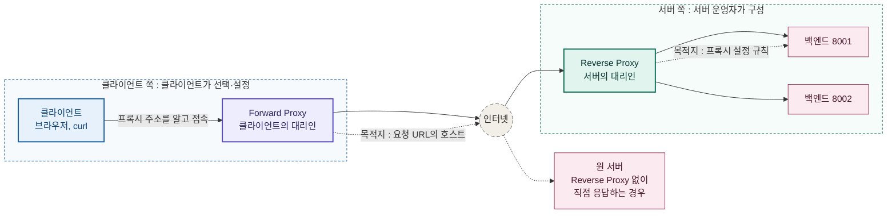

[⬅ overview](./00-overview.md)

---

# 8. 프록시와 리버스 프록시
> - Forward와 Reverse의 차이: 누구의 입장에서 누구를 대신하는가
> - 연결 두 개를 들고 중계하는 구조
> - 경로·호스트 기반 라우팅, Round-Robin 로드 밸런싱, 캐싱
> - 백엔드 장애 처리: 타임아웃, 502 / 504
> - 정적은 프록시가 직접, 동적은 백엔드로 넘기는 구조(nginx 방식)

---

## Forward vs Reverse 차이
- 공통점 : 클라이언트와 서버 사이에서 요청을 대신 전달하는 서버
- 차이점 : "누구의 대리인가?"
  - Forward : 클라이언트의 대리인 (클라이언트는 `IP:Port`를 포워드 프록시로 설정, 시작줄에 서버 주소)
  - Reverse : 서버의 대리인
  
  | | Forward Proxy | Reverse Proxy |
  | --- | --- | --- |
  | 대리하는 대상 | 클라이언트 | 서버 |
  | 누가 존재를 아나 | 클라이언트가 알고 설정함 | 클라이언트는 모름. 그냥 서버라고 생각함 |
  | 숨겨지는 쪽 | 클라이언트 (원 서버에는 프록시 주소가 보임) | 백엔드 서버들 (클라이언트에는 프록시 주소만 보임) |
  | 전달 목적지를 정하는 것 | 요청에 적힌 URL의 호스트 | 프록시의 설정 (라우팅 규칙) |
  | 대표 용도 | 사내망 외부 접속 통제, 클라이언트 익명화, 캐싱 | 로드 밸런싱, 백엔드 보호, 정적 파일 처리, 캐싱 |


---

## 연결 두 개를 바탕으로 중계

- 프록시는 TCP 연결을 "통과시키는 것"이 아님
- 클라이언트와 맺은 연결 & 백엔드와 맺은 연결 각각을 들고 한쪽에서 읽은 바이트를 다른 한 쪽에 써 줌
- 두 개의 연결 존재 이유 : TCP 연결이 두 끝점 사이에서만 성립하기 때문
  - 시퀀스 번호, ACK, FIN 등  TCP 약속은 모두 두 끝 사이에서의 약속
  - 프록시가 중간에서 "연결을 이어 붙일" 방법은 없음
- 프록시의 동작
  - 클라이언트 쪽에서는 서버의 역할 : `listen` → `aacept`로 `client_fd` 획득
  - 백엔드 쪽에서는 클라이언트 역할 : `socket` → `connect`로 `backend_fd` 획득
- 요청 흐름의 순서
  ``` mermaid
  sequenceDiagram
    participant C as 클라이언트
    participant P as 프록시
    participant B as 백엔드 8001

    C->>P: 연결 ① 맺기 (OS가 handshake)
    Note over P: accept 로 client_fd 획득
    C->>P: GET /api/users HTTP/1.1 (연결 ①로 전송)
    Note over P: 요청을 끝까지 읽고 해석, 라우팅 규칙으로 백엔드 결정
    P->>B: 연결 ② 맺기: socket + connect (OS가 handshake)
    Note over P: backend_fd 획득
    P->>B: GET /api/users HTTP/1.1 (연결 ②로 전송)
    B-->>P: 200 OK + 본문 (연결 ②로 수신)
    P-->>C: 200 OK + 본문 (연결 ①로 전송)
    Note over P: 연결 ②는 요청 하나 끝나면 닫거나 재사용 (구현 선택)
  ```
- 이벤트 루프 처리 : 연결 구조체가 두 방향의 연결을 모두 포함
  ``` mermaid
  classDiagram
    class ProxyPair {
        int client_fd
        int backend_fd
        buf c2b_buf
        buf b2c_buf
        state phase
    }
    class EpollEntry {
        fd
        data.ptr
    }
    ProxyPair "1" --> "2" EpollEntry : client_fd 와 backend_fd 를 각각 등록
    EpollEntry --> ProxyPair : data.ptr 이 같은 쌍을 가리킴
  ```
  - `client_fd`와 `backend_fd`를 각각 epoll에 등록. 둘의 data.ptr이 같은 ProxyPair를 가리키도록 함.
  - 버퍼가 방향 별로 둘. 클라이언트에서 읽은 것을 백엔드에 쓸 때까지(c2b_buf), 백엔드에서 읽은 것을 클라이언트에 쓸 때까지 (b2c_buf)로 임시 보관
  - phase는 요청 읽는 중, 백엔드 연결 중, 응답 경계 중 같은 단계
  - 한 쪽의 연결이 끊기면 프록시가 read == 0을 보고 close로 정리해야 함

---

## 경로·호스트 기반 라우팅
- **라우팅** : 요청에 의해 경로나 Host 값을 꺼내 규칙표와 비교해서 백엔드 하나를 고르는 것
- 필요성 : 백엔드들의 역할이 다른 상황
- 규칙표 예시
  ``` text
  경로 기반                          호스트 기반
  /api/    → 127.0.0.1:8001          blog.test → 127.0.0.1:8003
  /static/ → 127.0.0.1:8002          shop.test → 127.0.0.1:8004
  ```
- 서버 찾기
  ``` mermaid
  flowchart TD
    A["요청 헤더를 끝까지 읽음<br/>(rnrn 확인, 5-4)"] --> B["경로, Host 꺼내기"]
    B --> C["경로 정규화·디코딩<br/>(6-1, 6-2와 같은 처리)"]
    C --> D{"규칙표에서<br/>맞는 줄이 있나?"}
    D -->|"있음"| E["백엔드 주소 결정<br/>연결 ② 열기 (8-2)"]
    D -->|"없음"| F["처리 방식은 구현 선택<br/>예: 404 / 기본 백엔드"]
  ```  
- 경로 읽기 주의
  - 정규화된 경로를 기준으로 선택해야 한다
  - 규칙이 여러 개 맞을 때, 가장 긴 접두사를 우선으로 하는 방법 vs 선언 순서 우선 (정해야 함)

---

## Round-Robin 로드 밸런싱
- 같은 일을 한느 백엔드가 여러 대일 때, 요청을 순서대로 돌아가며 한 대씩 분배하는 방식
- 라우팅과의 차이
  - 라우팅은 **어느 그룹**으로 가는지 고름
  - 로드밸런싱은 그 그룹 안의 **여러 서버 중 누구**인지 고름
- 규칙표
  ``` text
  /api/    → [127.0.0.1:8001, 127.0.0.1:8011, 127.0.0.1:8021]   ← 3대, 설명용
  /static/ → [127.0.0.1:8002]                                   ← 1대

  ```
- 필요성 : 서버 한 대는 처리량에 한계가 있음. 서버 한 대에 장애가 있어도 다른 서버가 대체 가능
- 동작 : 카운터 기반
  ``` mermaid
  sequenceDiagram
    participant C as 클라이언트들
    participant P as 프록시
    participant B1 as 8001
    participant B2 as 8011
    participant B3 as 8021

    C->>P: 요청 1
    P->>B1: 전달 (next=0)
    C->>P: 요청 2
    P->>B2: 전달 (next=1)
    C->>P: 요청 3
    P->>B3: 전달 (next=2)
    C->>P: 요청 4
    P->>B1: 전달 (next가 0으로 돌아옴)
    C->>P: 요청 5
    P->>B2: 전달 (next=1)
    C->>P: 요청 6
    P->>B3: 전달 (next=2)
  ```
  - 카운터는 그룹마다 따로임
  - 같은 클라이언트가 다른 서버로 갈 수 있음
  - 균등하게 나누는 것은 "요청 수"이지, 부하가 아님

---

## 캐싱
- **캐싱** : 프록시가 백엔드에서 받은 응답을 저장해 두었다가, 같은 요청이 오면 백엔드에 가지 않고 저장본을 돌려주는 것
  - 재사용 : 응답 전체를 그대로 다시 보냄
  - 같은 요청 : 메서드와 대상 주소. Forward는 요청의 전체 URL, ReveRsE는 Host + 경로 + 쿼리
- 흐름 : hit & miss
  ``` mermaid
  flowchart TD
    A["요청 도착, 헤더 해석"] --> B["캐시 키 계산"]
    B --> C{"저장소에 있고<br/>아직 유효한가?"}
    C -->|"있음 : 히트"| D["저장본을 클라이언트에 바로 응답<br/>연결 ② 열지 않음"]
    C -->|"없음 또는 만료 : 미스"| E["백엔드에 중계 (8-2)"]
    E --> F["응답을 클라이언트에 전달"]
    E --> G["조건이 맞으면 저장소에 저장"]
  ```
  - 캐시 히트일 때는 "서버로의 연결 자체를 열지 않는다"는 점이 핵심
- 필요성 및 장점
  - 같은 응답을 반복해서 만드는 백엔드의 일을 줄임
  - 서버와의 연결을 열고 백엔드가 처리하는 시간을 생략해 응답이 빨라짐
  - Forward쪽에서는 여러 클라이언트가 같은 외부 자원 요청을 프록시 한 곳에 모아, 외부 트래픽을 줄임
  - Reverse쪽에서는 백엔드를 보호하는 기능
- 주의사항
  - 아무 응답이나 저장하면 안 됨. POST 요청이나, 사용자마다 다른 응답은 부적합 (다른 사용자의 쿠키가 응답 헤더에 포함되는 등)
  - 캐시가 백엔드의 변경을 모름. TTL이 끝날 때까지는 오래된 응답을 사용할 수 있다는 점

---

## 백엔드 장애 처리
- 백엔드가 죽었거나 느릴 때, 프록시는 클라이언트를 무한정 기다리게 두면 안 됨.
- 프록시가 정한 시간 안에 실패를 판단하고, 자신이 아닌 뒤의 서버 문제라는 뜻의 502 또는 504로 응답
- 장애 판단 과정
  ``` mermaid
  flowchart TD
    A["백엔드 선택 완료"] --> B["연결 ② 열기: connect"]
    B -->|"즉시 실패<br/>ECONNREFUSED"| X1["502<br/>프로세스가 죽어 포트가 닫힘"]
    B -->|"시간 안에 완료 안 됨"| X2["504<br/>connect 타임아웃"]
    B -->|"성공"| C["요청 전달 후 응답 대기"]
    C -->|"헤더를 받기 전에<br/>백엔드가 연결을 끊음 (read가 0)"| X3["502"]
    C -->|"시간 안에<br/>응답을 못 받음"| X4["504<br/>응답 대기 타임아웃"]
    C -->|"응답 헤더 수신"| D["클라이언트에 중계"]
    D -->|"본문 도중 끊김<br/>이미 200 전송됨"| X5["코드 변경 불가<br/>연결을 끊어 실패를 알림"]
  ```
- 타임아웃
  - 백엔드가 응답하지 않는데 기다리기만 하면 문제 발생
    - 블로킹 방식을 단일 루프에서 쓰면 프록시 전체가 멈춤
    - non-blocking으로 바꿔도 마감 시각이 없으면 ProxyPair가 영원히 남아 fd가 쌓임

---

## 정적은 프록시가 직접, 동적은 백엔드로 (nginx)
- 라우팅 규칙의 목적지가 반드시 백엔드일 필요는 없음
- 정적 파일 요청은 프록시가 직접 응답하고, 동적 요청만 백엔드에 중계하는 구조
  - `/static/` : 로컬 파일. `./www` 아래에서 직접 읽음 
  - `/api/` : 백엔드 그룹. `[8001, 8011]`, Round-Robin
  ``` mermaid
  flowchart TD
    A["요청 도착, 헤더 해석<br/>경로 정규화"] --> B{"규칙의 목적지 종류"}
    B -->|"로컬 파일"| C["6장 방식으로 직접 응답<br/>URI를 파일 경로로, MIME, 404/403"]
    B -->|"백엔드 그룹"| D["백엔드 선택<br/>연결 ② 열고 중계"]
    C --> E["클라이언트에 응답<br/>연결 ② 없음"]
    D --> F["클라이언트에 응답<br/>실패 시 502 / 504"]
  ```
- 정적 파일을 프록시에서 처리할 때의 장점
  - 정적 파일은 백엔드가 만들 내용이 없으므로 전달할 이유가 없음
  - 불필요하게 백엔드를 거치면 연결과 백엔드 처리 시간만 더해짐 
  - 장애가 격리됨. 백엔드가 죽어도 정적 요청은 영향을 받지 않음
- 정적 파일의 기준 : 경로 접두사(`/static/`), 확장자 (`.css`, `.png`) 등
- 정적 직접 서빙은 캐싱과 다름. 캐시는 백엔드의 응답 복사본을 저장해 두었다가 재사용하는 것.
- 정적 파일을 프록시가 직접 전달 → 프록시의 이벤트 루프에서 정적 파일 읽기(I/O) 발생 → 루프 병목 발생 가능

<br>
<br>

---

<p align="right">
  <a href="./07-concurrency.md">⬅ 이전 페이지</a>
  &nbsp;&nbsp;&nbsp;|&nbsp;&nbsp;&nbsp;
  <a href="./09-robustness.md">다음 페이지 ➡</a>
</p>
